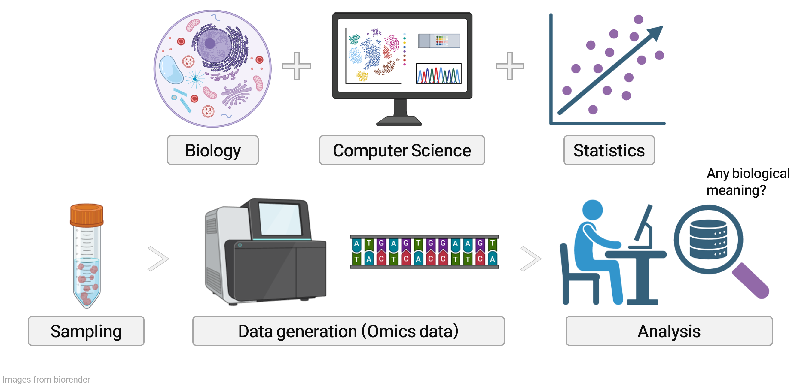
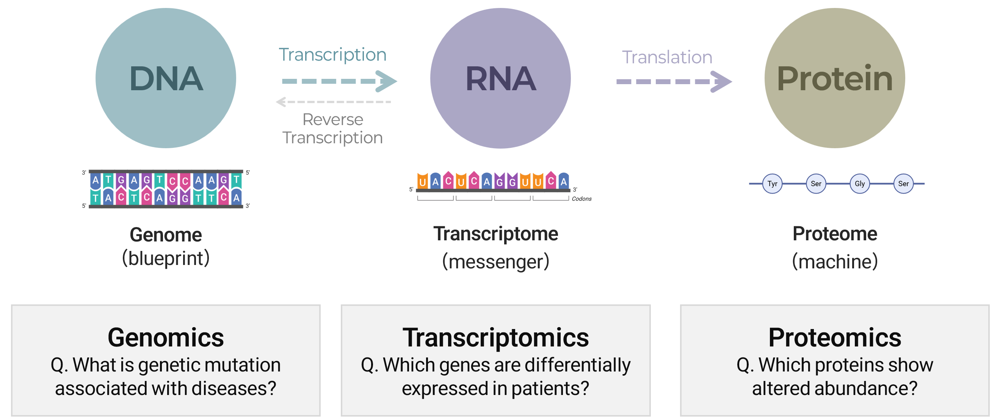
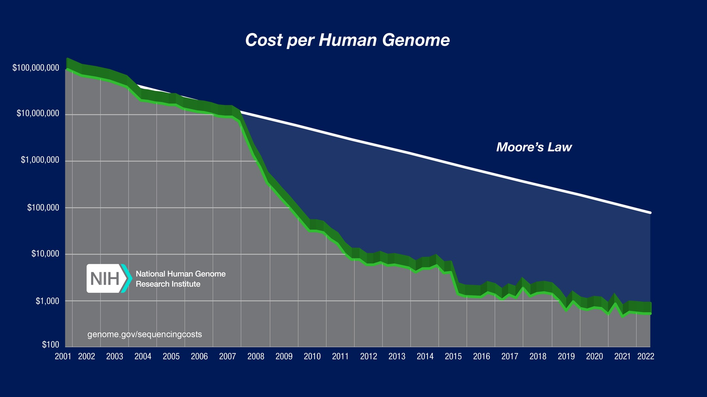
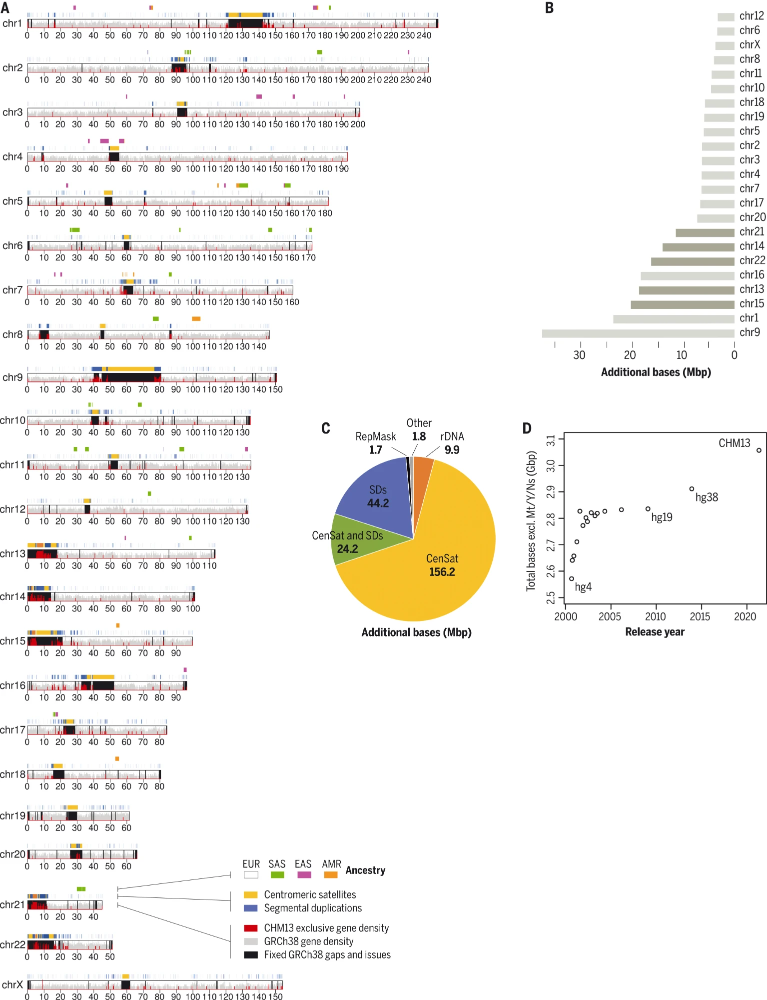

::: {.callout-note collapse="true"}
## 🎯 학습 목표

이 장을 마치면:

-   생물정보학이 진료와 연구에서 하는 일을 한 문장으로 설명
-   중심 원리를 따라 오믹스 층(유전체, 후성유전체, 전사체, 단백체, 대사체, 마이크로바이옴)이 각각 무엇을 측정하는지 구분
-   시퀀싱 데이터가 FASTQ → BAM → VCF → 표로 바뀌는 흐름 설명
-   레퍼런스 유전체가 "정상"이 아니라 좌표계인 이유를 설명하고 변이 표기(`chr2:166002537 G>A`) 읽기
-   이 수업에서 쓸 공공 데이터베이스를 알고 JupyterHub 실습 환경에 접속
-   ⚠️ 분석 결과가 깔끔해 보여도 틀릴 수 있는 이유 설명
:::

> 🩺 **오늘의 케이스**\
> 환자가 유전자 검사 결과지 한 장을 들고 왔다. "*CYP2C19* \*2/\*2 — 대사 저하형(poor metabolizer)"\
> → 이 한 줄이 나오기까지 어떤 시료가, 어떤 데이터가, 어떤 처리를 거쳤을까? (🔗 [§7](#w1-s7)에서 정리, W4에서 그 의미를 다룸)

💡 각 절의 본문 = 꼭 알아야 할 기초. **🔍 더 알아보기**는 궁금할 때 펼쳐 보는 심화 내용

------------------------------------------------------------------------

# 1. 생물정보학이란 👩‍💻 {#w1-s1}

> 🔑 **핵심** — 생물정보학 = 몸에서 얻은 시료를 데이터로 바꾸고, 그 데이터를 다시 의학적 의미로 바꾸는 일

## 1) Bio + Information {#w1-s1-1}

생물정보학(bioinformatics)은 생물학, 컴퓨터, 통계가 만나는 분야다. 혈액 한 튜브에서 시작해 시퀀서가 만든 방대한 데이터를 컴퓨터로 정리하고, 통계로 우연과 진짜 차이를 가려낸다. 마지막에는 "그래서 이 환자에게 무슨 뜻인가"라는 질문에 답해야 한다.

{fig-align="center"}

-   **Bio** — 환자의 혈액, 조직, 세포, 그리고 그 사람의 임상 정보
-   **Information** — 시료에서 나온 데이터. 대개 아주 큰 표
-   목표는 프로그램을 돌리는 것이 아니라 **결과를 믿어도 되는지 판단하는 것**

## 2) 진료에서 이미 쓰이는 곳 {#w1-s1-2}

생물정보학은 연구실에만 있지 않다. 지금도 여러 검사 결과지 뒤에서 일하고 있다.

| 진료 상황 | 쓰이는 데이터 | 이 수업 |
|---|---|---|
| 원인 모를 희귀질환 아이의 진단 | 엑솜·전장 유전체 시퀀싱 | W2–W3 |
| 약 처방 전 유전자 검사 | 약물유전체 검사 | W4–W5 |
| 암 환자의 표적치료제 선택 | 종양 유전자 패널, 혈액 속 종양 DNA | W6–W7 |
| 산전 선별검사 | 엄마 혈액 속 태아(태반) 유래 DNA 조각 | 🔗 W6 액체생검과 같은 원리 |
| 유방암 재발 위험 예측 | 종양 조직의 유전자 발현 | W9–W10 |
| 감염병 유행 추적 | 병원체 유전체 | W13–W14 |

## 3) Wet lab ➡️ dry lab {#w1-s1-3}

실험실(wet lab)에서 쌓는 감각은 컴퓨터 분석(dry lab)에서도 그대로 쓰인다. 대조군은 있었나, 반복은 몇 번 했나, 비교가 공정했나를 똑같이 묻는다.

⚠️ 다른 점이 하나 있다. **분석은 언제나 결과를 낸다.**

-   실패한 PCR → 빈 젤. 실패가 눈에 보임
-   실패한 분석 → p값 순으로 깔끔하게 정리된 유전자 847개. **겉모습만으로는 틀렸는지 알 수 없음**
-   → 이 수업에서 매주 "어디서 틀릴 수 있나"를 묻는 이유

## 4) 이 수업의 지도 {#w1-s1-4}

-   **Part 1 (W2–W7)** — DNA: 희귀질환 → 복합질환과 약물 반응 → 암
-   **Part 2 (W9–W14)** — DNA 다음: 유전자 발현 → 세포 하나하나 → 몸속 미생물
-   매주 같은 흐름: 이론 주에 임상 케이스 → 다음 실습 주에 그 케이스를 직접 풂
-   어떤 검사든 같은 세 가지 질문 — **① 무엇을 측정하나? ② 결과는 어떻게 생겼나? ③ 어디서 틀릴 수 있나?**
-   전체 일정과 주차별 케이스 → [홈 강의계획](../index.qmd)

------------------------------------------------------------------------

# 2. 중심 원리에서 오믹스로 🧬 {#w1-s2}

> 🔑 **핵심** — 오믹스 = 세포 안 분자 한 종류를 "전부" 한꺼번에 재는 것. 층마다 답할 수 있는 질문이 다름

## 1) 중심 원리 다시 보기 {#w1-s2-1}

일반생물학에서 배운 중심 원리(central dogma)가 이 수업의 뼈대다. DNA는 설계도, RNA는 설계도를 옮겨 적은 전달자, 단백질은 실제로 일하는 기계다.

{fig-align="center"}

-   **-ome** = "전체". 유전체(genome) = 한 사람이 가진 DNA 전체
-   **-omics** = 그 전체를 한꺼번에 재는 학문 → 오믹스(omics)
-   예전: 유전자 하나씩 연구 → 오믹스: 2만 개 유전자를 한 번에 측정

## 2) 오믹스 층이 측정하는 것 {#w1-s2-2}

| 층 | 무엇을 재나 | 대표 기술 | 이 수업 |
|---|---|---|---|
| 유전체 (genome) | DNA 염기서열과 그 차이(변이) | 유전자 패널, 엑솜·전장 유전체 시퀀싱 | W2–W7 |
| 후성유전체 (epigenome) | 유전자를 켜고 끄는 표지 (예: DNA 메틸화) | 메틸화 어레이, 메틸화 시퀀싱 | W6 |
| 전사체 (transcriptome) | 어떤 유전자의 RNA가 얼마나 있나 | RNA-seq | W9–W10 |
| 단일세포 전사체 | 세포 하나하나의 RNA | single-cell RNA-seq | W11–W12 |
| 단백체 (proteome) | 어떤 단백질이 얼마나 있나 | 질량분석, 항체 기반 측정 | W9 |
| 대사체 (metabolome) | 당, 지질, 아미노산 같은 작은 분자 | 질량분석 | — |
| 마이크로바이옴 (microbiome) | 몸에 사는 미생물들의 유전체 | 16S, shotgun 메타유전체 | W13–W14 |

-   대사체는 따로 다루지 않음. 다만 진료에서 이미 익숙한 예가 있음 → 신생아 발뒤꿈치 혈액으로 하는 선천성 대사이상 선별검사(질량분석)
-   진단검사의학과 검사의 상당수(트로포닌, 혈당 등)도 단백체·대사체 측정의 한 형태 (🔗 W9)

## 3) 같은 유전체, 다른 세포 {#w1-s2-3}

신경세포와 간세포는 같은 DNA를 가지고 있다. 둘을 다르게 만드는 것은 어떤 유전자를 켜고 끄느냐다. 그래서 DNA만 읽어서는 세포가 지금 무엇을 하고 있는지 알 수 없다.

-   **DNA** — 평생 거의 그대로, 몸의 거의 모든 세포가 같음 (예외: 암세포의 체세포 변이 🔗 W6)
-   **RNA·단백질** — 조직, 시점, 질병, 약물에 따라 변함
-   💡 진료에서 뜻하는 것
    -   유전 질환 검사 → 혈액이나 침의 DNA로 가능
    -   발현 검사 → 병이 있는 조직을, 적절한 시점에 봐야 함

------------------------------------------------------------------------

# 3. 시퀀싱과 데이터 🧪 {#w1-s3}

> 🔑 **핵심** — 대부분의 오믹스 = DNA 조각을 읽고 세는 일. 데이터는 FASTQ → BAM → VCF → 표로 갈수록 작아지고, 그만큼 정보를 버림

## 1) DNA를 읽는 세 가지 방법 {#w1-s3-1}

시퀀싱(sequencing)은 DNA의 염기 순서를 읽는 일이다. RNA를 재는 경우에도 RNA를 DNA로 바꾼 뒤 읽기 때문에, 거의 모든 오믹스 데이터가 DNA 시퀀싱에서 나온다.

| 방법 | 한 번에 읽는 길이 | 특징 | 진료에서 |
|---|---|---|---|
| **Sanger** | 약 800–1,000 염기 | 매우 정확, 한 번에 한 조각 | 이미 아는 변이 하나 확인 (예: 가족 검사) |
| **Short-read** (Illumina) | 100–300 염기 | 수억 조각을 동시에, 싸고 정확 | 유전자 패널, 엑솜, 전장 유전체, RNA-seq |
| **Long-read** (PacBio, Nanopore) | 수만–수백만 염기 | 길게 읽어 반복 서열과 큰 구조 변화에 강함 | 짧은 read로 안 보이는 변이 (🔗 W2) |

{fig-align="center"}

-   2001년 약 1억 달러 → 지금은 수백 달러 → 진료에 쓸 수 있게 된 이유
-   이제 어려운 것은 데이터를 *만드는* 일이 아니라 *해석하는* 일
-   ⚠️ Short-read의 근본 한계 — 조각이 반복 서열보다 짧으면 어디서 왔는지 정할 수 없음. 깊이를 늘려도 해결되지 않음

::: {.callout-note collapse="true" icon=false}
## 🔍 더 알아보기 — 수억 조각을 동시에 읽는 원리

-   DNA를 짧게 자르고 양 끝에 어댑터(adapter)를 붙임
-   유리판(flow cell) 위에서 한 조각을 수천 개로 복제해 점 하나로 만듦
-   염기를 하나씩 붙일 때마다 색이 다른 형광을 찍어 점마다 염기를 읽음
-   시료마다 짧은 바코드(index)를 달아 여러 환자의 시료를 한 번에 돌리고 나중에 분리
:::

## 2) 데이터의 여정 {#w1-s3-2}

시퀀서가 낸 원본에서 결과지 한 줄까지 데이터는 여러 형식을 거친다. 단계마다 필요한 것만 남기고 요약한다.

```
혈액 → DNA → 시퀀싱 → FASTQ ──정렬──→ BAM ──변이 호출──→ VCF ──해석──→ 결과지
                     읽은 조각       위치를 찾은 조각     레퍼런스와 다른 곳
```

### ① FASTQ — 읽은 조각 {#w1-s3-2-1}

-   조각 하나 = read. 시료 하나에 수천만–수억 개
-   있는 것: 염기서열, 염기마다 시퀀서가 얼마나 확신하는지(품질 점수)
-   없는 것: 이 조각이 유전체의 **어디에서** 왔는지

```
@SRR21484222.626.1 626 length=51           ← read 이름
GCCTTGGTGGTGAAATGGTAGACTGGAATTCTCGGGTGCC   ← 염기서열
+SRR21484222.626.1 626 length=51
F:FFFFFFFFFFFFFFFFFFFFFFFFFFF:FFFFFFFFFF   ← 염기마다 품질 점수 (글자 하나 = 점수 하나)
```

### ② BAM — 위치를 찾은 조각 {#w1-s3-2-2}

-   read를 레퍼런스 유전체에 맞춰 놓은 것 = 정렬(alignment)
-   read마다 "몇 번 염색체 몇 번째"라는 위치가 붙음
-   같은 위치를 몇 개의 read가 덮었나 = 깊이(depth). 깊을수록 그 위치의 판단을 더 믿을 수 있음
-   ⚠️ 정렬은 관찰이 아니라 **추론** — 비슷한 서열이 유전체 여러 곳에 있으면 프로그램이 그중 하나를 고를 뿐

### ③ VCF — 레퍼런스와 다른 곳 {#w1-s3-2-3}

-   레퍼런스와 **다른** 위치만 기록한 파일 = 변이(variant) 목록
-   위치마다 유전형(genotype)을 함께 적음: `0/0` = 둘 다 레퍼런스, `0/1` = 한쪽만 다름(이형접합), `1/1` = 양쪽 다 다름(동형접합)

```
#CHROM  POS        ID         REF  ALT  QUAL  FILTER  환자1
chr1    11796321   rs1801133  G    A    1530  PASS    1/1
chr19   44908684   rs429358   T    C    812   PASS    0/1
```

-   CHROM·POS = 위치, REF → ALT = 바뀐 염기, QUAL·FILTER = 얼마나 믿을 만한가
-   첫 줄 = *MTHFR* 유전자의 흔한 변이, 둘째 줄 = 알츠하이머병 위험과 관련된 *APOE* ε4를 정하는 변이 중 하나
-   ⚠️ **기록이 없음 ≠ 변이가 없음** — 레퍼런스와 같아서일 수도, 그 위치를 제대로 못 읽어서일 수도

### ④ 표 — 분석의 출발점 {#w1-s3-2-4}

-   VCF에 유전자 이름, 단백질 변화, 집단 빈도 같은 정보를 붙여 표로 만들어 분석
-   행 = 변이(또는 유전자), 열 = 정보(또는 시료)
-   → 🔗 W3 실습에서 R로 읽는 표가 바로 이것

## 3) 크기 감각 {#w1-s3-3}

-   전장 유전체를 평균 30번씩 읽으면(30×) → 약 900억 염기 → 압축한 FASTQ만 수십–100 GB
-   그 결과인 VCF → 수백만 개 변이, 수백 MB
-   결과지 → 한 장
-   💡 생물정보학의 일 = 100 GB와 한 장 사이에서 무엇을 남기고 무엇을 버릴지 정하는 것

------------------------------------------------------------------------

# 4. 레퍼런스 유전체 🗺️ {#w1-s4}

> 🔑 **핵심** — 레퍼런스 유전체 = 모두가 같은 위치를 같은 숫자로 부르기 위한 좌표계. "정상"의 기준이 아님

## 1) 사람 유전체의 규모 {#w1-s4-1}

-   약 31억 염기쌍(3.1 × 10⁹ bp), 22쌍의 상염색체 + 성염색체(X, Y) + 미토콘드리아 DNA
-   단백질 암호화 유전자 약 2만 개
-   그중 실제로 단백질을 지정하는 서열(coding sequence, CDS)은 유전체의 1–2% → 엑솜(exome) 시퀀싱이 읽는 부분 (🔗 W2)
-   나머지 98% → 유전자 조절 서열, 반복 서열, 아직 기능을 모르는 부분
-   한 사람의 유전체는 레퍼런스와 약 400–500만 위치가 다름 → 그래도 99.9%는 같음

## 2) 레퍼런스 = 좌표계 {#w1-s4-2}

레퍼런스 유전체(reference genome)는 여러 사람의 DNA를 이어 붙여 만든 표준 지도다. 실제로 존재하는 한 사람의 유전체가 아니고, "건강한 사람"의 유전체도 아니다. 모두가 같은 지도를 쓰기 때문에 "2번 염색체 166,002,537번째"라고 말하면 어느 연구실, 어느 병원에서든 같은 곳을 가리킨다.

-   **GRCh38** (2013) — 지금 진료와 연구의 표준
-   **T2T-CHM13** (2022) — GRCh38에 남아 있던 빈틈을 메운 첫 완전한 사람 유전체
-   ⚠️ **레퍼런스와 다름 ≠ 병적** — 어떤 위치에서는 레퍼런스 쪽이 오히려 드문 대립유전자(allele)
    -   예: W3 실습의 한 *SCN1A* 변이는 레퍼런스와 다르지만, 전 세계 대립유전자의 약 70%(한국인은 약 90%)가 이 형태 → 오히려 다수형 (🔗 W3)

::: {.callout-note collapse="true" icon=false}
## 🔍 더 알아보기 — GRCh38의 빈틈과 T2T

-   GRCh38에는 거의 같은 서열이 수없이 반복되는 구간(염색체 중심부 등)이 비어 있었음 → 짧은 read로는 순서를 정할 수 없었기 때문
-   T2T-CHM13은 긴 read([§3.1](#w1-s3-1))로 이 구간을 처음으로 이어 붙임

{fig-align="center"}

-   그래도 대부분의 임상 데이터와 데이터베이스는 아직 GRCh38 기준 → 당분간 GRCh38이 표준
:::

## 3) 좌표와 변이 표기 읽기 {#w1-s4-3}

같은 변이 하나를 여러 방식으로 부른다. W3 실습에서 만날 변이로 연습해 보자.

| 표기 | 예 | 읽는 법 |
|---|---|---|
| 유전체 좌표 | `chr2:166002537 G>A` (GRCh38) | 2번 염색체 166,002,537번째 염기 G가 A로 |
| 코딩 서열(c.) | *SCN1A* c.4219C>T | *SCN1A* 유전자 코딩 서열의 4,219번째 C가 T로 |
| 단백질(p.) | p.Arg1407Ter | 1,407번째 아미노산 아르기닌(Arg) 자리에 종결 코돈(Ter) |
| rs 번호 | rs398123593 | dbSNP 데이터베이스가 붙인 변이 이름 |

-   유전체는 G>A인데 코딩 서열은 C>T? → *SCN1A*는 반대쪽 가닥에 있는 유전자라 상보적인 염기로 읽힘
-   ⚠️ **레퍼런스 버전이 다르면 좌표도 다름**
    -   예: *CYP2C19* \*2를 만드는 변이 rs4244285 → GRCh38 `chr10:94781859`, 옛 버전 GRCh37 `chr10:96541616`
    -   결과지와 논문에서 어느 버전 기준인지 항상 확인
-   💡 gnomAD 같은 웹 데이터베이스에서는 `2-166002537-G-A` 형식으로 검색 (🔗 W3)

------------------------------------------------------------------------

# 5. 공공 데이터베이스 🗄️ {#w1-s5}

> 🔑 **핵심** — 수많은 사람의 데이터가 공개되어 있음 → 내 환자의 결과를 그 위에 놓고 비교하는 것이 해석의 출발점

| 데이터베이스 | 무엇이 있나 | 이 수업 |
|---|---|---|
| NCBI · Ensembl · UCSC Genome Browser | 레퍼런스 유전체, 유전자 위치와 구조 | W2–W3 |
| gnomAD | 수십만 명의 변이와 집단별 빈도 | W2–W5 |
| ClinVar | 변이마다 보고된 임상 해석 | W2–W3 |
| GWAS Catalog · PGS Catalog | 복합질환 관련 변이, 다유전자 위험점수 | W4–W5 |
| ClinPGx · CPIC | 약물–유전자 정보와 처방 지침 | W4–W5 |
| cBioPortal · OncoKB | 암 유전체 코호트, 암 변이의 치료 근거 | W6–W7 |
| GEO | 공개된 유전자 발현 데이터 | W9–W10 |
| CELLxGENE | 단일세포 아틀라스 | W11–W12 |
| Nextstrain · CARD | 병원체 계통과 전파, 항생제 내성 유전자 | W13–W14 |

-   ⚠️ 데이터베이스도 바뀌고 틀릴 수 있음
    -   ClinVar 분류는 새 근거가 나오면 다시 분류됨 → 확인한 날짜를 함께 기록
    -   데이터베이스 속 사람들은 유럽계가 가장 많음 → 한국인에게 그대로 맞지 않을 수 있음 (🔗 W4)
-   한국인 유전체 자료(예: Korea4K)도 점점 쌓이는 중

------------------------------------------------------------------------

# 6. 실습 준비 💻 {#w1-s6}

> 🔑 **핵심** — 실습 = 웹 데이터베이스 + 수업용 JupyterHub의 R. 설치할 것은 없고 브라우저 하나면 됨

## 1) 웹 도구 {#w1-s6-1}

-   크롬 같은 최신 브라우저
-   [§5](#w1-s5)의 데이터베이스는 대부분 가입 없이 사용 가능

## 2) JupyterHub와 R {#w1-s6-2}

R은 데이터 분석용 프로그래밍 언어다. 이 수업에서는 서버에 설치된 R을 브라우저로 쓴다(JupyterHub). 노트북의 칸(셀)에 코드를 넣고 실행하면 결과가 바로 아래에 나온다.

1.  첫 수업에서 받은 주소로 접속해 아이디와 비밀번호로 로그인
2.  Launcher 화면 → **Notebook**에서 **R** 선택 → 새 노트북
3.  셀에 코드를 넣고 **Shift + Enter** → 실행
4.  파일 올리기 → 왼쪽 파일 창에 파일을 끌어다 놓기

첫 코드:

```r
1 + 1
x <- c(3, 1, 2)
mean(x)
```

-   `x <- c(3, 1, 2)` = 숫자 세 개를 묶어 `x`라는 이름으로 저장 → 이렇게 이름 붙은 것 = 객체(object)
-   `mean(x)` = 평균을 구하는 함수(function)에 `x`를 넣음
-   여러 함수를 묶어 배포한 것 = 패키지(package). 필요한 패키지는 서버에 미리 설치해 둠

## 3) AI 도우미 사용 원칙 {#w1-s6-3}

-   ✅ 적극 사용 — 코드 한 줄씩 설명, 오류 메시지 해석, R 문법
-   ✅ 이 사이트 오른쪽 아래 채팅 버튼 = 이 장의 내용을 아는 AI 도우미
-   ❌ 맡기지 말 것 — 결과 해석과 제출 문단. 자기 말로 씀
-   ⚠️ **AI도 틀림** — 변이 분류, 약물 지침 같은 사실은 반드시 원 데이터베이스에서 확인

------------------------------------------------------------------------

# 7. 진료에서 — 케이스로 돌아가기 🏥 {#w1-s7}

> 🔑 **핵심** — 결과지 한 줄 = 시료 → 시퀀싱 → 정렬 → 변이 호출 → 데이터베이스 해석을 거친 끝. 단계마다 틀릴 수 있는 곳이 있음

"*CYP2C19* \*2/\*2 — 대사 저하형"이 나오기까지:

1.  **시료** — 혈액이나 침에서 DNA 추출
2.  **측정** — *CYP2C19* 유전자를 시퀀싱하거나, 정해진 위치만 읽는 유전형 검사
3.  **비교** — 레퍼런스와 다른 위치 찾기 → rs4244285 (`chr10:94781859 G>A`)가 양쪽 대립유전자 모두에 있음 → 유전형 `1/1`
4.  **이름 붙이기** — 이 변이 조합을 별표 대립유전자 이름으로 → \*2/\*2
5.  **해석** — 지침(CPIC)과 데이터베이스로 → 효소 기능이 거의 없는 "대사 저하형" → 의미는 🔗 W4

**③ 어디서 틀릴 수 있나?**

-   시료가 바뀜 → 다른 사람의 결과
-   검사가 일부 위치만 읽는 방식이면 → 검사하지 않은 드문 변이는 놓치고 "정상"으로 판정될 수 있음
-   레퍼런스 버전이나 대립유전자 정의가 바뀌면 → 같은 데이터도 다르게 해석될 수 있음

➡️ 이 결과가 약 처방을 어떻게 바꾸는지는 W4, 직접 찾아보는 실습은 W5

------------------------------------------------------------------------

# 🤔 흔한 오해

1.  **레퍼런스 유전체는 건강한 사람의 "정상" 유전체다?**\
    아니다. 여러 사람의 DNA로 만든 좌표계일 뿐이다. 레퍼런스 쪽이 오히려 드문 대립유전자를 가진 위치도 있다.
2.  **변이(variant)는 병을 일으키는 돌연변이다?**\
    아니다. 두 사람 사이에는 수백만 개의 차이가 있고 대부분은 무해하다. 그래서 진료와 연구에서는 가치 판단이 없는 "변이"라는 말을 쓴다.
3.  **DNA를 전부 읽으면 모든 병을 예측할 수 있다?**\
    아니다. 많은 병은 유전, 환경, 우연이 함께 만든다. 유전체 대부분의 기능도 아직 모른다 (🔗 W4).
4.  **분석 결과가 깔끔하게 나왔으면 맞는 결과다?**\
    아니다. 분석은 입력이 틀려도 언제나 그럴듯한 결과를 낸다. 실패가 눈에 보이지 않는다는 점이 dry lab의 가장 큰 함정이다.
5.  **데이터베이스에 있는 정보는 확정된 사실이다?**\
    아니다. 새 근거가 나오면 분류가 바뀌고, 데이터베이스 속 사람들이 한국인을 대표하지 않을 수도 있다.

# ❓ 복습 문제

**1. (개념)** 사람 유전체에 대한 설명으로 가장 알맞은 것은?\
(a) 단백질 암호화 유전자 약 2,000개, 암호화 서열은 유전체의 약 0.1%\
(b) 단백질 암호화 유전자 약 2만 개, 암호화 서열은 유전체의 1–2%\
(c) 단백질 암호화 유전자 약 20만 개, 암호화 서열은 유전체의 약 50%\
(d) 단백질 암호화 유전자 약 2만 개, 암호화 서열은 유전체의 약 25%

**2. (개념)** 레퍼런스 유전체에 대한 설명으로 옳은 것은?\
(a) 건강한 한 사람의 유전체를 그대로 읽은 것\
(b) 모두가 같은 위치를 같은 숫자로 부르기 위한 공통 좌표계\
(c) 버전이 달라도 같은 변이의 좌표는 같음\
(d) 레퍼런스와 다른 염기는 모두 병적 변이

**3. (개념)** 파일 형식과 그 안에 든 것을 짝지으시오.\
FASTQ · BAM · VCF ↔ (가) 레퍼런스와 다른 위치와 유전형 (나) 읽은 조각의 염기서열과 품질 점수 (다) 레퍼런스 위에서 위치가 정해진 조각

**4. (적용)** `chr2:166002537 G>A`에서 각 부분이 뜻하는 것을 쓰시오. 또 결과지에 "GRCh37 기준"이라고 적혀 있다면, 이 숫자를 GRCh38 기준 데이터베이스에 그대로 검색하면 안 되는 이유는?

**5. (적용)** 각 질문에 가장 알맞은 오믹스 층을 고르시오.\
(가) 원인 모를 경련이 있는 아이의 유전적 원인\
(나) 같은 병기의 유방암인데 재발 위험이 다른 이유\
(다) 항생제 치료 뒤 반복되는 장염\
(라) 신생아의 선천성 대사이상 선별

**6. (임상 시나리오)** 환자의 VCF에서 어떤 약물 관련 위치에 아무 기록이 없다. 보호자가 "그럼 그 위치에는 변이가 없는 거죠?"라고 묻는다. 2–3문장으로 답하시오.

::: {.callout-tip collapse="true"}
## 정답과 해설

**1. (b)** 단백질 암호화 유전자는 약 2만 개이고, 실제로 단백질을 지정하는 서열은 유전체의 1–2%다.

**2. (b)** 레퍼런스는 여러 사람의 DNA로 만든 표준 지도다. 버전이 다르면 좌표가 다르고, 레퍼런스와 다르다고 병적인 것은 아니다.

**3.** FASTQ – (나), BAM – (다), VCF – (가)

**4.** `chr2` = 2번 염색체, `166002537` = 그 염색체의 166,002,537번째 염기, `G>A` = 레퍼런스 염기 G가 이 사람에게서는 A. 레퍼런스 버전마다 같은 변이의 좌표 숫자가 다르므로, GRCh37 좌표를 GRCh38 데이터베이스에서 찾으면 엉뚱한 위치를 보게 된다.

**5.** (가) 유전체 (나) 전사체 (다) 마이크로바이옴 (라) 대사체

**6. 핵심 논점**: VCF는 레퍼런스와 *다른* 곳만 기록하므로 기록이 없다는 것은 "레퍼런스와 같다"일 수도 있고 "그 위치를 제대로 읽지 못했다"일 수도 있다. 그 위치를 충분한 깊이로 읽었는지, 그 위치가 검사 범위에 들어 있었는지 확인해야 "변이 없음"이라고 말할 수 있다.
:::

------------------------------------------------------------------------

# 📝 요약

-   생물정보학 = 시료를 데이터로, 데이터를 다시 의학적 의미로 바꾸는 일. 이미 유전자 검사, 암 치료제 선택, 감염병 추적에 쓰임
-   ⚠️ 분석은 언제나 결과를 냄 → 틀린 분석도 깔끔해 보임
-   중심 원리를 따라 오믹스 층마다 재는 분자와 답할 수 있는 질문이 다름. DNA는 거의 평생 같고, RNA·단백질은 조직과 시점에 따라 변함
-   거의 모든 오믹스 = DNA 시퀀싱. Short-read가 표준, long-read는 반복 서열과 큰 구조 변화에 강함
-   데이터의 여정: FASTQ(읽은 조각) → BAM(위치를 찾은 조각) → VCF(레퍼런스와 다른 곳) → 표
-   ⚠️ 정렬은 추론, VCF에 기록이 없음 ≠ 변이가 없음
-   레퍼런스 유전체 = 좌표계. GRCh38이 표준. ⚠️ 레퍼런스와 다름 ≠ 병적, 버전이 다르면 좌표도 다름
-   공공 데이터베이스가 해석의 출발점. ⚠️ 분류는 바뀌고, 집단 구성은 한국인과 다를 수 있음
-   실습 = 웹 데이터베이스 + JupyterHub의 R. AI 도우미는 코드 설명에, 해석은 자기 말로

------------------------------------------------------------------------

# 🔑 핵심 용어

| 용어 | 한 줄 설명 |
|----------------------------|--------------------------------------------|
| Bioinformatics (생물정보학) | 생물학·의학 데이터를 컴퓨터와 통계로 정리하고 해석하는 분야 |
| Central dogma (중심 원리) | 유전 정보가 DNA → RNA → 단백질로 흐른다는 원리 |
| Genome (유전체) | 한 생물이 가진 DNA 전체 |
| Omics (오믹스) | 세포 안 분자 한 종류를 전부 한꺼번에 재는 학문 (유전체학, 전사체학 등) |
| Sequencing (시퀀싱) | DNA의 염기 순서를 읽는 일 |
| Read | 시퀀서가 읽은 DNA 조각 하나의 염기서열 |
| FASTQ | Read의 염기서열과 품질 점수를 담은 파일 |
| Alignment (정렬) | Read를 레퍼런스 유전체 위 제자리에 맞춰 놓는 일 |
| BAM | 정렬된 read를 담은 파일 |
| Depth (깊이) | 한 위치를 덮은 read의 수. 깊을수록 그 위치의 판단을 더 믿을 수 있음 |
| Variant (변이) | 레퍼런스와 다른 염기. 병적이라는 뜻은 담고 있지 않음 |
| VCF | 레퍼런스와 다른 위치와 유전형을 담은 파일 |
| Allele (대립유전자) | 한 위치에 올 수 있는 염기서열의 각 형태 |
| Genotype (유전형) | 한 위치에서 두 대립유전자의 조합 (`0/0`, `0/1`, `1/1`) |
| Reference genome (레퍼런스 유전체) | 위치를 부르기 위해 모두가 함께 쓰는 표준 유전체 서열 |
| GRCh38 | 지금 진료와 연구에서 표준으로 쓰는 사람 레퍼런스 유전체 버전 |
| Coding sequence (CDS) | 유전자 가운데 실제로 아미노산을 지정하는 서열 |

------------------------------------------------------------------------

# ➕ 참고문헌

### 사람 유전체와 레퍼런스

Nurk S, et al. [*The complete sequence of a human genome.*](https://doi.org/10.1126/science.abj6987) Science. 2022.\
Schneider VA, et al. [*Evaluation of GRCh38 and de novo haploid genome assemblies demonstrates the enduring quality of the reference assembly.*](https://doi.org/10.1101/gr.213611.116) Genome Res. 2017.\
1000 Genomes Project Consortium (Auton A, et al.). [*A global reference for human genetic variation.*](https://doi.org/10.1038/nature15393) Nature. 2015.

### 시퀀싱 기술

Goodwin S, McPherson JD, McCombie WR. [*Coming of age: ten years of next-generation sequencing technologies.*](https://doi.org/10.1038/nrg.2016.49) Nat Rev Genet. 2016.\
Wetterstrand KA. [*DNA Sequencing Costs: Data from the NHGRI Genome Sequencing Program.*](https://www.genome.gov/sequencingcostsdata) NHGRI.

### 변이 표기와 해석

den Dunnen JT, et al. [*HGVS Recommendations for the Description of Sequence Variants: 2016 Update.*](https://doi.org/10.1002/humu.22981) Hum Mutat. 2016.\
Richards S, et al. [*Standards and guidelines for the interpretation of sequence variants (ACMG/AMP).*](https://doi.org/10.1038/gim.2015.30) Genet Med. 2015.\
Lee CR, et al. [*Clinical Pharmacogenetics Implementation Consortium Guideline for CYP2C19 Genotype and Clopidogrel Therapy: 2022 Update.*](https://doi.org/10.1002/cpt.2526) Clin Pharmacol Ther. 2022.

### 데이터베이스

Karczewski KJ, et al. [*The mutational constraint spectrum quantified from variation in 141,456 humans.*](https://doi.org/10.1038/s41586-020-2308-7) Nature. 2020. (gnomAD)\
Landrum MJ, et al. [*ClinVar: improvements to accessing data.*](https://doi.org/10.1093/nar/gkz972) Nucleic Acids Res. 2020.\
[UCSC Genome Browser](https://genome.ucsc.edu/) · [Ensembl](https://www.ensembl.org/) · [gnomAD](https://gnomad.broadinstitute.org/) · [ClinVar](https://www.ncbi.nlm.nih.gov/clinvar/)
