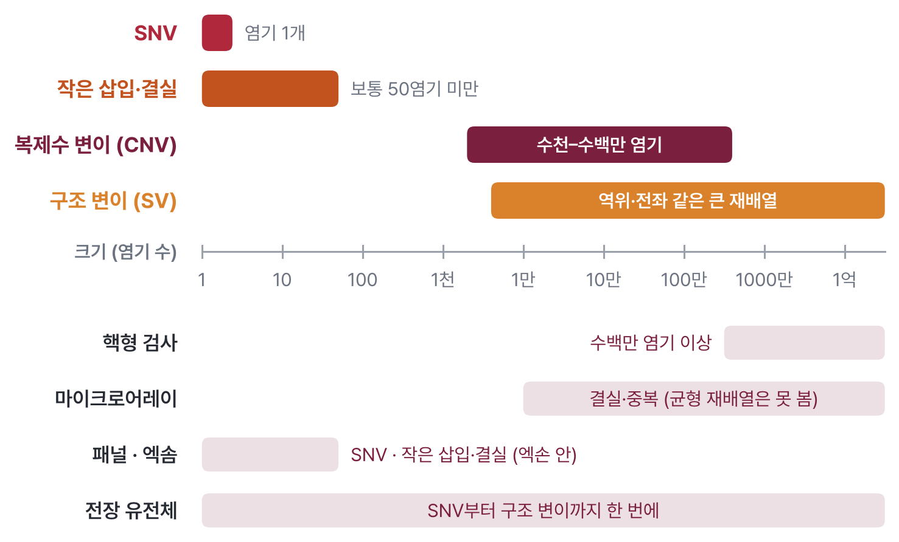
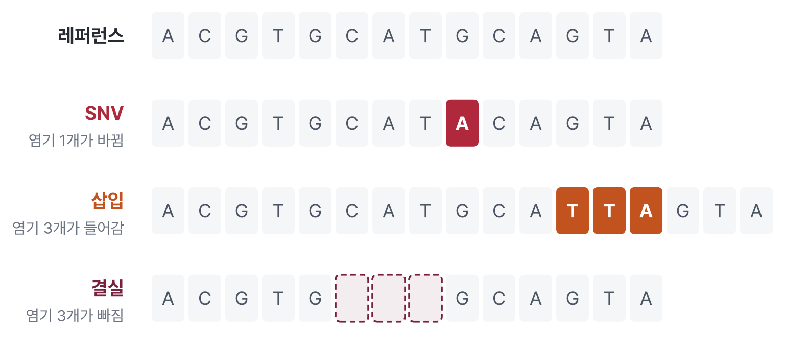
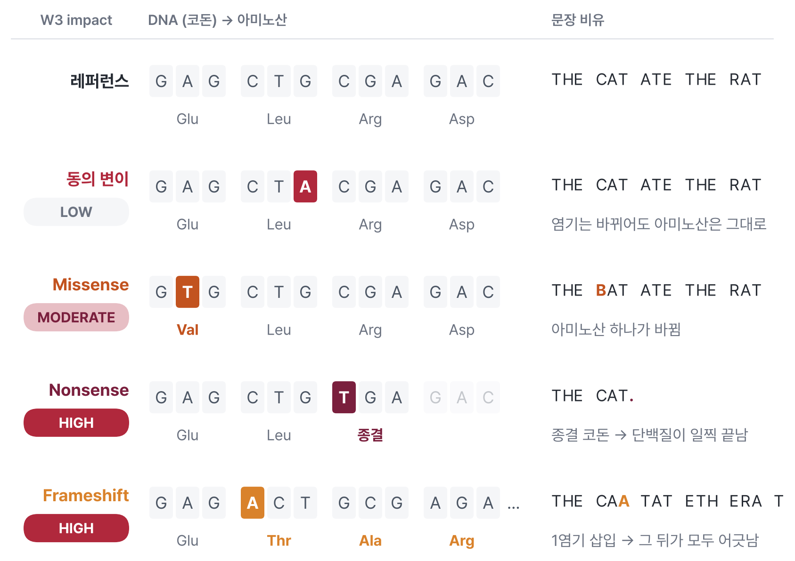
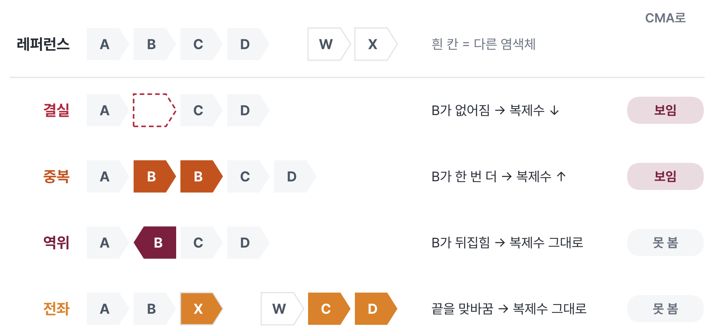
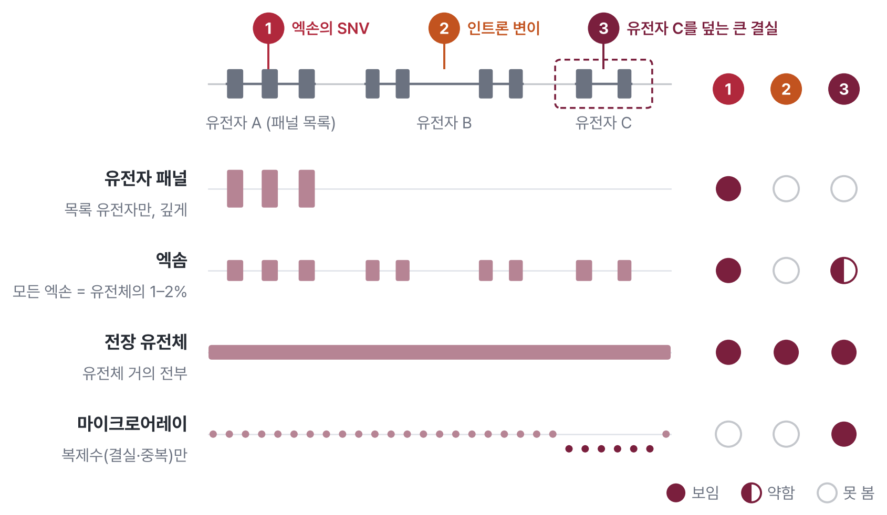
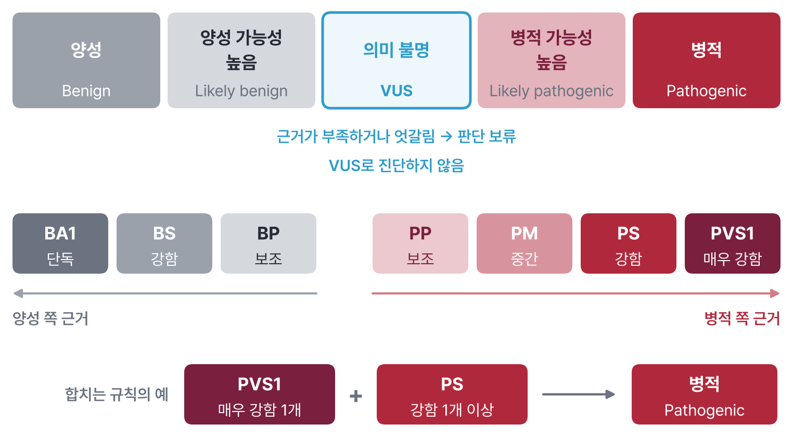
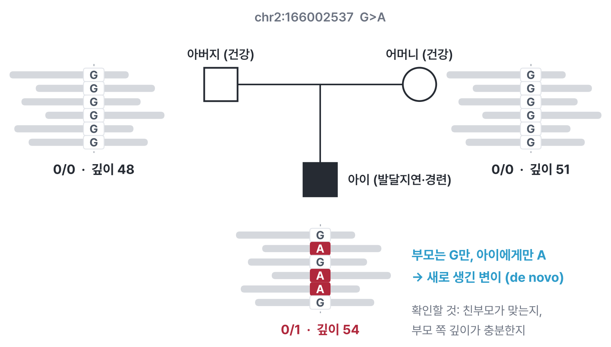

::: {.callout-note collapse="true"}
## 🎯 학습 목표

이 장을 마치면:

-   변이의 종류(SNV, indel, CNV, 구조 변이, 반복 확장)와 단백질에 미치는 영향 구분
-   유전 검사의 종류(염색체 마이크로어레이, 유전자 패널, WES, WGS)를 범위와 한계로 비교
-   변이 호출(variant calling)이 "추론"인 이유를 설명하고 VCF 한 줄 읽기
-   집단 빈도, 기존 보고, 예측 도구를 묶어 ACMG/AMP 5단계로 분류하는 원리와 VUS의 의미 설명
-   트리오 분석과 de novo 변이가 진단에 도움이 되는 이유 설명
-   ⚠️ "엑솜 음성 = 유전 질환 아님", "VUS = 원인"이 틀린 이유 설명
:::

> 🩺 **오늘의 케이스**\
> 세 살 남자아이, 원인 모를 발달지연과 반복되는 경련. 부모는 건강하다. 염색체 검사는 정상이었다.\
> 아이와 부모 셋 모두 엑솜 시퀀싱(WES)을 했고, 아이에게서 레퍼런스와 다른 위치가 약 2만 개 나왔다.\
> → 이 중 원인 변이를 어떻게 찾을까? (🔗 [W3 실습](w03_rare_disease_lab.qmd)에서 직접)

💡 각 절의 본문 = 꼭 알아야 할 기초. **🔍 더 알아보기**는 궁금할 때 펼쳐 보는 심화 내용

------------------------------------------------------------------------

# 1. 사람 유전 변이 🧬 {#w2-s1}

> 🔑 **핵심** — 변이는 크기(염기 하나 ~ 염색체 조각)와 단백질에 미치는 결과로 나눔. 한 사람이 가진 수백만 개 변이의 대부분은 무해

## 1) 크기별 변이의 종류 {#w2-s1-1}

변이(variant)는 레퍼런스와 다른 서열이다 (🔗 [W1 §3.2](w01_intro.qmd#w1-s3-2-3)). 염기 하나가 바뀐 것부터 염색체 조각이 통째로 없어진 것까지 크기가 매우 다양하다. 크기가 다르면 찾는 검사도 달라진다.

{fig-align="center"}

| 종류 | 크기 | 질환 예 |
|---|---|---|
| 단일 염기 변이(SNV) | 염기 1개가 바뀜 | 겸상적혈구빈혈 — *HBB* p.Glu7Val |
| 작은 삽입·결실(indel) | 보통 50염기 미만 | 낭포성 섬유증 — *CFTR* p.Phe508del (3염기 결실) |
| 복제수 변이(CNV) | 수천–수백만 염기의 결실·중복 | 22q11.2 결실 증후군 |
| 구조 변이(SV) | 역위, 전좌 등 큰 재배열 | 균형 전좌, 만성골수성백혈병의 *BCR::ABL1* (🔗 W6) |
| 반복 확장(repeat expansion) | 짧은 서열의 반복 횟수 증가 | 취약 X 증후군 — *FMR1* CGG 반복 200회 이상 |

{fig-align="center"}

## 2) 단백질에 미치는 영향 {#w2-s1-2}

같은 SNV라도 단백질에 미치는 결과는 다르다. 유전자 코드는 염기 세 개(코돈)씩 읽히기 때문이다. 문장 "THE CAT ATE THE RAT"를 세 글자씩 읽는다고 생각하면 이해하기 쉽다.

| 결과 | 무슨 일이 생기나 | 문장 비유 | W3 표의 `impact` |
|---|---|---|---|
| Synonymous (동의 변이) | 염기는 바뀌어도 아미노산은 그대로 | THE CAT ATE THE RAT (결과 문장이 그대로) | LOW |
| Missense | 아미노산 하나가 바뀜 | THE **B**AT ATE THE RAT | MODERATE |
| Nonsense | 그 자리에 종결 코돈 → 단백질이 일찍 끝남 | THE CAT. | HIGH |
| Frameshift | 3의 배수가 아닌 삽입·결실 → 그 뒤가 모두 어긋남 | THE CA**A** TAT ETH ERA T | HIGH |
| Splice site | 엑손을 이어 붙이는 자리가 깨짐 → 엑손이 빠지거나 인트론이 남음 | 문장 한 덩어리가 통째로 빠짐 | HIGH |

{fig-align="center"}

-   Nonsense·frameshift → 대개 단백질이 만들어지지 않거나 기능을 잃음 = 기능 상실(loss of function)
-   ⚠️ **동의 변이가 늘 무해하지는 않음** — splicing 신호를 망가뜨리기도 함
    -   예: W1에서 본 *CYP2C19* \*2 변이(c.681G>A)는 서열상 동의 변이처럼 보이지만 splicing을 망가뜨려 효소를 못 만들게 함 (🔗 W4)

::: {.callout-note collapse="true" icon=false}
## 🔍 더 알아보기 — 일찍 끝나는 mRNA는 왜 사라지나

-   종결 코돈이 너무 일찍 나타난 mRNA는 세포가 알아보고 분해함 (nonsense-mediated decay)
-   → 짧은 단백질이 만들어지는 대신 그 대립유전자에서 단백질이 거의 안 나옴
-   → 두 대립유전자 중 하나만 망가져도 단백질 양이 절반으로 줄어 병이 생기는 유전자가 있음 (haploinsufficiency). *SCN1A*가 그런 예 (🔗 W3)
:::

## 3) 두 사람 사이의 차이 {#w2-s1-3}

-   한 사람의 유전체 = 레퍼런스와 약 400–500만 위치가 다름 (🔗 [W1 §4.1](w01_intro.qmd#w1-s4-1))
-   엑솜 안에서만 = 약 2만 개 → 오늘 케이스의 숫자
-   건강한 사람도 단백질 기능을 없애는 변이를 약 100개 가지고, 그중 약 20개 유전자는 양쪽 대립유전자가 모두 꺼져 있음
-   → "단백질을 망가뜨리는 변이를 찾았다"만으로는 원인이라고 할 수 없음. 어떤 유전자인지, 증상과 맞는지가 중요

------------------------------------------------------------------------

# 2. 어떤 검사를 고를까 🔬 {#w2-s2}

> 🔑 **핵심** — 검사마다 볼 수 있는 변이가 다름. 원리상 못 보는 변이에 대해서는 결과가 "음성"이 아니라 "모름"

## 1) 염색체 마이크로어레이 {#w2-s2-1}

-   핵형 검사(현미경으로 염색체 보기) → 수백만 염기 이상의 큰 변화만 보임
-   염색체 마이크로어레이(chromosomal microarray, CMA) → 그보다 작은 결실·중복(CNV)까지 찾음
-   원인 모를 발달지연, 지적장애, 자폐, 다발 기형에서 일차 검사로 권고 → 진단율 15–20% (핵형 검사는 약 3%)
-   ⚠️ 염기 하나의 변화(SNV)나 균형 전좌는 보지 못함 → 케이스의 "염색체 검사 정상"은 다음 단계로 넘어가라는 뜻

{fig-align="center"}

## 2) 유전자 패널 vs WES vs WGS {#w2-s2-2}

| 검사 | 읽는 범위 | 장점 | 한계 |
|---|---|---|---|
| 유전자 패널(gene panel) | 증상과 관련된 수십–수백 개 유전자 | 깊게 읽음, 해석할 변이가 적음 | 목록 밖 유전자는 못 봄 |
| 엑솜 시퀀싱(WES) | 단백질 암호화 엑손 전체 (유전체의 1–2%) | 약 2만 개 유전자를 한 번에, 나중에 재분석 가능 | 비암호화 영역, 큰 구조 변이, 반복 확장에 약함 |
| 전장 유전체 시퀀싱(WGS) | 유전체 거의 전부 | 비암호화 변이, CNV, 구조 변이까지 한 번에 | 비용, 해석할 변이 수백만 개 |

{fig-align="center"}

-   신경발달질환에서 엑솜의 진단율 = 약 36% (메타분석) → 마이크로어레이보다 높아 일차 검사로 권고됨
-   → 그래도 3명 중 2명은 엑솜으로 진단이 나오지 않음 ([§6.2](#w2-s6-2))

## 3) ⚠️ 검사가 원리적으로 볼 수 없는 변이 {#w2-s2-3}

짧은 read로 엑손만 읽는 일반 엑솜 분석은 다음을 놓치기 쉽다. 이런 질환이 의심되면 다른 검사를 따로 해야 한다.

-   **반복 확장** — 취약 X 증후군의 *FMR1* CGG 반복 → 반복 길이가 read보다 길어 셀 수 없음 → 전용 검사 필요
-   **거의 똑같은 유전자가 둘인 경우** — 척수성 근위축증의 *SMN1*은 *SMN2*와 거의 같아 read가 어느 쪽에서 왔는지 구분하기 어려움 → 전용 검사 필요
-   **큰 구조 변이, 인트론 깊숙한 변이** → 엑솜은 그 구간을 읽지 않음
-   **잘 안 읽히는 구간** — 깊이가 얕으면 변이가 있어도 호출되지 않음 (🔗 [W1 §3.2](w01_intro.qmd#w1-s3-2-3) "기록이 없음 ≠ 변이가 없음")

------------------------------------------------------------------------

# 3. Read에서 변이까지 🧮 {#w2-s3}

> 🔑 **핵심** — 변이 호출 = 여러 read를 보고 "이 위치는 이 유전형일 것"이라고 추론하는 일. 깊이와 품질이 그 추론을 얼마나 믿을지 정함

## 1) 정렬과 깊이 {#w2-s3-1}

read를 레퍼런스 위에 정렬하면(🔗 [W1 §3.2](w01_intro.qmd#w1-s3-2-2)) 한 위치를 여러 read가 겹쳐 덮는다. 아래 그림에서 5번 위치를 보자.

```
position    12345678
reference   ACGTGACT
read 1      ACGTAACT
read 2       CGTGACT
read 3      ACGTAAC
read 4        GTGACT
read 5      ACGTAACT
read 6       CGTGAC
                ^
                position 5:  G x 3,  A x 3
```

-   5번 위치에서 G가 3개, A가 3개 → "이형접합(`0/1`)"으로 추론

-   대립유전자 두 개 중 하나가 A라면 read의 약 절반이 A여야 함
-   이 위치를 덮은 read 수 = 깊이(depth) 6
-   ⚠️ 깊이가 3이라면? → 우연히 한쪽 대립유전자만 읽혀 이형접합을 놓칠 수 있음 → 깊이가 얕은 호출은 덜 믿음

## 2) 변이 호출 = 추론 {#w2-s3-2}

변이 호출(variant calling)은 프로그램이 read를 보고 유전형을 판단하는 단계다. 판단은 틀릴 수 있다.

-   가짜 변이(거짓 양성)의 원인
    -   시퀀싱 오류 (염기 약 1,000개에 1개)
    -   정렬 오류 — 비슷한 서열이 다른 곳에 있으면 read가 엉뚱한 곳에 놓임
-   놓친 변이(거짓 음성)의 원인 → 깊이 부족, 정렬이 안 되는 구간
-   그래서 VCF에는 판단의 신뢰도가 함께 적힘
    -   QUAL = 품질 점수, FILTER = 기준 통과 여부 (`PASS` 또는 `LowQual` 등)
-   ⚠️ 트리오 분석에서 특히 조심 → 부모 쪽 깊이가 얕아 부모의 변이를 놓치면, 아이의 변이가 **가짜 de novo**처럼 보임 (🔗 [W3 고쳐 보기](w03_rare_disease_lab.qmd#w3-s2-6))
-   💡 진료에서는 결과를 바꿀 중요한 변이를 다른 방법(예: Sanger 시퀀싱)으로 다시 확인하기도 함 (🔗 [W1 §3.1](w01_intro.qmd#w1-s3-1))

## 3) VCF 한 줄 읽기 {#w2-s3-3}

W3 실습에서 만날 변이를 트리오 VCF로 쓰면 이렇다 (깊이 숫자는 예시).

```
#CHROM  POS        ID           REF  ALT  FILTER  FORMAT  아이     아버지   어머니
chr2    166002537  rs398123593  G    A    PASS    GT:DP   0/1:54  0/0:48  0/0:51
```

-   `GT:DP` = 각 사람 칸에 "유전형:깊이" 순서로 적혀 있다는 뜻
-   아이 `0/1` → 한쪽 대립유전자만 A, 깊이 54
-   부모 `0/0` → 둘 다 레퍼런스 그대로, 깊이도 충분 → 부모에게 없는 새 변이(de novo)일 가능성 ([§5.2](#w2-s5-2))

------------------------------------------------------------------------

# 4. 변이 해석 🔎 {#w2-s4}

> 🔑 **핵심** — 해석 = 서로 독립된 근거(빈도, 기존 보고, 예측, 가족)를 모아 "이 변이가 이 병의 원인일 가능성"에 등급을 매기는 일

## 1) 집단 빈도 — gnomAD {#w2-s4-1}

드문 병의 원인 변이는 건강한 사람들 사이에서 흔할 수 없다. 이 단순한 논리가 가장 많은 변이를 걸러 낸다. gnomAD는 수십만 명의 엑솜·유전체에서 변이마다 얼마나 흔한지 모아 둔 데이터베이스다.

-   흔한 변이(예: 5% 이상) → 드문 병의 원인으로 보지 않음
-   어디까지를 "드물다"고 할지는 질환의 빈도와 유전 양식에 따라 다름 → W3 실습에서는 0.1%를 기준으로 씀
-   ⚠️ **집단마다 빈도가 다름** → 전체 빈도만 보지 말고 환자와 같은 집단의 빈도를 볼 것
    -   예: 난청 원인으로 흔한 *GJB2* c.235delC (rs80338943) → gnomAD 엑솜 전체 빈도 약 0.02%, 한국인 자료(Korea4K) 약 0.65%
    -   전체 빈도만 보면 "아주 드물다"고 오해할 수 있음

## 2) 기존 보고 — ClinVar와 문헌 {#w2-s4-2}

-   ClinVar = 전 세계 검사기관과 연구실이 제출한 변이 해석을 모은 데이터베이스
-   분류마다 검토 수준을 별점으로 표시
    -   ★ 한 기관 제출 → ★★ 여러 기관이 같은 판단 → ★★★ 전문가 패널 검토 → ★★★★ 진료 지침
    -   별이 없는 제출(근거 기준 없음)도 있음
-   기관끼리 판단이 다르면 "Conflicting"으로 표시
-   ⚠️ ClinVar 분류는 새 근거가 나오면 바뀜 → 확인한 날짜를 기록

## 3) 예측 도구 {#w2-s4-3}

-   컴퓨터 프로그램이 아미노산 변화의 영향을 예측
    -   여러 동물 종에서 그 자리의 아미노산이 늘 같은가(보존성), 단백질 구조에서 중요한 자리인가
    -   예: SIFT, PolyPhen-2, CADD, AlphaMissense
-   ⚠️ **보조 근거일 뿐** — 예측 점수 하나로 병적이라고 판단하지 않음

## 4) ACMG/AMP 5단계 분류 {#w2-s4-4}

미국 의학유전학회(ACMG)와 분자병리학회(AMP)의 지침은 근거마다 이름과 세기를 정해 두고, 근거를 합쳐 변이를 다섯 단계로 나눈다. 전 세계 검사기관이 이 틀을 쓴다.

| 분류 | 뜻 |
|---|---|
| Pathogenic (병적) | 병의 원인 |
| Likely pathogenic (병적 가능성 높음) | 원인일 가능성이 90%를 넘는다고 판단 |
| Uncertain significance (VUS, 의미 불명) | 근거가 부족하거나 엇갈려 판단 보류 |
| Likely benign (양성 가능성 높음) | 무해할 가능성이 90%를 넘는다고 판단 |
| Benign (양성) | 무해 |

근거의 세기:

| 방향 | 세기 | 대표 예 |
|---|---|---|
| 병적 쪽 | 매우 강함 (PVS1) | 기능을 잃으면 병이 생기는 유전자에서 단백질을 끝내는 변이(nonsense, frameshift 등) |
| | 강함 (PS) | 부모 관계가 확인된 de novo 변이 (PS2) |
| | 중간 (PM) | 집단 데이터베이스에 없거나 극히 드묾 (PM2) |
| | 보조 (PP) | 예측 도구들이 모두 해롭다고 예측 (PP3) |
| 양성 쪽 | 단독 (BA1) | 집단 빈도가 5%를 넘음 |
| | 강함·보조 (BS, BP) | 건강한 성인에게서 관찰됨, 예측 도구들이 무해하다고 예측 등 |

{fig-align="center"}

-   근거를 합치는 규칙이 정해져 있음 → 예: "매우 강함 1개 + 강함 1개 이상" = Pathogenic (🔗 [W3 §3.4](w03_rare_disease_lab.qmd#w3-s3-4)에서 직접 적용)
-   ⚠️ **VUS ≠ 원인**
    -   VUS만으로 진단하거나 진료 결정을 내리지 않음
    -   나중에 다시 분류될 때는 양성 쪽으로 바뀌는 경우가 훨씬 많음 → 유전성 암 검사 연구에서 재분류된 VUS의 91%가 양성 또는 양성 가능성 높음으로 바뀜

------------------------------------------------------------------------

# 5. 가족과 함께 보기 👨‍👩‍👧 {#w2-s5}

> 🔑 **핵심** — 부모의 DNA를 함께 보면(트리오) 후보가 크게 줄어듦. 건강한 부모에게 없는 새 변이(de novo)는 강력한 근거

## 1) 유전 양식 {#w2-s5-1}

증상을 일으키려면 대립유전자가 몇 개 망가져야 하는지에 따라 찾아야 할 유전형이 달라진다.

| 유전 양식 | 아이에게서 찾을 유전형 | 예 |
|---|---|---|
| 상염색체 우성 | 한쪽만 변이 (`0/1`) — 부모에게서 받았거나 de novo | *SCN1A* 관련 뇌전증 (대개 de novo) |
| 상염색체 열성 | 양쪽 모두 변이 (`1/1`), 또는 서로 다른 두 변이를 부모에게서 하나씩 | 낭포성 섬유증, 척수성 근위축증 |
| X 연관 | 남아는 X가 하나 → 변이 하나로 발병 | 취약 X 증후군, 뒤센 근이영양증 |

-   ⚠️ 열성 질환 유전자에 변이가 **하나만** 있으면 보인자일 뿐 → ClinVar에 Pathogenic이라도 이 아이의 병을 설명하지 못함

## 2) 트리오 분석과 de novo 변이 {#w2-s5-2}

모든 사람은 부모에게 없던 새 변이(de novo 변이)를 조금씩 가지고 태어난다. 그 수는 많지 않다. 그래서 건강한 부모와 아이를 함께 시퀀싱하면(트리오 분석, trio analysis) 아이에게만 있는 새 변이를 몇 개로 좁힐 수 있다.

{fig-align="center"}

-   한 사람의 de novo 변이 = 유전체 전체에서 수십 개, 그중 단백질 암호화 영역에는 보통 1–2개
-   아버지 나이가 한 살 많을수록 아이의 de novo 변이가 약 2개씩 늘어남 → 대부분 아버지 쪽 정자에서 생김
-   중증 발달 질환, 뇌전증의 상당수가 de novo 변이로 생김 → 부모가 건강한데 아이만 아픈 이유
-   → W3 실습에서 2만 개가 2개로 줄어드는 마지막 단계가 바로 이것
-   ⚠️ 주의할 점
    -   생물학적 부모가 맞는지 확인 필요 (지침의 PS2 조건)
    -   부모의 깊이가 얕아 생긴 가짜 de novo ([§3.2](#w2-s3-2))
    -   de novo라는 것만으로는 원인이 아님 → 모든 사람이 de novo 변이를 가짐. 유전자와 증상이 맞아야 함

------------------------------------------------------------------------

# 6. 진료에서 — 케이스로 돌아가기 🏥 {#w2-s6}

> 🔑 **핵심** — 유전 진단은 검사의 끝이 아니라 치료, 예후, 가족 상담의 시작. 진단이 나오지 않아도 거기서 끝나지 않음

## 1) 진단 오디세이의 끝 {#w2-s6-1}

희귀질환 아이의 가족은 진단이 나오기까지 여러 해 동안 병원과 검사를 전전하기도 한다(진단 오디세이). 케이스의 아이에게 지금까지 배운 것을 적용하면 이렇게 된다.

1.  **품질** — 믿을 만한 호출만 남김 ([§3](#w2-s3))
2.  **빈도** — 건강한 사람들 사이에서 흔한 변이 제외 ([§4.1](#w2-s4-1))
3.  **단백질 영향** — 단백질을 바꾸는 변이부터 ([§1.2](#w2-s1-2))
4.  **유전 양식** — 부모가 건강하므로 de novo 가설 ([§5](#w2-s5))
5.  **근거 모으기** — ClinVar, 문헌, ACMG 분류 ([§4](#w2-s4))

➡️ 직접 해 보는 것은 [W3 실습](w03_rare_disease_lab.qmd)

진단이 나오면 바뀌는 것:

-   **치료** — 원인 유전자에 따라 피해야 할 약, 써야 할 약이 달라짐 (예는 W3)
-   **예후와 관리** — 같은 유전 질환 환자들의 경과를 참고해 미리 대비
-   **가족 상담** — 다음 아이의 재발 위험, 다른 가족의 검사 필요 여부
-   **검사 중단** — 더 이상 원인을 찾는 검사를 반복하지 않아도 됨

## 2) 진단이 나오지 않을 때 {#w2-s6-2}

-   엑솜으로 진단이 나오지 않는 경우가 더 많음 ([§2.2](#w2-s2-2))
-   선택지
    -   **재분석** — 새로운 질환 유전자가 계속 밝혀지므로 1–2년 뒤 같은 데이터를 다시 분석하면 진단이 나오기도 함
    -   **다른 검사** — WGS, long-read 시퀀싱, 반복 확장 전용 검사, RNA 검사(🔗 W9)
-   ⚠️ **엑솜 음성 ≠ 유전 질환 아님** — 검사가 볼 수 없는 변이([§2.3](#w2-s2-3))이거나, 아직 모르는 유전자일 수 있음

## 3) 우연히 발견되는 변이 {#w2-s6-3}

-   엑솜·유전체 검사는 검사 목적과 상관없는 유전자도 함께 읽음
-   이차 발견(secondary findings) = 미리 알면 예방·치료할 수 있는 질환의 유전자 변이를 함께 보고하는 것
    -   예: *BRCA1/2* (유전성 유방·난소암, 🔗 W6), *LDLR* (가족성 고콜레스테롤혈증)
    -   ACMG가 보고 대상 유전자 목록을 정해 주기적으로 갱신
-   검사 전에 이런 결과를 알고 싶은지 묻고 동의를 받음

------------------------------------------------------------------------

# 🤔 흔한 오해

1.  **엑솜에서 아무것도 나오지 않았으면 유전 질환이 아니다?**\
    아니다. 엑솜이 원리적으로 못 보는 변이(반복 확장, 큰 구조 변이, 비암호화 변이)가 있고, 아직 원인 유전자로 밝혀지지 않은 유전자도 많다. 재분석이나 다른 검사로 진단이 나오기도 한다.
2.  **VUS는 병적일 가능성이 높으니 가족 모두 검사해야 한다?**\
    아니다. VUS는 "판단 보류"다. VUS로 진단하거나 진료 결정을 내리지 않고, 다시 분류될 때는 양성 쪽으로 바뀌는 경우가 훨씬 많다.
3.  **ClinVar에 Pathogenic이면 이 환자의 병의 원인이다?**\
    아니다. 그 변이가 일으키는 병과 환자의 증상, 유전 양식이 맞아야 한다. 열성 질환 유전자에 변이가 하나만 있으면 보인자일 뿐이다.
4.  **아미노산이 바뀌지 않는 동의 변이는 항상 무해하다?**\
    아니다. splicing 신호를 망가뜨려 단백질을 못 만들게 하기도 한다. *CYP2C19* \*2가 그런 예다.
5.  **부모에게 없는 de novo 변이면 원인이다?**\
    아니다. 모든 사람이 de novo 변이를 수십 개 가지고 태어난다. 호출 품질, 부모 관계, 유전자와 증상의 일치를 함께 봐야 한다 (🔗 W3의 *OR5A1* 변이).

# ❓ 복습 문제

**1. (개념)** Frameshift 변이에 대한 설명으로 옳은 것은?\
(a) 아미노산 하나만 바뀐다\
(b) 단백질 서열은 그대로다\
(c) 3의 배수가 아닌 삽입·결실 때문에 그 뒤의 코돈이 모두 어긋난다\
(d) 염색체 일부가 다른 염색체로 옮겨 간다

**2. (개념)** 일반적인 short-read 엑솜 시퀀싱으로 찾기 가장 어려운 것은?\
(a) Missense SNV (b) Nonsense SNV (c) 취약 X 증후군의 *FMR1* CGG 반복 확장 (d) 1염기 결실에 의한 frameshift

**3. (개념)** ACMG/AMP 5단계 분류에서 VUS의 뜻과, VUS를 진료에서 다루는 원칙을 쓰시오.

**4. (적용)** 상염색체 열성 질환이 의심되는 아이에게서 같은 유전자에 서로 다른 드문 변이가 두 개 나왔다. 트리오 결과에서 무엇을 확인해야 이 두 변이로 병을 설명할 수 있는가?

**5. (적용)** gnomAD 전체 빈도는 0.05%지만 동아시아인 빈도는 2%인 변이가, 한국인 아이의 아주 드문 우성 질환의 원인으로 거론되었다. 어떻게 판단하겠는가?

**6. (임상 시나리오)** 결과지에 "*SCN2A* 변이, VUS, 아버지에게서 유전"이라고 적혀 있다. 보호자가 묻는다. "이게 아이 경련의 원인인가요? 동생도 검사해야 하나요?" 2–3문장으로 답하시오.

::: {.callout-tip collapse="true"}
## 정답과 해설

**1. (c)** 코돈은 세 염기씩 읽히므로 3의 배수가 아닌 삽입·결실은 그 뒤를 모두 어긋나게 한다.

**2. (c)** 반복 길이가 read 길이보다 길어 짧은 read로는 셀 수 없다. 전용 검사가 필요하다.

**3.** VUS = 병적인지 양성인지 근거가 부족하거나 엇갈려 판단을 보류한 변이. VUS만으로 진단하거나 진료 결정을 내리지 않고, 새 근거가 쌓이면 다시 분류한다.

**4.** 두 변이가 부모에게서 하나씩 왔는지(한 변이는 아버지, 다른 변이는 어머니) 확인해야 한다. 그래야 두 대립유전자가 모두 망가진 것이다. 두 변이가 같은 부모에게서 왔다면 한쪽 대립유전자에만 있어 정상 대립유전자가 남는다.

**5.** 환자와 같은 집단에서 2%나 되는 변이는 아주 드문 우성 질환의 원인이 되기 어렵다. 전체 빈도만 보고 "드물다"고 판단하면 틀린다. 집단별 빈도를 확인해야 한다.

**6. 핵심 논점**: VUS는 원인인지 아닌지 아직 판단할 근거가 부족하다는 뜻이고, 건강한 아버지에게도 있으므로 지금 근거로는 원인이라고 보기 어렵다. VUS를 근거로 동생을 검사하거나 진료를 바꾸지 않으며, 새 근거가 나오면 다시 분류될 수 있다. 다른 후보(예: de novo 변이)를 함께 검토해야 한다.
:::

------------------------------------------------------------------------

# 📝 요약

-   변이는 크기(SNV → indel → CNV → 구조 변이, 반복 확장)와 단백질에 미치는 결과(동의, missense, nonsense, frameshift, splice site)로 나눔
-   건강한 사람도 단백질 기능을 없애는 변이를 약 100개 가짐 → 망가뜨리는 변이라는 것만으로는 원인이 아님
-   검사마다 보는 변이가 다름: 마이크로어레이(CNV), 패널, 엑솜, 전장 유전체. 신경발달질환에서 엑솜 진단율 약 36%
-   ⚠️ 반복 확장, 거의 같은 유전자, 큰 구조 변이 → 엑솜으로 놓치기 쉬움. 엑솜 음성 ≠ 유전 질환 아님
-   변이 호출 = 추론. 깊이와 품질이 신뢰도를 정함. ⚠️ 부모 깊이 부족 → 가짜 de novo
-   해석 = 집단 빈도(gnomAD) + 기존 보고(ClinVar) + 예측 + 가족 → ACMG/AMP 5단계
-   ⚠️ 집단마다 빈도가 다름 (*GJB2* c.235delC: 전체 0.02%, 한국인 0.65%)
-   ⚠️ VUS ≠ 원인. 재분류되면 대부분 양성 쪽
-   트리오 분석 → de novo 변이를 1–2개로 좁힘. 아버지 나이가 많을수록 de novo 증가
-   진단은 치료, 예후, 가족 상담을 바꿈. 진단이 안 나오면 재분석과 다른 검사

------------------------------------------------------------------------

# 🔑 핵심 용어

| 용어 | 한 줄 설명 |
|----------------------------|--------------------------------------------|
| Single nucleotide variant (SNV) | 염기 하나가 바뀐 변이 |
| Indel | 50염기 미만의 작은 삽입이나 결실 |
| Copy number variant (CNV) | 수천 염기 이상 구간의 결실이나 중복 |
| Structural variant (구조 변이) | 역위, 전좌처럼 염색체 구간의 큰 재배열 |
| Repeat expansion (반복 확장) | 짧은 서열이 반복되는 횟수가 늘어난 변이 |
| Synonymous variant (동의 변이) | 염기는 바뀌어도 아미노산은 그대로인 변이 |
| Missense | 아미노산 하나가 다른 아미노산으로 바뀌는 변이 |
| Nonsense | 종결 코돈이 생겨 단백질이 일찍 끝나는 변이 |
| Frameshift | 3의 배수가 아닌 삽입·결실로 그 뒤 코돈이 모두 어긋나는 변이 |
| Loss of function (기능 상실) | 변이 때문에 단백질이 기능을 잃는 것 |
| Chromosomal microarray (CMA) | 유전체 전체의 작은 결실·중복을 찾는 검사 |
| Gene panel (유전자 패널) | 증상과 관련된 유전자 목록만 읽는 검사 |
| Whole-exome sequencing (WES) | 단백질 암호화 엑손 전체를 읽는 검사 |
| Whole-genome sequencing (WGS) | 유전체 거의 전부를 읽는 검사 |
| Variant calling (변이 호출) | Read를 보고 위치마다 유전형을 판단하는 단계 |
| gnomAD | 수십만 명의 변이 빈도를 집단별로 모은 데이터베이스 |
| ClinVar | 변이마다 제출된 임상 해석과 검토 수준을 모은 데이터베이스 |
| Variant of uncertain significance (VUS) | 병적인지 양성인지 근거가 부족해 판단을 보류한 변이 |
| De novo variant (de novo 변이) | 부모에게 없고 아이에게서 새로 생긴 변이 |
| Trio analysis (트리오 분석) | 아이와 부모를 함께 시퀀싱해 변이의 유래를 확인하는 분석 |
| Secondary findings (이차 발견) | 검사 목적과 무관하지만 조치할 수 있어 함께 보고하는 변이 |

------------------------------------------------------------------------

# ➕ 참고문헌

### 지침과 권고

Richards S, et al. [*Standards and guidelines for the interpretation of sequence variants (ACMG/AMP).*](https://doi.org/10.1038/gim.2015.30) Genet Med. 2015.\
Miller DT, et al. [*Consensus statement: chromosomal microarray is a first-tier clinical diagnostic test for individuals with developmental disabilities or congenital anomalies.*](https://doi.org/10.1016/j.ajhg.2010.04.006) Am J Hum Genet. 2010.\
Srivastava S, et al. [*Meta-analysis and multidisciplinary consensus statement: exome sequencing is a first-tier clinical diagnostic test for individuals with neurodevelopmental disorders.*](https://doi.org/10.1038/s41436-019-0554-6) Genet Med. 2019.\
Miller DT, et al. [*ACMG SF v3.2 list for reporting of secondary findings in clinical exome and genome sequencing.*](https://doi.org/10.1016/j.gim.2023.100866) Genet Med. 2023.

### 변이와 de novo

MacArthur DG, et al. [*A systematic survey of loss-of-function variants in human protein-coding genes.*](https://doi.org/10.1126/science.1215040) Science. 2012.\
Kong A, et al. [*Rate of de novo mutations and the importance of father's age to disease risk.*](https://doi.org/10.1038/nature11396) Nature. 2012.\
Acuna-Hidalgo R, Veltman JA, Hoischen A. [*New insights into the generation and role of de novo mutations in health and disease.*](https://doi.org/10.1186/s13059-016-1110-1) Genome Biol. 2016.

### 해석 자원

Karczewski KJ, et al. [*The mutational constraint spectrum quantified from variation in 141,456 humans.*](https://doi.org/10.1038/s41586-020-2308-7) Nature. 2020. (gnomAD)\
Landrum MJ, et al. [*ClinVar: improvements to accessing data.*](https://doi.org/10.1093/nar/gkz972) Nucleic Acids Res. 2020.\
Cheng J, et al. [*Accurate proteome-wide missense variant effect prediction with AlphaMissense.*](https://doi.org/10.1126/science.adg7492) Science. 2023.\
Mersch J, et al. [*Prevalence of variant reclassification following hereditary cancer genetic testing.*](https://doi.org/10.1001/jama.2018.13152) JAMA. 2018.
