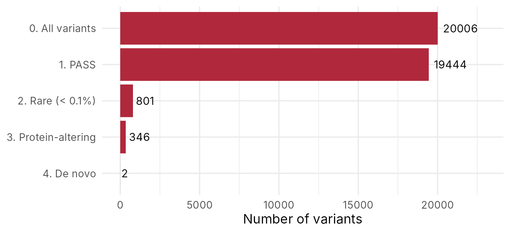

::: {.callout-note collapse="true"}
## 🎯 학습 목표

이 실습을 마치면:

-   유전체 브라우저에서 유전자 구조(엑손, 가닥)와 변이 위치 확인
-   R로 변이표를 읽고 단계별로 걸러 약 2만 개를 후보 몇 개로 좁히기
-   gnomAD와 ClinVar로 후보 변이의 집단 빈도와 기존 해석 찾기
-   근거를 모아 원인 변이 하나를 고르고, 확진에 무엇이 더 필요한지 설명
:::

> 🩺 **케이스 다시 보기** (🔗 [W2](w02_rare_disease.qmd))\
> 세 살 남자아이, 원인 모를 발달지연과 반복되는 경련. 부모는 건강하다. 아이와 부모 셋 모두 엑솜 시퀀싱을 했고, 아이에게서 레퍼런스와 다른 위치가 약 2만 개 나왔다.\
> → 오늘 목표: 2만 개에서 후보 변이 하나와 그 근거까지

------------------------------------------------------------------------

# 0. 준비물 🧰 {#w3-s0}

-   웹: [UCSC Genome Browser](https://genome.ucsc.edu/), [gnomAD](https://gnomad.broadinstitute.org/), [ClinVar](https://www.ncbi.nlm.nih.gov/clinvar/) — 모두 가입 필요 x
-   데이터: [w03_variants.tsv](../data/w03_variants.tsv) — 아이·아버지·어머니의 엑솜 변이표 (20,006줄)
-   JupyterHub: 로그인 → 새 R 노트북 → 내려받은 파일을 왼쪽 파일 창에 끌어다 놓기 (🔗 [W1 §6.2](w01_intro.qmd#w1-s6-2))

::: {.callout-note collapse="true"}
## 이 데이터에 대해

-   실습용 **가상 환자 가족**의 자료. 실제 환자 자료가 아님
-   유전자 이름과 유전자 구간은 실제(GRCh38)지만, 대부분의 변이(위치, 염기, 단백질 변화, 빈도)는 무작위로 만듦. 부모와 아이의 유전형은 멘델 유전을 따르게 만듦
-   오늘 웹에서 직접 찾아볼 *SCN1A*, *SCN2A* 변이 세 개는 ClinVar에 실제로 있는 변이를 그대로 넣음
-   만든 방법: 저장소의 `scripts/make_w03_variants.R`
:::

------------------------------------------------------------------------

# 1. 🌐 유전체 브라우저로 *SCN1A* 보기 {#w3-s1}

*SCN1A*는 경련이 있는 아이에게서 가장 먼저 의심하는 유전자 중 하나다. 뇌 신경세포에서 전기 신호를 만드는 나트륨 통로 단백질의 한 부분을 만든다. 데이터를 거르기 전에 이 유전자가 어떻게 생겼는지 먼저 보자.

1.  [UCSC Genome Browser](https://genome.ucsc.edu/) → 위 메뉴 **Genomes** → **Human GRCh38/hg38**
2.  검색창에 `SCN1A` 입력 → 결과 목록에서 *SCN1A* 유전자 선택
    -   **여기서 볼 것**: 화면 맨 위의 위치 표시(몇 번 염색체, 어디부터 어디까지)
3.  유전자 track 읽기
    -   굵은 막대 = 단백질을 만드는 엑손, 얇은 막대 = UTR, 가는 선 = 인트론
    -   선 위의 작은 화살표 방향 = 유전자가 놓인 가닥(+ 또는 −)
4.  검색창에 `chr2:166,002,537` 입력 → 오늘 끝까지 따라갈 변이의 위치
    -   **여기서 볼 것**: 이 위치가 굵은 막대(엑손) 위에 있는지

| 항목 | 내가 찾은 값 |
|------|-------------|
| *SCN1A*의 위치 (염색체:시작–끝) | |
| 대략적인 길이 | |
| 가닥 (+ / −) | |
| `chr2:166,002,537`은 엑손? 인트론? | |

✅ **확인 질문** — *SCN1A* 전체 길이에서 굵은 막대(엑손)가 차지하는 부분은 많은가, 적은가? 엑솜 시퀀싱은 이 중 어디를 읽는가? (🔗 [W1 §4.1](w01_intro.qmd#w1-s4-1))

::: {.callout-tip collapse="true"}
## 확인

-   NCBI Gene 기준 `chr2:165,984,641–166,149,161`, 약 16만 염기. 보는 전사체에 따라 끝 위치가 조금 다를 수 있음
-   반대(−) 가닥 → 그래서 유전체 표기는 G>A인데 코딩 서열 표기는 c.4219C>T (🔗 [W1 §4.3](w01_intro.qmd#w1-s4-3))
-   엑손은 유전자 길이의 일부일 뿐이고 대부분은 인트론 → 엑솜 시퀀싱은 이 엑손들만 읽음
:::

------------------------------------------------------------------------

# 2. 💻 R로 2만 개를 몇 개로 {#w3-s2}

## 1) 노트북 시작 {#w3-s2-1}

필요한 패키지 세 개를 불러오고, 노트북에 그릴 그림 크기를 정한다. 사이트의 코드 블록 오른쪽 위 복사 버튼으로 복사해 셀에 붙여 넣고 **Shift + Enter**.

```r
library(readr)    # 표 읽기
library(dplyr)    # 표 거르기·고르기
library(ggplot2)  # 그림 그리기

options(repr.plot.width = 8, repr.plot.height = 4)  # 노트북 그림 크기
```

**결과에서 볼 것** — 오류 없이 끝나면 준비 완료. `dplyr`를 불러올 때 나오는 "masked" 안내문은 오류가 아님

## 2) 표 읽기 {#w3-s2-2}

변이표를 읽어 `variants`라는 이름으로 저장하고, 몇 줄인지와 처음 몇 줄을 본다.

```r
variants <- read_tsv("w03_variants.tsv")
nrow(variants)
head(variants)
```

**결과에서 볼 것** — `20006`. 한 줄 = 아이에게서 레퍼런스와 다르게 나온 위치 하나. 열의 뜻은 아래 표

| 열 | 뜻 |
|---|---|
| `chrom`, `pos` | 염색체와 위치 (GRCh38) |
| `ref`, `alt` | 레퍼런스 염기, 이 아이에게서 나온 염기 |
| `gene` | 변이가 있는 유전자 |
| `consequence` | 단백질에 미치는 결과 (예: `missense_variant` 아미노산 하나 바뀜, `stop_gained` 종결 코돈 생김) |
| `impact` | 영향 등급: `HIGH` 단백질이 일찍 끝나거나 읽는 틀이 어긋나는 등 크게 망가짐 > `MODERATE` 아미노산 하나 바뀜 > `LOW` 아미노산은 그대로 > `MODIFIER` 단백질 바깥 |
| `protein` | 단백질 변화 표기 (🔗 [W1 §4.3](w01_intro.qmd#w1-s4-3)) |
| `gnomad_af` | gnomAD에서 이 염기의 빈도. `0` = 관찰된 적 없음, `0.001` = 0.1% |
| `filter` | 변이 호출 품질 판정: `PASS` 통과, `LowQual` 미달 |
| `depth` | 이 위치를 덮은 read 수 (🔗 [W1 §3.2](w01_intro.qmd#w1-s3-2-2)) |
| `proband`, `father`, `mother` | 아이, 아버지, 어머니의 유전형 (`0/0`, `0/1`, `1/1`) |

## 3) 한 단계씩 거르기 {#w3-s2-3}

변이 2만 개를 하나씩 볼 수는 없다. 이유가 있는 기준으로 한 단계씩 거른다.

| 단계 | 기준 | 이유 |
|---|---|---|
| ① 품질 | `filter`가 `PASS` | 변이 호출은 추론 → 품질 미달 호출은 가짜일 수 있음 (🔗 [W2 §3](w02_rare_disease.qmd#w2-s3)) |
| ② 빈도 | `gnomad_af` < 0.001 | 드문 병의 원인이 천 명에 한 명보다 흔할 수는 없음 (🔗 [W2 §4.1](w02_rare_disease.qmd#w2-s4-1)) |
| ③ 영향 | `impact`가 `HIGH` 또는 `MODERATE` | 단백질을 바꾸는 변이부터 봄 |
| ④ 유전 방식 | 아이 `0/1`, 부모 둘 다 `0/0` | 부모는 건강 → 부모에게 없던 새 변이(de novo) 가설 (🔗 [W2 §5](w02_rare_disease.qmd#w2-s5)) |

```r
step1 <- variants |> filter(filter == "PASS")
step2 <- step1 |> filter(gnomad_af < 0.001)
step3 <- step2 |> filter(impact %in% c("HIGH", "MODERATE"))
step4 <- step3 |> filter(proband == "0/1",
                         father == "0/0", mother == "0/0")

c(nrow(variants), nrow(step1), nrow(step2), nrow(step3), nrow(step4))
```

-   `|>` = 왼쪽 결과를 오른쪽 함수에 넘김 → "그리고 나서"로 읽기
-   `filter()` = 조건에 맞는 행만 남김. `==` 같다, `%in%` 목록 중 하나, 쉼표 = 그리고

**결과에서 볼 것** — `20006 19444 801 346 2`. 2만 개가 두 개로

## 4) 깔때기 그림 {#w3-s2-4}

단계마다 남은 개수를 막대그래프로 그린다.

```r
funnel <- tibble(
  step = c("0. All variants", "1. PASS", "2. Rare (< 0.1%)",
           "3. Protein-altering", "4. De novo"),
  n = c(nrow(variants), nrow(step1), nrow(step2), nrow(step3), nrow(step4))
)

ggplot(funnel, aes(x = n, y = step)) +
  geom_col(fill = "#B0283C") +
  geom_text(aes(label = n), hjust = -0.15) +
  scale_y_discrete(limits = rev) +
  expand_limits(x = 23000) +
  labs(x = "Number of variants", y = NULL) +
  theme_minimal(base_size = 13)
```

{fig-align="center" width="85%"}

**결과에서 볼 것** — 어느 단계에서 가장 많이 줄었나? 그 단계가 뜻하는 것은?

## 5) 남은 후보 {#w3-s2-5}

마지막에 남은 두 줄에서 보고 싶은 열만 고른다.

```r
step4 |> select(gene, consequence, protein, gnomad_af, depth, proband, father, mother)
```

**결과에서 볼 것** — 두 후보

| gene | consequence | protein | gnomad_af | depth | proband | father | mother |
|---|---|---|---|---|---|---|---|
| SCN1A | stop_gained | p.Arg1407Ter | 0 | 54 | 0/1 | 0/0 | 0/0 |
| OR5A1 | missense_variant | p.Ser187Cys | 0 | 49 | 0/1 | 0/0 | 0/0 |

→ 둘 다 드물고, 둘 다 de novo. 무엇이 원인인지는 [§3](#w3-s3)에서 근거로 가림

## 6) 다른 길: 증상과 관련된 유전자부터 {#w3-s2-6}

진료에서는 증상과 관련된 유전자 목록(가상 패널)을 먼저 보기도 한다. ③단계까지 거른 표에서 경련 관련 유전자만 남겨 본다.

```r
epilepsy_genes <- c("SCN1A", "SCN2A", "SCN8A", "KCNQ2",
                    "STXBP1", "CDKL5", "PCDH19", "SLC2A1")

step3 |>
  filter(gene %in% epilepsy_genes) |>
  select(gene, consequence, protein, gnomad_af, proband, father, mother)
```

**결과에서 볼 것** — *SCN1A* p.Arg1407Ter와 *SCN2A* p.Ile1951Thr. *SCN2A* 변이는 누구에게서 왔나? → 아버지 `0/1`

→ 두 길(de novo, 유전자 목록)이 함께 가리키는 후보 = *SCN1A* p.Arg1407Ter

::: {.callout-tip collapse="true"}
## 🛠️ 고쳐 보기

1.  ② 빈도 기준을 0.01(1%)로 느슨하게 바꾸면 ③단계 뒤에 몇 개가 남나? 기준을 정하는 일이 왜 중요한가?
2.  ① 품질 거르기를 빼고 `variants`에서 바로 ③·④ 기준만 적용하면 어떤 변이가 더 나오나? 그 변이의 `filter`와 `depth`는?
3.  이 아이의 *SCN1A* 변이를 모두 보기: `variants |> filter(gene == "SCN1A")`. p.Arg1407Ter 말고 하나가 더 있다. 그 변이의 유전형과 빈도는?

**확인**: (1) 926개 (2) *FLNC* p.Gln871Ter — `LowQual`, depth 6 → 품질이 낮은 호출은 가짜 de novo일 수 있음 (3) p.Ala1067Thr, 아이 `1/1`, 빈도 0.70 → 같은 유전자 안에 있어도 흔한 변이는 원인이 아님 (🔗 [W1 §4.2](w01_intro.qmd#w1-s4-2))
:::

::: {.callout-note collapse="true" icon=false}
## 💡 AI 도우미에게 묻기

-   "이 R 코드를 의예과 학생이 이해할 수 있게 한 줄씩 설명해 줘: (코드 붙여넣기)"
-   "`filter()` 안에서 `==`와 `%in%`는 어떻게 달라?"
-   "이 오류 메시지는 무슨 뜻이고 무엇을 고쳐야 해? (오류 붙여넣기)"
:::

------------------------------------------------------------------------

# 3. 🌐 후보 변이 조사하기 {#w3-s3}

R로 좁힌 후보를 데이터베이스에서 하나씩 확인한다. 아래 네 변이를 조사해 기록표를 채운다.

| 변이 | gnomAD 검색어 | 출처 |
|---|---|---|
| *SCN1A* p.Arg1407Ter | `2-166002537-G-A` | de novo, 유전자 목록 |
| *OR5A1* p.Ser187Cys | — | de novo (실습용 가상 변이라 데이터베이스에는 없음) |
| *SCN2A* p.Ile1951Thr | `2-165389658-T-C` | 유전자 목록, 아버지에게서 |
| *SCN1A* p.Ala1067Thr | `2-166036278-C-T` | 고쳐 보기 3 |

## 1) gnomAD — 얼마나 흔한가 {#w3-s3-1}

1.  [gnomAD](https://gnomad.broadinstitute.org/) 검색창에 위 검색어 입력
2.  변이 페이지가 열리면 → **여기서 볼 것**: Allele Frequency, 아래쪽 집단별 표의 East Asian 줄
3.  "Variant not found"가 뜨면 → 수십만 명의 자료에서 한 번도 관찰되지 않았다는 뜻
4.  유전자 이름(`SCN1A`, `OR5A1`)으로도 검색 → 유전자 페이지의 **Constraint** 표에서 pLoF 줄의 Observed와 Expected 비교

::: {.callout-note collapse="true" icon=false}
## 🔍 더 알아보기 — Constraint 표가 말해 주는 것

-   건강한 수십만 명에게서 단백질 기능을 없애는 변이(pLoF)가 **기대보다 훨씬 적게** 보인다면 → 그 유전자는 한 쪽만 망가져도 문제가 생긴다는 신호
-   반대로 기대만큼 보인다면 → 망가져도 잘 견디는 유전자
-   *SCN1A*와 *OR5A1*(후각 수용체 유전자)을 비교해 보기
:::

## 2) ClinVar — 이미 알려진 해석 {#w3-s3-2}

1.  [ClinVar](https://www.ncbi.nlm.nih.gov/clinvar/) 검색창에 rs 번호 입력
    -   *SCN1A* p.Arg1407Ter = `rs398123593`, *SCN2A* p.Ile1951Thr = `rs1458271629`, *SCN1A* p.Ala1067Thr = `rs2298771`
2.  **여기서 볼 것**
    -   Germline classification — Pathogenic, Uncertain significance, Benign 등
    -   Review status 별점 — 별이 많을수록 여러 기관이 같은 판단을 했거나 전문가 패널이 검토함
    -   Condition — 어떤 질환으로 보고되었나
3.  ⚠️ ClinVar 분류는 새 근거가 나오면 바뀜 → 확인한 날짜를 기록

## 3) 기록표 {#w3-s3-3}

| 변이 | gnomAD 빈도 | ClinVar 분류 (별점) | 유전 방식 | 유전자 제약 | 판단 |
|---|---|---|---|---|---|
| *SCN1A* p.Arg1407Ter | | | | | |
| *OR5A1* p.Ser187Cys | | | | | |
| *SCN2A* p.Ile1951Thr | | | | | |
| *SCN1A* p.Ala1067Thr | | | | | |

## 4) 근거 모으기 {#w3-s3-4}

변이 해석 지침(ACMG/AMP)은 근거마다 이름과 세기를 정해 두고, 근거를 합쳐 다섯 단계로 분류한다 (🔗 [W2 §4.4](w02_rare_disease.qmd#w2-s4-4)). 오늘은 그중 세 가지만 써 본다.

| 근거 | 지침의 이름과 세기 | *SCN1A* p.Arg1407Ter에 해당? |
|---|---|---|
| 단백질을 일찍 끝내는 변이이고, 이 유전자는 기능을 잃으면 병이 생기는 유전자 | PVS1 · 매우 강함 | |
| 부모에게 없는 새 변이(부모 관계 확인)이고, 증상이 이 유전자의 질환과 맞음 | PS2 · 강함 | |
| 집단 데이터베이스에 없거나 극히 드묾 | PM2 · 중간 | |

-   지침에서는 "매우 강함" 1개 + "강함" 1개 이상이면 병적(Pathogenic)으로 분류할 수 있음
-   ClinVar의 기존 분류는 이 판단과 맞는가?

✅ **확인 질문** — *OR5A1* p.Ser187Cys도 드물고 de novo다. 그런데 왜 원인 후보에서 밀리나?

::: {.callout-tip collapse="true"}
## 확인

-   *SCN1A* p.Arg1407Ter — gnomAD에 없음, ClinVar Pathogenic(여러 기관 제출·불일치 없음, 2026-11 확인), 드라베 증후군(Dravet syndrome, 영아기 중증 근간대 뇌전증)을 포함한 *SCN1A* 관련 뇌전증으로 보고됨 → 위 세 근거 모두 해당
-   *OR5A1* p.Ser187Cys — 후각 수용체 유전자. 증상과 연결되는 근거가 없고, 후각 수용체 유전자들은 대체로 기능을 잃어도 잘 견디며, 아미노산 하나만 바뀌는 변이 → de novo라는 사실만으로는 원인이 되지 못함
-   *SCN2A* p.Ile1951Thr — 매우 드물지만 ClinVar VUS(의미 불명), 건강한 아버지에게서 물려받음 → 지금 근거로는 원인으로 보기 어려움
-   *SCN1A* p.Ala1067Thr — 흔한 변이(대립유전자의 약 70%, 동아시아인에서 더 높음), ClinVar Benign → 레퍼런스와 다를 뿐
:::

------------------------------------------------------------------------

# ✍️ 제출

케이스에 대한 한 문단 해석:

-   최종 후보 변이 하나와 그렇게 판단한 근거 세 가지 이상
-   이 결과가 **말해 주지 않는 것**과 확진·진료를 위해 더 필요한 것 (예: 다른 방법으로 변이 재확인, 부모 관계 확인, 임상 소견과 대조, 유전 상담)

::: {.callout-important collapse="true"}
## 🏥 진단이 진료를 바꾸는 예

*SCN1A* 기능 상실 변이로 드라베 증후군 진단이 내려지면:

-   진단을 찾아 헤매던 검사가 끝남 (진단 오디세이의 끝, 🔗 [W2 §6](w02_rare_disease.qmd#w2-s6))
-   약 선택이 바뀜 → 나트륨 통로를 막는 계열의 항경련제는 경련을 오히려 악화시킬 수 있어 피함
-   가족 상담이 바뀜 → de novo 변이라 다음 아이의 재발 위험은 낮지만, 부모 생식세포의 모자이시즘 때문에 0은 아님
:::

------------------------------------------------------------------------

# 📝 정리

| 도구 또는 함수 | 한 일 |
|----------------|-------|
| UCSC Genome Browser | 유전자 구조와 변이 위치 확인 |
| gnomAD | 집단 빈도, 유전자가 변이를 얼마나 견디는지(constraint) |
| ClinVar | 기존 임상 해석과 그 근거 수준 |
| `read_tsv()` | 표 읽기 |
| `nrow()` · `head()` | 행 개수 세기, 처음 몇 줄 보기 |
| `filter()` | 조건에 맞는 행만 남기기 |
| `select()` | 보고 싶은 열만 고르기 |
| `%in%` | 목록 안에 있는지 확인 |
| `ggplot()` + `geom_col()` | 막대그래프 |

# ➕ 참고 링크

-   [ClinVar — SCN1A c.4219C>T (p.Arg1407Ter), Variation ID 93649](https://www.ncbi.nlm.nih.gov/clinvar/variation/93649/)
-   [*SCN1A Seizure Disorders.* GeneReviews®, NCBI Bookshelf (NBK1318)](https://www.ncbi.nlm.nih.gov/books/NBK1318/)
-   Richards S, et al. [*Standards and guidelines for the interpretation of sequence variants (ACMG/AMP).*](https://doi.org/10.1038/gim.2015.30) Genet Med. 2015.
-   [UCSC Genome Browser 사용자 안내](https://genome.ucsc.edu/goldenPath/help/hgTracksHelp.html) · [gnomAD 도움말](https://gnomad.broadinstitute.org/help) · [dplyr `filter()` 설명서](https://dplyr.tidyverse.org/reference/filter.html)
