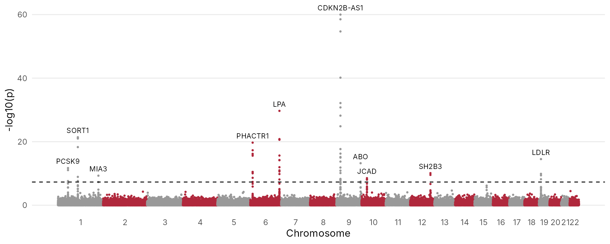

::: {.callout-note collapse="true"}
## 🎯 학습 목표

이 장을 마치면:

-   단일유전자 질환과 복합질환의 유전 구조 차이 설명
-   GWAS Manhattan plot을 읽고 5×10⁻⁸ 기준이 필요한 이유 설명
-   GWAS hit이 곧 원인 유전자가 아닌 이유 설명
-   다유전자 위험점수(PRS)가 말해 주는 것과 말해 주지 않는 것 구분
-   *CYP2C19* 유전형에 따라 클로피도그렐 반응이 달라지는 기전과 CPIC 지침 읽기
-   집단(ancestry) 차이가 GWAS, PRS, 약물유전체 적용에 주는 영향 설명
:::

> 🩺 **오늘의 케이스**\
> 60세 남성, 급성 심근경색으로 스텐트 시술 후 클로피도그렐 복용. 석 달 뒤 스텐트 혈전증.\
> 아들은 해외 유전자 검사 서비스에서 "관상동맥질환 다유전자 위험점수 상위 10%"라는 결과를 받았다.\
> → 같은 집안의 두 유전 정보는 각각 무엇을 말해 줄까? (🔗 [W5 실습](w05_complex_pgx_lab.qmd)에서 직접)

💡 각 절의 본문 = 꼭 알아야 할 기초. **🔍 더 알아보기**는 궁금할 때 펼쳐 보는 심화 내용

------------------------------------------------------------------------

# 1. 유전 구조: 희귀질환과 복합질환 ⚖️ {#w4-s1}

> 🔑 **핵심** — 희귀질환 = 효과가 큰 변이 하나가 원인. 복합질환 = 효과가 작은 흔한 변이 수백–수천 개 + 환경

## 1) 효과 크기 × 빈도 {#w4-s1-1}

W2의 아이는 변이 하나로 병이 설명됐다. 심근경색, 2형 당뇨, 고혈압 같은 흔한 병은 다르다. 이런 병을 복합질환(complex disease)이라 부른다. 유전의 영향은 분명히 있지만, 그 영향이 수많은 변이에 조금씩 나뉘어 있고 생활습관과 환경이 함께 작용한다.

변이를 "얼마나 흔한가"와 "효과가 얼마나 큰가" 두 축으로 놓으면 지도가 그려진다.

|  | 효과가 큼 | 효과가 작음 |
|---|---|---|
| **드묾** | 단일유전자 질환의 원인 변이 → W2·W3 (예: *SCN1A*, 가족성 고콜레스테롤혈증의 *LDLR* 변이) | 효과도 작고 드물어 찾기 어려움 |
| **흔함** | 드묾. 예외적인 예 → *APOE* ε4와 알츠하이머병 | 복합질환 GWAS에서 찾는 변이 대부분 → 이 장 |

-   흔하면서 효과가 큰 변이는 드묾 → 자연선택이 그런 변이를 줄여 왔기 때문으로 봄
-   복합질환에서는 변이 하나의 효과가 작아 위험을 10–30% 정도 높이는 수준이 흔함 (예: 9p21 위험 대립유전자 동형접합 → 관상동맥질환 위험 약 30–40% 증가)

## 2) 🔗 W2와 비교 {#w4-s1-2}

| | W2 · 희귀질환 | W4 · 복합질환 |
|---|---|---|
| 질문 | 이 아이의 병을 일으킨 변이는? | 이 병의 위험을 조금씩 높이는 변이들은? |
| 변이 | 드물고 효과 큼, 보통 하나 | 흔하고 효과 작음, 수백–수천 개 |
| 방법 | 가족 단위 시퀀싱(트리오) | 수만–수십만 명 비교 (GWAS) |
| 결과의 쓰임 | 진단 확정 | 위험 예측, 질병 기전 탐색, 약물 표적 |

-   ⚠️ 같은 병에도 두 경로가 함께 있음 → 예: 관상동맥질환 대부분은 복합질환이지만, 일부는 가족성 고콜레스테롤혈증처럼 효과 큰 단일 변이로 생김

------------------------------------------------------------------------

# 2. GWAS 📈 {#w4-s2}

> 🔑 **핵심** — GWAS = 환자군과 대조군에서 수백만 개 변이의 빈도를 하나씩 비교하는 연구. 다중검정 때문에 p < 5×10⁻⁸이어야 "유의"

## 1) GWAS가 묻는 것 {#w4-s2-1}

전장 유전체 연관 분석(genome-wide association study, GWAS)은 질문이 단순하다. "이 변이의 한쪽 대립유전자가 환자에게 더 흔한가?" 이 질문을 유전체 전체의 변이마다 한 번씩 던진다.

1.  환자 수만 명, 대조군 수만–수십만 명 모으기
2.  유전형 칩(genotyping array)으로 수십만 개 위치를 읽고, 참조 자료로 읽지 않은 위치까지 추정해 수백만 개로 늘림
3.  변이마다 환자군과 대조군의 대립유전자 빈도 비교 → 효과 크기와 p값 계산
4.  효과 크기 = 오즈비(odds ratio, OR). 1보다 크면 위험 증가 (예: 1.2 = 위험 대립유전자 하나당 오즈 20% 증가)

-   예: 9p21 locus의 rs1333049
    -   위험 대립유전자 C의 빈도 → 영국 코호트 약 47%, 한국인 자료 약 48% (dbSNP: ALSPAC, Korea4K)
    -   → 흔한 변이, 효과는 작지만 반복해서 확인된 관상동맥질환 locus

## 2) Manhattan plot과 5×10⁻⁸ {#w4-s2-2}

{fig-align="center"}

-   x축 = 염색체 위치, y축 = −log₁₀(p) → 위로 갈수록 p값이 작음 (p = 10⁻⁸ → 8)
-   탑 하나 = locus 하나. 탑에 점이 여러 개인 이유 → [§2.3](#w4-s2-3)

**왜 하필 5×10⁻⁸인가 — 다중검정(multiple testing)**

-   p < 0.05 = "효과가 없어도 20번에 1번은 우연히 이 정도가 나옴"
-   변이 100만 개를 검정하면 → 효과가 전혀 없어도 약 5만 개가 p < 0.05
-   그래서 기준을 검정 횟수만큼 엄격하게 → 사람 유전체의 독립적인 검정 ≈ 100만 번 → 0.05 / 1,000,000 = **5×10⁻⁸** = 전장 유전체 유의수준(genome-wide significance)
-   🔗 같은 문제가 W9(수천 개 유전자 비교)에서 다시 나옴

::: {.callout-note collapse="true" icon=false}
## 🔍 더 알아보기 — QQ plot: 결과 전체가 믿을 만한가

-   변이 대부분은 병과 무관 → 그들의 p값은 우연이 만드는 분포를 따라야 함
-   QQ plot = 실제 p값과 "우연이라면 나올 p값"을 나란히 그린 그림
-   정상 → 대부분 대각선 위에 있고 끝부분만 위로 휨 (진짜 신호)
-   처음부터 전체가 대각선 위로 들뜸 → 집단 구조 같은 교란을 의심 ([§2.4](#w4-s2-4))
-   W5 실습의 🛠️ 고쳐 보기에서 직접 그려 봄
:::

## 3) ⚠️ Hit ≠ 원인 {#w4-s2-3}

GWAS가 찾는 것은 "병과 함께 움직이는 위치"이지 "병을 일으키는 변이"가 아니다.

-   **연관 불평형(linkage disequilibrium, LD)** — 염색체에서 가까운 변이들은 세대를 거쳐도 함께 물려 내려옴
    -   → 원인 변이 하나 주변의 수십 개 변이가 모두 비슷하게 유의
    -   → GWAS만으로는 그중 어느 것이 원인인지 정할 수 없음 (W5 실습: 9p21 주변에서만 21개 변이가 기준을 넘음)
-   **대부분의 hit는 단백질을 바꾸지 않는 비암호화 영역**
    -   예: 9p21 locus → 처음 보고된 58 kb 구간에는 단백질 암호화 유전자가 없음
    -   → 유전자의 켜고 끔(조절)에 영향을 준다고 봄 (🔗 W6 후성유전체, W9 전사체)
-   **가장 가까운 유전자 ≠ 원인 유전자**
    -   1p13 locus의 변이는 *CELSR2*, *PSRC1* 바로 옆에 있음
    -   그러나 실제로는 간에서 조금 떨어진 *SORT1*의 발현을 바꿔 LDL 콜레스테롤과 심근경색 위험에 영향을 줌 (Musunuru 2010)
    -   비만과 관련된 *FTO* locus도 같은 예 → 변이는 *FTO* 안에 있지만 영향을 받는 것은 *IRX3*, *IRX5* (Claussnitzer 2015)

## 4) 집단 구조라는 교란 {#w4-s2-4}

-   환자군과 대조군의 조상(ancestry) 구성이 다르면 → 병과 상관없이 조상에 따라 빈도가 다른 변이가 모두 "유의"하게 나옴 = 집단 구조(population stratification)
-   유명한 사고실험 "젓가락 유전자" (Hamer & Sirota 2000)
    -   여러 조상이 섞인 도시에서 "젓가락을 쓰는가"로 GWAS를 하면
    -   → 동아시아계에 흔한 변이가 "젓가락 유전자"로 나옴
    -   변이가 젓가락질을 만든 것이 아니라 조상과 문화가 함께 움직였을 뿐
-   해결 → 조상 성분으로 보정, 같은 집단끼리 비교, QQ plot으로 점검

------------------------------------------------------------------------

# 3. 유전율과 다유전자 위험점수 🧮 {#w4-s3}

> 🔑 **핵심** — PRS = 위험 대립유전자 수 × 효과 크기를 모두 더한 점수. 같은 집단 안에서의 순위를 말해 줄 뿐, 병에 걸릴지를 정해 주지 않음

## 1) 유전율 {#w4-s3-1}

-   유전율(heritability) = 집단 안에서 어떤 형질의 개인차 가운데 유전 차이로 설명되는 비율
-   ⚠️ 개인에게 적용하는 숫자가 아님
    -   "유전율 50%" ≠ "내 병의 절반은 유전 탓"
-   환경이 바뀌면 같은 형질의 유전율도 달라짐 → 집단과 시대에 묶인 값

## 2) PRS 계산 원리 {#w4-s3-2}

다유전자 위험점수(polygenic risk score, PRS)는 GWAS 결과를 한 사람에게 적용한 점수다. 변이마다 그 사람이 가진 위험 대립유전자 수(0, 1, 2)에 GWAS에서 얻은 효과 크기를 곱하고, 모두 더한다.

| 변이 | 아들의 위험 대립유전자 수 | 효과 크기 (설명용 숫자) | 곱 |
|---|---|---|---|
| 9p21 rs1333049 | 2 | 0.25 | 0.50 |
| *LPA* rs10455872 | 0 | 0.40 | 0 |
| 1p13 rs646776 | 1 | 0.12 | 0.12 |
| … (실제 점수는 수십만–수백만 개 변이) | | | |
| **합계** | | | **0.62 + …** |

-   이 숫자 자체에는 의미가 없음 → 같은 집단 사람들의 점수와 비교해 "상위 몇 %"로 표현
-   실제 점수의 효과 크기는 W5에서 보는 PGS Catalog 같은 곳에 공개됨

## 3) 상대위험 vs 절대위험 {#w4-s3-3}

-   "상위 10%" = 순위, "평균의 1.5배" = 상대위험(relative risk)
-   진료에서 중요한 것 = 절대위험(absolute risk): 앞으로 몇 년 안에 실제로 병이 생길 확률
-   계산 예 (설명용 숫자)
    -   같은 나이·성별의 10년 위험이 평균 4%
    -   PRS 결과 "평균의 1.5배" → 4% × 1.5 = **6%**
    -   → 상대위험은 50% 증가, 절대위험 차이는 2%p
-   PRS가 의미 있을 수 있는 이유 → 한 연구에서 관상동맥질환 점수 상위 8%는 평균보다 위험이 3배 이상, 단일유전자 변이에 맞먹는 수준 (Khera 2018)
-   ⚠️ 그래도 콜레스테롤, 혈압, 흡연, 당뇨가 여전히 큰 위험인자 → 점수가 낮다고 안전한 것도 아님

## 4) ⚠️ 다른 집단으로 옮겨 쓸 때 {#w4-s3-4}

-   지금까지 GWAS 참가자 대부분이 유럽계 → PRS도 유럽계에서 몇 배 더 정확 (Martin 2019)
-   왜 다른 집단에서는 덜 맞나
    -   대립유전자 빈도가 다름
    -   연관 불평형 패턴이 다름 → 유럽계에서 원인 변이를 대신 보여 주던 변이가 다른 집단에서는 원인과 따로 움직임
    -   어떤 집단에만 있는 변이는 유럽계 GWAS에서 아예 보이지 않음
-   예 (dbSNP 빈도, W5 실습의 locus)

| 변이 | 유럽계 (영국 코호트) | 동아시아 (한국·일본 코호트) |
|---|---|---|
| *LPA* rs10455872 위험 대립유전자 | 약 7% | 거의 없음 (일본 0.001%) |
| *SH2B3* rs3184504 위험 대립유전자 | 약 45–49% | 거의 없음 (한국 약 0.07%) |

-   → 유럽계 점수에서 중요한 변이가 한국인에게는 거의 없음 → 점수의 정확도가 떨어질 수 있음
-   동아시아인 대상 GWAS(일본 바이오뱅크, 한국 코호트 등)가 늘면서 동아시아인용 점수도 개발되는 중

------------------------------------------------------------------------

# 4. 약물유전체 💊 {#w4-s4}

> 🔑 **핵심** — 같은 약, 다른 반응. 일부 약–유전자 짝은 유전형만으로 반응을 미리 알 수 있어 처방 지침이 있음

## 1) 같은 약, 다른 반응 {#w4-s4-1}

약물유전체(pharmacogenomics)는 유전 차이로 약의 효과와 부작용이 달라지는 현상을 다룬다. 복합질환 GWAS와 달리 효과가 큰 변이가 많아, 한 사람의 처방을 바꿀 수 있다.

| 약 | 유전자 | 무엇이 달라지나 | 집단 차이 |
|---|---|---|---|
| 클로피도그렐 (항혈소판제) | *CYP2C19* | 약을 활성형으로 못 바꿈 → 효과 감소 | 기능 없는 대립유전자가 한국인에서 더 흔함 |
| 와파린 (항응고제) | *VKORC1*, *CYP2C9* | 필요한 용량 | *VKORC1* 저용량 대립유전자 → 한국인 약 93%, 유럽계 약 37% |
| 알로퓨리놀 (통풍 약) | HLA-B\*58:01 | 중증 피부 이상반응 | 동아시아인에서 더 흔함 |
| 아바카비르 (HIV 약) | HLA-B\*57:01 | 과민반응 | 유럽계에서 더 흔하고 동아시아인에서는 드묾 |

-   기전은 세 갈래
    -   **약동학** — 약을 바꾸고 없애는 효소(예: CYP 효소) → 몸속 약 농도가 달라짐
    -   **약력학** — 약이 작용하는 표적 → 같은 농도에서 효과가 달라짐 (예: 와파린의 표적 *VKORC1*)
    -   **면역** — HLA 유전자형 → 특정 약에 대한 면역 반응

## 2) *CYP2C19*와 클로피도그렐 {#w4-s4-2}

클로피도그렐은 그 자체로는 혈소판을 억제하지 못하는 전구약물(prodrug)이다. 간의 효소, 특히 CYP2C19가 활성형으로 바꿔야 효과가 난다. 그래서 CYP2C19 효소가 없는 사람은 약을 먹어도 활성형이 충분히 만들어지지 않는다.

**대립유전자 이름** — 약물유전체에서는 대립유전자를 별표(\*) 이름으로 부름 = 별표 대립유전자(star allele)

| 대립유전자 | 대표 변이 | 효소 기능 | 한국인 | 영국 코호트 |
|---|---|---|---|---|
| \*1 | (기준) | 정상 | — | — |
| \*2 | rs4244285, c.681G>A → splicing 이상 | 없음 | 약 28% | 약 15% |
| \*3 | rs4986893, c.636G>A → 조기 종결 코돈 | 없음 | 약 10% | 0.1% 미만 |
| \*17 | rs12248560, 프로모터 변이 | 증가 | 약 1% | 약 21–23% |

-   빈도는 dbSNP의 Korea4K와 영국 코호트(TWINSUK, ALSPAC) 값
-   🔗 \*2 변이는 서열상 동의 변이처럼 보이지만 splicing을 망가뜨림 (W2 §1.2)

**유전형 → 표현형**

| 유전형 (예) | 표현형 |
|---|---|
| \*1/\*1 | 정상 대사형 (normal metabolizer) |
| \*1/\*17 | 빠른 대사형 (rapid) |
| \*17/\*17 | 초고속 대사형 (ultrarapid) |
| \*1/\*2, \*1/\*3 | 중간 대사형 (intermediate) |
| \*2/\*2, \*2/\*3, \*3/\*3 | 대사 저하형 (poor metabolizer) |

-   한국인은 기능 없는 대립유전자(\*2 + \*3)의 빈도가 약 38% → 대사 저하형이 대략 7명 중 1명 (W5 실습에서 직접 계산)

## 3) HLA-B\*58:01과 알로퓨리놀 {#w4-s4-3}

-   알로퓨리놀 = 통풍과 고요산혈증에 흔히 쓰는 약
-   드물지만 스티븐스-존슨 증후군(SJS), 독성 표피 괴사 용해(TEN) 같은 중증 피부 이상반응(severe cutaneous adverse reaction, SCAR) → 생명을 위협할 수 있음
-   한족 환자 연구에서 알로퓨리놀 SCAR 환자 51명 **전원**이 HLA-B\*58:01을 가졌고, 약을 문제없이 쓴 환자는 15%만 가짐 (Hung 2005)
-   CPIC 지침 → HLA-B\*58:01 보유자에게 알로퓨리놀을 쓰지 않음 (다른 약 선택)
-   한국인을 포함한 동아시아인에서 이 대립유전자가 유럽계보다 흔함 → 처방 전 검사가 더 의미 있음
-   ⚠️ 보유자 대부분은 약을 먹어도 이상반응이 생기지 않음 → 검사 양성 ≠ 반드시 부작용

## 4) CPIC 지침 읽기 {#w4-s4-4}

CPIC(Clinical Pharmacogenetics Implementation Consortium)는 약물유전체 처방 지침을 만드는 국제 컨소시엄이다. 지침은 "검사를 꼭 하라"보다 "검사 결과가 있다면 이렇게 처방하라"에 초점을 둔다.

읽는 순서: **유전형 → 표현형 → 권고와 권고 강도**

| 표현형 | 클로피도그렐 권고 (급성 관상동맥증후군, 스텐트 시술 등 심혈관 적응증) |
|---|---|
| 정상, 빠른, 초고속 대사형 | 표준 용량 클로피도그렐 |
| 중간 대사형 | 가능하면 표준 용량 클로피도그렐을 피하고 금기가 없으면 prasugrel 또는 ticagrelor (2022 개정에서 권고 강화) |
| 대사 저하형 | 클로피도그렐을 피하고 금기가 없으면 prasugrel 또는 ticagrelor |

-   출처: CPIC 2022 개정판 (Lee 2022)
-   ⚠️ 실제 처방은 출혈 위험, 다른 약, 환자 상태를 함께 보고 주치의가 결정

------------------------------------------------------------------------

# 5. 한국인 환자에게 적용할 때 🌏 {#w4-s5}

> 🔑 **핵심** — 같은 변이도 집단마다 빈도가 다름. 약물유전체에서는 한국인에게 더 중요한 변이가 있고, PRS에서는 한국인에게 덜 맞는 점수가 있음

| 변이 | 한국인 | 유럽계 | 뜻하는 것 |
|---|---|---|---|
| *CYP2C19* \*2 + \*3 (기능 없음) | 약 38% | 약 15% | 클로피도그렐 저반응이 한국인에서 더 흔함 |
| *CYP2C19* \*17 (기능 증가) | 약 1% | 약 20% | 유럽계 자료의 "빠른 대사형" 비율을 그대로 쓰면 안 됨 |
| *VKORC1* 저용량 대립유전자 | 약 93% | 약 37% | 한국인은 대체로 와파린 필요 용량이 낮음 |
| *SH2B3* rs3184504 위험 대립유전자 | 거의 없음 | 약 45% | 유럽계 PRS의 일부 변이는 한국인에게 정보가 없음 |

-   빈도 확인 습관 → gnomAD의 집단별 빈도(동아시아), 한국인 자료(Korea4K 등), 일본 자료(ToMMo)
-   ⚠️ "동아시아인" 값과 "한국인" 값은 비슷한 경우가 많지만 같지 않음 → 어느 집단의 숫자인지 함께 적기

------------------------------------------------------------------------

# 6. 진료에서 — 케이스로 돌아가기 🏥 {#w4-s6}

> 🔑 **핵심** — 아버지의 약물유전체 결과는 지금 처방을 바꿀 수 있는 정보. 아들의 PRS는 위험 순위에 대한 확률 정보

**아버지 — 클로피도그렐을 먹었는데 스텐트 혈전증**

-   *CYP2C19* 검사로 중간·저하 대사형이 나오면 → 클로피도그렐이 충분히 활성화되지 않았을 가능성
-   CPIC 지침 → 금기가 없다면 다른 항혈소판제(prasugrel, ticagrelor) 고려
-   ⚠️ 스텐트 혈전증의 원인은 여러 가지 (복약 중단, 시술 요인 등) → 유전형 하나로 단정하지 않음
-   💡 한국인은 기능 없는 대립유전자가 흔해 이 검사가 유럽계보다 더 자주 처방을 바꿀 수 있음

**아들 — "PRS 상위 10%"**

-   순위일 뿐 → 절대위험은 나이, 콜레스테롤, 혈압, 흡연, 당뇨와 함께 계산해야 함
-   어느 집단의 GWAS로 만든 점수인지 확인 → 유럽계 점수라면 한국인에게서 정확도가 떨어질 수 있음
-   할 수 있는 일 → 일반적인 심혈관 위험인자 관리. PRS는 아직 진료의 표준 검사가 아님
-   💡 아버지의 조기 심근경색이라는 가족력 자체가 이미 중요한 위험 정보

**소비자 유전자 검사 결과를 들고 온 환자에게 물을 것**

1.  어떤 병, 어떤 점수인가? 몇 개 변이로 만들었나?
2.  어느 집단에서 개발하고 검증했나?
3.  절대위험으로 바꾸면 얼마인가?

➡️ W5 실습: CPIC·gnomAD로 아버지의 결과를, GWAS Catalog·PGS Catalog와 R로 아들의 점수를 직접 따져 봄

------------------------------------------------------------------------

# 🤔 흔한 오해

1.  **GWAS에서 찾은 변이가 병의 원인 변이다?**\
    아니다. 연관 불평형 때문에 주변 변이들이 함께 유의하게 나오고, 대부분은 비암호화 영역에 있다. 가장 가까운 유전자가 원인 유전자가 아닌 경우도 많다.
2.  **PRS 상위 10%면 거의 확실히 병에 걸린다?**\
    아니다. PRS는 같은 집단 안의 순위다. 실제로 병이 생길 확률(절대위험)은 다른 위험인자와 함께 봐야 하고, 상대위험이 높아도 절대위험은 크지 않을 수 있다.
3.  **유전율이 50%면 내 병의 절반은 유전 탓이다?**\
    아니다. 유전율은 집단 안의 개인차를 나누는 숫자이고, 한 사람의 병을 나누는 숫자가 아니다.
4.  **약물유전체 검사가 정상이면 그 약은 반드시 잘 듣고 부작용도 없다?**\
    아니다. 검사가 보지 않은 드문 변이, 함께 먹는 약, 간·신장 기능, 복약 순응도도 반응을 바꾼다.
5.  **외국에서 만든 유전 점수와 빈도도 한국인에게 그대로 맞는다?**\
    아니다. 대립유전자 빈도와 연관 불평형 패턴이 집단마다 달라, 점수의 정확도와 약물 반응 비율이 달라진다.

# ❓ 복습 문제

**1. (개념)** GWAS에서 p < 0.05가 아니라 p < 5×10⁻⁸을 기준으로 쓰는 가장 큰 이유는?\
(a) 환자 수가 적어서\
(b) 변이 수백만 개를 동시에 검정하므로 우연히 작은 p값이 많이 나오기 때문\
(c) 변이의 효과 크기가 커서\
(d) 유전형 칩의 오류율이 높아서

**2. (개념)** *CYP2C19* 대사 저하형 환자에서 클로피도그렐 효과가 떨어지는 이유는?\
(a) 약이 너무 빨리 분해되어서\
(b) 전구약물인 클로피도그렐을 활성형으로 충분히 바꾸지 못해서\
(c) 혈소판 수용체에 변이가 있어서\
(d) 장에서 흡수되지 않아서

**3. (개념)** 유전율에 대한 설명으로 옳은 것은?\
(a) 한 사람의 병 가운데 유전 때문인 비율\
(b) 집단 안에서 형질의 개인차 가운데 유전 차이로 설명되는 비율이며, 환경이 바뀌면 달라질 수 있음\
(c) 모든 집단과 시대에서 같은 값\
(d) 유전율이 높으면 그 병은 예방할 수 없음

**4. (적용)** Manhattan plot의 9p21 탑에서 수십 개 변이가 모두 5×10⁻⁸보다 작다. GWAS만으로 이 중 원인 변이를 정할 수 없는 이유를 쓰고, 원인을 찾으려면 무엇이 더 필요한지 한 가지 쓰시오.

**5. (적용)** 같은 나이·성별의 10년 관상동맥질환 위험이 평균 3%다. PRS 결과지에 "평균의 2배"라고 적혀 있다면 이 사람의 10년 절대위험과, 평균과의 절대위험 차이는?

**6. (임상 시나리오)** 스텐트 시술을 받은 한국인 환자의 *CYP2C19* 검사 결과가 \*2/\*3이다. (가) 표현형은? (나) CPIC 지침에 따른 항혈소판제 권고는? (다) 이 검사가 유럽계보다 한국인에게서 처방을 더 자주 바꿀 수 있는 이유는?

::: {.callout-tip collapse="true"}
## 정답과 해설

**1. (b)** 효과가 없는 변이 100만 개를 검정해도 p < 0.05는 약 5만 개 나온다. 검정 횟수만큼 기준을 엄격하게 한 것이 5×10⁻⁸이다.

**2. (b)** 클로피도그렐은 CYP2C19가 활성형으로 바꿔야 효과가 나는 전구약물이다.

**3. (b)** 유전율은 집단 수준의 숫자이고 환경에 따라 달라진다. 유전율이 높아도 환경이나 치료로 바꿀 수 있는 병이 많다.

**4.** 가까운 변이들은 연관 불평형으로 함께 물려 내려와 원인 변이와 함께 유의하게 나온다. 원인을 가리려면 미세 매핑(fine-mapping, 통계로 후보를 좁히기), 여러 조상 집단의 자료 비교, 그 위치의 유전자 조절 기능을 보는 실험 등이 필요하다.

**5.** 3% × 2 = 6%. 평균과의 절대위험 차이는 3%p. 상대위험은 2배지만 절대위험은 100명 중 3명 더 많은 정도다.

**6.** (가) \*2와 \*3 모두 기능 없는 대립유전자 → 대사 저하형. (나) 금기가 없다면 클로피도그렐 대신 prasugrel 또는 ticagrelor. (다) 한국인은 기능 없는 대립유전자(\*2, \*3)의 빈도가 약 38%로 유럽계(약 15%)보다 높아 중간·저하 대사형이 더 흔하다.
:::

------------------------------------------------------------------------

# 📝 요약

-   복합질환 = 효과 작은 흔한 변이 수백–수천 개 + 환경. 희귀질환(W2)은 효과 큰 변이 하나
-   GWAS = 수백만 개 변이를 환자군·대조군에서 비교. ⚠️ 다중검정 때문에 기준은 5×10⁻⁸
-   ⚠️ GWAS hit ≠ 원인 유전자 → 연관 불평형, 비암호화 영역, 가장 가까운 유전자 ≠ 원인 (예: 1p13 → *SORT1*)
-   ⚠️ 집단 구조는 가짜 연관을 만듦 → 조상 보정, QQ plot 점검
-   유전율은 집단의 숫자. PRS = 위험 대립유전자 수 × 효과 크기의 합 → 순위일 뿐
-   상대위험과 절대위험을 구분 → 진료에서는 절대위험이 중요
-   ⚠️ GWAS·PRS는 유럽계 중심 → 한국인에게 정확도가 떨어질 수 있음
-   약물유전체 = 효과 큰 변이로 처방을 바꿈. 클로피도그렐–*CYP2C19*, 알로퓨리놀–HLA-B\*58:01
-   CPIC 지침: 유전형 → 표현형 → 권고. 한국인은 *CYP2C19* 기능 없는 대립유전자가 흔함

------------------------------------------------------------------------

# 🔑 핵심 용어

| 용어 | 한 줄 설명 |
|----------------------------|--------------------------------------------|
| Complex disease (복합질환) | 여러 유전 변이와 환경이 함께 작용해 생기는 흔한 병 |
| Genome-wide association study (GWAS) | 수백만 개 변이의 빈도를 환자군과 대조군에서 하나씩 비교하는 연구 |
| Odds ratio (오즈비) | 위험 대립유전자가 병의 오즈를 몇 배로 바꾸는지 나타내는 효과 크기 |
| Manhattan plot | 변이 위치를 x축, −log₁₀(p)를 y축으로 그린 GWAS 결과 그림 |
| Multiple testing (다중검정) | 검정을 많이 할수록 우연히 작은 p값이 나오는 문제 |
| Genome-wide significance (전장 유전체 유의수준) | GWAS에서 쓰는 유의 기준 p < 5×10⁻⁸ |
| Linkage disequilibrium (LD) | 가까운 변이들이 함께 물려 내려와 서로 연관되어 움직이는 현상 (연관 불평형) |
| Population stratification (집단 구조) | 비교하는 두 군의 조상 구성이 달라 가짜 연관이 생기는 교란 |
| Heritability (유전율) | 집단 안에서 형질의 개인차 가운데 유전 차이로 설명되는 비율 |
| Polygenic risk score (PRS) | 여러 변이의 위험 대립유전자 수에 효과 크기를 곱해 더한 점수 |
| Relative risk (상대위험) | 비교 대상보다 위험이 몇 배인지 |
| Absolute risk (절대위험) | 정해진 기간 안에 실제로 병이 생길 확률 |
| Pharmacogenomics (약물유전체) | 유전 차이로 약의 효과와 부작용이 달라지는 현상을 다루는 분야 |
| Prodrug (전구약물) | 몸속에서 효소가 바꿔 줘야 효과를 내는 약 |
| Star allele (별표 대립유전자) | 약물유전체에서 대립유전자를 \*1, \*2처럼 부르는 이름 |
| Poor metabolizer (대사 저하형) | 기능 없는 대립유전자 두 개를 가져 효소 기능이 거의 없는 표현형 |
| CPIC | 유전형에 따른 처방 지침을 만드는 국제 컨소시엄 |
| Severe cutaneous adverse reaction (SCAR) | SJS, TEN 등 생명을 위협할 수 있는 중증 피부 약물 이상반응 |

------------------------------------------------------------------------

# ➕ 참고문헌

### GWAS

Visscher PM, et al. [*10 Years of GWAS Discovery: Biology, Function, and Translation.*](https://doi.org/10.1016/j.ajhg.2017.06.005) Am J Hum Genet. 2017.\
Tam V, et al. [*Benefits and limitations of genome-wide association studies.*](https://doi.org/10.1038/s41576-019-0127-1) Nat Rev Genet. 2019.\
McPherson R, et al. [*A common allele on chromosome 9 associated with coronary heart disease.*](https://doi.org/10.1126/science.1142447) Science. 2007.\
Nikpay M, et al. [*A comprehensive 1,000 Genomes-based genome-wide association meta-analysis of coronary artery disease.*](https://doi.org/10.1038/ng.3396) Nat Genet. 2015.\
Hamer D, Sirota L. [*Beware the chopsticks gene.*](https://doi.org/10.1038/sj.mp.4000662) Mol Psychiatry. 2000.

### Hit에서 원인 유전자로

Musunuru K, et al. [*From noncoding variant to phenotype via SORT1 at the 1p13 cholesterol locus.*](https://doi.org/10.1038/nature09266) Nature. 2010.\
Claussnitzer M, et al. [*FTO Obesity Variant Circuitry and Adipocyte Browning in Humans.*](https://doi.org/10.1056/NEJMoa1502214) N Engl J Med. 2015.\
Maurano MT, et al. [*Systematic localization of common disease-associated variation in regulatory DNA.*](https://doi.org/10.1126/science.1222794) Science. 2012.

### 다유전자 위험점수

Khera AV, et al. [*Genome-wide polygenic scores for common diseases identify individuals with risk equivalent to monogenic mutations.*](https://doi.org/10.1038/s41588-018-0183-z) Nat Genet. 2018.\
Martin AR, et al. [*Clinical use of current polygenic risk scores may exacerbate health disparities.*](https://doi.org/10.1038/s41588-019-0379-x) Nat Genet. 2019.\
Lambert SA, et al. [*The Polygenic Score Catalog as an open database for reproducibility and systematic evaluation.*](https://doi.org/10.1038/s41588-021-00783-5) Nat Genet. 2021.

### 약물유전체

Lee CR, et al. [*Clinical Pharmacogenetics Implementation Consortium Guideline for CYP2C19 Genotype and Clopidogrel Therapy: 2022 Update.*](https://doi.org/10.1002/cpt.2526) Clin Pharmacol Ther. 2022.\
Saito Y, et al. [*Clinical Pharmacogenetics Implementation Consortium (CPIC) guidelines for human leukocyte antigen B (HLA-B) genotype and allopurinol dosing: 2015 update.*](https://doi.org/10.1002/cpt.161) Clin Pharmacol Ther. 2016.\
Hung SI, et al. [*HLA-B\*5801 allele as a genetic marker for severe cutaneous adverse reactions caused by allopurinol.*](https://doi.org/10.1073/pnas.0409500102) Proc Natl Acad Sci U S A. 2005.

### 데이터베이스

Sollis E, et al. [*The NHGRI-EBI GWAS Catalog: knowledgebase and deposition resource.*](https://doi.org/10.1093/nar/gkac1010) Nucleic Acids Res. 2023.\
[GWAS Catalog](https://www.ebi.ac.uk/gwas/) · [PGS Catalog](https://www.pgscatalog.org/) · [ClinPGx](https://www.clinpgx.org/) · [CPIC](https://cpicpgx.org/) · [dbSNP](https://www.ncbi.nlm.nih.gov/snp/)
