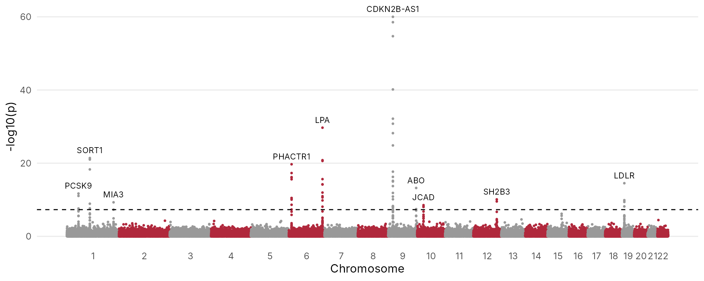
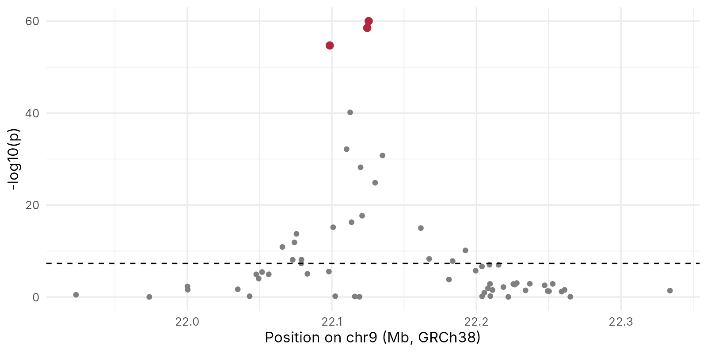
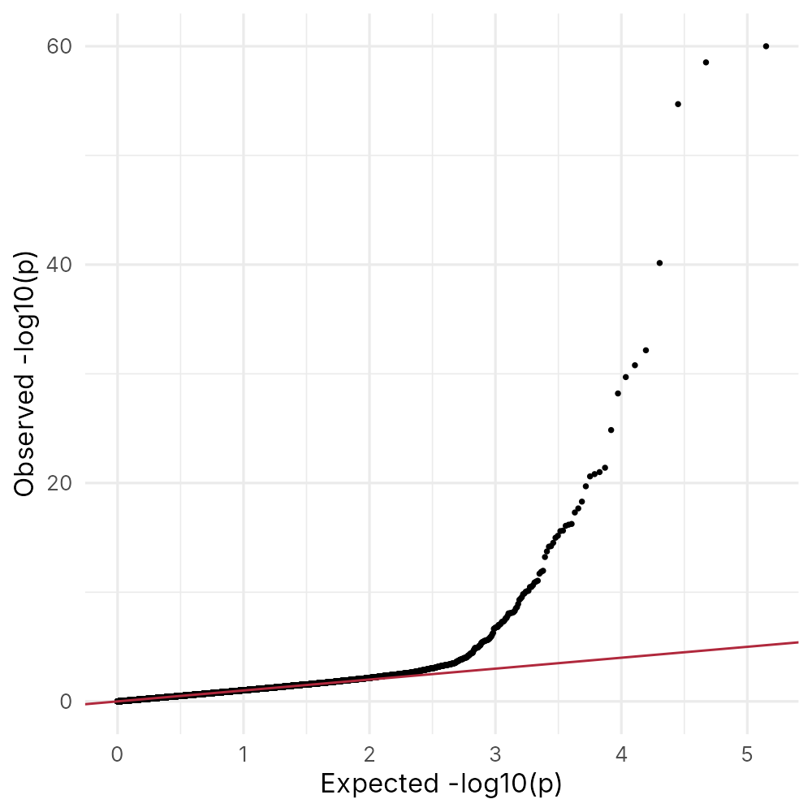

::: {.callout-note collapse="true"}
## 🎯 학습 목표

이 실습을 마치면:

-   CPIC와 ClinPGx에서 유전형에 따른 처방 권고 찾기
-   gnomAD에서 같은 대립유전자의 집단별 빈도를 비교하고, 그 차이가 진료에서 뜻하는 것 설명
-   GWAS Catalog와 PGS Catalog에서 연관 locus와 위험점수의 개발 집단 확인
-   R로 GWAS 요약 통계를 읽고 Manhattan plot을 그려 유의한 locus 찾기
-   한 locus를 확대해 "hit 하나 ≠ 원인 변이 하나"를 눈으로 확인
:::

> 🩺 **케이스 다시 보기** (🔗 [W4](w04_complex_pgx.qmd))\
> 클로피도그렐 복용 중 스텐트 혈전증이 생긴 아버지, 다유전자 위험점수 "상위 10%"를 받은 아들.\
> → 오늘 목표: 두 사람에게 각각 무엇을 말해 줄 수 있고 무엇은 말할 수 없는지, 근거와 함께 정리

------------------------------------------------------------------------

# 0. 준비물 🧰 {#w5-s0}

-   웹: [CPIC](https://cpicpgx.org/), [ClinPGx](https://www.clinpgx.org/), [gnomAD](https://gnomad.broadinstitute.org/), [GWAS Catalog](https://www.ebi.ac.uk/gwas/), [PGS Catalog](https://www.pgscatalog.org/) — 모두 가입 필요 x
-   데이터: [w05_cad_gwas.tsv](../data/w05_cad_gwas.tsv) — 가상 관상동맥질환 GWAS 요약 통계 (70,487줄)
-   JupyterHub: 로그인 → 새 R 노트북 → 내려받은 파일을 왼쪽 파일 창에 끌어다 놓기 (🔗 [W1 §6.2](w01_intro.qmd#w1-s6-2))

::: {.callout-note collapse="true"}
## 이 데이터에 대해

-   **모든 p값과 효과 크기는 가상이다.** 실제 GWAS 결과가 아니라 실습용으로 만든 숫자
-   신호가 나오는 10개 locus는 실제로 관상동맥질환 GWAS에서 반복 보고된 곳이고, 표에 적힌 rs 번호와 GRCh38 위치는 dbSNP에서 확인했다
-   실제 GWAS는 변이 수백만 개를 검정하지만, 노트북에서 빠르게 돌아가도록 약 7만 개만 만들었다
-   만든 방법: 저장소의 `scripts/make_w05_cad_gwas.R`
:::

------------------------------------------------------------------------

# 1. 🌐 아버지의 약: *CYP2C19* {#w5-s1}

## 1) CPIC에서 권고 찾기 {#w5-s1-1}

1.  [CPIC](https://cpicpgx.org/) → **Guidelines** → 약 이름 `clopidogrel`로 찾기
2.  클로피도그렐–*CYP2C19* 지침 페이지 열기 → **여기서 볼 것**: 표현형별 권고 표 (normal / intermediate / poor metabolizer)
3.  [ClinPGx](https://www.clinpgx.org/)에서 `CYP2C19` 검색 → 별표 대립유전자 목록 → **여기서 볼 것**: \*1, \*2, \*3, \*17의 기능(function) 표시
4.  아버지가 \*2/\*2라면 표현형과 권고가 무엇인지 기록표에 적기

| 항목 | 내가 찾은 값 |
|---|---|
| \*2의 효소 기능 | |
| \*3의 효소 기능 | |
| \*17의 효소 기능 | |
| \*2/\*2의 표현형 | |
| 그 표현형의 항혈소판제 권고 | |

## 2) gnomAD에서 집단별 빈도 {#w5-s1-2}

1.  [gnomAD](https://gnomad.broadinstitute.org/) 검색창에 `rs4244285` (\*2) 입력
2.  변이 페이지 → **여기서 볼 것**: 전체 빈도, 그리고 아래 집단별 표의 **East Asian** 줄
3.  `rs4986893` (\*3), `rs12248560` (\*17)도 같은 방법으로
4.  ⚠️ 어느 집단의 숫자인지 함께 적기 → "East Asian"과 "Korean"은 같지 않음

| 변이 | 대립유전자 | gnomAD 전체 | gnomAD East Asian | gnomAD European (non-Finnish) |
|---|---|---|---|---|
| rs4244285 | \*2 | | | |
| rs4986893 | \*3 | | | |
| rs12248560 | \*17 | | | |

✅ **확인 질문** — 세 변이 중 동아시아인에서 더 흔한 것과 유럽계에서 더 흔한 것은? 그 차이가 "한국에서 이 검사가 유럽보다 더 자주 처방을 바꿀 수 있다"와 어떻게 연결되나?

------------------------------------------------------------------------

# 2. 💻 R로 대사 저하형 비율 가늠하기 {#w5-s2}

## 1) 노트북 시작 {#w5-s2-1}

패키지를 불러오고 노트북 그림 크기를 정한다. 코드 블록 오른쪽 위 복사 버튼으로 복사해 셀에 붙여 넣고 **Shift + Enter**.

```r
library(readr)
library(dplyr)
library(ggplot2)

options(repr.plot.width = 10, repr.plot.height = 4)
```

## 2) 기능 없는 대립유전자 빈도에서 표현형 비율로 {#w5-s2-2}

대립유전자 빈도를 알면 그 유전형을 가진 사람의 비율을 가늠할 수 있다. 집단이 무작위로 짝을 짓는다고 가정하면, 기능 없는 대립유전자를 양쪽에서 모두 물려받을 확률은 빈도의 제곱이다(Hardy–Weinberg).

```r
cyp <- tibble(
  population = c("Korean (Korea4K)", "UK (TWINSUK)"),
  star2 = c(0.277, 0.152),
  star3 = c(0.099, 0.0005)
)

cyp |>
  mutate(no_function = star2 + star3,
         poor_metabolizer = no_function^2)
```

**결과에서 볼 것** — 두 집단의 마지막 열 차이

| population | star2 | star3 | no_function | poor_metabolizer |
|---|---|---|---|---|
| Korean (Korea4K) | 0.277 | 0.099 | 0.376 | 0.141 |
| UK (TWINSUK) | 0.152 | 0.0005 | 0.153 | 0.023 |

-   한국인 약 14% (7명에 1명), 영국 코호트 약 2% (43명에 1명)
-   빈도 출처: dbSNP의 Korea4K, TWINSUK
-   ⚠️ 어림값임 → 중간 대사형(\*1/\*2 등)은 빼고 계산했고, 별표 대립유전자는 여기 쓴 세 개 말고도 더 있음

------------------------------------------------------------------------

# 3. 💻 아들의 점수: GWAS 결과 직접 보기 {#w5-s3}

## 1) 요약 통계 읽기 {#w5-s3-1}

GWAS 요약 통계(summary statistics)는 변이마다 효과 크기와 p값을 적은 표다. 논문과 함께 공개되는 경우가 많아, 누구나 다시 그림을 그려 볼 수 있다.

```r
gwas <- read_tsv("w05_cad_gwas.tsv")
nrow(gwas)
head(gwas)
```

**결과에서 볼 것** — `70487`. 열의 뜻은 아래 표

| 열 | 뜻 |
|---|---|
| `snp` | rs 번호. `.` = 이름 없는 가상 변이 |
| `chrom`, `pos` | 염색체와 위치 (GRCh38) |
| `locus` | 이 변이가 속한 locus 이름. `.` = 신호 없는 배경 변이 |
| `beta` | 효과 크기 (log 오즈비). 양수 = 위험 증가 |
| `se` | 효과 크기의 표준오차 |
| `p` | 연관 검정의 p값 |

## 2) 유의한 변이 세기 {#w5-s3-2}

```r
hits <- gwas |> filter(p < 5e-8)
nrow(hits)

hits |>
  group_by(locus) |>
  slice_min(p, n = 1) |>
  ungroup() |>
  arrange(p)
```

-   `group_by()` + `slice_min()` = locus마다 p값이 가장 작은 변이(리드 변이) 하나씩 남기기

**결과에서 볼 것** — 기준을 넘은 변이는 62개지만 locus는 10개뿐

| snp | chrom | pos | locus | beta | p |
|---|---|---|---|---|---|
| rs1333049 | 9 | 22125504 | CDKN2B-AS1 | 0.25 | 1e-60 |
| rs10455872 | 6 | 160589086 | LPA | 0.40 | 2e-30 |
| rs646776 | 1 | 109275908 | SORT1 | 0.12 | 4e-22 |
| rs9349379 | 6 | 12903725 | PHACTR1 | 0.11 | 2e-20 |
| rs1122608 | 19 | 11052925 | LDLR | 0.11 | 3e-15 |
| rs579459 | 9 | 133278724 | ABO | 0.09 | 6e-14 |
| rs11206510 | 1 | 55030366 | PCSK9 | 0.08 | 2e-12 |
| rs3184504 | 12 | 111446804 | SH2B3 | 0.07 | 8e-11 |
| rs17465637 | 1 | 222650187 | MIA3 | 0.07 | 5e-10 |
| rs2505083 | 10 | 30046193 | JCAD | 0.06 | 3e-9 |

-   효과 크기를 오즈비로 바꾸면 `exp(beta)` → 0.25면 약 1.28배
-   → 복합질환 변이 하나의 효과가 얼마나 작은지 (🔗 [W4 §1.1](w04_complex_pgx.qmd#w4-s1-1))

## 3) Manhattan plot {#w5-s3-3}

염색체를 가로로 이어 붙여 변이 위치를 x축에, −log₁₀(p)를 y축에 그린다.

```r
chrom_start <- gwas |>
  group_by(chrom) |>
  summarise(len = max(pos)) |>
  mutate(start = cumsum(as.numeric(len)) - len)

gwas_plot <- gwas |>
  left_join(chrom_start, by = "chrom") |>
  mutate(x = start + pos)

axis_labels <- gwas_plot |>
  group_by(chrom) |>
  summarise(center = (min(x) + max(x)) / 2)

leads <- gwas_plot |>
  filter(p < 5e-8) |>
  group_by(locus) |>
  slice_min(p, n = 1)
```

-   `chrom_start` = 각 염색체를 앞 염색체 끝에 이어 붙이기 위한 시작 위치
-   `leads` = 그림에 이름을 붙일 locus별 리드 변이

```r
ggplot(gwas_plot, aes(x = x, y = -log10(p), colour = factor(chrom %% 2))) +
  geom_point(size = 0.6) +
  geom_hline(yintercept = -log10(5e-8), linetype = "dashed") +
  geom_text(data = leads, aes(label = locus), colour = "black",
            size = 3, vjust = -0.8) +
  scale_colour_manual(values = c("#B0283C", "grey60"), guide = "none") +
  scale_x_continuous(breaks = axis_labels$center, labels = axis_labels$chrom) +
  labs(x = "Chromosome", y = "-log10(p)") +
  theme_minimal(base_size = 12) +
  theme(panel.grid.major.x = element_blank(),
        panel.grid.minor = element_blank())
```

{fig-align="center"}

**결과에서 볼 것** — 탑 하나가 점 하나가 아니라 여러 점의 묶음인 것, 그리고 15번 염색체에 점선에 못 미치는 작은 봉우리가 있는 것

## 4) 한 locus를 확대 {#w5-s3-4}

가장 높은 탑(9p21) 주변만 떼어 본다.

```r
region <- gwas |>
  filter(chrom == 9, pos > 21.9e6, pos < 22.35e6)

nrow(region)
sum(region$p < 5e-8)
```

**결과에서 볼 것** — 이 구간의 변이 62개 중 21개가 기준을 넘음

```r
ggplot(region, aes(x = pos / 1e6, y = -log10(p))) +
  geom_point(colour = "grey50") +
  geom_point(data = filter(region, snp != "."), colour = "#B0283C", size = 2.5) +
  geom_hline(yintercept = -log10(5e-8), linetype = "dashed") +
  labs(x = "Position on chr9 (Mb, GRCh38)", y = "-log10(p)") +
  theme_minimal(base_size = 12)
```

{fig-align="center"}

**결과에서 볼 것** — 봉우리 꼭대기 근처에 여러 변이가 몰려 있음 → 연관 불평형 때문에 함께 유의해짐 (🔗 [W4 §2.3](w04_complex_pgx.qmd#w4-s2-3))

→ **GWAS만으로는 이 중 어느 것이 원인인지 정할 수 없다**

::: {.callout-tip collapse="true"}
## 🛠️ 고쳐 보기

1.  기준을 `p < 1e-5`로 느슨하게 하면 locus가 몇 개로 늘어나나? `gwas |> filter(p < 1e-5) |> distinct(locus)`로 확인. 늘어난 것 중 "suggestive"는 무엇을 뜻할까?
2.  QQ plot 그려 보기 (🔗 [W4 §2.2](w04_complex_pgx.qmd#w4-s2-2)의 더 알아보기)

```r
qq <- gwas |>
  arrange(p) |>
  mutate(expected = -log10(ppoints(n())),
         observed = -log10(p))

ggplot(qq, aes(x = expected, y = observed)) +
  geom_point(size = 0.6) +
  geom_abline(colour = "#B0283C") +
  labs(x = "Expected -log10(p)", y = "Observed -log10(p)") +
  theme_minimal(base_size = 12)
```

{fig-align="center"}

**확인**: (1) 11개 locus. "suggestive" = 기준에 못 미치는 신호 → 진짜일 수도, 우연일 수도 있어 더 큰 연구가 필요한 후보. (2) 처음부터 전체가 대각선 위로 들떴다면 집단 구조 같은 교란을 의심해야 한다.
:::

::: {.callout-note collapse="true" icon=false}
## 💡 AI 도우미에게 묻기

-   "이 R 코드에서 `group_by()`와 `slice_min()`이 하는 일을 예를 들어 설명해 줘: (코드 붙여넣기)"
-   "`-log10(p)`를 y축에 쓰는 이유가 뭐야?"
-   "이 오류 메시지는 무슨 뜻이고 무엇을 고쳐야 해? (오류 붙여넣기)"
:::

------------------------------------------------------------------------

# 4. 🌐 점수는 누구에게서 만들어졌나 {#w5-s4}

R로 본 것은 "어느 locus가 연관되는가"였다. 아들이 받은 점수는 이런 GWAS 결과를 모아 만든다. 그 점수가 아들에게 맞는지 보려면 누구에게서 만들었는지를 봐야 한다.

## 1) GWAS Catalog {#w5-s4-1}

1.  [GWAS Catalog](https://www.ebi.ac.uk/gwas/)에서 `coronary artery disease` 검색
2.  **여기서 볼 것**: 연관 변이 수, 연구 수, 참가자의 조상(ancestry) 구성
3.  `rs1333049`로도 검색 → 이 변이가 어떤 형질들과 연관 보고되었는지

## 2) PGS Catalog {#w5-s4-2}

1.  [PGS Catalog](https://www.pgscatalog.org/)에서 `coronary artery disease` 검색
2.  점수 하나를 골라 열고 **여기서 볼 것**
    -   점수에 들어간 변이 수 (수십 개 ~ 수백만 개)
    -   개발(development)에 쓰인 집단
    -   평가(evaluation)에 쓰인 집단 → 동아시아인 자료가 있나?

| 항목 | 내가 고른 점수 |
|---|---|
| 점수 ID와 이름 | |
| 변이 수 | |
| 개발 집단 | |
| 평가 집단에 동아시아인 포함? | |

✅ **확인 질문** — 이 점수가 한국인인 아들에게 그대로 적용된다고 말할 수 있나? 그렇게 판단한 근거는?

------------------------------------------------------------------------

# ✍️ 제출

아버지와 아들에게 각각 한 문단씩:

-   **아버지** — *CYP2C19* 결과가 말해 주는 것, CPIC 권고, 그리고 이 결과만으로는 말할 수 없는 것
-   **아들** — "상위 10%"가 말해 주는 것과 말해 주지 않는 것, 집단 차이 문제, 지금 할 수 있는 일

------------------------------------------------------------------------

# 📝 정리

| 도구 또는 함수 | 한 일 |
|---|---|
| CPIC · ClinPGx | 유전형 → 표현형 → 처방 권고 |
| gnomAD | 대립유전자의 집단별 빈도 |
| GWAS Catalog | 질환과 연관 보고된 변이와 연구의 조상 구성 |
| PGS Catalog | 위험점수의 변이 수, 개발·평가 집단 |
| `tibble()` · `mutate()` | 표 만들기, 새 열 계산 |
| `filter()` · `arrange()` | 행 거르기, 정렬 |
| `group_by()` + `slice_min()` | 묶음마다 가장 작은 값 하나 남기기 |
| `left_join()` | 두 표를 공통 열로 붙이기 |
| `ggplot()` + `geom_point()` · `geom_hline()` · `geom_text()` | Manhattan plot, QQ plot |

# ➕ 참고 링크

-   [CPIC](https://cpicpgx.org/) · [ClinPGx](https://www.clinpgx.org/) — 약물유전체 처방 지침
-   [GWAS Catalog](https://www.ebi.ac.uk/gwas/) · [PGS Catalog](https://www.pgscatalog.org/) · [gnomAD](https://gnomad.broadinstitute.org/)
-   Lee CR, et al. [*CPIC Guideline for CYP2C19 Genotype and Clopidogrel Therapy: 2022 Update.*](https://doi.org/10.1002/cpt.2526) Clin Pharmacol Ther. 2022.
-   Lambert SA, et al. [*The Polygenic Score Catalog as an open database for reproducibility and systematic evaluation.*](https://doi.org/10.1038/s41588-021-00783-5) Nat Genet. 2021.
-   [dplyr `group_by()` 설명서](https://dplyr.tidyverse.org/reference/group_by.html) · [ggplot2 설명서](https://ggplot2.tidyverse.org/)
