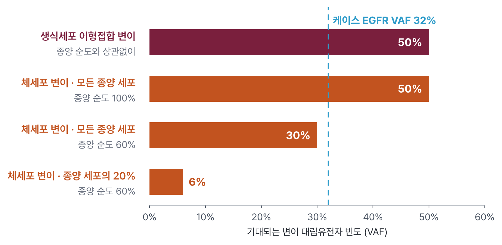
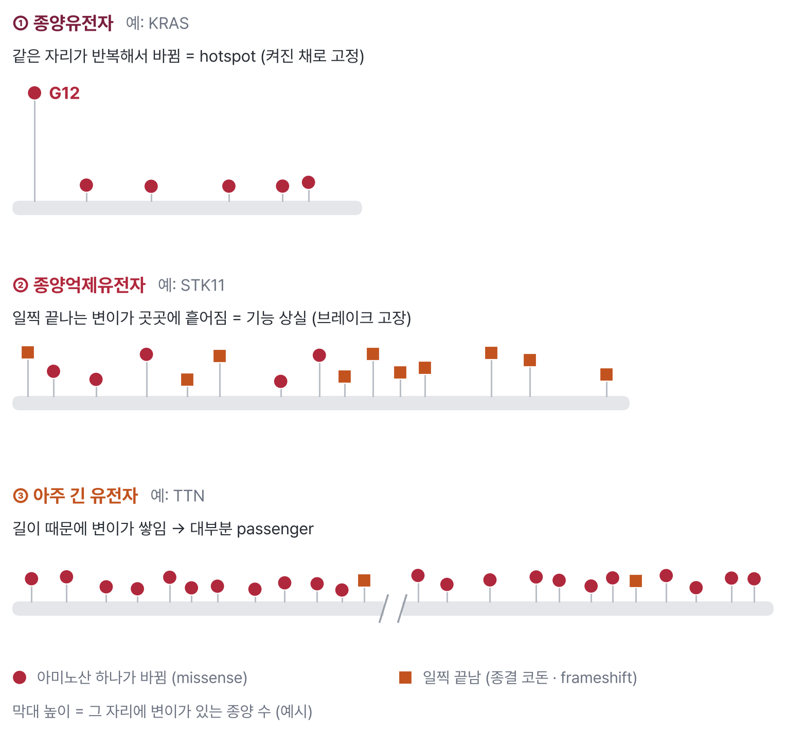
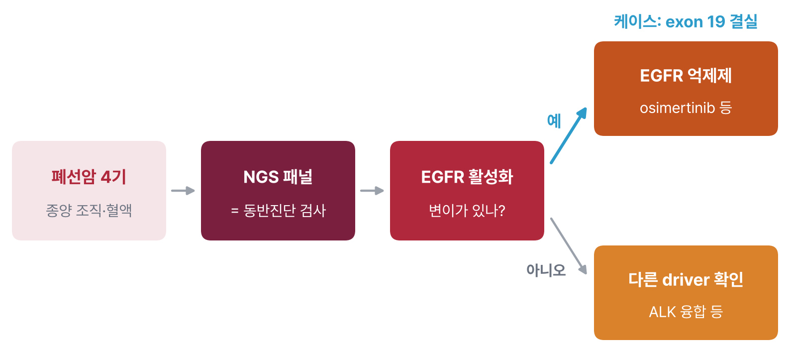
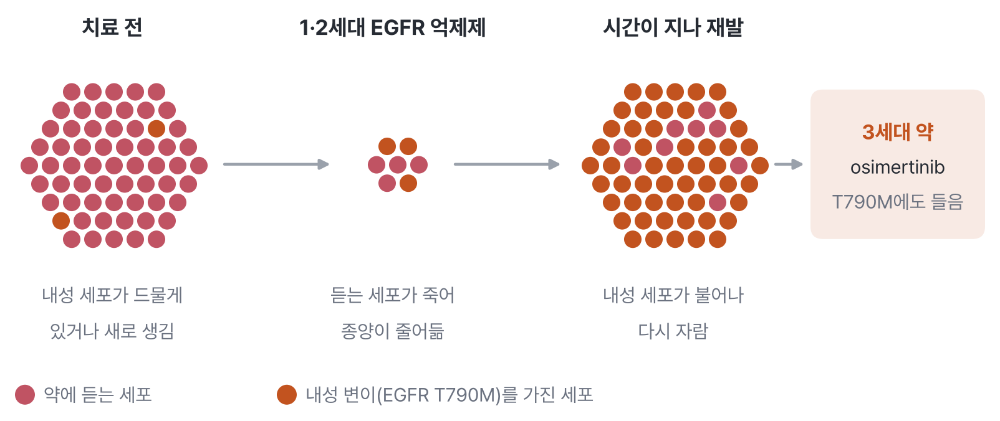
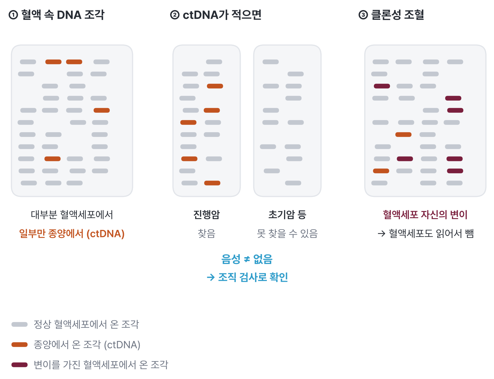
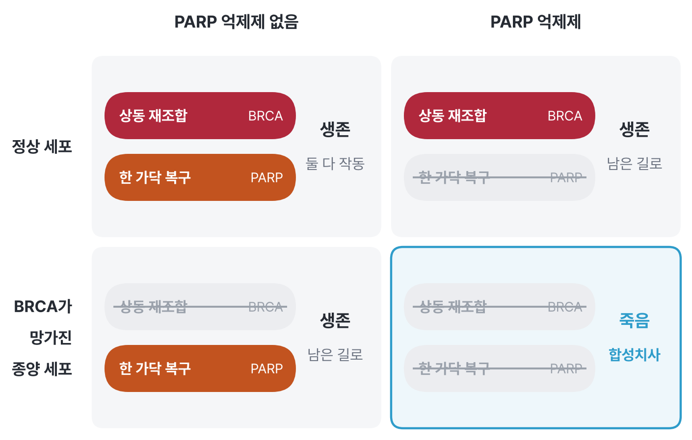

::: {.callout-note collapse="true"}
## 🎯 학습 목표

이 장을 마치면:

-   생식세포 변이와 체세포 변이를 구분하고, 변이 대립유전자 빈도(VAF)로 둘을 가늠하는 법 설명
-   종양 하나에 수백 개 변이가 있어도 driver는 몇 개뿐인 이유와 driver를 알아보는 단서 설명
-   표적치료와 동반진단의 관계를 설명하고, 같은 변이도 암종에 따라 근거 수준이 다른 이유 설명
-   TMB와 MSI가 면역항암제 반응과 연결되는 이유 설명
-   액체생검(ctDNA)의 쓰임과 한계(CHIP 포함) 설명
-   DNA 메틸화가 암 진단과 치료 선택에 쓰이는 예 들기
-   ⚠️ 종양 검사에서 유전성 암의 단서를 알아보기
:::

> 🩺 **오늘의 케이스**\
> 비흡연 52세 여성, 4기 폐선암. 조직 NGS 패널 리포트:\
> "*EGFR* exon 19 deletion (VAF 32%), *TP53* R273H (VAF 30%)"\
> → 어떤 변이가 치료를 바꾸고, 어떤 변이는 바꾸지 않을까? (🔗 [W7 실습](w07_cancer_lab.qmd)에서 직접)

💡 각 절의 본문 = 꼭 알아야 할 기초. **🔍 더 알아보기**는 궁금할 때 펼쳐 보는 심화 내용

------------------------------------------------------------------------

# 1. 생식세포 변이 vs 체세포 변이 🧬 {#w6-s1}

> 🔑 **핵심** — 암 유전체 검사의 첫 질문 = 이 변이가 태어날 때부터 있던 것인가(생식세포), 종양에서 새로 생긴 것인가(체세포)

## 1) 어디서 생겨 어디에 있고, 유전되는가 {#w6-s1-1}

W2·W3에서 본 희귀질환 변이는 부모에게서 받았거나 수정 직후 생긴 변이였다. 이런 변이는 몸의 거의 모든 세포에 있다. 암은 다르다. 한 세포에서 살아가는 동안 변이가 쌓이고, 그 세포가 불어나 종양이 된다. 그래서 종양에서 찾은 변이 대부분은 종양 세포에만 있다.

| 구분 | 생식세포 변이(germline variant) | 체세포 변이(somatic variant) |
|---|---|---|
| 언제 생기나 | 부모에게서 받거나 수정 직후 | 태어난 뒤 한 세포에서 |
| 어디에 있나 | 몸의 거의 모든 세포 | 종양 세포(또는 그 일부)에만 |
| 자녀에게 | 전달될 수 있음 | 전달되지 않음 |
| 검사 시료 | 혈액, 침 | 종양 조직, 혈액 속 종양 DNA |
| 진료 질문 | 가족의 위험, 예방 | 이 종양에 맞는 치료 |

 종양-정상 쌍)](/assets/img/w06/germline_somatic.png){fig-align="center"}

## 2) 종양-정상 쌍, VAF, 종양 순도 {#w6-s1-2}

종양 조직에는 종양 세포만 있지 않다. 정상 세포, 면역세포, 혈관이 섞여 있다. 그래서 종양에만 있는 변이는 read 가운데 일부에서만 보인다.

-   변이 대립유전자 빈도(variant allele frequency, VAF) = 그 위치의 read 중 변이를 가진 read의 비율
-   종양 순도(tumour purity) = 시료 속 세포 중 종양 세포의 비율
-   한쪽 대립유전자에만 생긴 체세포 변이가 모든 종양 세포에 있다면 → VAF ≈ 종양 순도 ÷ 2
-   생식세포 이형접합 변이 → 정상 세포에도 있으므로 순도와 상관없이 VAF ≈ 50%
-   종양-정상 쌍(tumour–normal pair) 검사 = 종양과 혈액을 함께 읽어 혈액에도 있는 변이(생식세포)를 빼는 방법

{fig-align="center"}

-   케이스: *EGFR* 32%, *TP53* 30% → 순도 약 60–65%인 종양에서 두 변이 모두 거의 모든 종양 세포에 있다고 볼 수 있음
-   VAF가 훨씬 낮은 변이 → 종양 세포 일부에만 있는 변이(subclone)일 수 있음

::: {.callout-note collapse="true" icon=false}
## 🔍 더 알아보기 — VAF가 계산과 어긋나는 경우

-   종양에서 염색체 조각이 늘거나 줄면(복제수 변화) 대립유전자의 비율이 바뀜
-   한쪽 대립유전자가 통째로 사라지면(이형접합 소실, loss of heterozygosity) 남은 변이 대립유전자의 VAF가 50%를 넘을 수 있음
-   그래서 VAF 하나만으로 생식세포·체세포를 확정하지 않음 → 근거 중 하나
:::

## 3) ⚠️ 종양 검사에서 나온 생식세포 변이 {#w6-s1-3}

많은 병원 검사는 종양만 읽는다(tumour-only). 이때 종양 리포트에 생식세포 변이가 섞여 나올 수 있다.

-   단서: VAF가 순도와 상관없이 50% 근처(또는 100% 근처), 유전성 암 유전자(*BRCA1/2*, *TP53*, 불일치 복구 유전자 등)의 병적 변이
-   이런 결과 → 환자의 혈액으로 생식세포 검사를 따로 해 확인
-   확인되면 → 환자의 다른 암 위험, **가족**의 위험과 검사로 이어짐 ([§7](#w6-s7))

------------------------------------------------------------------------

# 2. Driver와 passenger 🚗 {#w6-s2}

> 🔑 **핵심** — 종양 하나에 단백질을 바꾸는 변이가 수십–수백 개 있지만, 암을 실제로 밀고 가는 driver는 보통 몇 개뿐. 나머지는 함께 실려 온 passenger

## 1) 종양 하나에 수십–수천 개의 체세포 변이 {#w6-s2-1}

-   TCGA 폐선암 559명의 종양 → 단백질을 바꾸는 체세포 변이 수의 중앙값 약 160개 (🔗 [W7](w07_cancer_lab.qmd#w7-s3-6)에서 직접 셈)
-   흡연자 종양의 변이가 훨씬 많음 → 담배 연기 속 발암물질이 DNA에 남긴 흔적
-   흔히 쓰는 정리 → 한 종양의 driver 유전자 변이는 보통 2–8개, 나머지는 passenger
-   driver(동인 변이) = 세포가 더 잘 자라게 해서 선택된 변이
-   passenger(동승 변이) = driver를 가진 세포가 불어날 때 함께 실려 온 변이. 성장에 도움이 되지 않음
-   ⚠️ **우연과 다중검정** — 종양 하나에 수백 개 변이 → "이 유전자에도 변이가 있다"는 사실 하나로는 아무 의미가 없음

::: {.callout-note collapse="true" icon=false}
## 🔍 더 알아보기 — 변이의 "지문"

-   발암물질마다 남기는 염기 변화의 패턴이 다름 → 돌연변이 서명(mutational signature)
-   담배 연기 → C>A 변화가 많은 서명, 자외선 → C>T 변화가 많은 서명
-   서명을 보면 이 종양이 어떤 노출을 겪었는지 거꾸로 짐작할 수 있음
:::

## 2) Driver를 알아보는 법 {#w6-s2-2}

-   **반복되는 자리(hotspot)** — 여러 환자의 종양에서 같은 아미노산이 반복해서 바뀜
    -   예: *KRAS* G12, *EGFR* L858R, *BRAF* V600E → 단백질을 "켜진 채로" 고정하는 자리
    -   이런 유전자 = 종양유전자(oncogene). 액셀이 붙은 채로 고정
-   **기능 상실 패턴** — 종결 코돈, frameshift가 유전자 곳곳에 흩어짐
    -   예: *STK11*, *KEAP1*, *NF1* → 브레이크가 망가진 유전자 = 종양억제유전자(tumour suppressor gene)
    -   *TP53*은 둘 다 보임 → DNA 결합 부위의 hotspot missense(R175, R248, R273 등)와 흩어진 절단 변이
-   **암 변이 데이터베이스** — COSMIC, cBioPortal, OncoKB에 같은 변이가 반복 보고되었는지 확인 (🔗 W7)
-   ⚠️ **passenger vs driver** — 자주 변이된다고 driver는 아님
    -   예: *TTN*처럼 아주 긴 유전자는 길이 때문에 변이가 많이 쌓임 → 많은 종양에서 보여도 대부분 passenger (🔗 [W7 §3.3](w07_cancer_lab.qmd#w7-s3-3))

{fig-align="center"}

------------------------------------------------------------------------

# 3. 표적치료와 동반진단 🎯 {#w6-s3}

> 🔑 **핵심** — 표적치료 = driver가 만든 비정상 단백질만 골라 막는 약. 그래서 약을 쓰기 전에 그 driver가 있는지 반드시 확인(동반진단)

## 1) 대표적인 짝 {#w6-s3-1}

| 유전자 변화 | 대표 암 | 표적치료제(계열) |
|---|---|---|
| *EGFR* 활성화 변이 (exon 19 결실, L858R) | 폐선암 | EGFR 억제제 (gefitinib, osimertinib 등) |
| *ALK* 융합 | 폐선암 | ALK 억제제 (crizotinib, alectinib 등) |
| *BRAF* V600E | 흑색종 | BRAF 억제제 + MEK 억제제 |
| *HER2*(*ERBB2*) 증폭 | 유방암 | HER2 항체 (trastuzumab 등) |
| *BCR::ABL1* 융합 | 만성골수성백혈병 | imatinib 등 |

-   *EGFR* 변이 폐암이 EGFR 억제제에 잘 반응한다는 사실은 2004년, 약에 극적으로 반응한 환자들의 종양을 분석하다 밝혀짐
-   표적치료제 = 작은 분자 약(-nib)과 항체 약(-mab)으로 나뉨

## 2) 동반진단 {#w6-s3-2}

-   동반진단(companion diagnostic) = 특정 약을 쓸 환자를 고르기 위해 그 약과 함께 승인된 검사
-   예: HER2 검사 → 양성일 때만 HER2 표적치료, *EGFR* 변이 검사 → 양성일 때 EGFR 억제제
-   일부 동반진단은 혈액 속 종양 DNA로도 할 수 있음 ([§5](#w6-s5))
-   ⚠️ 연구용 검사에서 변이를 찾았다 ≠ 약을 쓸 수 있다 → 승인된 검사와 근거가 있어야 함

{fig-align="center"}

## 3) 근거 수준 {#w6-s3-3}

OncoKB 같은 데이터베이스는 변이–약 짝마다 근거 수준을 매긴다. 숫자가 작을수록 근거가 강하다.

-   **1단계** — 이 암종에서 승인된 약의 표적 / **2단계** — 진료 지침이 권하는 표준 치료
-   **3단계** — 임상 근거가 있는 연구 단계 / **4단계** — 실험실 근거만
-   **R** — 이 변이가 있으면 약이 듣지 않음(내성)
-   ⚠️ **같은 변이도 암종에 따라 다름**
    -   *BRAF* V600E 흑색종 → BRAF 억제제에 잘 반응
    -   *BRAF* V600E 대장암 → BRAF 억제제 하나만 쓰면 잘 듣지 않음. 약이 BRAF를 막으면 대장암 세포에서는 EGFR 신호가 되살아나기 때문 → EGFR 항체를 함께 쓰는 조합이 쓰임

## 4) 내성 {#w6-s3-4}

-   표적치료제를 쓰면 처음에는 종양이 줄지만, 대개 시간이 지나면 다시 자람
-   이유 = 약을 피하는 새 변이를 가진 세포가 살아남아 불어남
-   예: 1·2세대 EGFR 억제제 뒤에 생기는 *EGFR* T790M → 3세대 약 osimertinib이 이 변이에도 듣도록 설계됨
-   지금은 osimertinib을 처음부터 쓰기도 함 → 첫 치료로 썼을 때 기존 약보다 무진행 생존이 길었음

{fig-align="center"}

------------------------------------------------------------------------

# 4. 면역항암 바이오마커 🛡️ {#w6-s4}

> 🔑 **핵심** — 변이가 많은 종양일수록 면역세포가 "낯선 단백질"을 알아보기 쉬움 → 면역관문억제제가 들을 가능성이 높아짐

-   면역관문억제제(예: PD-1 항체) = 면역세포의 브레이크를 풀어 종양을 공격하게 하는 약
-   종양 변이 부담(tumour mutational burden, TMB) = 읽은 길이(Mb)당 체세포 변이 수
    -   변이가 많을수록 → 비정상 단백질 조각(신생항원)이 많아짐 → 면역세포가 알아보기 쉬움
-   현미부수체 불안정성(microsatellite instability, MSI)
    -   불일치 복구(mismatch repair, MMR)가 고장 난 세포 → DNA 복제 오류가 고쳐지지 않아 짧은 반복 서열(현미부수체)의 길이가 제각각 바뀜
    -   → 변이가 매우 많음(MSI-High, dMMR)
    -   12개 암종의 불일치 복구 결핍 환자에서 PD-1 항체로 53%가 종양이 줄어듦
-   **암종과 무관한(tissue-agnostic) 승인** — 어느 장기의 암이든 MSI-High/dMMR이면 PD-1 항체를 쓸 수 있게 한 미국 FDA 승인(2017) → 암을 장기가 아니라 유전체로 나눈 첫 사례. 2020년에는 TMB가 높은(10 변이/Mb 이상) 고형암에도 승인
-   ⚠️ 바이오마커가 높아도 듣지 않는 환자, 낮아도 듣는 환자가 있음 → 확률을 높여 줄 뿐

------------------------------------------------------------------------

# 5. 액체생검 🩸 {#w6-s5}

> 🔑 **핵심** — 혈액 속에 떠다니는 DNA 조각에는 종양에서 나온 것도 섞여 있음 → 피 한 번으로 종양 변이를 읽음. 단, 없을 때 "없다"고 말하기는 어려움

## 1) ctDNA로 할 수 있는 것 {#w6-s5-1}

죽은 세포는 DNA 조각을 혈액으로 흘린다. 이 혈액 속 DNA를 cell-free DNA(cfDNA)라 한다. 대부분은 혈액세포에서 오지만, 암 환자에게서는 종양에서 온 조각(circulating tumour DNA, ctDNA)이 섞여 있다.

-   **치료 표적 찾기** — 조직 검사가 어렵거나 조직이 모자랄 때
-   **내성 추적** — 치료 중 피를 다시 뽑아 *EGFR* T790M 같은 내성 변이가 나타나는지 봄 ([§3.4](#w6-s3-4))
-   **미세잔존질환(minimal residual disease, MRD)** — 수술·치료 뒤 남은 암을 ctDNA로 찾아 재발 위험을 미리 봄 (연구와 진료 도입이 진행 중)
-   🔗 **같은 원리, 다른 쓰임: 산전 선별검사(NIPT)** (W1 [§1.2](w01_intro.qmd#w1-s1-2))
    -   임신부 혈액 cfDNA의 일부는 태반에서 온 태아 쪽 DNA (1997년에 처음 발견)
    -   이 조각을 세어 21번 염색체 등에서 온 조각이 지나치게 많은지 봄 → 염색체 수 이상 선별
    -   드물게 NIPT 이상 소견이 태아가 아니라 **엄마에게 숨어 있던 암** 때문인 경우가 보고됨

## 2) ⚠️ 한계 {#w6-s5-2}

-   **음성 ≠ 없음** — 종양이 DNA를 적게 흘리면(초기 암, 일부 장기의 암) ctDNA가 너무 적어 못 찾음 → 음성이면 조직 검사로 확인
-   **클론성 조혈(clonal hematopoiesis, CHIP)** — 나이가 들면 혈액세포에도 체세포 변이가 생기고, 그 세포가 불어남
    -   혈액세포 DNA가 cfDNA의 대부분 → 혈액세포의 변이를 종양 변이로 착각할 수 있음
    -   한 연구에서 암 환자 cfDNA 변이의 절반 이상(53%)이 클론성 조혈로 설명됨
    -   → 혈액세포를 함께 읽어 빼는 방법을 씀

{fig-align="center"}

------------------------------------------------------------------------

# 6. 🔗 후성유전체: 메틸화로 암 읽기 🔵 {#w6-s6}

> 🔑 **핵심** — DNA 서열은 그대로인데 유전자의 스위치가 바뀌는 것도 암의 원인이자 단서. 메틸화 패턴은 치료 반응을 예측하고 종양의 정체를 알려 줌

## 1) DNA 메틸화 기초 {#w6-s6-1}

DNA 메틸화(DNA methylation)는 DNA 염기 C에 작은 화학 표지(메틸기)가 붙는 것이다. 주로 C 다음에 G가 오는 자리(CpG)에 붙는다. 유전자 앞 조절 부위(프로모터)에 메틸화가 많이 붙으면 그 유전자는 꺼진다. 서열은 바뀌지 않으므로 시퀀싱 변이 목록에는 나타나지 않는다. (🔗 W1 [§2.2](w01_intro.qmd#w1-s2-2) 후성유전체)

-   종양억제유전자가 변이 대신 메틸화로 꺼지기도 함
    -   예: 산발성(유전되지 않은) MSI-High 대장암의 상당수 → 불일치 복구 유전자 *MLH1*의 프로모터가 메틸화되어 꺼진 경우 ([§4](#w6-s4))

## 2) *MGMT* 프로모터 메틸화와 테모졸로마이드 {#w6-s6-2}

-   교모세포종 = 가장 흔한 악성 뇌종양. 표준 항암제 = 테모졸로마이드(DNA에 손상을 주는 약)
-   *MGMT* = 그 손상을 고치는 효소의 유전자
-   *MGMT* 프로모터가 메틸화되어 꺼진 종양 → 손상을 못 고침 → 테모졸로마이드가 더 잘 들음
-   2005년 연구에서 교모세포종의 45%가 메틸화, 이 환자들에서 테모졸로마이드를 더한 치료의 생존 이득이 뚜렷함
-   → 메틸화 검사 결과가 치료 선택과 예후 설명에 쓰임

## 3) 메틸화 프로파일로 뇌종양 분류 {#w6-s6-3}

-   종양마다 원래 세포의 메틸화 패턴이 "지문"처럼 남아 있음
-   수천 개 뇌종양의 메틸화 패턴을 학습한 분류기 → 현미경 진단과 비교했을 때 전향적 사례의 최대 12%에서 진단이 바뀜
-   2021년 WHO 중추신경계 종양 분류 → 메틸화 프로파일 같은 새 기술로 정의되는 종양 유형이 들어감

------------------------------------------------------------------------

# 7. 유전성 암 👨‍👩‍👧 {#w6-s7}

> 🔑 **핵심** — 일부 암은 생식세포 변이에서 시작됨. 이 경우 같은 변이가 치료(약 선택)와 가족(검사·예방) 모두를 바꿈

-   ***BRCA1/2*와 PARP 억제제**
    -   *BRCA1/2* = DNA 이중가닥 손상을 정확히 고치는 경로(상동 재조합)의 유전자
    -   PARP 억제제 = DNA 한 가닥 손상을 고치는 다른 경로를 막는 약
    -   정상 세포는 한 경로가 막혀도 다른 경로로 버팀. *BRCA*가 망가진 종양 세포는 두 경로를 다 잃고 죽음 → 합성치사(synthetic lethality)
    -   난소암, 유방암, 전립선암, 췌장암에서 쓰임

{fig-align="center"}

-   **린치 증후군(Lynch syndrome)**
    -   불일치 복구 유전자(*MLH1*, *MSH2*, *MSH6*, *PMS2*)의 생식세포 변이 → 대장암·자궁내막암 등의 위험 증가
    -   이런 종양 = 흔히 MSI-High → 면역항암제가 듣는 경우가 많음 ([§4](#w6-s4))
-   ⚠️ 종양에서 찾은 변이가 생식세포 변이로 확인되면 → 유전 상담, 가족 검사 ([§1.3](#w6-s1-3))

------------------------------------------------------------------------

# 8. 진료에서 — 케이스로 돌아가기 🏥 {#w6-s8}

> 🔑 **핵심** — *EGFR* exon 19 결실은 치료를 바꾸는 driver, *TP53* R273H는 중요한 driver지만 지금 바로 쓸 약이 없음

| 변이 | 무엇인가 | 치료를 바꾸나? |
|---|---|---|
| *EGFR* exon 19 결실 (VAF 32%) | 폐선암의 대표 활성화 driver, 동반진단 대상 | **예** — EGFR 억제제가 첫 치료 |
| *TP53* R273H (VAF 30%) | DNA 결합 부위의 hotspot, 종양억제 기능 상실 | 직접 겨냥하는 승인 약 없음 |

-   VAF 두 값이 비슷하고 30% 근처 → 순도 60–65% 종양에서 두 변이가 모두 거의 모든 종양 세포에 있다고 볼 수 있음 ([§1.2](#w6-s1-2))
-   VAF가 50% 근처가 아니므로 생식세포 변이일 가능성은 낮아 보임. 다만 종양만 읽은 검사라면 확정할 수 없음 → *TP53* 생식세포 변이(리-프라우메니 증후군)가 의심되는 가족력이 있다면 혈액 검사로 확인
-   **⚠️ 집단 차이** — 비흡연 아시아인 여성 폐선암은 *EGFR* 변이가 흔한 집단
    -   아시아 7개 지역 폐선암 1,450명 → *EGFR* 변이 51.4%, 비흡연자에서는 60.7%
    -   서양인 중심의 TCGA 폐선암(아시아계 약 2%) → 대표 활성화 변이(exon 19 결실, L858R) 약 9% (🔗 [W7](w07_cancer_lab.qmd#w7-s3-6))
-   다음 단계 → 치료 중 액체생검으로 내성 변이 추적 ([§5](#w6-s5))
-   ➡️ OncoKB의 근거 수준, TCGA 코호트에서의 빈도, *EGFR*·*KRAS* 상호배타성은 W7에서 직접 확인

------------------------------------------------------------------------

# 🤔 흔한 오해

1.  **종양에서 찾은 변이는 모두 체세포 변이다?**\
    아니다. 종양만 읽는 검사에는 생식세포 변이가 섞여 나온다. 유전성 암 유전자의 변이가 VAF 50% 근처로 보이면 혈액으로 따로 확인해야 한다.
2.  **변이가 많이 나온 환자일수록 쓸 수 있는 표적치료제가 많다?**\
    아니다. 대부분은 passenger다. 치료를 바꾸는 driver는 보통 한두 개다. 다만 변이 수(TMB) 자체는 면역항암제 반응의 단서가 된다.
3.  **같은 변이라면 어느 장기의 암이든 같은 약이 듣는다?**\
    아니다. *BRAF* V600E는 흑색종에서는 BRAF 억제제에 잘 듣지만, 대장암에서는 혼자 쓰면 잘 듣지 않는다. 근거 수준은 변이와 암종의 짝으로 매긴다.
4.  **액체생검에서 변이가 안 나오면 종양에 그 변이가 없다?**\
    아니다. 종양이 흘린 DNA가 너무 적으면 못 찾는다. 음성이면 조직 검사로 확인한다.
5.  **여러 환자에게서 자주 변이된 유전자일수록 중요한 driver다?**\
    아니다. 아주 긴 유전자나 변이가 잘 생기는 구간에는 passenger가 많이 쌓인다. Hotspot, 기능 상실 패턴, 기능 연구가 함께 있어야 driver로 본다.

# ❓ 복습 문제

**1. (개념)** 생식세포 변이와 체세포 변이에 대한 설명으로 옳은 것은?\
(a) 체세포 변이는 자녀에게 전달된다\
(b) 생식세포 변이는 종양 세포에만 있다\
(c) 종양-정상 쌍 검사는 혈액에도 있는 변이를 빼서 체세포 변이를 골라낸다\
(d) 종양 검사에서 나온 변이는 모두 체세포 변이다

**2. (개념)** Driver 변이의 단서로 가장 거리가 먼 것은?\
(a) 여러 환자의 종양에서 같은 아미노산 자리가 반복해서 바뀜\
(b) 종양억제유전자 곳곳에 종결 코돈 변이가 흩어져 있음\
(c) 아주 긴 유전자라서 많은 종양에서 변이가 보임\
(d) 그 변이가 단백질을 켜진 채로 고정한다는 기능 연구

**3. (개념)** 동반진단에 대한 설명으로 옳은 것은?\
(a) 약을 쓴 뒤 부작용을 확인하는 검사\
(b) 특정 약을 쓸 환자를 고르기 위해 그 약과 함께 승인된 검사\
(c) 가족에게 유전성 암이 있는지 보는 검사\
(d) 종양의 크기를 재는 영상 검사

**4. (적용)** 종양 순도가 40%인 시료에서, 모든 종양 세포의 한쪽 대립유전자에만 있는 체세포 변이의 VAF는 대략 얼마인가? 같은 시료에서 VAF 49%인 *BRCA2* 병적 변이가 나왔다면 무엇을 의심해야 하나?

**5. (적용)** 액체생검에서 *DNMT3A* 변이가 VAF 2%로 나왔고 종양 조직에서는 보이지 않았다. 가능한 설명 하나와 확인 방법을 쓰시오.

**6. (임상 시나리오)** 60대 남성 대장암 환자의 NGS 리포트에 "*BRAF* V600E"가 있다. 동료가 "흑색종에서 잘 듣는 BRAF 억제제를 쓰면 되겠다"고 한다. 2–3문장으로 답하시오.

::: {.callout-tip collapse="true"}
## 정답과 해설

**1. (c)** 체세포 변이는 자녀에게 전달되지 않고, 생식세포 변이는 몸의 거의 모든 세포에 있다. 종양 검사 결과에는 생식세포 변이도 섞일 수 있다.

**2. (c)** 긴 유전자에는 길이 때문에 passenger가 많이 쌓인다. 나머지는 모두 driver의 단서다.

**3. (b)**

**4.** 약 20% (= 40% ÷ 2). VAF 49%는 순도로 기대되는 값보다 훨씬 높고 50%에 가깝다. 생식세포 변이일 수 있으므로 혈액으로 생식세포 검사를 하고, 확인되면 유전 상담과 가족 검사로 이어진다.

**5.** 혈액세포의 클론성 조혈(CHIP)에서 온 변이일 수 있다. *DNMT3A*는 클론성 조혈에서 흔히 변이되는 유전자다. 혈액세포를 함께 읽어 같은 변이가 있는지 확인한다.

**6. 핵심 논점**: 근거 수준은 변이와 암종의 짝으로 정해진다. 대장암에서는 BRAF 억제제를 혼자 쓰면 EGFR 신호가 되살아나 잘 듣지 않으므로, 대장암에서 근거가 있는 조합(EGFR 항체 병용 등)을 OncoKB와 진료 지침으로 확인해야 한다.
:::

------------------------------------------------------------------------

# 📝 요약

-   암 유전체의 첫 질문 = 생식세포 변이인가, 체세포 변이인가. 종양-정상 쌍 검사와 VAF로 가늠
-   VAF ≈ 종양 순도 × (그 변이를 가진 종양 세포 비율) ÷ 2. 생식세포 이형접합 변이는 약 50%
-   ⚠️ 종양만 읽은 검사의 유전성 암 유전자 변이 → 혈액으로 확인
-   종양 하나에 단백질을 바꾸는 변이가 수십–수백 개, driver는 보통 몇 개. Hotspot과 기능 상실 패턴이 driver의 단서
-   ⚠️ 자주 변이된 유전자 ≠ driver (긴 유전자의 passenger)
-   표적치료 = driver를 겨냥한 약 → 동반진단으로 대상 환자를 고름. 근거 수준은 변이 × 암종의 짝으로 정함
-   치료 중 새 변이가 생겨 내성 (예: *EGFR* T790M)
-   TMB·MSI가 높으면 면역항암제가 들을 가능성이 높음 → 장기와 무관한 승인
-   액체생검 = 피로 종양 변이를 읽음. ⚠️ 음성 ≠ 없음, 클론성 조혈 주의
-   메틸화 = 서열은 그대로인 스위치. *MGMT* 메틸화는 테모졸로마이드 반응을 예측하고, 메틸화 패턴은 뇌종양 분류에 쓰임
-   ⚠️ 집단 차이 — 아시아인 폐선암의 *EGFR* 변이 약 51%, 서양인 중심 TCGA의 대표 활성화 변이 약 9%

------------------------------------------------------------------------

# 🔑 핵심 용어

| 용어 | 한 줄 설명 |
|----------------------------|--------------------------------------------|
| Germline variant (생식세포 변이) | 부모에게서 받거나 수정 직후 생겨 몸의 거의 모든 세포에 있는 변이 |
| Somatic variant (체세포 변이) | 수정 이후 특정 세포에서 생겨 그 세포의 자손에게만 있고, 자녀에게 전달되지 않는 변이 |
| Variant allele frequency (VAF) | 한 위치의 read 가운데 변이를 가진 read의 비율 |
| Tumour purity (종양 순도) | 시료 속 세포 가운데 종양 세포의 비율 |
| Driver (동인 변이) | 세포가 더 잘 자라게 해서 종양의 진행을 이끄는 변이 |
| Passenger (동승 변이) | 종양 세포에 함께 실려 왔을 뿐 성장에 도움이 되지 않는 변이 |
| Hotspot | 여러 환자의 종양에서 반복해서 바뀌는 같은 자리 |
| Oncogene (종양유전자) | 지나치게 켜지면 세포 증식을 일으키는 유전자 |
| Tumour suppressor gene (종양억제유전자) | 기능을 잃으면 세포 증식의 브레이크가 풀리는 유전자 |
| Companion diagnostic (동반진단) | 특정 약을 쓸 환자를 고르기 위해 그 약과 함께 승인된 검사 |
| Tumour mutational burden (TMB) | 종양의 읽은 길이(Mb)당 체세포 변이 수 |
| Microsatellite instability (MSI) | 불일치 복구 고장으로 짧은 반복 서열의 길이가 제각각 바뀐 상태 |
| Mismatch repair (MMR) | DNA 복제 때 잘못 짝지어진 염기를 고치는 경로 |
| Cell-free DNA (cfDNA) | 혈액 속에 떠다니는, 세포 밖 DNA 조각 |
| Circulating tumour DNA (ctDNA) | cfDNA 가운데 종양에서 나온 조각 |
| Clonal hematopoiesis (클론성 조혈) | 체세포 변이를 가진 혈액세포가 불어난 상태. 액체생검에서 가짜 종양 변이의 원인 |
| DNA methylation (DNA 메틸화) | DNA의 C에 메틸기가 붙는 표지. 프로모터에 많으면 유전자가 꺼짐 |
| Synthetic lethality (합성치사) | 두 경로 중 하나만 막히면 살지만 둘 다 막히면 죽는 관계 |

------------------------------------------------------------------------

# ➕ 참고문헌

### 암 유전체와 driver

Vogelstein B, et al. [*Cancer genome landscapes.*](https://doi.org/10.1126/science.1235122) Science. 2013.\
Cancer Genome Atlas Research Network. [*Comprehensive molecular profiling of lung adenocarcinoma.*](https://doi.org/10.1038/nature13385) Nature. 2014.\
Alexandrov LB, et al. [*Mutational signatures associated with tobacco smoking in human cancer.*](https://doi.org/10.1126/science.aag0299) Science. 2016.

### 해석 지침과 데이터베이스

Li MM, et al. [*Standards and Guidelines for the Interpretation and Reporting of Sequence Variants in Cancer (AMP/ASCO/CAP).*](https://doi.org/10.1016/j.jmoldx.2016.10.002) J Mol Diagn. 2017.\
Chakravarty D, et al. [*OncoKB: A Precision Oncology Knowledge Base.*](https://doi.org/10.1200/PO.17.00011) JCO Precis Oncol. 2017.\
Cerami E, et al. [*The cBio cancer genomics portal.*](https://doi.org/10.1158/2159-8290.CD-12-0095) Cancer Discov. 2012.

### 표적치료와 내성

Lynch TJ, et al. [*Activating mutations in the epidermal growth factor receptor underlying responsiveness of non-small-cell lung cancer to gefitinib.*](https://doi.org/10.1056/NEJMoa040938) N Engl J Med. 2004.\
Mok TS, et al. [*Gefitinib or carboplatin-paclitaxel in pulmonary adenocarcinoma.*](https://doi.org/10.1056/NEJMoa0810699) N Engl J Med. 2009.\
Soria JC, et al. [*Osimertinib in untreated EGFR-mutated advanced non-small-cell lung cancer.*](https://doi.org/10.1056/NEJMoa1713137) N Engl J Med. 2018.\
Shi Y, et al. [*A prospective, molecular epidemiology study of EGFR mutations in Asian patients with advanced non-small-cell lung cancer of adenocarcinoma histology (PIONEER).*](https://doi.org/10.1097/JTO.0000000000000033) J Thorac Oncol. 2014.\
Prahallad A, et al. [*Unresponsiveness of colon cancer to BRAF(V600E) inhibition through feedback activation of EGFR.*](https://doi.org/10.1038/nature10868) Nature. 2012.

### 면역항암과 유전성 암

Le DT, et al. [*Mismatch repair deficiency predicts response of solid tumors to PD-1 blockade.*](https://doi.org/10.1126/science.aan6733) Science. 2017.\
Lord CJ, Ashworth A. [*PARP inhibitors: Synthetic lethality in the clinic.*](https://doi.org/10.1126/science.aam7344) Science. 2017.

### 액체생검

Wan JCM, et al. [*Liquid biopsies come of age: towards implementation of circulating tumour DNA.*](https://doi.org/10.1038/nrc.2017.7) Nat Rev Cancer. 2017.\
Razavi P, et al. [*High-intensity sequencing reveals the sources of plasma circulating cell-free DNA variants.*](https://doi.org/10.1038/s41591-019-0652-7) Nat Med. 2019.\
Jaiswal S, et al. [*Age-related clonal hematopoiesis associated with adverse outcomes.*](https://doi.org/10.1056/NEJMoa1408617) N Engl J Med. 2014.\
Lo YM, et al. [*Presence of fetal DNA in maternal plasma and serum.*](https://doi.org/10.1016/S0140-6736(97)02174-0) Lancet. 1997.\
Bianchi DW, et al. [*Noninvasive prenatal testing and incidental detection of occult maternal malignancies.*](https://doi.org/10.1001/jama.2015.7120) JAMA. 2015.

### 메틸화

Hegi ME, et al. [*MGMT gene silencing and benefit from temozolomide in glioblastoma.*](https://doi.org/10.1056/NEJMoa043331) N Engl J Med. 2005.\
Capper D, et al. [*DNA methylation-based classification of central nervous system tumours.*](https://doi.org/10.1038/nature26000) Nature. 2018.\
Louis DN, et al. [*The 2021 WHO Classification of Tumors of the Central Nervous System: a summary.*](https://doi.org/10.1093/neuonc/noab106) Neuro Oncol. 2021.
