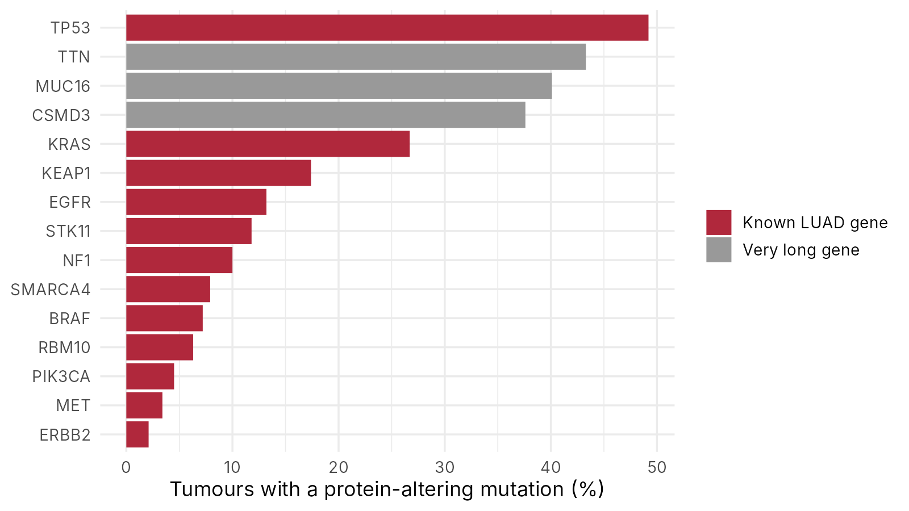
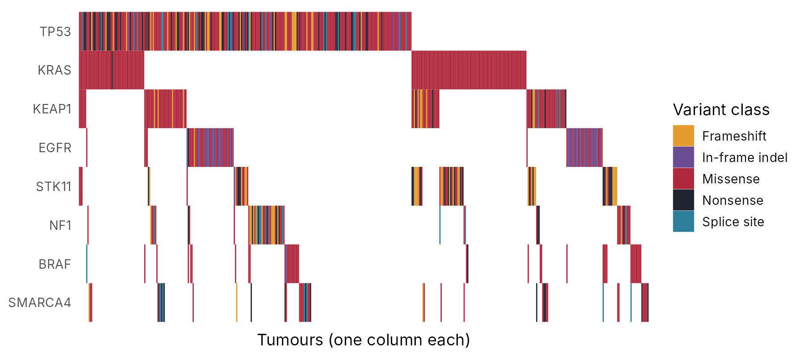
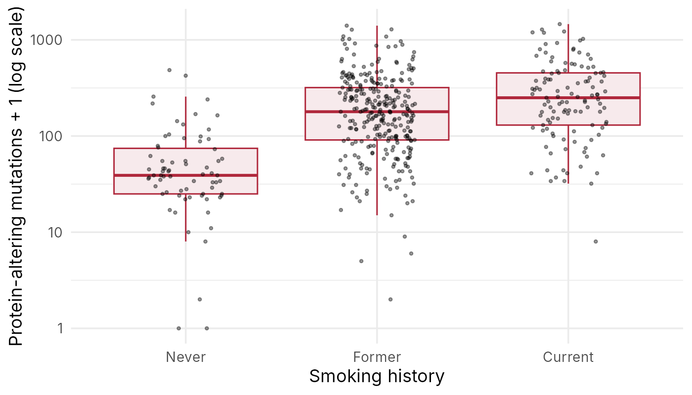

::: {.callout-note collapse="true"}
## 🎯 학습 목표

이 실습을 마치면:

-   OncoKB에서 변이별 의미와 치료 근거 수준 찾기
-   cBioPortal에서 TCGA 코호트의 변이 빈도와 상호배타 패턴 보기
-   R로 TCGA 폐선암 변이표를 읽고 유전자별 빈도와 oncoplot 그리기
-   흡연력과 집단 구성이 변이 빈도를 어떻게 바꾸는지 데이터로 확인
-   NGS 리포트 한 장을 읽고 치료 관련 변이와 추가로 필요한 검사 정리
:::

> 🩺 **케이스 다시 보기** (🔗 [W6](w06_cancer.qmd))\
> 비흡연 52세 여성, 4기 폐선암. 조직 NGS 리포트: *EGFR* exon 19 deletion (VAF 32%), *TP53* R273H (VAF 30%).\
> → 오늘 목표: 리포트 한 장을 치료 결정에 쓸 수 있는 문장으로 바꾸기

------------------------------------------------------------------------

# 0. 준비물 🧰 {#w7-s0}

-   웹: [OncoKB](https://www.oncokb.org/), [cBioPortal](https://www.cbioportal.org/) — 둘 다 가입 없이 검색 가능
-   데이터 (둘 다 내려받기)
    -   [w07_luad_mutations.tsv](../data/w07_luad_mutations.tsv) — TCGA 폐선암 559개 종양의 체세포 변이 (15개 유전자, 단백질을 바꾸는 변이만, 2,268줄)
    -   [w07_luad_samples.tsv](../data/w07_luad_samples.tsv) — 종양마다 변이 수, 흡연력, 인종, 병기 (559줄)
-   JupyterHub: 로그인 → 새 R 노트북 → 두 파일을 왼쪽 파일 창에 끌어다 놓기 (🔗 [W1 §6.2](w01_intro.qmd#w1-s6-2))

::: {.callout-note collapse="true"}
## 이 데이터에 대해

-   **실제 공개 자료** — The Cancer Genome Atlas(TCGA) 폐선암(LUAD) 프로젝트. 가상 자료가 아님
    -   체세포 변이: UCSC Xena GDC hub의 TCGA-LUAD 체세포 변이(엑솜, SNV와 작은 삽입·결실)
    -   인종·병기: 같은 hub의 TCGA-LUAD 임상 정보 / 흡연력: UCSC Xena TCGA hub의 LUAD 임상 정보
    -   2026-11-10에 내려받음. 출처 표기: TCGA Research Network (<https://www.cancer.gov/tcga>)
-   가공
    -   원발 종양만, 한 환자에 종양 시료 하나
    -   단백질을 바꾸는 변이(missense, nonsense, frameshift, splice site, in-frame 삽입·결실 등)만 남김. 동의 변이와 인트론 변이는 뺌
    -   변이표에는 실습에 쓰는 15개 유전자만. `n_mutations`는 모든 유전자에서 센 단백질을 바꾸는 변이 수
-   만든 방법: 저장소의 `scripts/make_w07_luad.R` (출처 주소에서 다시 내려받아 똑같이 만듦)
-   ⚠️ 융합 유전자(*ALK* 등)와 복제수 변화는 이 표에 없음 → cBioPortal 숫자와 조금 다를 수 있음
:::

------------------------------------------------------------------------

# 1. 🌐 OncoKB로 변이 하나씩 {#w7-s1}

OncoKB는 암 변이마다 "암을 일으키는 변이인가(oncogenic)", "어떤 약의 근거가 있나"를 정리한 데이터베이스다 (🔗 [W6 §3.3](w06_cancer.qmd#w6-s3-3)).

1.  [OncoKB](https://www.oncokb.org/) 첫 화면 검색창에 유전자 이름(예: `EGFR`) 입력 → 유전자 페이지
2.  변이 목록에서 해당 변이를 찾거나, 검색창에 유전자와 변이를 함께 입력 (예: `EGFR E746_A750del`, `KRAS G12C`)
3.  변이 페이지에서 **여기서 볼 것**
    -   Oncogenic 여부와 Mutation Effect (기능 획득인가, 상실인가)
    -   치료 표 — 암종(Cancer Type)이 "Non-Small Cell Lung Cancer"인 줄의 근거 수준(Level)과 약
4.  아래 다섯 변이를 기록표에 채움

| 변이 | Oncogenic? | 효과 | 폐암에서 가장 높은 근거 수준 | 약 |
|---|---|---|---|---|
| *EGFR* E746_A750del (exon 19 결실) | | | | |
| *TP53* R273H | | | | |
| *KRAS* G12C | | | | |
| *ALK* 융합 (예: *EML4::ALK*) | | | | |
| *BRAF* V600E — 흑색종 vs 대장암 | | | (암종 둘 비교) | |

✅ **확인 질문** — 케이스의 두 변이 중 치료 표에 약이 나오는 것은? 나오지 않는 변이는 의미가 없는가?

::: {.callout-tip collapse="true"}
## 확인할 것

정확한 단계와 약 목록은 새 승인에 따라 바뀜 → 확인한 날짜를 기록하고 아래 방향과 맞는지 볼 것

-   *EGFR* exon 19 결실 → oncogenic, 기능 획득. 폐암에서 승인된 EGFR 억제제가 있는 가장 높은 단계가 나와야 함
-   *TP53* R273H → oncogenic(종양억제 기능 상실)으로 나오지만, 이 변이를 직접 겨냥하는 치료 단계는 없음 → 약이 없다고 의미가 없는 것은 아님 (예후, 생식세포 검사 판단에 쓰임)
-   *KRAS* G12C → 폐암에서 KRAS G12C를 겨냥하는 약(예: sotorasib)의 근거가 나와야 함. 다른 *KRAS* 변이(G12D 등)와 비교해 보기
-   *ALK* 융합 → ALK 억제제가 여럿. 이 융합은 오늘의 R 데이터에는 없음(변이표에 융합이 없음)
-   *BRAF* V600E → 흑색종과 대장암에서 근거 수준이나 약 조합이 다름 (🔗 [W6 §3.3](w06_cancer.qmd#w6-s3-3))
:::

------------------------------------------------------------------------

# 2. 🌐 cBioPortal로 코호트 보기 {#w7-s2}

cBioPortal은 TCGA 같은 대규모 암 유전체 연구를 웹에서 바로 탐색하는 도구다. 한 환자의 변이를 수백 명의 종양 위에 놓고 본다.

## 1) 변이 빈도 {#w7-s2-1}

1.  [cBioPortal](https://www.cbioportal.org/) 첫 화면 검색창에 `lung adenocarcinoma` → 목록에서 **Lung Adenocarcinoma (TCGA, PanCancer Atlas)** 선택
2.  **Query By Gene** → 유전자 칸에 `EGFR KRAS TP53 STK11 KEAP1` → **Submit Query**
3.  **OncoPrint** 탭 → **여기서 볼 것**: 유전자 이름 옆의 % = 그 유전자에 변화가 있는 환자 비율
4.  **Mutations** 탭 → *EGFR* 선택 → 막대 그림(lollipop)에서 막대가 몰린 자리 = hotspot

## 2) 상호배타성 {#w7-s2-2}

1.  **Mutual Exclusivity** 탭 → *EGFR*–*KRAS* 줄
2.  **여기서 볼 것**: 경향(Tendency)이 "mutual exclusivity"인가, 함께 변이된 환자 수
3.  왜 그럴까? → 둘 다 같은 신호 경로를 켜는 driver → 하나만 있어도 충분해서 두 번째가 선택될 이유가 없음

## 3) ⚠️ 코호트 구성 {#w7-s2-3}

-   연구 요약 화면(연구 이름 클릭)에서 인종(Race) 항목이 보이면 분포 확인. 안 보이면 [§3.6](#w7-s3-6)의 R 결과로 확인
-   TCGA 폐선암 환자는 대부분 백인 → 비흡연 아시아인 여성인 케이스 환자를 대표하지 못함 (🔗 [W6 §8](w06_cancer.qmd#w6-s8))

✅ **확인 질문** — OncoPrint의 *EGFR* %를 케이스 환자에게 그대로 "*EGFR* 변이가 있을 확률"로 설명해도 되나?

------------------------------------------------------------------------

# 3. 💻 R로 직접 세고 그리기 {#w7-s3}

## 1) 노트북 시작 {#w7-s3-1}

```r
library(readr)    # 표 읽기
library(dplyr)    # 표 거르기·요약
library(ggplot2)  # 그림 그리기

options(repr.plot.width = 8, repr.plot.height = 4)  # 노트북 그림 크기
```

## 2) 표 두 개 읽기 {#w7-s3-2}

```r
mutations <- read_tsv("w07_luad_mutations.tsv")
samples <- read_tsv("w07_luad_samples.tsv")

nrow(mutations)
nrow(samples)
head(mutations)
```

**결과에서 볼 것** — `2268`, `559`. `mutations`는 한 줄 = 변이 하나, `samples`는 한 줄 = 종양 하나

| 표 | 열 | 뜻 |
|---|---|---|
| `mutations` | `sample` | 종양 이름 (TCGA 바코드) |
| | `gene`, `protein` | 유전자와 단백질 변화 (🔗 [W1 §4.3](w01_intro.qmd#w1-s4-3)) |
| | `variant_class` | 변이 종류: Missense, Nonsense, Frameshift, Splice site, In-frame indel, Other |
| | `vaf` | 변이 대립유전자 빈도 (🔗 [W6 §1.2](w06_cancer.qmd#w6-s1-2)) |
| `samples` | `n_mutations` | 이 종양의 모든 유전자에서 센 단백질을 바꾸는 체세포 변이 수 |
| | `smoking` | 흡연력: Never(평생 비흡연), Former(과거 흡연), Current(현재 흡연) |
| | `race`, `stage` | 인종, 병기 (`NA` = 정보 없음) |

## 3) 유전자별 변이 빈도 {#w7-s3-3}

유전자마다 변이가 있는 종양이 몇 개인지 센다. 한 종양에 같은 유전자 변이가 여러 개여도 한 번만 센다.

```r
n_tumours <- nrow(samples)

gene_freq <- mutations |>
  distinct(sample, gene) |>
  count(gene, sort = TRUE) |>
  mutate(percent = round(100 * n / n_tumours, 1))

gene_freq
```

-   `distinct()` = 같은 (종양, 유전자) 짝은 한 번만 남김
-   `count()` = 유전자별 개수, `mutate()` = 새 열(비율) 만들기

```r
long_genes <- c("TTN", "MUC16", "CSMD3")

gene_freq |>
  mutate(type = ifelse(gene %in% long_genes, "Very long gene", "Known LUAD gene")) |>
  ggplot(aes(x = percent, y = reorder(gene, percent), fill = type)) +
  geom_col() +
  scale_fill_manual(values = c("Known LUAD gene" = "#B0283C", "Very long gene" = "grey60")) +
  labs(x = "Tumours with a protein-altering mutation (%)", y = NULL, fill = NULL) +
  theme_minimal(base_size = 13)
```

{fig-align="center" width="85%"}

**결과에서 볼 것** — 회색 막대의 유전자들은 왜 이렇게 자주 변이되었을까? 아래 코드로 확인

```r
samples |>
  mutate(TTN = sample %in% mutations$sample[mutations$gene == "TTN"]) |>
  group_by(TTN) |>
  summarise(tumours = n(), median_mutations = median(n_mutations))
```

| TTN | tumours | median_mutations |
|---|---|---|
| FALSE | 317 | 94 |
| TRUE | 242 | 318 |

→ *TTN* 변이가 있는 종양은 전체 변이 수가 3배 이상 많음 → 변이가 많은 종양일수록 긴 유전자에 우연히 변이가 걸림 = passenger (🔗 [W6 §2.2](w06_cancer.qmd#w6-s2-2))

## 4) Oncoplot {#w7-s3-4}

Oncoplot은 유전자(행) × 종양(열) 격자에 변이가 있는 칸만 색칠한 그림이다. 수백 명의 변이 패턴을 한눈에 본다. 알려진 driver 8개로 그린다.

```r
drivers <- c("TP53", "KRAS", "KEAP1", "EGFR", "STK11", "NF1", "BRAF", "SMARCA4")

onco <- mutations |>
  filter(gene %in% drivers) |>
  distinct(sample, gene, .keep_all = TRUE)

# 위쪽 유전자에 변이가 있는 종양부터 왼쪽에 오도록 순서 점수 매기기
order_key <- onco |>
  group_by(sample) |>
  summarise(key = sum(2^(length(drivers) - match(gene, drivers))))

onco <- onco |>
  left_join(order_key, by = "sample") |>
  mutate(sample = reorder(sample, -key),
         gene = factor(gene, levels = rev(drivers)))
```

-   `left_join()` = 두 표를 `sample`을 기준으로 이어 붙임
-   순서 점수 = 맨 위 유전자에 변이가 있으면 가장 큰 점수 → 같은 패턴의 종양끼리 모임

```r
ggplot(onco, aes(x = sample, y = gene, fill = variant_class)) +
  geom_tile() +
  scale_fill_manual(values = c("Missense" = "#B0283C", "Nonsense" = "#1F2430",
                               "Frameshift" = "#E39B2D", "Splice site" = "#2E7D9A",
                               "In-frame indel" = "#6A4C93", "Other" = "grey60")) +
  labs(x = "Tumours (one column each)", y = NULL, fill = "Variant class") +
  theme_minimal(base_size = 13) +
  theme(axis.text.x = element_blank(), panel.grid = element_blank())
```

{fig-align="center"}

**결과에서 볼 것**

-   *KRAS* · *TP53* = 대부분 빨간색(missense) → 같은 자리가 반복되는 hotspot 패턴
-   *STK11* · *KEAP1* · *NF1* = 검정·주황(nonsense, frameshift)이 섞임 → 기능 상실 패턴 (🔗 [W6 §2.2](w06_cancer.qmd#w6-s2-2))
-   *EGFR* = 보라색(in-frame indel)이 많음 → exon 19 결실

## 5) *EGFR*와 *KRAS* {#w7-s3-5}

두 유전자 변이가 한 종양에 함께 있는 경우를 센다.

```r
samples <- samples |>
  mutate(EGFR = sample %in% mutations$sample[mutations$gene == "EGFR"],
         KRAS = sample %in% mutations$sample[mutations$gene == "KRAS"])

table(EGFR = samples$EGFR, KRAS = samples$KRAS)
```

| | KRAS FALSE | KRAS TRUE |
|---|---|---|
| **EGFR FALSE** | 337 | 148 |
| **EGFR TRUE** | 73 | 1 |

→ 둘 다 있는 종양은 559개 중 1개 → 상호배타성 ([§2.2](#w7-s2-2))

## 6) 흡연력, 변이 수, 집단 {#w7-s3-6}

흡연력에 따라 변이 수와 *EGFR* 변이 비율이 어떻게 다른지 본다.

```r
median(samples$n_mutations)

samples |>
  filter(!is.na(smoking)) |>
  group_by(smoking) |>
  summarise(tumours = n(),
            median_mutations = median(n_mutations),
            EGFR_percent = round(100 * mean(EGFR), 1))
```

**결과에서 볼 것** — 전체 중앙값 `162`, 그리고

| smoking | tumours | median_mutations | EGFR_percent |
|---|---|---|---|
| Current | 119 | 249 | 7.6 |
| Former | 305 | 178 | 10.2 |
| Never | 71 | 38 | 39.4 |

```r
samples |>
  filter(!is.na(smoking)) |>
  mutate(smoking = factor(smoking, levels = c("Never", "Former", "Current"))) |>
  ggplot(aes(x = smoking, y = n_mutations + 1)) +
  geom_boxplot(fill = "#F7EAEC", colour = "#B0283C", outlier.shape = NA) +
  geom_jitter(width = 0.2, size = 0.8, alpha = 0.4) +
  scale_y_log10() +
  labs(x = "Smoking history", y = "Protein-altering mutations + 1 (log scale)") +
  theme_minimal(base_size = 13)
```

{fig-align="center" width="85%"}

-   흡연자 종양 → 변이가 많음 (담배가 남긴 흔적, 🔗 [W6 §2.1](w06_cancer.qmd#w6-s2-1))
-   비흡연자 종양 → 변이는 적지만 *EGFR* 변이가 훨씬 흔함

이제 대표 활성화 변이(exon 19 결실, L858R)만 세고, 이 코호트가 누구로 이루어졌는지 본다.

```r
# exon 19 결실 = 745–759번 아미노산 근처에서 시작하는 in-frame 결실
egfr_active <- mutations |>
  filter(gene == "EGFR") |>
  filter(protein == "p.L858R" |
           (variant_class == "In-frame indel" &
              grepl("^p\\.[A-Z]7(4[5-9]|5[0-9])_", protein)))

n_distinct(egfr_active$sample)
round(100 * n_distinct(egfr_active$sample) / n_tumours, 1)

samples |> filter(!is.na(race)) |> count(race)
```

**결과에서 볼 것** — 대표 활성화 변이 `50`개 종양, `8.9`%. 인종 정보가 있는 443명 중 백인 382명(86%), 아시아계 8명(1.8%)

-   ⚠️ **집단 차이** — 아시아인 폐선암에서는 *EGFR* 변이가 약 51% (🔗 [W6 §8](w06_cancer.qmd#w6-s8)) → 이 코호트의 숫자를 케이스 환자에게 그대로 옮기면 안 됨

## 7) 케이스의 두 변이 찾기 {#w7-s3-7}

```r
mutations |>
  filter(gene == "EGFR", variant_class == "In-frame indel") |>
  count(protein, sort = TRUE)

mutations |>
  filter(gene == "TP53") |>
  count(protein, sort = TRUE) |>
  head()

mutations |> filter(gene == "TP53", protein == "p.R273H")
```

**결과에서 볼 것**

-   *EGFR* in-frame 결실 중 가장 흔한 것 = `p.E746_A750del` (18개 종양) → 케이스와 같은 exon 19 결실
-   `p.A767_V769dup`, `p.D770_N771insGL` 같은 삽입 = exon 20 삽입 → 같은 *EGFR* 변이라도 일반 EGFR 억제제가 잘 듣지 않는 종류. 리포트에서 "*EGFR* 양성"만 보지 말고 변이 이름까지 확인
-   *TP53*은 R273, G245, R158 같은 자리가 여러 종양에서 반복 → hotspot. R273H 자체는 1개 종양(TCGA-49-AAQV-01, VAF 0.296)
-   ⚠️ 그 종양의 `smoking`, `n_mutations`도 `samples`에서 찾아보기

::: {.callout-tip collapse="true"}
## 🛠️ 고쳐 보기

1.  [§3.4](#w7-s3-4)의 `drivers`에 `"PIK3CA"`, `"MET"`를 더해 oncoplot을 다시 그리기. 새 줄은 어디에 붙나?
2.  *KRAS* 변이의 종류 세기: `mutations |> filter(gene == "KRAS") |> count(protein, sort = TRUE)`. 승인된 표적치료제가 있는 G12C는 *KRAS* 변이 종양 149개 중 몇 개인가?
3.  `samples |> filter(sample == "TCGA-49-AAQV-01")`로 *TP53* R273H 종양의 흡연력과 변이 수를 보고, 비흡연자 중앙값과 비교하기

**확인**: (1) 맨 아래 두 줄로 붙음. 두 유전자는 변이가 있는 종양이 5% 미만이라 칸이 드문드문 보임 (2) 57개 (약 38%) — G12V 39, G12D 18 (3) Never, 54개 → 비흡연자 중앙값(38)에 가까움
:::

::: {.callout-note collapse="true" icon=false}
## 💡 AI 도우미에게 묻기

-   "이 R 코드의 `distinct()`와 `count()`가 하는 일을 의예과 학생이 이해할 수 있게 설명해 줘: (코드 붙여넣기)"
-   "`grepl(\"^p\\\\.[A-Z]7(4[5-9]|5[0-9])_\", protein)` 이 정규표현식을 한 글자씩 풀어서 설명해 줘"
-   "oncoplot에서 유전자 순서를 바꾸려면 어디를 고쳐야 해?"
:::

------------------------------------------------------------------------

# ✍️ 제출

케이스의 NGS 리포트에 대한 한 문단 해석:

-   두 변이 각각 — driver인가, 치료를 바꾸는가, 그 근거(OncoKB 근거 수준, 코호트 빈도, hotspot 여부)
-   이 결과가 **말해 주지 않는 것**과 더 필요한 것 (예: 융합 유전자 검사 범위, 생식세포 검사가 필요한 상황, 치료 중 액체생검으로 내성 추적)
-   TCGA 숫자를 이 환자에게 그대로 쓰면 안 되는 이유 한 줄

------------------------------------------------------------------------

# 📝 정리

| 도구 또는 함수 | 한 일 |
|----------------|-------|
| OncoKB | 변이의 의미(oncogenic, 기능)와 치료 근거 수준 |
| cBioPortal | TCGA 코호트에서 변이 빈도, 상호배타성, hotspot |
| `read_tsv()` | 표 읽기 |
| `distinct()` | 같은 조합은 한 번만 남기기 |
| `count()` | 그룹별 개수 세기 |
| `mutate()` | 새 열 만들기 |
| `group_by()` + `summarise()` | 그룹별 요약값(개수, 중앙값, 비율) |
| `left_join()` | 두 표를 공통 열로 이어 붙이기 |
| `grepl()` | 글자 패턴이 들어 있는지 확인 |
| `geom_col()` · `geom_tile()` · `geom_boxplot()` | 막대그래프, oncoplot, 상자그림 |
| `table()` | 두 조건의 교차표 |

# ➕ 참고 링크

-   [OncoKB — 근거 수준 설명](https://www.oncokb.org/levels) · [cBioPortal 사용 안내](https://docs.cbioportal.org/user-guide/overview/)
-   Chakravarty D, et al. [*OncoKB: A Precision Oncology Knowledge Base.*](https://doi.org/10.1200/PO.17.00011) JCO Precis Oncol. 2017.
-   Cancer Genome Atlas Research Network. [*Comprehensive molecular profiling of lung adenocarcinoma.*](https://doi.org/10.1038/nature13385) Nature. 2014.
-   [UCSC Xena](https://xena.ucsc.edu/) — 오늘 데이터를 받은 곳 · [TCGA 프로그램 안내](https://www.cancer.gov/tcga)
