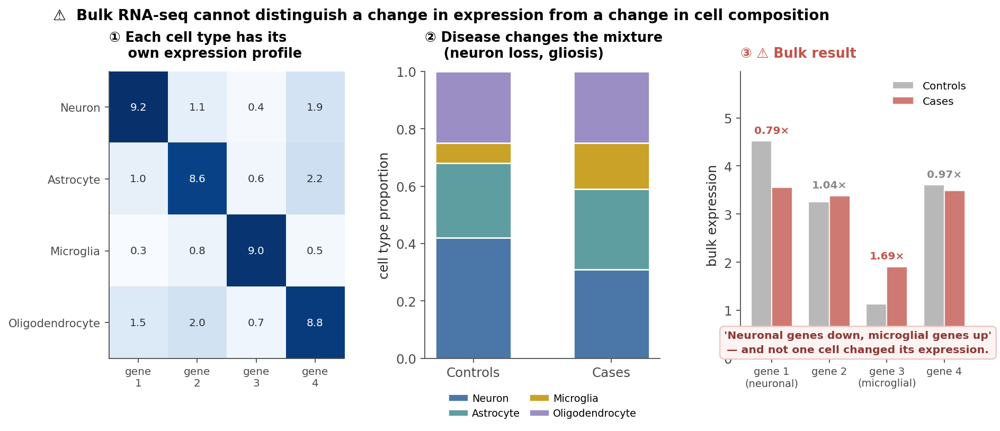
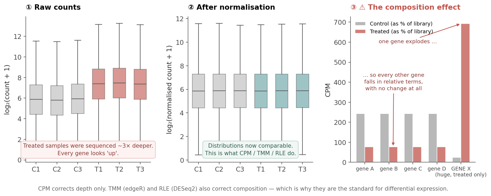
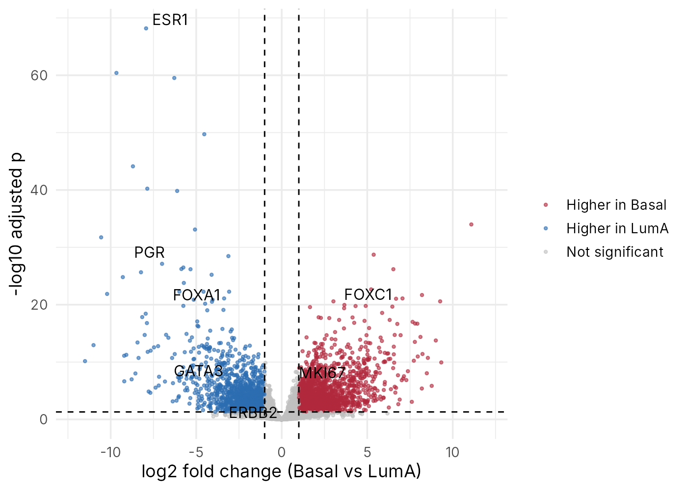

::: {.callout-note collapse="true"}
## 🎯 학습 목표

이 장을 마치면:

-   RNA-seq이 측정하는 것(존재량)과 측정하지 않는 것(합성 속도, 단백질) 구분
-   반복 실험과 배치 효과가 결과를 좌우하는 이유 설명
-   Raw count를 바로 비교할 수 없는 이유와 정규화의 역할 설명
-   Fold change, FDR, volcano plot 읽기
-   경로 분석(ORA, GSEA)의 원리와 흔한 오용 설명
-   Oncotype DX, PAM50처럼 발현 기반 검사가 치료 결정에 쓰이는 방식 설명
-   RNA와 단백질의 관계, 혈액 바이오마커가 대부분 단백질인 이유 설명
-   ⚠️ "차등 발현 유전자가 수천 개"와 "발현 차이 = 원인"이 왜 조심해야 할 말인지 설명
:::

> 🩺 **오늘의 케이스**\
> 50대 여성 두 명. 둘 다 호르몬 수용체 양성, HER2 음성, 림프절 전이가 없는 초기 유방암으로 수술을 받았다. 병기도 같다.\
> 수술 조직에서 유전자 21개의 발현으로 계산한 "재발 점수"가 한 명은 12, 다른 한 명은 31이었다. 점수가 31인 환자에게만 항암화학요법을 권했다.\
> → 유전자 발현이 어떻게 치료 결정을 바꿀 수 있을까? (🔗 [W10 실습](w10_transcriptome_lab.qmd)에서 직접)

💡 각 절의 본문 = 꼭 알아야 할 기초. **🔍 더 알아보기**는 궁금할 때 펼쳐 보는 심화 내용

------------------------------------------------------------------------

# 1. RNA-seq이 측정하는 것 📏 {#w9-s1}

> 🔑 **핵심** — RNA-seq = 시료 속 RNA 조각을 세어 유전자마다 얼마나 "켜져" 있는지 재는 검사. 그 순간의 존재량이고, 단백질도 개별 세포도 아님

## 1) DNA는 같아도 발현은 다르다 {#w9-s1-1}

같은 사람의 세포는 거의 같은 DNA를 가지지만, 어떤 유전자를 얼마나 쓰는지는 세포마다 다르다 (🔗 [W1 §2.3](w01_intro.qmd#w1-s2-3)). 유전자가 RNA로 옮겨 적히는 것을 발현(gene expression)이라 하고, 한 시료 속 RNA 전체를 전사체(transcriptome)라 한다. RNA-seq은 이 RNA를 시퀀싱해 유전자마다 몇 조각이 나왔는지 센다.

-   유방암 세포가 에스트로겐 수용체(ER) 유전자 *ESR1*을 많이 발현 → 에스트로겐 신호에 기대어 자람 → 호르몬 치료의 표적
-   같은 "유방암"이라도 어떤 유전자들이 켜져 있느냐에 따라 성질과 치료가 달라짐 → 오늘 케이스의 출발점

## 2) 존재량의 스냅숏 {#w9-s1-2}

-   RNA 양 = 만드는 속도(전사)와 없애는 속도(분해)의 균형
-   RNA-seq은 시료를 채취한 **그 순간** 남아 있던 양만 봄
    -   전사가 두 배로 늘어난 유전자와 RNA가 두 배 오래 버티는 유전자는 똑같이 보임
    -   한 시점의 사진 → 시간에 따라 변하는 반응은 놓칠 수 있음
-   ⚠️ 단백질 양은 직접 재지 않음 → [§7](#w9-s7)

## 3) 조직 = 세포의 혼합물 {#w9-s1-3}

종양 조직 한 조각에는 암세포만 있지 않다. 면역세포, 섬유모세포, 혈관세포가 섞여 있다. 보통의 RNA-seq(bulk RNA-seq)은 이 모든 세포의 RNA를 한꺼번에 갈아 평균을 낸다.

{fig-align="center"}

-   ⚠️ **발현 차이 ≠ 원인** — "면역 유전자 발현 증가"는 세포가 발현을 바꾼 것일 수도, 면역세포가 더 많이 섞인 것일 수도 있음
-   세포 비율을 계산으로 추정하는 방법(deconvolution)도 있지만, 직접 확인하려면 세포 하나하나를 재야 함 (🔗 [W11 §1.2](w11_singlecell.qmd#w11-s1-2))

------------------------------------------------------------------------

# 2. 실험 설계 ⚙️ {#w9-s2}

> 🔑 **핵심** — 분석보다 설계가 먼저. 반복과 배치를 잘못 짜면 어떤 분석으로도 구할 수 없음

## 1) 생물학적 반복 vs 기술적 반복 {#w9-s2-1}

-   **생물학적 반복** = 서로 다른 환자(또는 동물, 배양 접시) → 우리가 일반화하려는 단위
-   **기술적 반복** = 같은 시료를 다시 시퀀싱 → 장비의 흔들림만 봄
-   표본 수 n = 생물학적 반복의 수. 같은 환자를 열 번 읽어도 n = 1
-   ⚠️ n이 작으면 진짜 차이도 놓침. 실험실 관례인 n = 3은 근거가 아니라 습관

## 2) ⚠️ 배치 효과 {#w9-s2-2}

배치 효과(batch effect)는 생물학과 무관한 처리 조건(처리한 날, 시약 묶음, 시퀀싱 장비, 병원)이 데이터에 남긴 차이다. 이 차이는 종종 질병에 의한 차이보다 크다.

-   예: 암 조직은 모두 월요일에, 정상 조직은 모두 금요일에 처리 → "암 vs 정상" 차이와 "월요일 vs 금요일" 차이를 영원히 구분할 수 없음
-   ✅ 해결은 분석이 아니라 **설계** → 비교할 두 군을 각 배치에 골고루 섞기
-   배치가 비교 조건과 겹치지 않았다면 → 분석에서 배치를 변수로 넣어 보정 가능

## 3) 시료 품질 {#w9-s2-3}

-   RNA는 DNA보다 쉽게 분해됨 → 채취부터 보관까지 시간이 길면 품질 저하
-   병리과에 보관하는 FFPE 조직(포르말린 고정 + 파라핀 포매) → RNA가 잘게 쪼개져 있음
    -   그래도 측정할 수 있게 만든 검사가 있음 → Oncotype DX는 FFPE 조직으로 측정 ([§6.1](#w9-s6-1))
-   💡 품질이 시료마다 다르면 그것도 일종의 배치 → 품질 지표를 함께 기록

------------------------------------------------------------------------

# 3. Read에서 count로 🔢 {#w9-s3}

> 🔑 **핵심** — RNA-seq의 출발 자료 = count matrix(유전자 × 시료). 칸마다 "이 시료에서 이 유전자로 온 read 수"

1.  RNA 추출 → DNA(cDNA)로 바꿈 → 시퀀싱 (🔗 [W1 §3.1](w01_intro.qmd#w1-s3-1))
2.  read를 유전체나 전사체 서열에 맞춰 보기 → 어느 유전자에서 왔는지 결정
3.  유전자마다 read 수 세기 → count matrix

W10 실습 데이터(TCGA 유방암)의 한 부분:

| 유전자 | LumA_01 | LumA_02 | Basal_01 | Basal_02 |
|---|---:|---:|---:|---:|
| *ESR1* | 20,137 | 26,594 | 43 | 51 |
| *KRT5* | 16,471 | 21,071 | 29,522 | 3,893 |

-   *ESR1* → Luminal A 종양에서 수백 배 많음. 눈으로도 보이는 차이
-   *KRT5* → 시료마다 들쭉날쭉 → 이런 유전자가 "진짜 차이"인지 가리는 것이 통계의 일

::: {.callout-note collapse="true" icon=false}
## 🔍 더 알아보기 — 정렬과 의사 정렬

-   **정렬(alignment)** — read를 유전체의 정확한 위치에 놓음. 엑손 경계를 건너뛰는 read도 처리 (예: STAR)
-   **의사 정렬(pseudo-alignment)** — 위치는 따지지 않고 "어느 전사체와 맞는가"만 빠르게 판단 (예: Salmon, kallisto)
-   유전자 발현량만 필요하면 둘 다 충분히 정확
:::

------------------------------------------------------------------------

# 4. 정규화와 차등 발현 📊 {#w9-s4}

> 🔑 **핵심** — Raw count는 깊이·길이·조성에 따라 달라짐 → 보정한 뒤, 반복 사이의 흔들림보다 확실히 큰 차이만 "차등 발현"으로 봄

## 1) 깊이, 길이, 조성 보정 {#w9-s4-1}

count가 많다고 그 유전자가 더 많이 발현된 것은 아니다. 생물학과 무관한 세 가지가 count를 바꾼다.

1.  **깊이(library size)** — 두 배 많이 시퀀싱하면 모든 유전자의 count가 두 배. W10 데이터에서 시료당 read 수는 3,370만–7,060만
2.  **유전자 길이** — 긴 유전자일수록 같은 양이어도 조각이 더 많이 나옴
3.  **조성** — 한 유전자가 폭발적으로 늘면, 전체 read 수는 정해져 있으니 다른 유전자들이 상대적으로 줄어 보임

{fig-align="center"}

-   정규화(normalization) = 이런 차이를 보정해 시료끼리 비교할 수 있게 만드는 일
-   차등 발현 도구(DESeq2, edgeR)는 깊이와 조성을 스스로 보정 → ⚠️ 그래서 이미 정규화한 값이 아니라 **raw count**를 넣어야 함

## 2) Fold change와 FDR {#w9-s4-2}

두 군의 차이를 말하려면 두 가지가 필요하다. 얼마나 다른가(효과 크기), 그리고 그 차이가 우연이 아니라고 얼마나 확신하는가.

-   **log₂ fold change** = 두 군 발현 비의 log₂ 값
    -   +1 = 2배, +2 = 4배, −1 = 절반, 0 = 차이 없음
-   **p값** = 진짜 차이가 없는데도 이만큼의 차이가 우연히 나올 확률
-   ⚠️ 유전자 2만 개를 한꺼번에 검정 → 차이가 하나도 없어도 p < 0.05인 유전자가 약 1,000개 우연히 나옴 (🔗 [W4 §2.2](w04_complex_pgx.qmd#w4-s2-2) GWAS의 5×10⁻⁸와 같은 문제)
-   ✅ 그래서 **FDR**(false discovery rate, 거짓 발견 비율)로 보정한 값(adjusted p, padj)을 씀
    -   padj < 0.05인 유전자 목록 → 그중 거짓 발견이 약 5% 이하일 것으로 기대
-   ⚠️ **"차등 발현 유전자 수천 개"는 자랑이 아님**
    -   W10 실습: Luminal A 12명 vs Basal-like 12명 → padj < 0.05인 유전자 5,549개
    -   서로 매우 다른 두 아형이면 수천 개가 나오는 것이 정상. 표본이 크면 아주 작은 차이도 "유의"해짐
    -   → 개수보다 **효과 크기와 생물학적 의미**를 봄

::: {.callout-note collapse="true" icon=false}
## 🔍 더 알아보기 — count에 t-test를 쓰지 않는 이유

-   count는 0 이상의 정수이고, 발현량이 클수록 환자 사이의 흔들림도 큼
-   DESeq2와 edgeR은 이런 성질을 반영한 음이항 분포(negative binomial) 모형을 씀
-   반복이 적을 때는 비슷한 발현량의 다른 유전자들에게서 흔들림 정보를 빌려 추정을 안정시킴
:::

## 3) Volcano plot 읽기 {#w9-s4-3}

{fig-align="center" width="85%"}

-   x축 = log₂ fold change → 얼마나 다른가
-   y축 = −log₁₀(padj) → 얼마나 확실한가. 위로 갈수록 확실
-   점선 = 기준선 (예: |log₂FC| > 1, padj < 0.05)
-   ⚠️ 오른쪽 아래 점 = 차이는 커 보이지만 확실하지 않음 (흔들림이 크거나 count가 적음)

------------------------------------------------------------------------

# 5. 유전자 목록 해석 🧠 {#w9-s5}

> 🔑 **핵심** — 수천 개 유전자 목록은 그대로 읽을 수 없음 → 미리 정리된 유전자 집합(경로)과 얼마나 겹치는지로 요약. 단, 겹친다 ≠ 원인

## 1) ORA와 GSEA {#w9-s5-1}

-   **ORA**(over-representation analysis) — 유의한 유전자 목록이 어떤 경로의 유전자와 우연보다 많이 겹치는가
    -   예: 목록 200개 중 "세포 분열" 경로 유전자가 15개. 무작위로 200개를 뽑았을 때 기대되는 수보다 훨씬 많다면 → 그 경로가 "농축(enriched)"
-   **GSEA**(gene set enrichment analysis) — 기준선으로 자르지 않고, 전체 유전자를 변화 순서로 줄 세운 뒤 경로 유전자가 한쪽 끝에 몰려 있는가
-   유전자 집합 데이터베이스: GO(Gene Ontology), KEGG, Reactome, MSigDB Hallmark 등

## 2) ⚠️ 흔한 오용 {#w9-s5-2}

-   **배경 유전자 집합을 잘못 고름** — "무작위로 뽑았을 때"의 기준은 사람 유전자 전체가 아니라 *이 실험에서 실제로 측정·검정한 유전자*여야 함
-   **데이터베이스마다 결과가 다름** — 같은 목록도 GO로 보면 뚜렷한 항목이 없고 Hallmark로 보면 뚜렷할 수 있음 (🔗 W10 실습에서 직접)
-   **경로가 나왔다 ≠ 그 경로가 병의 원인** — 질병의 결과로 바뀐 것일 수도, 세포 조성이 바뀐 것일 수도 있음 ([§1.3](#w9-s1-3))

------------------------------------------------------------------------

# 6. 발현 기반 진단 검사 🏥 {#w9-s6}

> 🔑 **핵심** — 연구용 유전자 목록이 진료용 검사가 되려면 정해진 유전자, 정해진 계산식, 그리고 대규모 임상시험에서의 검증이 필요

## 1) Oncotype DX 재발 점수 {#w9-s6-1}

케이스의 "재발 점수"가 바로 이 검사다. 호르몬 수용체 양성 유방암에서 수술 후 원격 재발 위험을 점수로 낸다.

-   유전자 21개 = 암 관련 16개 + 측정 기준용 5개 → FFPE 조직에서 RT-PCR로 측정
-   암 관련 유전자는 기능별 묶음으로 계산
    -   **증식**(*MKI67*, *AURKA*, *BIRC5*, *CCNB1*, *MYBL2*) → 높을수록 점수 ↑
    -   **에스트로겐**(*ESR1*, *PGR*, *BCL2*, *SCUBE2*) → 높을수록 점수 ↓
    -   **HER2**(*ERBB2*, *GRB7*), **침습**(*MMP11*, *CTSV*) 등
    -   → "잘 분열하고 에스트로겐 신호가 약한 종양"일수록 점수가 높음
-   처음 검증(타목시펜을 쓴 림프절 음성 환자 668명): 10년 원격 재발률 저위험 6.8%, 중간위험 14.3%, 고위험 30.5%
-   **TAILORx 임상시험** — 호르몬 수용체 양성, HER2 음성, 림프절 음성 환자 10,273명
    -   점수 11–25인 6,711명을 무작위로 나눔 → 호르몬 치료만 해도 항암화학요법을 더한 것과 성적이 비슷 (9년 무침습질환 생존 83.3% vs 84.3%)
    -   단, 50세 이하이면서 점수 16–25인 환자에서는 항암화학요법의 이득이 일부 보임
    -   점수가 높은 환자는 항암화학요법을 받음

## 2) PAM50 분자아형 {#w9-s6-2}

2000년, 유방암 수십 개의 발현을 비교하자 종양들이 몇 개의 무리로 나뉜다는 것이 알려졌다. 이 분류를 유전자 50개로 정리한 것이 PAM50이다.

| 아형 | 특징 |
|---|---|
| Luminal A | ER 양성, 증식 느림, 예후 좋음 |
| Luminal B | ER 양성, 증식 빠름 |
| HER2-enriched | *ERBB2* 발현 높음 |
| Basal-like | ER·PR·HER2 음성(삼중음성)인 경우가 많음, 증식 빠름 |

-   W10 실습 = Luminal A vs Basal-like 비교 → 재발 점수 유전자들이 어느 쪽으로 움직이는지 직접 봄
-   ⚠️ PAM50 아형 자체가 발현으로 붙인 이름 → "아형에 따라 발현이 다르다"는 결과는 어느 정도 당연함

## 3) 연구용 signature ≠ 검증된 검사 {#w9-s6-3}

-   논문의 "예후 유전자 목록" → 대부분 다른 환자군에서 재현되지 않거나 진료에 쓸 만큼 검증되지 않음
-   진료용 검사 = 정해진 유전자와 계산식, 정해진 측정법(조직 종류 포함), 그리고 결과로 치료를 나눈 임상시험의 근거
-   ⚠️ **참조 데이터의 구성** — 검사의 기준값과 대형 공개 자료는 특정 집단에서 만들어짐
    -   예: TCGA 유방암 환자 1,098명 가운데 아시아인은 61명(약 6%) (GDC 임상 자료, 2026-11 확인)
    -   → 다른 집단에서는 따로 확인이 필요 (🔗 [W4 §5](w04_complex_pgx.qmd#w4-s5)와 같은 문제)

------------------------------------------------------------------------

# 7. 🔗 RNA 다음: 단백체 💪 {#w9-s7}

> 🔑 **핵심** — 실제로 일하는 분자는 단백질. mRNA가 늘었다는 것은 단백질이 늘었다는 가설일 뿐이고, 진료 검사의 대부분은 단백질을 직접 잼

## 1) mRNA와 단백질의 상관은 중간 정도 {#w9-s7-1}

-   유전자 전체로 보면 mRNA가 많은 유전자가 단백질도 많은 경향은 있음 → 하지만 완벽하지 않고 유전자마다 크게 다름
-   단백질 양을 정하는 다른 단계
    -   번역 효율 — 같은 mRNA에서 단백질을 얼마나 자주 만드나
    -   단백질 수명 — 몇 분 만에 분해되는 단백질부터 며칠 버티는 단백질까지
    -   번역 후 변형 — 인산화 등으로 양은 같아도 활성이 달라짐
-   ⚠️ RNA-seq 결과로 "단백질이 늘었다"고 말하려면 단백질을 따로 확인해야 함

## 2) 진단검사의 대부분은 단백질 측정 {#w9-s7-2}

-   심근 손상 → 트로포닌, 전립선 → PSA, 염증 → CRP
-   케이스 환자의 "호르몬 수용체 양성, HER2 음성"도 단백질 검사 → 조직을 항체로 염색하는 면역조직화학(immunohistochemistry)
-   → 같은 환자에게 단백질 검사(면역조직화학)와 RNA 검사(재발 점수)가 함께 쓰임

## 3) 단백체를 재는 방법 한 장 요약 {#w9-s7-3}

단백체(proteome)는 시료 속 단백질 전체다. DNA나 RNA처럼 복제해서 늘릴 수 없어서, 있는 그대로 재야 한다.

| 방법 | 원리 | 쓰임 |
|---|---|---|
| 질량분석(mass spectrometry) | 단백질을 잘게 자른 조각의 질량으로 어떤 단백질인지 알아냄 | 수천 종을 한 번에, 새 단백질 발견 |
| 친화도 기반 측정 | 항체 등 특정 단백질에 붙는 분자로 잡아냄 | 혈액 속 정해진 단백질 수천 종을 대규모로 |

-   ⚠️ 혈장 속 단백질 농도는 가장 많은 알부민과 가장 드문 단백질 사이에 10자릿수 이상 차이 → 한 방법으로 모두 재기 어려움

------------------------------------------------------------------------

# 8. 진료에서 — 케이스로 돌아가기 🏥 {#w9-s8}

> 🔑 **핵심** — 재발 점수 = 종양이 얼마나 잘 분열하고 얼마나 에스트로겐에 기대는지를 유전자 발현으로 요약한 값. 그 점수로 치료를 나눌 수 있다는 근거는 임상시험에서 나옴

-   **점수 12인 환자** — 증식 유전자는 낮고 에스트로겐 관련 유전자는 높은 종양일 가능성 → 호르몬 치료가 잘 들음. TAILORx 결과에 따르면 50세가 넘은 환자에게 항암화학요법을 더해도 이득이 없었음
-   **점수 31인 환자** — 증식 신호가 강하고 에스트로겐 의존이 약한 종양 → 재발 위험이 높아 항암화학요법을 더함
-   병기는 같아도 종양의 **생물학**이 다름 → 발현이 그 차이를 숫자로 보여 줌
-   **③ 어디서 틀릴 수 있나?** — 조직에 암세포가 적으면(조성), 검사가 만들어진 집단과 환자가 다르면(참조 데이터), 검사가 검증되지 않은 상황에 쓰면(적응증)
-   ➡️ 이 유전자들이 실제 종양에서 어떻게 움직이는지는 [W10 실습](w10_transcriptome_lab.qmd)에서 직접 확인

------------------------------------------------------------------------

# 🤔 흔한 오해

1.  **RNA가 많으면 단백질도 많다?**\
    아니다. 경향은 있지만 번역 효율과 단백질 수명이 유전자마다 달라 일치하지 않는 경우가 많다. 단백질에 대한 결론은 단백질로 확인해야 한다.
2.  **차등 발현 유전자가 많을수록 강한 결과다?**\
    아니다. 표본이 크거나 두 군이 원래 매우 다르면 수천 개가 나오는 것이 정상이다. 개수보다 효과 크기, 재현성, 생물학적 의미가 중요하다.
3.  **차등 발현 유전자는 병의 원인이다?**\
    아니다. 병의 결과로 바뀐 것일 수도, 조직 속 세포 비율이 바뀐 것일 수도 있다. RNA-seq은 연관을 보여 줄 뿐이다.
4.  **이미 정규화한 값(TPM 등)을 DESeq2에 넣어도 된다?**\
    아니다. DESeq2와 edgeR은 raw count를 받아 스스로 보정하도록 만들어졌다. 정규화한 값을 넣으면 통계 모형이 틀어진다.
5.  **배치 효과는 분석 단계에서 언제든 보정할 수 있다?**\
    아니다. 배치가 비교 조건과 완전히 겹치면 둘을 구분할 방법이 없다. 설계 단계에서 섞어 두는 것만이 해결책이다.

# ❓ 복습 문제

**1. (개념)** log₂ fold change가 −1이라는 것은?\
(a) 2배 증가 (b) 절반으로 감소 (c) 변화 없음 (d) 10배 감소

**2. (개념)** 다음 중 배치 효과 때문에 분석으로 구할 수 없는 설계는?\
(a) 암 조직과 정상 조직을 매일 절반씩 섞어 처리\
(b) 암 조직은 모두 1월에, 정상 조직은 모두 3월에 처리\
(c) 모든 시료를 같은 날 같은 시약으로 처리\
(d) 두 장비에 암·정상 시료를 같은 비율로 나눠 시퀀싱

**3. (개념)** ORA의 배경 유전자 집합으로 가장 알맞은 것은?\
(a) 사람 유전자 전체\
(b) 이 실험에서 실제로 측정·검정한 유전자\
(c) 유의한 유전자만\
(d) 경로 데이터베이스에 있는 유전자만

**4. (적용)** 종양 조직 RNA-seq에서 면역세포 관련 유전자들이 한꺼번에 높게 나왔다. 가능한 해석 두 가지를 쓰고, 둘을 구분하려면 무엇이 필요한지 쓰시오.

**5. (적용)** volcano plot의 오른쪽 위 끝에 있는 유전자와 오른쪽 아래 끝에 있는 유전자는 각각 무엇을 뜻하는가?

**6. (임상 시나리오)** 55세 환자, 호르몬 수용체 양성, HER2 음성, 림프절 음성 유방암. 재발 점수 18. 환자가 "점수가 중간이라는데 항암치료를 안 해도 되나요?"라고 묻는다. 근거를 들어 2–3문장으로 답하시오.

::: {.callout-tip collapse="true"}
## 정답과 해설

**1. (b)** log₂(0.5) = −1. 절반으로 줄었다는 뜻이다.

**2. (b)** 비교 조건(암 vs 정상)과 처리 시기가 완전히 겹쳐 둘의 효과를 나눌 수 없다.

**3. (b)** "무작위로 뽑았을 때"의 기준은 실제로 측정해서 유의한 유전자가 될 기회가 있었던 유전자들이어야 한다.

**4.** ① 암세포나 주변 세포가 면역 유전자의 발현을 늘렸다 ② 면역세포가 조직에 더 많이 섞였다(세포 조성 차이). 구분하려면 세포 비율을 따로 재야 한다(면역조직화학, 단일세포 RNA-seq 🔗 W11, 또는 계산으로 추정하는 deconvolution).

**5.** 오른쪽 위 = 크게 증가했고 그 차이가 확실함. 오른쪽 아래 = 차이는 커 보이지만 확실하지 않음(반복 사이의 흔들림이 크거나 count가 적음).

**6. 핵심 논점**: TAILORx에서 호르몬 수용체 양성, HER2 음성, 림프절 음성이고 점수 11–25인 환자는 호르몬 치료만 해도 항암화학요법을 더한 것과 성적이 비슷했다. 항암화학요법의 이득은 50세 이하에서 일부 보였으므로, 55세라면 호르몬 치료만으로 충분하다는 근거가 된다. 최종 결정은 다른 임상 정보와 함께 내린다.
:::

------------------------------------------------------------------------

# 📝 요약

-   RNA-seq = 그 순간 시료 속 RNA 존재량. 합성 속도도, 단백질도, 개별 세포도 아님
-   ⚠️ bulk 발현 차이는 세포 조성 차이일 수 있음 → 발현 차이 ≠ 원인
-   표본 수 = 생물학적 반복의 수. ⚠️ 배치가 비교 조건과 겹치면 분석으로 구할 수 없음 → 설계에서 섞기
-   출발 자료 = count matrix(유전자 × 시료). 깊이·길이·조성을 보정해야 비교 가능, DESeq2·edgeR에는 raw count를 넣음
-   log₂ fold change = 효과 크기, FDR 보정 p값 = 확실성. ⚠️ 차등 발현 유전자 수천 개는 흔한 일 → 개수보다 효과 크기와 의미
-   경로 분석(ORA, GSEA)으로 목록을 요약. ⚠️ 배경 유전자 집합과 데이터베이스 선택이 결과를 바꿈, 경로 ≠ 원인
-   Oncotype DX = 유전자 21개 발현으로 재발 위험 계산 → TAILORx로 치료 결정에 쓰는 근거 확보
-   PAM50 = 발현으로 나눈 유방암 아형. ⚠️ 참조 집단이 환자와 다를 수 있음
-   단백질은 mRNA로 다 설명되지 않음. 진료 검사 대부분은 단백질을 직접 잼

------------------------------------------------------------------------

# 🔑 핵심 용어

| 용어 | 한 줄 설명 |
|----------------------------|--------------------------------------------|
| Gene expression (발현) | 유전자가 RNA로 옮겨 적혀 쓰이는 정도 |
| Transcriptome (전사체) | 한 시료 속 RNA 전체 |
| RNA-seq | RNA를 DNA로 바꿔 시퀀싱하고 유전자마다 조각 수를 세는 방법 |
| Bulk RNA-seq | 조직 속 여러 세포의 RNA를 한꺼번에 재는 RNA-seq |
| Biological replicate (생물학적 반복) | 서로 다른 환자나 개체에서 얻은 반복. 표본 수 n을 정함 |
| Batch effect (배치 효과) | 처리 날짜, 시약, 장비처럼 생물학과 무관한 조건이 남긴 차이 |
| FFPE | 포르말린으로 고정하고 파라핀에 묻어 보관한 병리 조직 |
| Count matrix | 유전자 × 시료 표. 칸마다 그 유전자로 온 read 수 |
| Normalization (정규화) | 깊이, 길이, 조성 차이를 보정해 시료끼리 비교할 수 있게 만드는 일 |
| log2 fold change | 두 군 발현 비의 log₂ 값. +1 = 2배, −1 = 절반 |
| False discovery rate (FDR) | 유의하다고 고른 것 가운데 거짓 발견의 비율. 다중검정 보정에 씀 |
| Volcano plot | x = 효과 크기, y = 확실성으로 유전자를 찍은 그림 |
| Over-representation analysis (ORA) | 유의한 유전자 목록이 어떤 경로와 우연보다 많이 겹치는지 보는 방법 |
| Gene set enrichment analysis (GSEA) | 전체 유전자 순위에서 경로 유전자가 한쪽에 몰렸는지 보는 방법 |
| Deconvolution | Bulk 발현에서 세포 유형별 비율을 계산으로 추정하는 방법 |
| PAM50 | 유전자 50개 발현으로 유방암을 분자아형으로 나누는 분류 |
| Proteome (단백체) | 한 시료 속 단백질 전체 |
| Immunohistochemistry (면역조직화학) | 항체로 조직 속 특정 단백질을 염색해 보는 검사 |

------------------------------------------------------------------------

# ➕ 참고문헌

### RNA-seq 분석

Conesa A, et al. [*A survey of best practices for RNA-seq data analysis.*](https://doi.org/10.1186/s13059-016-0881-8) Genome Biol. 2016.\
Love MI, Huber W, Anders S. [*Moderated estimation of fold change and dispersion for RNA-seq data with DESeq2.*](https://doi.org/10.1186/s13059-014-0550-8) Genome Biol. 2014.\
Leek JT, et al. [*Tackling the widespread and critical impact of batch effects in high-throughput data.*](https://doi.org/10.1038/nrg2825) Nat Rev Genet. 2010.\
Subramanian A, et al. [*Gene set enrichment analysis: a knowledge-based approach for interpreting genome-wide expression profiles.*](https://doi.org/10.1073/pnas.0506580102) PNAS. 2005.\
Newman AM, et al. [*Determining cell type abundance and expression from bulk tissues with digital cytometry.*](https://doi.org/10.1038/s41587-019-0114-2) Nat Biotechnol. 2019. (deconvolution)

### 유방암의 발현 기반 분류와 검사

Perou CM, et al. [*Molecular portraits of human breast tumours.*](https://doi.org/10.1038/35021093) Nature. 2000.\
Parker JS, et al. [*Supervised risk predictor of breast cancer based on intrinsic subtypes.*](https://doi.org/10.1200/JCO.2008.18.1370) J Clin Oncol. 2009. (PAM50)\
Paik S, et al. [*A multigene assay to predict recurrence of tamoxifen-treated, node-negative breast cancer.*](https://doi.org/10.1056/NEJMoa041588) N Engl J Med. 2004. (Oncotype DX)\
Sparano JA, et al. [*Adjuvant chemotherapy guided by a 21-gene expression assay in breast cancer.*](https://doi.org/10.1056/NEJMoa1804710) N Engl J Med. 2018. (TAILORx)\
Cancer Genome Atlas Network. [*Comprehensive molecular portraits of human breast tumours.*](https://doi.org/10.1038/nature11412) Nature. 2012.

### RNA와 단백질

Vogel C, Marcotte EM. [*Insights into the regulation of protein abundance from proteomic and transcriptomic analyses.*](https://doi.org/10.1038/nrg3185) Nat Rev Genet. 2012.\
Liu Y, Beyer A, Aebersold R. [*On the dependency of cellular protein levels on mRNA abundance.*](https://doi.org/10.1016/j.cell.2016.03.014) Cell. 2016.\
Anderson NL, Anderson NG. [*The human plasma proteome: history, character, and diagnostic prospects.*](https://doi.org/10.1074/mcp.r200007-mcp200) Mol Cell Proteomics. 2002.
