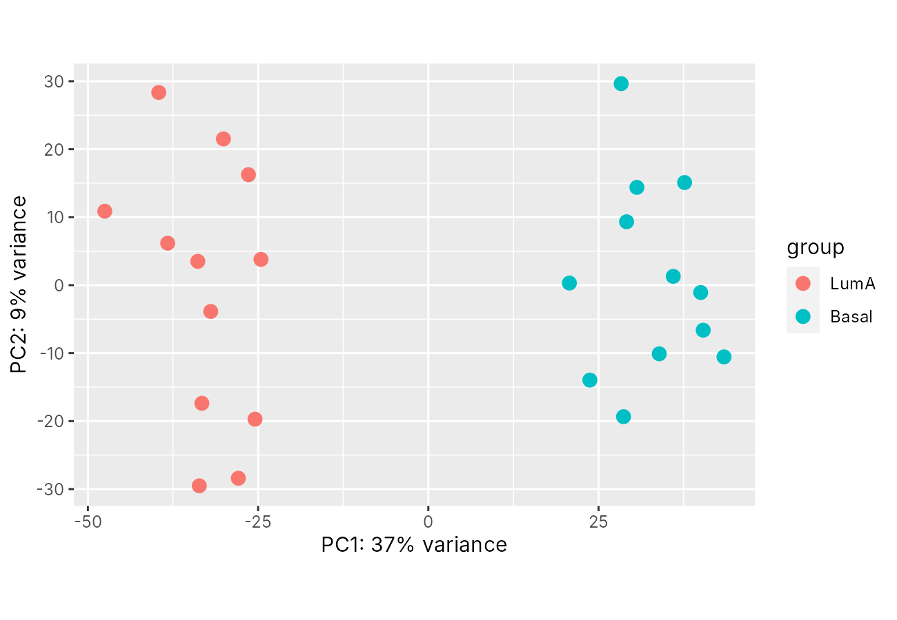
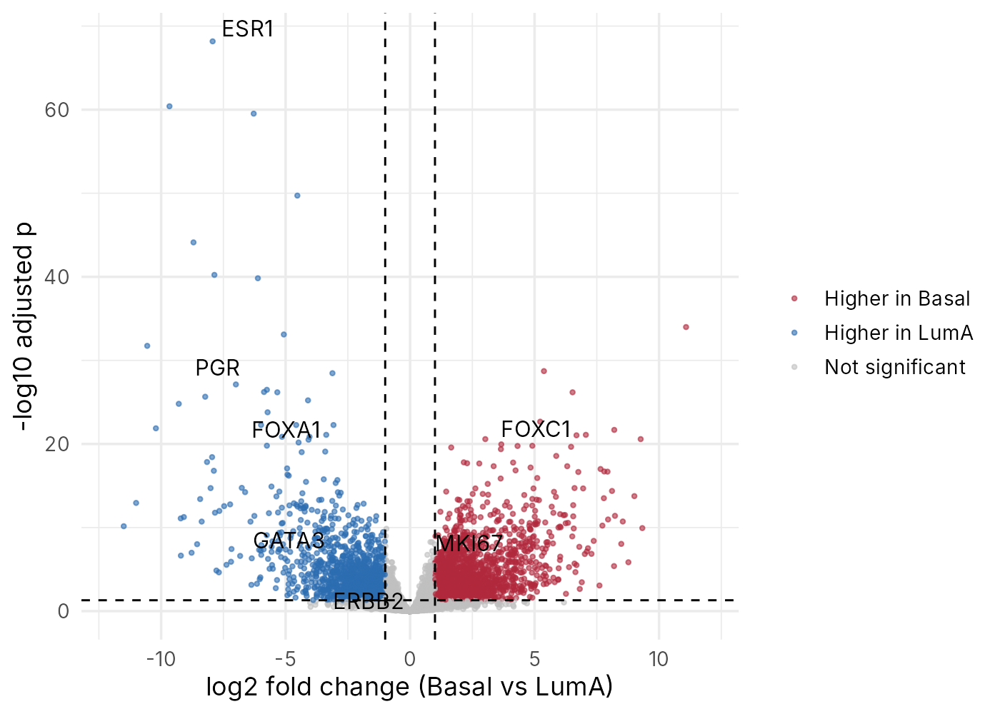
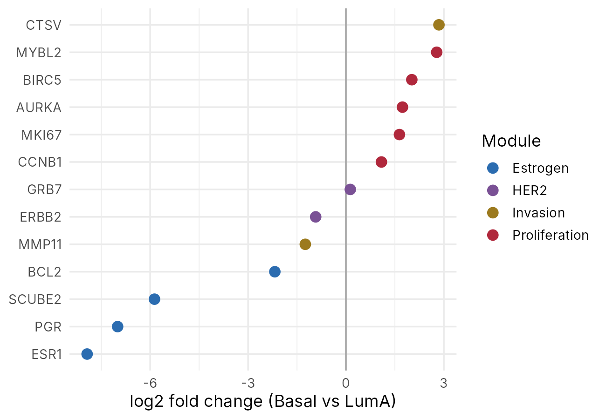

::: {.callout-note collapse="true"}
## 🎯 학습 목표

이 실습을 마치면:

-   GEO 시리즈 페이지에서 데이터셋의 설계(비교군, 표본 수, 플랫폼) 읽기
-   R DESeq2로 차등 발현 분석을 돌리고 결과표 읽기
-   PCA와 volcano plot을 그리고 해석
-   상위 유전자 목록으로 경로 분석을 하고, 결과가 말해 주는 것과 말해 주지 않는 것 구분
:::

> 🩺 **케이스 다시 보기** (🔗 [W9](w09_transcriptome.qmd))\
> 병기가 같은 두 유방암 환자. 유전자 21개로 계산한 재발 점수가 12와 31로 갈려 치료가 달라졌다. 점수를 올리는 것은 증식 유전자, 낮추는 것은 에스트로겐 관련 유전자다.\
> → 오늘 목표: 실제 유방암 RNA-seq 데이터에서 두 아형의 발현 차이를 찾고, 재발 점수 유전자들이 어느 쪽으로 움직이는지 직접 확인

------------------------------------------------------------------------

# 0. 준비물 🧰 {#w10-s0}

-   웹: [GEO](https://www.ncbi.nlm.nih.gov/geo/), [Enrichr](https://maayanlab.cloud/Enrichr/) 또는 [g:Profiler](https://biit.cs.ut.ee/gprofiler/gost) — 가입 필요 x
-   데이터 (둘 다 내려받기)
    -   [w10_brca_counts.tsv](../data/w10_brca_counts.tsv) — 유전자 17,603개 × 종양 24개의 count 표
    -   [w10_brca_samples.tsv](../data/w10_brca_samples.tsv) — 종양마다 PAM50 아형, ER·PR·HER2 상태, 진단 나이
-   JupyterHub: 로그인 → 새 R 노트북 → 두 파일을 왼쪽 파일 창에 끌어다 놓기 (🔗 [W1 §6.2](w01_intro.qmd#w1-s6-2))

::: {.callout-note collapse="true"}
## 이 데이터에 대해

-   **실제 환자 자료**: TCGA(The Cancer Genome Atlas) 유방암(BRCA) 공개 접근 데이터. GDC가 처리한 STAR 유전자 count를 UCSC Xena가 정리한 파일에서 가져옴 (2026-11-10)
-   고른 종양 24개 (원발 종양, 무작위 12개씩)
    -   **Luminal A** 12개 — ER 양성, HER2 음성
    -   **Basal-like** 12개 — ER·PR·HER2 모두 음성(삼중음성)
-   단백질 암호화 유전자만, 24개 종양을 다 합쳐 read가 10개 미만인 유전자는 뺌
-   ⚠️ PAM50 아형은 그 자체가 발현으로 정한 이름 → 두 아형의 발현이 다르게 나오는 것은 어느 정도 당연
-   ⚠️ Oncotype DX는 호르몬 수용체 양성 환자용 검사로, 삼중음성 유방암에는 쓰지 않음 → 여기서는 재발 점수 유전자 묶음이 어떻게 움직이는지 보려고 가장 대비되는 두 아형을 고름
-   만든 방법: 저장소의 `scripts/make_w10_brca.R` (원본 URL에서 다시 만들 수 있음)
:::

------------------------------------------------------------------------

# 1. 🌐 GEO 시리즈 페이지 읽기 {#w10-s1}

GEO(Gene Expression Omnibus)는 논문에 쓴 발현 데이터를 공개하는 NCBI 저장소다. 데이터를 받기 전에 시리즈(GSE) 페이지에서 실험 설계를 먼저 읽는다. 스웨덴의 대규모 유방암 RNA-seq 코호트(SCAN-B)를 예로 본다.

1.  [GEO](https://www.ncbi.nlm.nih.gov/geo/) 검색창에 `GSE96058` 입력 → 시리즈 페이지
2.  **Title, Summary, Overall design** 읽기
    -   **여기서 볼 것**: 무엇을 묻는 연구인가, 환자는 몇 명인가
3.  **Platforms** 줄 → 몇 종류의 시퀀싱 장비가 쓰였나
4.  **Samples** 목록 → 시료 이름 몇 개를 눌러 **Characteristics**(임상 정보 항목)를 보기
5.  페이지 아래 **Supplementary file** → 발현 표가 어떤 형식으로 올라와 있나

| 항목 | 내가 찾은 값 |
|------|-------------|
| 연구 질문 (한 줄) | |
| 환자 수 / 시료 수 | |
| 플랫폼 수와 이름 | |
| 시료마다 있는 임상 정보 (예: ER 상태, 아형) | |
| 분석할 때 조심할 점 | |

✅ **확인 질문** — 플랫폼이 두 종류라는 사실이 분석에서 왜 중요한가? (🔗 [W9 §2.2](w09_transcriptome.qmd#w9-s2-2))

::: {.callout-tip collapse="true"}
## 확인

-   RNA-seq으로 ER, PR, HER2, Ki67, 조직학적 등급 같은 기존 유방암 바이오마커를 예측할 수 있는지 본 연구
-   환자 3,273명, 시료 3,409개 → 일부 종양은 다시 측정한 기술적 반복(시료 이름 끝 `repl`)
-   플랫폼 2개: Illumina HiSeq 2000, Illumina NextSeq 500 → 장비가 곧 배치. 어느 장비로 읽었는지가 비교 조건과 겹치지 않는지 확인해야 함
:::

------------------------------------------------------------------------

# 2. 💻 R로 차등 발현 찾기 {#w10-s2}

## 1) 노트북 시작 {#w10-s2-1}

DESeq2를 **가장 먼저** 불러온다. 나중에 불러오면 dplyr의 `count()` 같은 함수가 다른 패키지의 같은 이름 함수에 가려져 오류가 난다.

```r
library(DESeq2)   # 차등 발현 분석 (먼저 불러오기)
library(readr)    # 표 읽기
library(dplyr)    # 표 거르기·고르기
library(ggplot2)  # 그림
library(ggrepel)  # 그림 속 글자가 겹치지 않게

options(repr.plot.width = 7, repr.plot.height = 5)
```

**결과에서 볼 것** — "Loading required package"와 "masked" 안내문이 길게 나와도 오류가 아님

## 2) 표 읽기 {#w10-s2-2}

count 표와 시료 표를 읽고, 시료 표에서 아형별로 몇 개인지 센다.

```r
counts  <- read_tsv("w10_brca_counts.tsv")
samples <- read_tsv("w10_brca_samples.tsv")
dim(counts)
samples |> count(pam50, er_status, pr_status, her2_status)
```

**결과에서 볼 것** — `17603 25` (유전자 17,603줄, 첫 열은 유전자 이름 + 종양 24열). 아형별 12개씩

| pam50 | er_status | pr_status | her2_status | n |
|---|---|---|---|---|
| Basal | Negative | Negative | Negative | 12 |
| LumA | Positive | Positive | Negative | 12 |

## 3) Count matrix 만들기 {#w10-s2-3}

DESeq2는 숫자만 든 행렬(matrix)을 받는다. 유전자 이름을 행 이름으로 옮기고, 두 유전자를 들여다본다.

```r
mat <- as.matrix(counts[, -1])
rownames(mat) <- counts$gene
mat[c("ESR1", "KRT5"), c("LumA_01", "LumA_02", "Basal_01", "Basal_02")]
```

**결과에서 볼 것**

|  | LumA_01 | LumA_02 | Basal_01 | Basal_02 |
|---|---:|---:|---:|---:|
| ESR1 | 20137 | 26594 | 43 | 51 |
| KRT5 | 16471 | 21071 | 29522 | 3893 |

## 4) 시료마다 깊이가 다르다 {#w10-s2-4}

열(종양)마다 count를 다 더하면 그 시료의 총 read 수(깊이)다. 백만 단위로 본다.

```r
round(colSums(mat) / 1e6, 1)
```

**결과에서 볼 것** — 33.7(Basal_09)부터 70.6(Basal_12)까지 두 배 넘게 차이 → count를 그대로 비교하면 안 되는 이유 (🔗 [W9 §4.1](w09_transcriptome.qmd#w9-s4-1))

## 5) DESeq2 객체와 PCA {#w10-s2-5}

count 행렬, 시료 표, 비교할 변수(`~ pam50`)를 묶어 DESeq2 객체를 만든다. 기준 그룹을 Luminal A로 정해 두면, 결과의 양수는 "Basal-like에서 더 높음"이 된다. 먼저 PCA로 종양 24개가 어떻게 모이는지 본다.

```r
samples <- samples |> mutate(pam50 = factor(pam50, levels = c("LumA", "Basal")))
dds <- DESeqDataSetFromMatrix(countData = mat, colData = samples, design = ~ pam50)

vsd <- vst(dds)
plotPCA(vsd, intgroup = "pam50")
```

{fig-align="center" width="75%"}

-   `vst()` = 그림과 PCA를 위해 count를 비교하기 좋은 척도로 바꿈 (차등 발현 검정에는 원래 count를 씀)
-   **결과에서 볼 것** — 같은 아형끼리 모이는가? 다른 무리와 섞인 종양은 없나? 배치가 있다면 여기서 엉뚱한 무리로 드러나기도 함

## 6) 차등 발현 검정 {#w10-s2-6}

`DESeq()` 한 줄이 정규화, 흔들림 추정, 검정을 차례로 한다. 몇 초에서 1분쯤 걸린다.

```r
dds <- DESeq(dds)
res <- results(dds)
summary(res, alpha = 0.05)
```

**결과에서 볼 것** — 보정 p값 < 0.05에서 Basal-like에서 높은 유전자 3,151개(LFC > 0), 낮은 유전자 2,398개(LFC < 0) → 합쳐서 5,549개. 두 아형이 매우 다르면 수천 개가 정상 (🔗 [W9 §4.2](w09_transcriptome.qmd#w9-s4-2))

## 7) 결과표 읽기 {#w10-s2-7}

결과를 다루기 쉬운 표로 바꾸고, 보정 p값이 계산되지 않은 유전자(count가 너무 적은 유전자)는 뺀다. 그다음 가장 확실한 10개와 W9에서 본 유전자들을 본다.

```r
res_df <- as.data.frame(res) |>
  tibble::rownames_to_column("gene") |>
  filter(!is.na(padj))

res_df |>
  arrange(padj) |>
  select(gene, baseMean, log2FoldChange, padj) |>
  head(10)
```

```r
genes <- c("ESR1", "PGR", "FOXA1", "GATA3", "ERBB2", "MKI67", "FOXC1")
res_df |>
  filter(gene %in% genes) |>
  select(gene, baseMean, log2FoldChange, padj) |>
  arrange(log2FoldChange)
```

**결과에서 볼 것** — 두 번째 표

| gene | baseMean | log2FoldChange | padj |
|---|---:|---:|---:|
| ESR1 | 25609 | −7.93 | 6.7e-69 |
| PGR | 6457 | −7.00 | 7.5e-28 |
| FOXA1 | 10603 | −5.72 | 1.6e-24 |
| GATA3 | 21474 | −4.12 | 2.6e-11 |
| ERBB2 | 14633 | −0.93 | 4.6e-04 |
| MKI67 | 9601 | 1.64 | 8.9e-07 |
| FOXC1 | 5299 | 4.32 | 1.7e-20 |

-   `baseMean` = 정규화한 평균 count, `log2FoldChange` = Basal-like ÷ Luminal A의 log₂, `padj` = FDR 보정 p값
-   *ESR1* −7.93 → Basal-like에서 약 250분의 1 (2⁷·⁹³ ≈ 244)
-   첫 번째 표 1위도 *ESR1* → 두 아형을 가르는 가장 확실한 유전자가 에스트로겐 수용체

## 8) Volcano plot {#w10-s2-8}

유전자마다 효과 크기와 확실성을 한 그림에 찍는다.

```r
res_df <- res_df |>
  mutate(group = case_when(
    padj < 0.05 & log2FoldChange >  1 ~ "Higher in Basal",
    padj < 0.05 & log2FoldChange < -1 ~ "Higher in LumA",
    TRUE                              ~ "Not significant"
  ))

ggplot(res_df, aes(x = log2FoldChange, y = -log10(padj), colour = group)) +
  geom_point(size = 0.8, alpha = 0.6) +
  geom_text_repel(data = filter(res_df, gene %in% genes),
                  aes(label = gene), colour = "black", size = 4) +
  geom_vline(xintercept = c(-1, 1), linetype = "dashed") +
  geom_hline(yintercept = -log10(0.05), linetype = "dashed") +
  scale_colour_manual(values = c("Higher in Basal" = "#B0283C",
                                 "Higher in LumA"  = "#2B6CB0",
                                 "Not significant" = "grey75")) +
  coord_cartesian(xlim = c(-12, 12)) +
  labs(x = "log2 fold change (Basal vs LumA)", y = "-log10 adjusted p", colour = NULL) +
  theme_minimal(base_size = 13)
```

{fig-align="center" width="85%"}

-   `case_when()` = 조건에 따라 이름표 붙이기. 위에서부터 차례로 확인
-   `coord_cartesian(xlim = …)` = 그림 범위만 자름. 한쪽 아형에서 거의 0인 유전자는 fold change가 극단적으로 커서(예: *MAGEA4*, log₂FC ≈ 25) 나머지가 쭈그러들기 때문
-   **결과에서 볼 것** — 빨간 점(1,974개)과 파란 점(1,600개). 점선 안쪽의 회색 점은 왜 회색인가?

## 9) 케이스와 연결: 재발 점수 유전자 {#w10-s2-9}

재발 점수에 들어가는 암 관련 유전자 가운데 네 묶음(13개)이 두 아형 사이에서 어떻게 움직이는지 본다.

```r
oncotype <- tibble(
  gene = c("ESR1", "PGR", "BCL2", "SCUBE2",
           "MKI67", "AURKA", "BIRC5", "CCNB1", "MYBL2",
           "ERBB2", "GRB7", "MMP11", "CTSV"),
  module = c(rep("Estrogen", 4), rep("Proliferation", 5),
             rep("HER2", 2), rep("Invasion", 2))
)

oncotype |>
  left_join(res_df, by = "gene") |>
  ggplot(aes(x = log2FoldChange, y = reorder(gene, log2FoldChange), colour = module)) +
  geom_vline(xintercept = 0, colour = "grey60") +
  geom_point(size = 3.5) +
  scale_colour_manual(values = c(Estrogen = "#2B6CB0", Proliferation = "#B0283C",
                                 HER2 = "#7A5195", Invasion = "#9C7A1E")) +
  labs(x = "log2 fold change (Basal vs LumA)", y = NULL, colour = "Module") +
  theme_minimal(base_size = 13)
```

{fig-align="center" width="75%"}

-   `left_join()` = 두 표를 유전자 이름으로 이어 붙임
-   **결과에서 볼 것** — 재발 점수를 올리는 방향(증식 ↑, 에스트로겐 ↓)이 Basal-like 쪽. 점수 31인 환자의 종양은 이 방향으로 기운 종양일 것

::: {.callout-tip collapse="true"}
## 🛠️ 고쳐 보기

1.  기준을 엄격하게: `padj < 0.01`이고 `abs(log2FoldChange) > 2`인 유전자는 몇 개인가?
2.  기준 그룹 바꾸기: [§2.5](#w10-s2-5)에서 `levels = c("Basal", "LumA")`로 바꿔 다시 돌리면 *ESR1*의 log₂FC는 어떻게 되나?
3.  `genes`에 *AR*, *TFF1*을 더해 volcano plot을 다시 그리기. 어느 쪽에 찍히나?

**확인**: (1) 1,448개 (2) 부호만 바뀜: +7.93 → "Luminal A에서 높음"을 양수로 읽게 됨. 기준 그룹이 결과 해석을 정함 (3) 둘 다 Luminal A 쪽(왼쪽)
:::

::: {.callout-note collapse="true" icon=false}
## 💡 AI 도우미에게 묻기

-   "DESeq2의 results() 표에서 baseMean, log2FoldChange, padj가 각각 무슨 뜻인지 의예과 학생에게 설명해 줘"
-   "`factor(pam50, levels = c("LumA", "Basal"))`가 결과의 부호를 어떻게 바꾸는지 예를 들어 설명해 줘"
-   "이 오류 메시지는 무슨 뜻이고 무엇을 고쳐야 해? (오류 붙여넣기)"
:::

------------------------------------------------------------------------

# 3. 🌐 경로 분석 {#w10-s3}

유의한 유전자 수천 개를 하나씩 볼 수는 없다. 상위 유전자 목록을 웹 도구에 넣어 어떤 경로와 겹치는지 본다 (🔗 [W9 §5](w09_transcriptome.qmd#w9-s5)).

## 1) 유전자 목록 만들기 {#w10-s3-1}

양쪽 방향으로 가장 확실한 유전자 200개씩, 그리고 배경으로 쓸 "검정한 유전자 전체"를 파일로 저장한다.

```r
top_basal <- res_df |> filter(padj < 0.05, log2FoldChange > 1) |>
  arrange(padj) |> slice_head(n = 200) |> pull(gene)
top_luma  <- res_df |> filter(padj < 0.05, log2FoldChange < -1) |>
  arrange(padj) |> slice_head(n = 200) |> pull(gene)

writeLines(top_basal, "top_basal.txt")
writeLines(top_luma,  "top_luma.txt")
writeLines(res_df$gene, "background.txt")   # 16,912개
```

**결과에서 볼 것** — 파일 창에 세 파일이 생김. 파일을 열어 내용을 복사하거나, 오른쪽 클릭 → Download

## 2) Enrichr에 넣기 {#w10-s3-2}

1.  [Enrichr](https://maayanlab.cloud/Enrichr/) → 입력 칸에 `top_basal.txt` 내용 붙여 넣기 → **Submit**
2.  **Pathways** 탭 → **MSigDB Hallmark** 결과, **Ontologies** 탭 → **GO Biological Process** 결과
    -   **여기서 볼 것**: 맨 위 경로 이름과 보정 p값(Adjusted p-value)
3.  `top_luma.txt`로 같은 과정 반복
4.  (선택) [g:Profiler](https://biit.cs.ut.ee/gprofiler/gost)에서는 배경 유전자를 직접 넣을 수 있음 → Advanced options의 statistical domain scope에서 사용자 목록을 고르고 `background.txt` 붙여 넣기

| 목록 | Hallmark 1위 | GO BP 1위 | 한 줄 해석 |
|---|---|---|---|
| Basal-like에서 높은 200개 | | | |
| Luminal A에서 높은 200개 | | | |

✅ **확인 질문** — 이 결과가 "Basal-like 유방암은 세포 분열 경로 때문에 생긴다"는 뜻인가?

::: {.callout-tip collapse="true"}
## 확인

같은 200개 목록을 MSigDB Hallmark와 GO Biological Process 유전자 집합으로 미리 분석해 본 결과(배경 = 검정한 유전자 16,912개):

-   **Basal-like에서 높은 유전자** → Hallmark: G2M checkpoint, E2F targets (세포 주기). GO: 유사분열, 염색체 분리 관련 항목 → 증식이 빠른 종양
-   **Luminal A에서 높은 유전자** → Hallmark: Estrogen response early, Estrogen response late. 그런데 GO Biological Process에서는 보정 p값이 뚜렷한 항목이 없음 → **데이터베이스에 따라 결과가 다름**
-   Enrichr는 배경을 사람 유전자 전체로 잡기 때문에 숫자는 조금 다를 수 있음
-   확인 질문: 아님. 경로 분석은 "어떤 경로의 유전자들이 함께 달라져 있다"는 **연관**만 보여 줌. 빠른 증식은 Basal-like 종양의 특징이지, 이 분석만으로 원인이라고 말할 수 없음
:::

------------------------------------------------------------------------

# ✍️ 제출

케이스에 대한 한 문단 해석:

-   재발 점수의 증식 묶음과 에스트로겐 묶음이 두 아형에서 어떻게 달랐는지, 그것이 점수 12와 31의 차이를 어떻게 설명하는지
-   오늘 결과가 **말해 주지 않는 것** (예: 종양 24개뿐, 아형 이름이 발현에서 나옴, TCGA 환자 구성, RNA ≠ 단백질, 이 비교는 Oncotype DX 자체의 검증이 아님)

------------------------------------------------------------------------

# 📝 정리

| 도구 또는 함수 | 한 일 |
|----------------|-------|
| GEO | 공개 발현 데이터와 실험 설계 확인 |
| Enrichr · g:Profiler | 유전자 목록의 경로 분석 |
| `as.matrix()` · `rownames()` | 표를 숫자 행렬로 바꾸고 행 이름 붙이기 |
| `colSums()` | 시료별 총 read 수(깊이) |
| `factor(levels = …)` | 기준 그룹 정하기 |
| `DESeqDataSetFromMatrix()` | count, 시료 정보, 비교식을 묶은 DESeq2 객체 만들기 |
| `vst()` · `plotPCA()` | 그림용 척도 변환과 PCA |
| `DESeq()` · `results()` | 정규화와 차등 발현 검정, 결과표 |
| `case_when()` | 조건에 따라 이름표 붙이기 |
| `left_join()` | 두 표를 같은 열로 이어 붙이기 |
| `geom_text_repel()` | 그림 속 글자를 겹치지 않게 달기 |
| `writeLines()` | 목록을 텍스트 파일로 저장 |

# ➕ 참고 링크

-   [GEO — GSE96058 (SCAN-B)](https://www.ncbi.nlm.nih.gov/geo/query/acc.cgi?acc=GSE96058) · Brueffer C, et al. [*Clinical value of RNA sequencing-based classifiers for prediction of the five conventional breast cancer biomarkers.*](https://doi.org/10.1200/PO.17.00135) JCO Precis Oncol. 2018.
-   [UCSC Xena](https://xenabrowser.net/) · [NCI GDC Data Portal](https://portal.gdc.cancer.gov/) — TCGA 데이터의 출처
-   [DESeq2 사용 설명서 (Bioconductor)](https://bioconductor.org/packages/release/bioc/vignettes/DESeq2/inst/doc/DESeq2.html) · Love MI, et al. [*Moderated estimation of fold change and dispersion for RNA-seq data with DESeq2.*](https://doi.org/10.1186/s13059-014-0550-8) Genome Biol. 2014.
-   Kuleshov MV, et al. [*Enrichr: a comprehensive gene set enrichment analysis web server 2016 update.*](https://doi.org/10.1093/nar/gkw377) Nucleic Acids Res. 2016.
-   Kolberg L, et al. [*g:Profiler — interoperable web service for functional enrichment analysis and gene identifier mapping (2023 update).*](https://doi.org/10.1093/nar/gkad347) Nucleic Acids Res. 2023.
