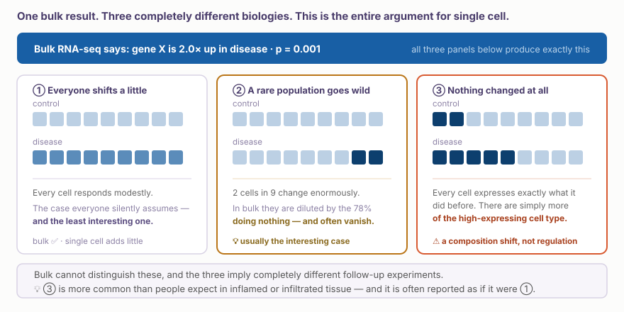
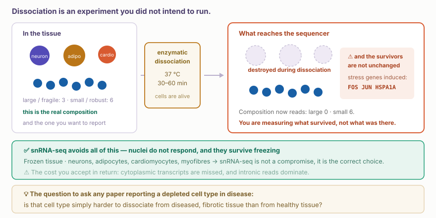
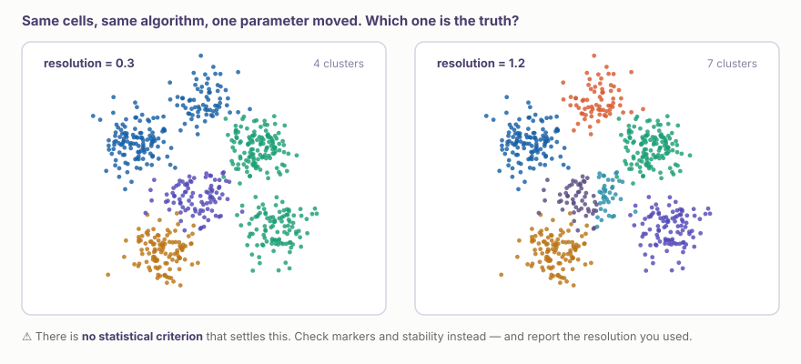
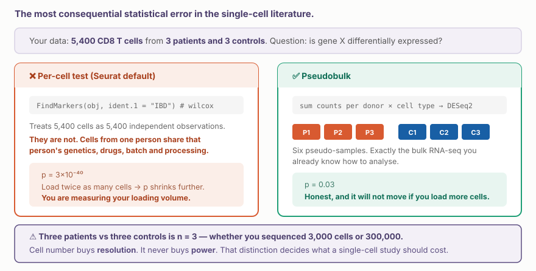

::: {.callout-note collapse="true"}
## 🎯 학습 목표

이 장을 마치면:

-   Bulk RNA-seq의 평균이 숨기는 것 설명
-   단일세포 실험 흐름(조직 해리, droplet, barcode, UMI)과 그 편향 설명
-   QC → 정규화 → PCA → 클러스터링 → UMAP 흐름과 UMAP 해석의 한계 설명
-   Marker 유전자와 참조 아틀라스로 세포 유형 이름 붙이기
-   조건 비교에서 n이 환자 수인 이유와 pseudobulk 설명
-   공간 전사체가 더해 주는 정보와 종양미세환경 연구에서의 쓰임 설명
-   ⚠️ "세포를 많이 읽었다 = 근거가 강하다"가 틀린 이유 설명
:::

> 🩺 **오늘의 케이스**\
> 같은 진행성 흑색종, 같은 면역관문억제제(항 PD-1 항체). 한 환자는 종양이 줄고 다른 환자는 그대로다.\
> 두 환자의 종양 조직을 세포 하나하나로 나눠 RNA를 읽었다.\
> → 종양 속 T세포는 무엇이 달랐을까? (🔗 [W12 실습](w12_singlecell_lab.qmd)에서 직접)

💡 각 절의 본문 = 꼭 알아야 할 기초. **🔍 더 알아보기**는 궁금할 때 펼쳐 보는 심화 내용

------------------------------------------------------------------------

# 1. 왜 단일세포인가 🔬 {#w11-s1}

> 🔑 **핵심** — Bulk RNA-seq = 조직 전체의 평균. 같은 평균 뒤에 전혀 다른 생물학이 숨어 있을 수 있음

## 1) 평균의 함정 {#w11-s1-1}

W9에서 본 bulk RNA-seq은 조직 한 조각을 통째로 갈아서 RNA를 읽는다. 과일을 모두 갈아 만든 스무디의 맛을 보는 것과 같다. 스무디 맛으로는 딸기가 많아졌는지, 딸기 몇 개만 유난히 달아졌는지 알 수 없다. 단일세포 RNA 시퀀싱(single-cell RNA-seq)은 과일 샐러드처럼 과일을 하나씩 집어서 본다.

{fig-align="center"}

-   **① 모든 세포가 조금씩 변함** — 보통 암묵적으로 가정하는 경우
-   **② 드문 세포만 크게 변함** — 가장 흥미로운 경우가 많음. Bulk에서는 나머지 세포에 희석되어 안 보일 수도
-   **③ 세포 구성만 바뀜** — 그 유전자를 많이 발현하는 세포 유형이 늘었을 뿐
-   → Bulk는 셋을 구분하지 못하고, 단일세포는 구분할 수 있음

## 2) 🔗 W9 다시 보기 {#w11-s1-2}

-   W9의 함정 "Bulk 발현 차이 = 세포 조성 차이일 수 있음" (🔗 [W9 §1.3](w09_transcriptome.qmd#w9-s1-3)) → 단일세포가 이 질문에 직접 답함
-   케이스에 적용하면: 반응한 환자의 종양에서 T세포 유전자가 높게 나왔다면?
    -   T세포가 **많아서**인가 (③ 조성)
    -   T세포의 **상태가 달라서**인가 (① 또는 ②)
    -   → 치료 전략이 달라지는 질문

## 3) Bulk가 여전히 나은 경우 {#w11-s1-3}

-   환자 수가 중요한 연구 → 단일세포는 비싸서 같은 예산이면 bulk로 훨씬 많은 환자를 볼 수 있음
-   세포가 고른 시료(배양 세포, 이미 분리한 세포)
-   발현이 낮은 유전자나 전사체 변형(isoform)을 깊이 봐야 할 때
-   보고 싶은 세포 유형을 이미 안다면 → 그 세포만 분리(FACS)해서 bulk로 읽는 편이 싸고 깊음
-   💡 "단일세포를 했다" ≠ 더 강한 연구. 질문에 맞는 방법인지가 중요

------------------------------------------------------------------------

# 2. 세포에 바코드 붙이기 🧫 {#w11-s2}

> 🔑 **핵심** — 세포 하나하나를 작은 방울에 가두고, 그 안의 RNA에 세포 주소(barcode)와 분자 번호(UMI)를 붙여 수천 개 세포를 한꺼번에 읽음

## 1) 조직을 낱개 세포로 풀기 {#w11-s2-1}

-   신선한 조직을 효소로 녹여 세포 하나하나가 떠다니는 액체로 만듦 = 해리(dissociation)
-   혈액은 이미 낱개 세포라 해리가 필요 없음 → W12 실습 데이터가 혈액인 이유 중 하나
-   ⚠️ **해리 편향**
    -   약하거나 큰 세포는 해리 중에 부서져 사라짐 → 측정한 구성 = 원래 구성이 아니라 **살아남은 세포의 구성**
    -   살아남은 세포도 37 °C에서 30–60분 시달리며 스트레스 유전자(*FOS*, *JUN* 등)를 켬 → "활성화된 세포"처럼 보이는 가짜 신호

::: {.callout-note collapse="true" icon=false}
## 🔍 더 알아보기 — 해리 편향과 핵(nucleus) 시퀀싱

{fig-align="center"}

-   세포 대신 **핵**만 꺼내 읽는 방법(single-nucleus RNA-seq)도 있음
    -   냉동 조직으로도 가능 → 병원에 보관된 시료를 쓸 수 있음
    -   신경세포, 심근세포처럼 해리가 어려운 세포도 읽을 수 있음
-   "질환에서 세포 유형 X가 줄었다"는 결과는 "질환 조직에서 X를 해리하기 더 어려웠다"와 같은 데이터를 만들 수 있음 → 감소 주장은 의심해 볼 것
:::

## 2) Droplet, barcode, UMI {#w11-s2-2}

가장 널리 쓰이는 방식은 기름 속 작은 물방울(droplet)을 쓴다. 미세한 관 속에서 세포 하나와 바코드 구슬 하나가 물방울 하나에 함께 갇힌다. 구슬에 붙은 짧은 DNA 꼬리표가 그 물방울 속 RNA에 붙는다.

-   **Cell barcode (세포 바코드)** — 이 RNA가 **어느 세포**에서 왔나. 한 구슬의 꼬리표는 모두 같은 바코드
-   **UMI** (unique molecular identifier) — 원래 RNA **분자 하나하나**에 붙은 번호 → PCR로 불어난 복사본을 하나로 셈
-   결과 = 유전자 × 세포 표, 칸마다 그 세포에서 잡힌 그 유전자의 **분자 수** (count matrix, 🔗 [W1 §3.2](w01_intro.qmd#w1-s3-2-4))
-   한 번에 수천–수만 개 세포 → W12 실습 데이터 = 건강한 사람 혈액 세포 약 2,700개

## 3) 표의 대부분이 0 {#w11-s2-3}

-   세포 하나에서 약 2만 개 유전자 중 수백–수천 개만 검출됨 → W12 데이터에서 칸의 약 97%가 0
-   0의 두 가지 뜻
    -   그 세포가 실제로 그 유전자를 발현하지 않음
    -   발현했지만 분자를 못 잡음 → 세포 하나에서 잡히는 RNA는 전체의 일부뿐
-   ⚠️ **세포 하나에서 0 → 유전자가 꺼졌다고 단정하면 안 됨**
    -   예: W12 데이터의 CD8 T세포 무리에서도 *CD8A*가 검출된 세포는 약 절반뿐

------------------------------------------------------------------------

# 3. Count matrix에서 지도까지 🗺️ {#w11-s3}

> 🔑 **핵심** — QC → 정규화 → 중요한 유전자 고르기 → PCA → 클러스터링 → UMAP. 단계마다 사람이 정하는 기준이 있고, 그 기준이 결과를 바꿈

## 1) QC — 세포가 아닌 것 걸러 내기 {#w11-s3-1}

| 문제 | 표에서 보이는 모습 | 거르는 법 |
|---|---|---|
| 빈 droplet | 세포 없이 구슬만 → 유전자 수가 아주 적음 | 유전자 수 하한 |
| 이중세포(doublet) | 한 방울에 세포 둘 → 유전자 수가 너무 많고, 두 세포 유형의 표지가 함께 보임 | 유전자 수 상한, 전용 도구 |
| 죽어가는 세포 | 세포막이 깨져 세포질 RNA가 새고 미토콘드리아 RNA 비율이 높아짐 | 미토콘드리아 비율 상한 (예: 5%) |

-   ⚠️ **기준값 하나가 실제 세포 집단을 함께 지울 수 있음**
    -   미토콘드리아가 원래 많은 심근세포에 5% 기준은 틀림
    -   유전자 수 하한을 높이면 혈소판처럼 RNA가 적은 작은 세포도 사라짐
-   → 분포를 그려 보고 기준을 정하고, 쓴 기준을 보고함 (🔗 W12에서 직접)

## 2) 정규화 → PCA → 클러스터링 → UMAP {#w11-s3-2}

| 단계 | 하는 일 | 쉽게 말하면 |
|---|---|---|
| 정규화 | 세포마다 잡힌 분자 총량이 달라 비율로 맞춤 | 큰 세포와 작은 세포를 공평하게 (🔗 [W9 §4](w09_transcriptome.qmd#w9-s4)) |
| 변이 큰 유전자 고르기 | 세포마다 차이가 큰 유전자 약 2,000개만 사용 | 모두 똑같이 켜진 유전자는 구분에 도움 안 됨 |
| PCA | 수천 개 유전자 정보를 수십 개 축으로 요약 | 정보를 압축 |
| 이웃 그래프와 클러스터링(clustering) | 비슷한 세포끼리 연결하고 무리로 묶음 | 친구 관계로 반 나누기 |
| UMAP | 수십 개 축을 2차원 그림으로 펼침 | 보기 위한 지도 |

-   클러스터링에는 **해상도(resolution)**라는 손잡이가 있음 → 높이면 더 잘게, 낮추면 더 크게 묶음 ([§4](#w11-s4))

## 3) ⚠️ UMAP 읽기 {#w11-s3-3}

UMAP은 수천 차원의 정보를 종이 한 장에 억지로 펼친 그림이다. 지구본을 평면 지도로 펴면 대륙의 크기와 거리가 일그러지는 것과 비슷하다.

-   ✅ 읽어도 되는 것 — 어떤 무리가 있나, 어떤 유전자가 어느 무리에서 켜지나
-   ❌ 읽으면 안 되는 것 — 무리 사이의 **거리**, 무리의 **크기와 모양**, 빈 공간
    -   설정값만 바꿔도 이런 특징은 크게 바뀜
-   → 결론은 UMAP 모양이 아니라 유전자 발현과 통계로 말함

------------------------------------------------------------------------

# 4. 세포 유형 이름 붙이기 🏷️ {#w11-s4}

> 🔑 **핵심** — 클러스터는 알고리즘이 만든 묶음, 세포 유형은 생물학적 판단. 이름은 marker 유전자와 참조 아틀라스를 보고 사람이 붙임

## 1) Marker 유전자 {#w11-s4-1}

세포 유형마다 특징적으로 켜는 유전자가 있다. 이것을 표지 유전자(marker gene)라 한다. 혈액 세포의 대표 marker는 다음과 같다 (🔗 W12에서 그대로 씀).

| 세포 유형 | 대표 marker |
|---|---|
| T세포 | *CD3E* |
| 그중 naive T세포 | *CCR7* |
| CD8 T세포 | *CD8A* |
| B세포 | *MS4A1* (CD20) |
| 단핵구 | *CD14*, *LYZ* / *FCGR3A* (CD16) |
| NK세포 | *GNLY*, *NKG7* |
| 수지상세포 | *FCER1A* |
| 혈소판 | *PPBP* |

## 2) 참조 아틀라스 {#w11-s4-2}

-   세포 아틀라스(cell atlas) = 사람 몸의 세포 유형과 그 발현을 정리한 참조 지도
    -   예: Human Cell Atlas, CZ CELLxGENE Discover (🔗 W12)
-   내 데이터의 세포를 아틀라스와 비교해 자동으로 이름을 붙이기도 함
-   ⚠️ **아틀라스의 대표성** — 아틀라스에 어떤 사람, 어떤 조직, 어떤 질환이 들어 있는지에 따라 이름이 달라짐
    -   내 환자 집단이나 질환이 아틀라스에 잘 들어 있지 않으면 이름이 틀릴 수 있음
    -   아틀라스에 없는 세포 상태(예: 종양 속에만 있는 특수한 T세포)는 가장 비슷한 기존 이름으로 억지로 붙음

## 3) ⚠️ 클러스터 ≠ 세포 유형 {#w11-s4-3}

{fig-align="center"}

-   W12 데이터: 해상도 0.1 → 클러스터 4개, 0.5 → 9개, 1.0 → 11개
-   세포 유형 하나가 여러 클러스터로 쪼개지기도, 두 유형이 한 클러스터로 합쳐지기도 함
-   → "클러스터가 몇 개냐"가 아니라 "이 구분이 marker와 생물학으로 설명되느냐"를 봄

------------------------------------------------------------------------

# 5. 비교와 통계 📊 {#w11-s5}

> 🔑 **핵심** — 세포는 수천 개라도 표본 수는 환자 수. 환자 3명 대 3명이면 n = 3

## 1) ⚠️ 세포 수 ≠ 표본 수 {#w11-s5-1}

같은 사람에게서 나온 세포들은 유전형, 복용한 약, 시료 처리 과정을 함께 나눈다. 그래서 서로 독립된 관찰이 아니다. 환자 몇 명의 세포 수천 개를 수천 개의 독립된 표본처럼 검정하면 p값이 터무니없이 작아진다.

{fig-align="center"}

-   세포 단위 검정은 거짓 양성이 많다는 것이 여러 데이터로 확인됨 (Squair et al., 2021)
-   💡 연구 설계에서 뜻하는 것 → 환자당 세포를 더 읽는 것보다 **환자 수를 늘리는 것**이 근거를 키움

## 2) Pseudobulk {#w11-s5-2}

-   환자 × 세포 유형별로 count를 모두 더함 → 환자마다 "CD8 T세포만의 작은 bulk RNA-seq"
-   그다음은 W9의 차등 발현 방법을 그대로 씀 (🔗 [W9 §4](w09_transcriptome.qmd#w9-s4))

## 3) 세포 비율 비교 {#w11-s5-3}

-   "반응자의 종양에 어떤 T세포가 더 많은가?" = 세포 유형의 **비율** 비교
-   이것도 환자 단위로 비교 (환자마다 비율 하나)
-   ⚠️ 비율은 서로 묶여 있음 → 한 세포 유형이 늘면 다른 유형의 비율은 저절로 줄어 보임 (🔗 [W13 §4](w13_microbiome.qmd#w13-s4) 조성 데이터)

------------------------------------------------------------------------

# 6. 공간 전사체 📍 {#w11-s6}

> 🔑 **핵심** — 조직을 풀지 않고 제자리에서 RNA를 읽어 "어떤 세포가 어디에, 누구 옆에 있는지" 봄

단일세포 분석은 조직을 풀면서 세포의 위치 정보를 잃는다. 공간 전사체(spatial transcriptomics)는 조직 절편을 그대로 둔 채 위치마다 RNA를 읽는다. 2020년 Nature Methods가 "올해의 방법"으로 뽑을 만큼 빠르게 퍼진 기술이다.

-   **점(spot) 기반** — 슬라이드 위 수천 개 점마다 위치 바코드 → 한 점에 세포 여러 개가 섞임 → 단일세포 데이터를 이용해 점 속 세포 구성을 추정
-   **영상 기반** — 현미경으로 RNA 분자 하나하나의 위치를 찍음 → 세포 하나 수준의 해상도, 대신 미리 고른 수백–수천 개 유전자만 측정
-   임상에서 묻는 질문의 예
    -   T세포가 종양 **안까지** 들어가 있나, **가장자리**에 막혀 있나
    -   종양 중심과 가장자리의 세포 구성이 다른가

------------------------------------------------------------------------

# 7. 진료에서 — 케이스로 돌아가기 🏥 {#w11-s7}

> 🔑 **핵심** — 반응한 환자의 종양에는 *TCF7*을 켠 CD8 T세포가 더 많았음. 다만 근거의 크기는 세포 수가 아니라 환자 수와 독립 검증이 정함

케이스와 같은 질문을 실제로 던진 연구가 있다 (Sade-Feldman et al., *Cell*, 2018).

-   면역관문억제제를 맞은 흑색종 환자의 종양 시료 48개에서 면역세포 16,291개를 단일세포로 읽음
-   CD8 T세포가 클러스터링으로 두 상태로 나뉨 → 한 상태는 종양이 줄어든 환자, 다른 상태는 진행한 환자와 관련
-   두 상태를 가르는 전사인자 하나 = *TCF7*
    -   *TCF7*을 켠 CD8 T세포 = 아직 덜 지친, 기억세포에 가까운 상태 → 다시 늘어나 싸울 수 있음
    -   *TCF7*이 꺼진 쪽 = 오래 싸워 지친 탈진(exhaustion) 상태
-   중요한 다음 단계: 고정된 종양 조직에서 *TCF7*을 염색으로 확인하고, **독립된 환자 집단**에서도 *TCF7* 양성 CD8 T세포가 좋은 치료 결과를 예측함

**세 가지 함정으로 다시 보기**

-   **세포 수 ≠ 표본 수** — 세포 1만 6천 개가 근거의 크기가 아님. 시료 48개, 그리고 독립 검증이 근거
-   **클러스터 ≠ 세포 유형** — "기억 비슷한 상태", "탈진 상태"는 클러스터를 보고 사람이 붙인 해석
-   **아틀라스의 대표성** — 한 연구의 흑색종 환자에게서 얻은 결과 → 다른 암, 다른 집단에도 맞는지는 따로 확인해야 함

**같은 방법이 쓰이는 다른 진료 장면**

-   CAR-T 세포 치료 — 주입하는 CAR-T 세포 제품을 단일세포로 분석했더니, 완전 관해에 이른 림프종 환자의 제품에는 기억세포 표지를 가진 CD8 T세포가 약 3배 많았음 (Deng et al., 2020)

➡️ W12에서는 건강한 사람 혈액 세포로 같은 흐름을 직접 돌려 CD8 T세포를 찾고 *TCF7*을 본다.

------------------------------------------------------------------------

# 🤔 흔한 오해

1.  **단일세포 분석은 bulk보다 항상 낫다?**\
    아니다. 비싸고, 해리 편향이 있고, 같은 예산으로 볼 수 있는 환자 수가 줄어든다. 질문이 세포 구성이나 드문 세포에 관한 것일 때 강하다.
2.  **세포를 많이 읽을수록 근거가 강해진다?**\
    아니다. 같은 사람의 세포는 독립된 표본이 아니다. 근거의 크기는 환자 수가 정한다.
3.  **클러스터 하나 = 세포 유형 하나다?**\
    아니다. 클러스터 수는 해상도 설정에 따라 바뀐다. 세포 유형은 marker와 생물학적 판단으로 정한다.
4.  **UMAP에서 멀리 떨어진 무리일수록 더 다른 세포다?**\
    아니다. UMAP의 거리, 크기, 모양은 설정값에 따라 크게 바뀐다. 무리가 있는지와 어떤 유전자가 켜지는지만 읽는다.
5.  **세포 하나에서 0으로 나온 유전자는 꺼져 있다?**\
    아니다. 세포 하나에서 잡히는 RNA는 일부뿐이라, 발현하고 있어도 0이 나올 수 있다.

# ❓ 복습 문제

**1. (개념)** 다음을 알맞게 짝지으시오.\
Cell barcode · UMI ↔ (가) PCR로 불어난 복사본을 원래 분자 하나로 세게 해 줌 (나) 그 RNA가 어느 세포에서 왔는지 알려 줌

**2. (개념)** QC에서 미토콘드리아 유전자 비율이 유난히 높은 세포는 대개 무엇인가?\
(a) 이중세포 (b) 죽어가거나 손상된 세포 (c) 빈 droplet (d) 혈소판

**3. (개념)** UMAP 그림에서 읽어도 되는 것은?\
(a) 두 무리 사이의 거리 (b) 무리의 크기 (c) 어떤 유전자가 어느 무리에서 켜지는지 (d) 무리 사이 빈 공간의 넓이

**4. (적용)** 같은 데이터에서 해상도 0.1로는 클러스터 4개, 1.0으로는 11개가 나왔다. 어느 쪽이 "정답"인가? 무엇을 보고 정해야 하나?

**5. (적용)** 환자 2명과 대조군 2명에게서 각각 세포 5,000개를 읽고, 세포 2만 개를 하나하나 표본으로 삼아 검정했더니 p = 10⁻⁴⁰이 나왔다. 무엇이 문제이고, 어떻게 분석해야 하나?

**6. (임상 시나리오)** 논문에 "면역항암제 반응 환자의 종양에서 *TCF7* 양성 CD8 T세포 비율이 높다 (세포 16,291개 분석)"라고 쓰여 있다. 이 결과를 우리 병원 폐암 환자의 치료 결정에 바로 쓸 수 있을까? 먼저 확인할 것 두세 가지를 쓰시오.

::: {.callout-tip collapse="true"}
## 정답과 해설

**1.** Cell barcode – (나), UMI – (가)

**2. (b)** 세포막이 깨지면 세포질 RNA는 새어 나가고 미토콘드리아 안의 RNA는 남아 비율이 높아진다.

**3. (c)** 거리, 크기, 빈 공간은 UMAP 설정에 따라 크게 바뀐다.

**4.** 둘 다 "정답"이 아니다. 해상도는 사람이 고르는 설정값이다. 클러스터마다 marker 유전자를 보고, 나눈 구분이 알려진 생물학으로 설명되는지, 연구 질문에 필요한 수준인지로 정한다.

**5.** 같은 사람의 세포는 독립된 표본이 아니므로 실제 n = 2 대 2다. 세포 수가 p값을 부풀렸다. 환자 × 세포 유형별로 count를 합친 pseudobulk로 환자 단위 비교를 해야 하고, 무엇보다 환자 수가 너무 적다.

**6. 핵심 논점**: (1) 분석한 환자·시료 수와 독립 집단에서 검증되었는지 — 세포 수가 아니라 환자 수가 근거 (2) 흑색종에서 얻은 결과가 폐암에도 맞는지, 연구 대상 집단과 우리 환자가 비슷한지 (3) 단일세포 분석 대신 진료에서 쓸 수 있는 검사(예: 조직 염색)로 옮겨 검증되었는지.
:::

------------------------------------------------------------------------

# 📝 요약

-   Bulk = 평균 → ① 모든 세포의 작은 변화 ② 드문 세포의 큰 변화 ③ 구성 변화를 구분 못 함. 단일세포는 구분 가능
-   단일세포가 늘 낫지는 않음. 비용, 환자 수, 질문에 맞는 방법을 고름
-   ⚠️ 해리 편향 → 측정한 구성 = 살아남은 세포의 구성, 스트레스 유전자는 가짜 신호일 수 있음
-   Droplet마다 세포 바코드 + 분자마다 UMI → 유전자 × 세포 count 표. 칸의 대부분이 0이고, 0 ≠ 꺼짐
-   QC → 정규화 → 변이 큰 유전자 → PCA → 클러스터링 → UMAP. ⚠️ QC 기준과 해상도는 사람이 정하고 결과를 바꿈
-   ⚠️ UMAP의 거리·크기·모양은 읽지 않음
-   ⚠️ 클러스터 ≠ 세포 유형. 이름은 marker와 아틀라스로 붙이고, 아틀라스의 대표성을 확인
-   ⚠️ 세포 수 ≠ 표본 수 → pseudobulk로 환자 단위 비교
-   공간 전사체 = 위치까지 읽음 → T세포가 종양 안에 있나 가장자리에 있나
-   케이스: 반응자 종양에 *TCF7* 양성 CD8 T세포가 많았고, 독립 집단에서 검증됨

------------------------------------------------------------------------

# 🔑 핵심 용어

| 용어 | 한 줄 설명 |
|----------------------------|--------------------------------------------|
| Single-cell RNA-seq (단일세포 RNA 시퀀싱) | 세포 하나하나의 RNA를 따로 읽는 방법 |
| Bulk RNA-seq | 조직이나 세포 덩어리를 통째로 갈아 평균 발현을 읽는 방법 |
| Dissociation (해리) | 조직을 효소로 녹여 낱개 세포로 만드는 과정. 일부 세포가 사라지고 스트레스 유전자가 켜짐 |
| Droplet | 세포 하나와 바코드 구슬 하나를 가두는 기름 속 작은 물방울 |
| Cell barcode (세포 바코드) | RNA가 어느 세포에서 왔는지 알려 주는 짧은 DNA 꼬리표 |
| UMI | RNA 분자마다 붙는 번호. PCR 복사본을 원래 분자 하나로 세게 해 줌 |
| Doublet (이중세포) | 한 방울에 세포 두 개가 들어가 세포 하나처럼 보이는 것 |
| Clustering (클러스터링) | 발현이 비슷한 세포끼리 무리로 묶는 일 |
| UMAP | 수천 차원의 발현 정보를 2차원 그림으로 펼친 것. 거리와 크기는 믿을 수 없음 |
| Marker gene (표지 유전자) | 특정 세포 유형에서 특징적으로 켜지는 유전자 |
| Cell atlas (세포 아틀라스) | 사람 몸의 세포 유형과 발현을 정리한 참조 지도 |
| Pseudobulk | 환자 × 세포 유형별로 count를 합쳐 만든 작은 bulk 데이터. 환자 단위 비교에 씀 |
| Spatial transcriptomics (공간 전사체) | 조직의 위치 정보를 유지한 채 RNA를 읽는 방법 |
| T cell exhaustion (탈진) | 오래 싸운 T세포가 기능을 잃어 가는 상태 |

------------------------------------------------------------------------

# ➕ 참고문헌

### 케이스와 임상 적용

Sade-Feldman M, et al. [*Defining T Cell States Associated with Response to Checkpoint Immunotherapy in Melanoma.*](https://doi.org/10.1016/j.cell.2018.10.038) Cell. 2018.\
Deng Q, et al. [*Characteristics of anti-CD19 CAR T cell infusion products associated with efficacy and toxicity in patients with large B cell lymphomas.*](https://doi.org/10.1038/s41591-020-1061-7) Nat Med. 2020.

### 단일세포 분석의 원리와 함정

Luecken MD, Theis FJ. [*Current best practices in single-cell RNA-seq analysis: a tutorial.*](https://doi.org/10.15252/msb.20188746) Mol Syst Biol. 2019.\
Zheng GXY, et al. [*Massively parallel digital transcriptional profiling of single cells.*](https://doi.org/10.1038/ncomms14049) Nat Commun. 2017.\
van den Brink SC, et al. [*Single-cell sequencing reveals dissociation-induced gene expression in tissue subpopulations.*](https://doi.org/10.1038/nmeth.4437) Nat Methods. 2017.\
Squair JW, et al. [*Confronting false discoveries in single-cell differential expression.*](https://doi.org/10.1038/s41467-021-25960-2) Nat Commun. 2021.\
Chari T, Pachter L. [*The specious art of single-cell genomics.*](https://doi.org/10.1371/journal.pcbi.1011288) PLoS Comput Biol. 2023.

### 아틀라스와 공간 전사체

Regev A, et al. [*The Human Cell Atlas.*](https://doi.org/10.7554/eLife.27041) eLife. 2017.\
Abdulla S, et al. [*CZ CELLxGENE Discover: a single-cell data platform for scalable exploration, analysis and modeling of aggregated data.*](https://doi.org/10.1093/nar/gkae1142) Nucleic Acids Res. 2025.\
Ståhl PL, et al. [*Visualization and analysis of gene expression in tissue sections by spatial transcriptomics.*](https://doi.org/10.1126/science.aaf2403) Science. 2016.\
Marx V. [*Method of the Year: spatially resolved transcriptomics.*](https://doi.org/10.1038/s41592-020-01033-y) Nat Methods. 2021.

### 도구

Hao Y, et al. [*Dictionary learning for integrative, multimodal and scalable single-cell analysis.*](https://doi.org/10.1038/s41587-023-01767-y) Nat Biotechnol. 2024. (Seurat v5)
