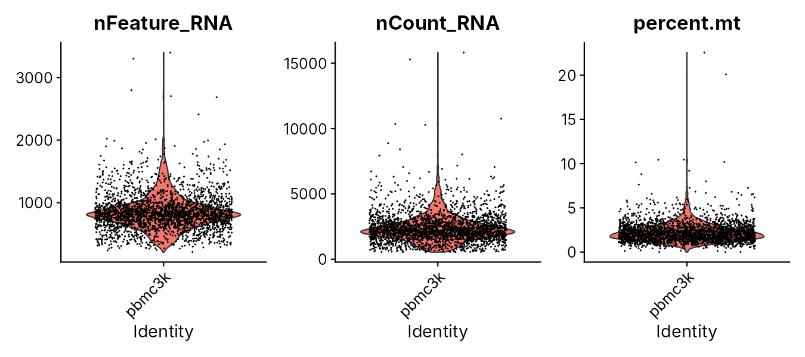
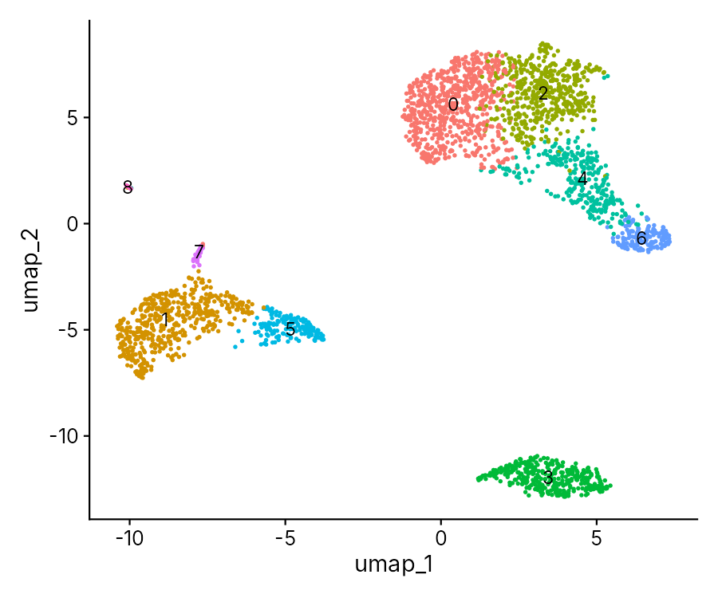
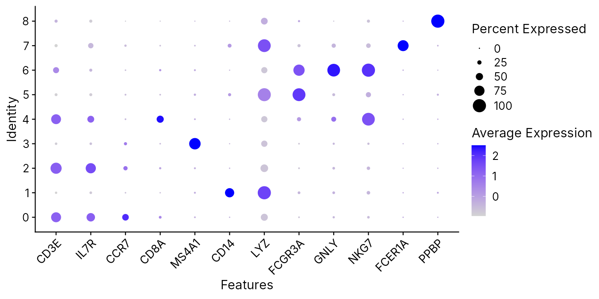
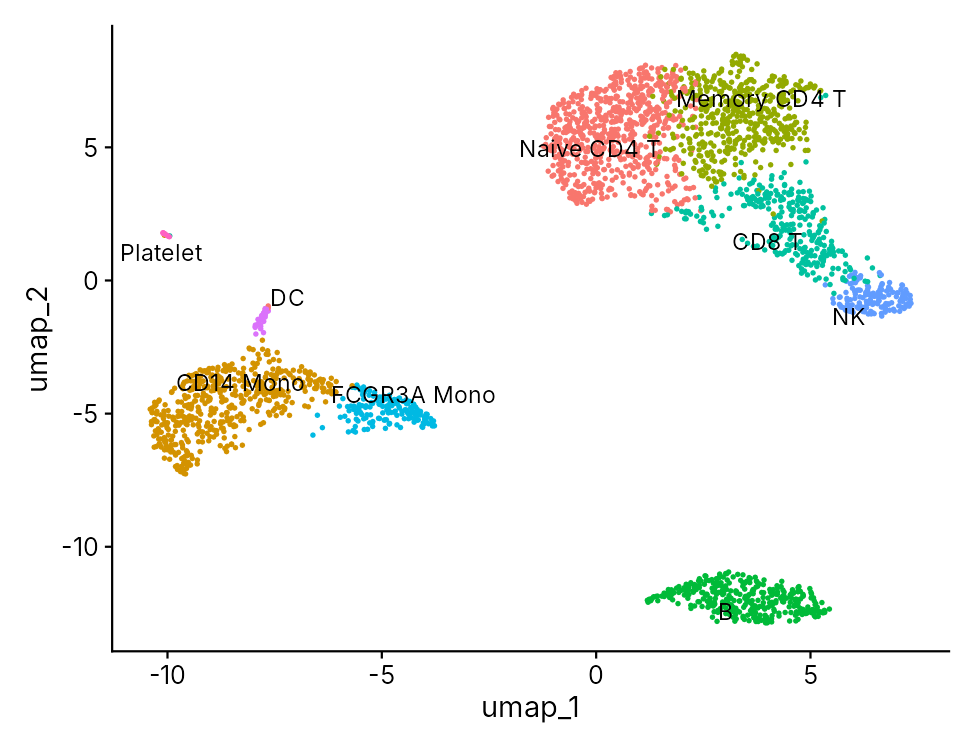
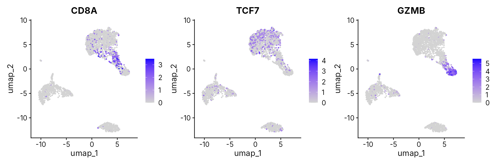

::: {.callout-note collapse="true"}
## 🎯 학습 목표

이 실습을 마치면:

-   CELLxGENE에서 공개 단일세포 데이터를 탐색하고 유전자 발현을 세포 유형별로 비교
-   R Seurat으로 QC → 클러스터링 → UMAP 흐름 돌려 보기
-   Marker 유전자로 클러스터에 세포 유형 이름 붙이기
-   CD8 T세포에서 *TCF7* 발현을 찾고, 이 데이터로 케이스에 대해 말할 수 있는 것과 없는 것 구분
:::

> 🩺 **케이스 다시 보기** (🔗 [W11](w11_singlecell.qmd))\
> 같은 면역항암제를 맞았는데 종양 반응이 달랐던 두 흑색종 환자. 반응한 쪽 종양에는 *TCF7*을 켠 CD8 T세포가 많았다.\
> → 오늘 목표: 세포 하나하나의 데이터에서 CD8 T세포를 직접 찾아 이름 붙이고, *TCF7*이 어디서 켜지는지 보기

------------------------------------------------------------------------

# 0. 준비물 🧰 {#w12-s0}

-   웹: [CZ CELLxGENE Discover](https://cellxgene.cziscience.com/) — 가입 필요 x
-   데이터: [w12_pbmc3k.tar.gz](../data/w12_pbmc3k.tar.gz) (7.6 MB) — 건강한 기증자 한 명의 혈액 단핵세포(PBMC) 약 2,700개
-   JupyterHub: 로그인 → 새 R 노트북 → 내려받은 파일을 **압축된 그대로** 왼쪽 파일 창에 끌어다 놓기 (🔗 [W1 §6.2](w01_intro.qmd#w1-s6-2))

::: {.callout-note collapse="true"}
## 이 데이터에 대해

-   **실제 공개 데이터** — 10x Genomics가 공개한 "3k PBMCs from a Healthy Donor". 단일세포 분석 입문에서 가장 널리 쓰이는 데이터이고, Seurat 공식 안내서도 이 데이터를 씀
-   단일세포 장비 회사의 분석 프로그램(Cell Ranger)이 내놓는 형식 그대로: 압축을 풀면 파일 세 개
    -   `matrix.mtx` = 유전자 × 세포 count 표 (0이 아닌 칸만 적어 둔 형식)
    -   `genes.tsv` = 행 이름 (유전자 32,738개)
    -   `barcodes.tsv` = 열 이름 (세포 바코드 2,700개)
-   종양이 아니라 **건강한 사람 한 명의 혈액** → 방법을 익히는 데이터. 반응자와 비반응자 비교는 이 데이터로 할 수 없음 ([§3.3](#w12-s3-3))
-   만든 방법: 저장소의 `scripts/fetch_w12_pbmc3k.py` (원본과 같은 파일인지 MD5와 행렬 크기로 확인)
:::

------------------------------------------------------------------------

# 1. 🌐 CELLxGENE에서 면역세포 보기 {#w12-s1}

CZ CELLxGENE Discover는 전 세계 연구팀이 공개한 단일세포 데이터 수천만 개 세포를 모아 둔 아틀라스다. 코딩 없이 브라우저에서 유전자가 어느 세포에서 켜지는지 볼 수 있다. 화면 구성은 업데이트에 따라 조금씩 바뀔 수 있으니, 아래 메뉴 이름이 보이지 않으면 비슷한 이름을 찾는다.

1.  [CELLxGENE Discover](https://cellxgene.cziscience.com/) → 위 메뉴 **Gene Expression**
2.  유전자 검색창에 `CD8A`, `TCF7`, `GZMB`, `PDCD1`을 하나씩 추가
    -   **여기서 볼 것**: 세포 유형 × 유전자 점 그림. 점 크기 = 그 유전자가 검출된 세포의 비율, 색 = 평균 발현량
3.  왼쪽 필터에서 조직(Tissue)을 `blood`로 → 혈액 세포만 보기
4.  질환(Disease) 필터에서 `normal`과 암(가능하면 흑색종, 없으면 폐암 등)을 바꿔 가며 비교
    -   **여기서 볼 것**: *PDCD1*(PD-1, 면역항암제가 막는 분자)이 정상 혈액과 암 조직의 T세포에서 어떻게 다른가
5.  위 메뉴 **Datasets**에서 PBMC 데이터셋 하나를 골라 **Explore** → UMAP에서 세포 유형(cell type)으로 색칠하고, 유전자 이름을 검색해 색칠해 보기

| 유전자 | 가장 많이 켜진 세포 유형 | 검출된 세포 비율 (대략) | 메모 |
|---|---|---|---|
| *CD8A* | | | |
| *TCF7* | | | |
| *GZMB* | | | |
| *PDCD1* | | | |

✅ **확인 질문** — CELLxGENE의 세포 유형 이름은 누가, 어떻게 붙였을까? 그 이름을 그대로 믿어도 될까? (🔗 [W11 §4.2](w11_singlecell.qmd#w11-s4-2))

::: {.callout-tip collapse="true"}
## 확인

-   이름은 데이터를 낸 연구팀이 붙이고, CELLxGENE은 이를 표준 세포 용어 목록(Cell Ontology)으로 맞춰 정리함
-   → 연구팀마다 기준이 다를 수 있고, 아틀라스에 들어간 사람·조직·질환이 내 환자를 대표하는지 따로 확인해야 함 (아틀라스의 대표성)
:::

------------------------------------------------------------------------

# 2. 💻 Seurat 기본 흐름 {#w12-s2}

W11 §3의 흐름(QC → 정규화 → PCA → 클러스터링 → UMAP)을 R 패키지 Seurat으로 직접 돌린다.

## 1) 노트북 시작 {#w12-s2-1}

```r
library(Seurat)   # 단일세포 분석
library(dplyr)    # 표 다루기
library(ggplot2)  # 그림

options(repr.plot.width = 9, repr.plot.height = 5)  # 노트북 그림 크기
```

**결과에서 볼 것** — "Loading required package: SeuratObject" 같은 안내문은 오류가 아님

## 2) 데이터 읽기 {#w12-s2-2}

압축을 풀고, 10x 형식의 파일 세 개를 count 표 하나로 읽는다.

```r
untar("w12_pbmc3k.tar.gz")
counts <- Read10X("filtered_gene_bc_matrices/hg19/")
dim(counts)
```

**결과에서 볼 것** — `32738 2700` → 유전자 32,738개(행) × 세포 2,700개(열)

표의 한 귀퉁이를 들여다보고, 0인 칸이 얼마나 되는지 센다.

```r
counts[c("CD3D", "MS4A1", "CD14"), 1:5]
1 - Matrix::nnzero(counts) / prod(dim(counts))
```

**결과에서 볼 것** — 아래 표처럼 대부분 `.`(= 0). 0인 칸의 비율 = `0.974` → 약 97%가 0 (🔗 [W11 §2.3](w11_singlecell.qmd#w11-s2-3))

처음 세 세포만 옮기면 (열 이름 = 세포 바코드, 예: `AAACATACAACCAC-1`):

| | 세포 1 | 세포 2 | 세포 3 |
|---|---|---|---|
| *CD3D* (T세포) | 4 | . | 10 |
| *MS4A1* (B세포) | . | 6 | . |
| *CD14* (단핵구) | . | . | . |

-   첫 세포는 *CD3D* 분자가 4개 → T세포일 가능성, 둘째 세포는 *MS4A1* 6개 → B세포일 가능성
-   숫자 = 그 세포에서 잡힌 그 유전자의 RNA 분자 수(UMI 수)

## 3) Seurat 객체 만들기와 QC {#w12-s2-3}

count 표를 Seurat 객체로 바꾸고, 세포마다 미토콘드리아 유전자(이름이 `MT-`로 시작) 비율을 계산한다.

```r
pbmc <- CreateSeuratObject(counts = counts, project = "pbmc3k",
                           min.cells = 3, min.features = 200)
pbmc[["percent.mt"]] <- PercentageFeatureSet(pbmc, pattern = "^MT-")
head(pbmc@meta.data, 3)
```

-   `min.cells = 3` → 세포 3개 미만에서만 보이는 유전자는 뺌, `min.features = 200` → 유전자 200개 미만인 바코드(빈 droplet)는 뺌
-   "Feature names cannot have underscores" 경고는 유전자 이름 표기를 바꿨다는 안내 → 무시해도 됨

**결과에서 볼 것** — 세포마다 세 가지 QC 숫자

| | nCount_RNA | nFeature_RNA | percent.mt |
|---|---|---|---|
| AAACATACAACCAC-1 | 2419 | 779 | 3.02 |
| AAACATTGAGCTAC-1 | 4903 | 1352 | 3.79 |
| AAACATTGATCAGC-1 | 3147 | 1129 | 0.89 |

-   `nCount_RNA` = 그 세포에서 잡힌 분자(UMI) 총수, `nFeature_RNA` = 검출된 유전자 수, `percent.mt` = 미토콘드리아 유전자 비율(%)

세 숫자의 분포를 바이올린 그림으로 본다.

```r
VlnPlot(pbmc, features = c("nFeature_RNA", "nCount_RNA", "percent.mt"),
        ncol = 3)
```

{fig-align="center" width="90%"}

**결과에서 볼 것** — 유전자 수가 유난히 많은 세포(이중세포 의심), 미토콘드리아 비율이 높은 세포(죽어가는 세포 의심)

기준을 정해 거른다. 이 기준은 Seurat 안내서가 이 데이터에 쓰는 값이다.

```r
pbmc <- subset(pbmc, subset = nFeature_RNA > 200 & nFeature_RNA < 2500 &
                 percent.mt < 5)
ncol(pbmc)
```

**결과에서 볼 것** — `2638` → 2,700개 중 62개가 빠짐 (유전자 2,500개 이상 5개, 미토콘드리아 5% 이상 57개)

## 4) 정규화에서 클러스터까지 {#w12-s2-4}

W11 §3.2의 표를 그대로 코드로 옮긴 것이다. 한 줄씩 실행해도 되고, 한 셀에 넣어 한꺼번에 돌려도 된다.

```r
pbmc <- NormalizeData(pbmc)                          # 세포마다 총량을 맞춤
pbmc <- FindVariableFeatures(pbmc, nfeatures = 2000) # 변이 큰 유전자 2,000개
pbmc <- ScaleData(pbmc)                              # 유전자마다 척도를 맞춤
pbmc <- RunPCA(pbmc)                                 # 수십 개 축으로 요약
pbmc <- FindNeighbors(pbmc, dims = 1:10)             # 비슷한 세포끼리 연결
pbmc <- FindClusters(pbmc, resolution = 0.5)         # 무리로 묶기
pbmc <- RunUMAP(pbmc, dims = 1:10)                   # 2차원 지도
table(Idents(pbmc))
```

**결과에서 볼 것** — 클러스터 9개와 클러스터마다 세포 수

| 클러스터 | 0 | 1 | 2 | 3 | 4 | 5 | 6 | 7 | 8 |
|---|---|---|---|---|---|---|---|---|---|
| 세포 수 | 684 | 481 | 476 | 344 | 291 | 162 | 155 | 32 | 13 |

```r
DimPlot(pbmc, reduction = "umap", label = TRUE) + NoLegend()
```

{fig-align="center" width="65%"}

-   지금은 번호만 있고 이름은 없음 → 다음 절에서 사람이 붙임
-   ⚠️ 무리 사이 거리와 크기는 읽지 않음 (🔗 [W11 §3.3](w11_singlecell.qmd#w11-s3-3))

------------------------------------------------------------------------

# 3. 💻 세포 유형 이름 붙이기 {#w12-s3}

## 1) Marker 유전자 보기 {#w12-s3-1}

W11 §4.1의 marker 유전자가 클러스터마다 얼마나 켜져 있는지 점 그림으로 본다.

```r
markers <- c("CD3E", "IL7R", "CCR7", "CD8A", "MS4A1", "CD14", "LYZ",
             "FCGR3A", "GNLY", "NKG7", "FCER1A", "PPBP")
DotPlot(pbmc, features = markers) + RotatedAxis()
```

{fig-align="center" width="90%"}

**결과에서 볼 것** — 클러스터마다 가장 크고 진한 점

-   0: *CD3E*, *CCR7* → naive CD4 T세포 / 2: *CD3E*, *IL7R*, *CCR7* 약함 → 기억(memory) CD4 T세포
-   4: *CD3E*, *CD8A* → CD8 T세포
-   3: *MS4A1* → B세포
-   1: *CD14*, *LYZ* → CD14 단핵구 / 5: *FCGR3A* → FCGR3A(CD16) 단핵구
-   6: *GNLY*, *NKG7* → NK세포 / 7: *FCER1A* → 수지상세포 / 8: *PPBP* → 혈소판

## 2) 이름 붙이기 {#w12-s3-2}

번호를 이름으로 바꾸고 다시 그린다.

```r
new_names <- c("0" = "Naive CD4 T", "1" = "CD14 Mono", "2" = "Memory CD4 T",
               "3" = "B", "4" = "CD8 T", "5" = "FCGR3A Mono",
               "6" = "NK", "7" = "DC", "8" = "Platelet")
pbmc <- RenameIdents(pbmc, new_names)
DimPlot(pbmc, reduction = "umap", label = TRUE, repel = TRUE) + NoLegend()
```

{fig-align="center" width="65%"}

-   ⚠️ **번호와 이름의 짝은 내 DotPlot을 보고 확인** → 버전이 다르면 번호가 바뀔 수 있음. 그러면 `new_names`의 짝을 내 결과에 맞게 고침
-   → 이것이 "클러스터 ≠ 세포 유형"의 뜻: 번호는 프로그램이 주고, 이름은 사람이 근거를 보고 붙임

## 3) 케이스로: CD8 T세포와 *TCF7* {#w12-s3-3}

세 유전자를 지도 위에 색칠한다. *CD8A* = CD8 T세포, *TCF7* = 덜 지친 기억 상태, *GZMB* = 표적 세포를 죽이는 효소(그랜자임 B).

```r
FeaturePlot(pbmc, features = c("CD8A", "TCF7", "GZMB"), ncol = 3)
```

{fig-align="center" width="100%"}

**결과에서 볼 것** — *TCF7*과 *GZMB*는 서로 다른 쪽에서 켜짐 → *TCF7* 쪽 = 아직 덜 분화된 상태, *GZMB* 쪽 = 공격 중인 상태

CD8 T세포만 골라, *TCF7*이 검출된 세포의 비율을 센다.

```r
cd8 <- subset(pbmc, idents = "CD8 T")
ncol(cd8)
mean(FetchData(cd8, vars = "TCF7")$TCF7 > 0)
```

**결과에서 볼 것** — CD8 T세포 `291`개 중 *TCF7*이 검출된 비율 `0.175` (약 18%)

-   ⚠️ 0 ≠ 꺼짐 → 같은 무리에서 *CD8A* 자체도 약 49%의 세포에서만 검출됨. 그래서 이 숫자는 "켜진 비율"이 아니라 "**검출된** 비율"
-   ⚠️ 이 데이터 = **건강한 사람 한 명의 혈액** → n = 1. 반응자와 비반응자를 비교하려면 여러 환자의 종양 시료와 환자 단위 비교가 필요 (🔗 [W11 §5](w11_singlecell.qmd#w11-s5))

::: {.callout-tip collapse="true"}
## 🛠️ 고쳐 보기

1.  §2.4의 `FindClusters()`에서 `resolution`을 `0.1`과 `1.0`으로 바꿔 다시 돌리면 클러스터는 몇 개가 되나? 어느 쪽이 "정답"인가?
2.  §2.3의 QC 기준 `percent.mt < 5`를 `percent.mt < 10`으로 느슨하게 하면 세포가 몇 개 남나?
3.  `FeaturePlot()`의 유전자를 `PDCD1`(PD-1)로 바꿔 보기. 건강한 혈액에서 잘 보이나? 1번 웹 단계에서 본 암 조직의 T세포와 비교하면?

**확인**: (1) 0.1 → 4개, 1.0 → 11개. 정답은 없고, marker로 설명되는 구분인지와 연구 질문에 필요한 수준인지로 정함 (2) 2,689개 → 기준 하나로 51개가 더 남음. 기준값을 보고해야 하는 이유 (3) CD8 T세포 중 약 3%에서만 검출 → 건강한 혈액 T세포와 종양 속 T세포는 상태가 다름
:::

::: {.callout-note collapse="true" icon=false}
## 💡 AI 도우미에게 묻기

-   "Seurat의 `FindNeighbors()`와 `FindClusters()`가 하는 일을 의예과 학생이 이해할 수 있게 설명해 줘"
-   "DotPlot에서 점 크기와 색이 각각 무엇을 뜻하는지 알려 줘"
-   "이 오류 메시지는 무슨 뜻이고 무엇을 고쳐야 해? (오류 붙여넣기)"
:::

------------------------------------------------------------------------

# ✍️ 제출

이름을 붙인 UMAP 한 장과 한 문단:

-   CD8 T세포라고 이름 붙인 근거 (marker 두 개 이상)
-   오늘 결과가 케이스에 대해 **말해 주는 것** — 예: 혈액 CD8 T세포 가운데 *TCF7*이 검출되는 세포가 있고, *GZMB*가 켜진 세포와 위치가 다름
-   오늘 결과가 **말해 주지 않는 것**과 그걸 알려면 무엇이 더 필요한지 — 예: 반응자와 비반응자의 종양 속 차이 → 여러 환자의 종양 시료, 환자 단위 비교, 독립 검증

------------------------------------------------------------------------

# 📝 정리

| 도구 또는 함수 | 한 일 |
|----------------|-------|
| CZ CELLxGENE Discover | 공개 단일세포 아틀라스에서 유전자 발현을 세포 유형별로 보기 |
| `untar()` · `Read10X()` | 압축 풀기, 10x 형식 파일을 count 표로 읽기 |
| `CreateSeuratObject()` | count 표를 Seurat 객체로 만들기 |
| `PercentageFeatureSet()` | 미토콘드리아 유전자 비율 계산 |
| `VlnPlot()` · `subset()` | QC 숫자의 분포 보기, 기준으로 세포 거르기 |
| `NormalizeData()` → `RunUMAP()` | 정규화, 변이 큰 유전자, PCA, 클러스터링, UMAP |
| `DimPlot()` | UMAP 지도 그리기 |
| `DotPlot()` · `FeaturePlot()` | Marker 발현을 클러스터별로, 지도 위에 보기 |
| `RenameIdents()` | 클러스터 번호에 세포 유형 이름 붙이기 |

# ➕ 참고 링크

-   [Seurat — Guided Clustering Tutorial (pbmc3k)](https://satijalab.org/seurat/articles/pbmc3k_tutorial) · 같은 데이터로 한 단계씩 더 자세히
-   [CZ CELLxGENE Discover](https://cellxgene.cziscience.com/) · Abdulla S, et al. [*CZ CELLxGENE Discover.*](https://doi.org/10.1093/nar/gkae1142) Nucleic Acids Res. 2025.
-   Zheng GXY, et al. [*Massively parallel digital transcriptional profiling of single cells.*](https://doi.org/10.1038/ncomms14049) Nat Commun. 2017. (이 데이터를 만든 droplet 방식 플랫폼을 소개한 논문)
-   Sade-Feldman M, et al. [*Defining T Cell States Associated with Response to Checkpoint Immunotherapy in Melanoma.*](https://doi.org/10.1016/j.cell.2018.10.038) Cell. 2018.
