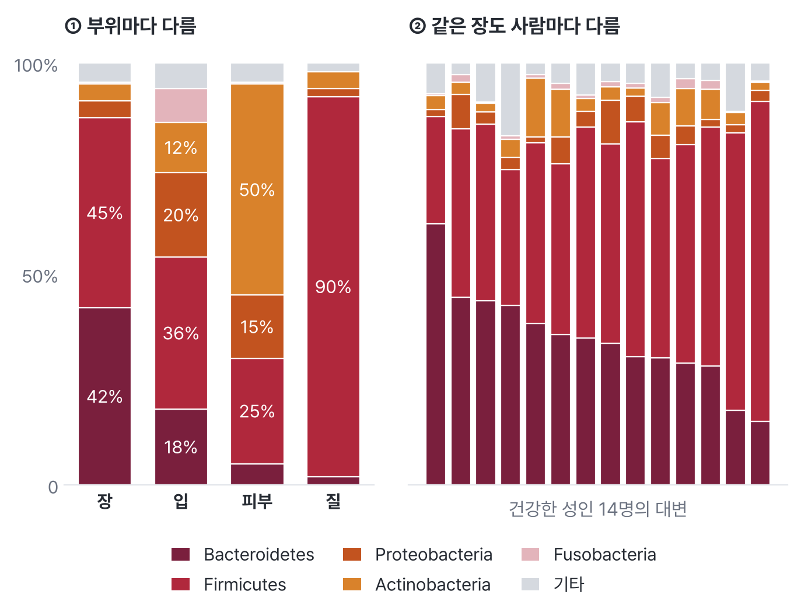
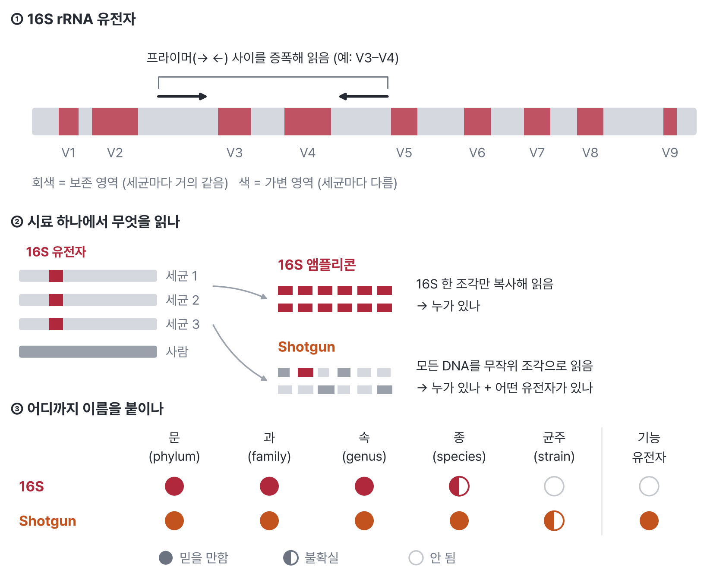
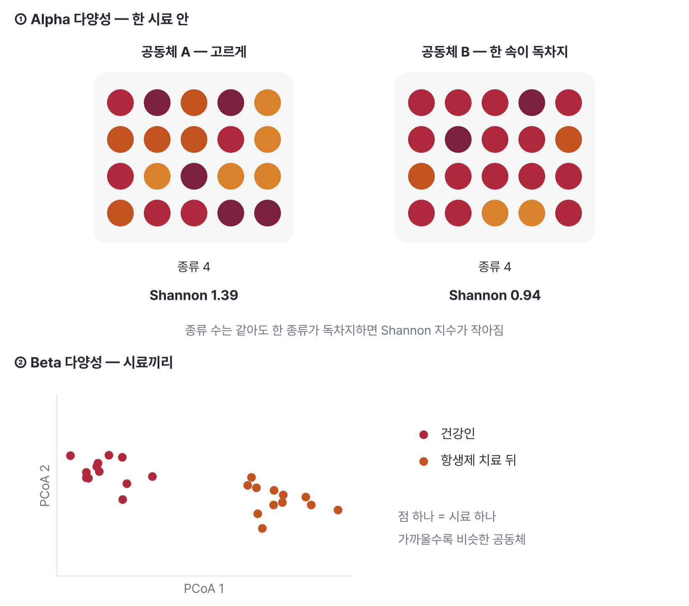
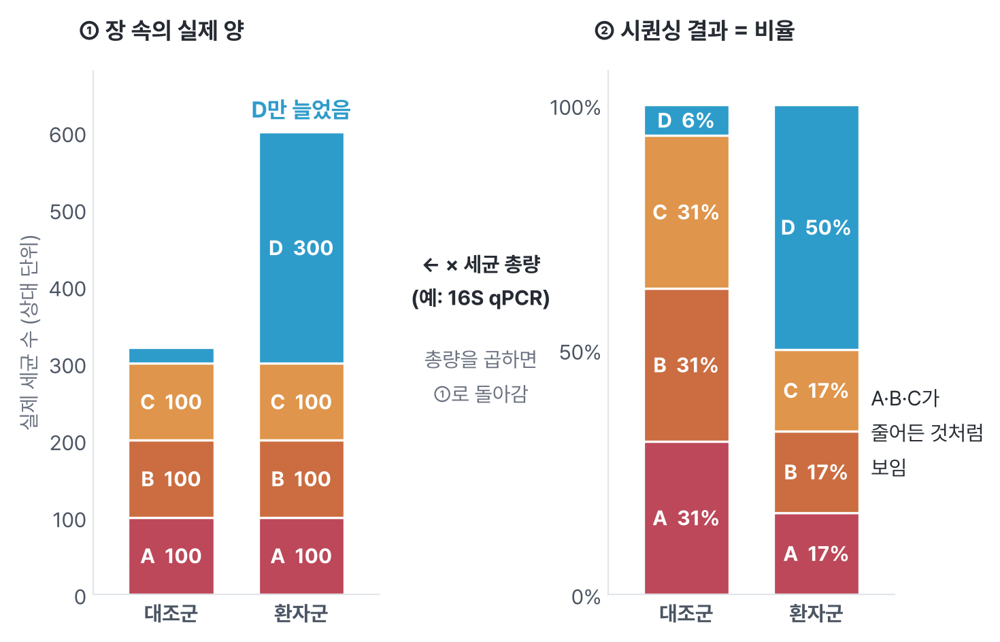
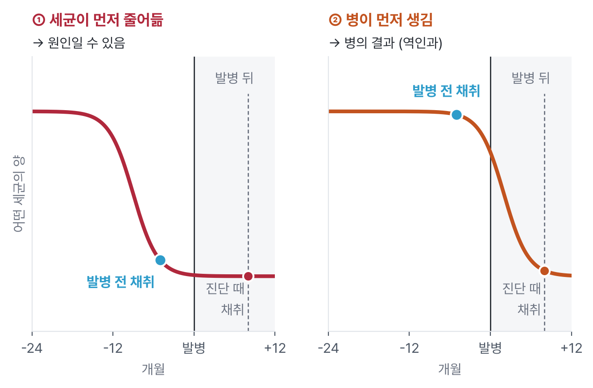
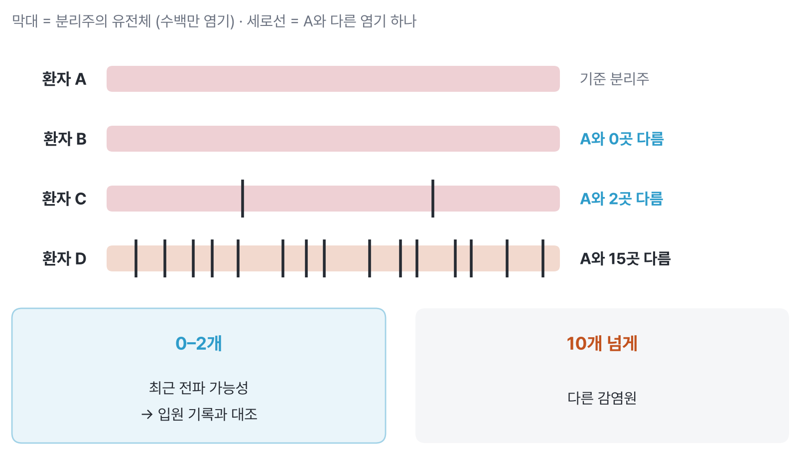
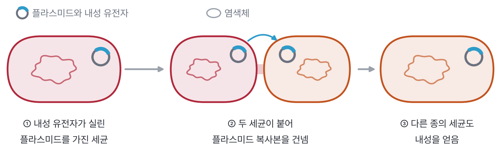
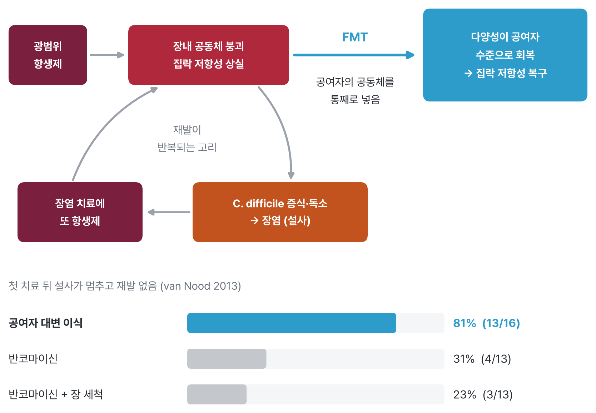

::: {.callout-note collapse="true"}
## 🎯 학습 목표

이 장을 마치면:

-   몸 부위별 미생물 공동체와 사람 사이의 차이, 항생제가 공동체에 주는 영향 설명
-   16S rRNA 앰플리콘과 shotgun 메타유전체 시퀀싱 비교
-   Alpha·beta 다양성 개념과 PCoA 그림 읽기
-   ⚠️ 시퀀싱 데이터가 상대 풍부도라는 점의 함정과 교란 요인 설명
-   마이크로바이옴 연관 연구에서 인과를 판단하는 기준 설명
-   병원체 유전체로 전파 경로와 항생제 내성을 추적하는 원리 설명
-   🎓 수업 전체의 체크리스트로 어떤 오믹스 결과든 따져 보기
:::

> 🩺 **오늘의 케이스**\
> 70대 환자, 폐렴으로 광범위 항생제 치료 후 *Clostridioides difficile* 장염. 치료 후 두 번 더 재발했다.\
> 건강한 사람의 대변 미생물을 이식(FMT)하자 재발이 멈췄다.\
> 같은 시기 같은 병동에서 *C. difficile* 환자가 세 명 더 나왔다.\
> → 이식은 왜 효과가 있었을까? 병동 환자들은 서로 옮긴 걸까? (🔗 [W14 실습](w14_microbiome_lab.qmd)에서 직접)

💡 각 절의 본문 = 꼭 알아야 할 기초. **🔍 더 알아보기**는 궁금할 때 펼쳐 보는 심화 내용

------------------------------------------------------------------------

# 1. 사람 마이크로바이옴 🦠 {#w13-s1}

> 🔑 **핵심** — 몸에는 사람 세포 수만큼의 세균이 살고, 그 공동체는 부위마다·사람마다 크게 다름. 건강한 공동체는 병원균이 자리 잡지 못하게 막는 방어막

## 1) 몸에 사는 미생물 {#w13-s1-1}

마이크로바이옴(microbiome)은 몸에 사는 미생물 공동체와 그 유전체 전체를 가리킨다. 세균이 대부분이고 바이러스, 곰팡이도 함께 산다. 우리가 "나"라고 부르는 몸의 상당 부분이 사실은 다른 생물이다.

-   몸속 세균 약 3.8 × 10¹³개, 사람 세포 약 3.0 × 10¹³개 → **거의 1 : 1**
    -   예전에 널리 인용된 "세균이 사람 세포의 10배"는 과대추정
    -   세균의 총 무게는 약 0.2 kg
-   그 대부분이 대장에 삶 → 이 장도 장내 세균 이야기가 중심

## 2) 부위마다 다른 생태계, 사람마다 다른 공동체 {#w13-s1-2}

{fig-align="center"}

-   장, 입, 피부, 질은 서로 다른 생태계 → 부위끼리 비교 x
-   건강한 사람끼리도 차이가 큼 → 환자 몇 명과 대조군 몇 명으로는 "병에 따른 차이"를 잡기 어려움
-   ⚠️ 차이를 만드는 큰 요인 = **식습관과 지역**(나라, 생활 방식), 약, 나이 → 다른 나라 연구의 "정상 범위"를 한국인에게 그대로 쓰기 어려움 (🔗 [W4 §5](w04_complex_pgx.qmd#w4-s5) 집단 차이와 같은 문제)

## 3) 항생제와 집락 저항성 {#w13-s1-3}

건강한 장내 공동체는 새로 들어온 세균이 자리 잡지 못하게 막는다. 이를 집락 저항성(colonization resistance)이라고 한다. 이미 자리와 영양분을 차지하고 있고, 병원균을 억제하는 물질도 만든다. 광범위 항생제가 이 공동체를 무너뜨리면 빈자리에 *C. difficile* 같은 병원균이 자리 잡는다.

-   *C. difficile* = 포자를 만드는 혐기성 세균. 독소로 장염을 일으키고, 항생제 관련 설사의 주요 원인
-   항생제 → 공동체 붕괴 → 집락 저항성 상실 → *C. difficile* 증식과 독소 → 장염
-   ⚠️ 장염을 치료하려고 또 항생제를 쓰면 공동체가 다시 무너짐 → 재발이 반복되는 이유

::: {.callout-note collapse="true" icon=false}
## 🔍 더 알아보기 — 세균이 세균을 막는 방법 하나

-   간에서 만든 담즙산은 장에서 일부 세균이 2차 담즙산으로 바꿈
-   생쥐 실험에서 2차 담즙산을 만드는 세균(*Clostridium scindens*)이 *C. difficile* 감염에 대한 저항성과 관련 있었고, 이 세균을 넣어 주면 저항성이 높아짐 (Buffie et al., Nature 2015)
-   → "다양한 공동체"라는 막연한 말 뒤에 구체적인 기전이 있음
:::

------------------------------------------------------------------------

# 2. 미생물 공동체 읽기 🧬 {#w13-s2}

> 🔑 **핵심** — 장내 세균의 상당수는 배양하기 어려움 → DNA를 읽어 "누가 얼마나" 있는지 셈. 16S는 이름표 유전자 하나를, shotgun은 DNA 전부를 읽음

## 1) 배양에서 시퀀싱으로 {#w13-s2-1}

-   병원의 미생물 검사는 대부분 **배양** 기반 → 키울 수 있는 균만 보임. 항생제 감수성 검사도 배양한 균으로 함
-   장내 혐기성 세균은 키우기 어려운 것이 많음 → 시료의 DNA를 직접 읽어 공동체 전체를 봄
-   💡 둘은 경쟁이 아니라 역할 분담: 배양 = 특정 균을 잡아 약을 고름, 시퀀싱 = 공동체 전체의 그림

## 2) 16S rRNA 앰플리콘 vs shotgun 메타유전체 {#w13-s2-2}

16S rRNA 유전자는 모든 세균이 가진 리보솜 RNA 유전자다. 모든 세균에서 거의 같은 부분(보존 영역)과 세균마다 다른 부분(가변 영역)이 번갈아 있다. 같은 부분에 프라이머를 붙여 PCR로 증폭하고, 다른 부분을 읽어 세균 이름을 붙인다. 이것이 16S 앰플리콘 시퀀싱이다.

{fig-align="center"}

|  | 16S rRNA 앰플리콘 | Shotgun 메타유전체 |
|---|---|---|
| 무엇을 읽나 | 16S 유전자 한 조각 | 시료의 DNA 전부 |
| 이름을 붙이는 수준 | 보통 속(genus)까지 | 종(species), 때로 균주(strain)까지 |
| 기능 정보 | 없음 | 있음 (어떤 유전자를 가졌나 — 예: 항생제 내성 유전자) |
| 비용 | 쌈 → 시료 수백 개 가능 | 비쌈 |
| 약점 | 프라이머가 잘 안 붙는 세균은 덜 보임 | 사람 DNA가 많은 시료(조직)에서는 세균 read가 적음 |

-   ⚠️ 16S로 종이나 균주를 단정하면 과잉 해석 → 같은 대장균 종 안에도 공생균부터 병원균까지 있음

## 3) 결과물은 표 {#w13-s2-3}

-   최종 결과 = 시료 × 분류군의 read 수 표 (🔗 [W1 §3.2 ④](w01_intro.qmd#w1-s3-2-4)) → W14 실습에서 R로 읽는 표가 이것
-   이름 붙이기 = 참조 데이터베이스에 비슷한 서열이 있어야 가능 → 데이터베이스에 없는 세균은 이름이 안 붙음 (🔗 [W1 §4.2](w01_intro.qmd#w1-s4-2) 레퍼런스의 한계)
-   데이터베이스와 버전이 다르면 같은 세균이 다른 이름으로 나오기도 함 → 연구끼리 비교할 때 확인

------------------------------------------------------------------------

# 3. 다양성 🌿 {#w13-s3}

> 🔑 **핵심** — Alpha 다양성 = 한 시료 안이 얼마나 다양한가, beta 다양성 = 시료끼리 얼마나 다른가

## 1) Alpha 다양성 — 한 시료 안 {#w13-s3-1}

공동체가 다양하다는 말에는 두 가지 뜻이 있다. 종류가 많은가(풍부도), 그리고 고르게 섞여 있는가(균등도)다. 아래 두 공동체는 종류 수는 같지만 다양성은 다르다.

| 공동체 | 구성 | 풍부도(richness) | Shannon 지수 |
|---|---|---|---|
| A | 네 속이 25%씩 | 4 | 1.39 |
| B | 한 속이 70%, 나머지 셋이 10%씩 | 4 | 0.94 |

{fig-align="center"}

-   Richness = 몇 종류가 있나
-   Shannon 지수 = 종류 수와 고르기를 함께 반영. 한 종류가 독차지할수록 작아짐
-   항생제 뒤 장내 공동체 → 소수의 속이 독차지 → alpha 다양성 감소 (🔗 W14에서 직접)
-   ⚠️ 깊이 문제 — 많이 읽을수록 드문 분류군이 더 보여 richness가 커짐 → 시료마다 read 수가 다르면 공정한 비교가 아님 → 깊이를 맞추거나(rarefaction) 어떻게 다뤘는지 밝힘

## 2) Beta 다양성과 PCoA {#w13-s3-2}

-   두 시료가 얼마나 다른지를 숫자 하나로 → 흔히 Bray–Curtis 비유사도 (0 = 구성이 같음, 1 = 겹치는 분류군이 없음)
-   시료가 여럿이면 모든 쌍의 거리를 2차원 지도로 펼쳐 봄 = PCoA
    -   가까운 점 = 비슷한 공동체, 먼 점 = 다른 공동체
    -   축에 붙은 % = 그 축이 설명하는 차이의 비율
-   💡 W11의 UMAP처럼 "점 하나 = 시료(또는 세포) 하나"인 지도. 다만 PCoA는 거리를 비교적 그대로 보존

::: {.callout-note collapse="true" icon=false}
## 🔍 더 알아보기 — 집단 차이를 검정할 때 p와 R²

-   집단(예: 환자 vs 건강인)이 지도에서 갈리는지 검정 → PERMANOVA
-   시료가 많으면 아주 작은 차이도 유의하게 나옴 → p만 보면 안 됨
-   R² = 집단 구분이 전체 차이의 몇 %를 설명하나 → "p = 0.001, R² = 0.02"라면 질병이 설명하는 것은 2%뿐
:::

------------------------------------------------------------------------

# 4. ⚠️ 조성 데이터의 함정 {#w13-s4}

> 🔑 **핵심** — 시퀀싱은 양이 아니라 **비율**을 잼. 그리고 결과는 시퀀싱 전에 일어난 일(시료 처리, 식습관, 약)과 검정 횟수에 크게 좌우됨

## 1) 상대 풍부도 {#w13-s4-1}

한 시료에서 읽는 read의 총수는 시퀀서에 얼마나 넣었느냐로 정해진다. 장 속 세균이 많든 적든 상관없다. 그래서 결과는 "이 세균이 전체의 몇 %"라는 상대 풍부도(relative abundance)다.

{fig-align="center"}

-   한 분류군이 크게 늘면 → 나머지는 그대로여도 줄어든 것처럼 보임
-   ⚠️ **상대 풍부도 증가 ≠ 절대량 증가**. 항생제 뒤 장 속 세균의 총량이 크게 줄었다면, 비율이 늘어난 균도 실제 수는 줄었을 수 있음
-   🔗 같은 문제를 여러 번 만남: RNA-seq의 조성 보정([W9 §4](w09_transcriptome.qmd#w9-s4)), 단일세포의 세포 비율([W11 §5](w11_singlecell.qmd#w11-s5))
-   💡 해결책 = 세균 총량을 따로 재기 (예: 16S qPCR) → 비율 × 총량 = 절대량

## 2) 시료 처리와 오염 {#w13-s4-2}

-   DNA 추출 방법에 따라 같은 대변에서도 다른 공동체가 나옴 → 다른 방법을 쓴 연구끼리 직접 비교는 위험
-   세균이 아주 적은 시료(혈액, 조직, 태반)는 추출 시약에 섞여 있던 세균 DNA가 결과의 대부분을 차지할 수 있음 → 아무것도 넣지 않은 음성 대조군을 함께 시퀀싱해야 함 (Salter et al., 2014)

## 3) 교란: 식습관, 지역, 약 {#w13-s4-3}

-   환자군과 대조군은 병 말고도 식습관, 사는 곳, 먹는 약이 다름 → 장내 세균은 이 모두에 반응
-   ⚠️ 대표 사례 — 제2형 당뇨병의 "장내 세균 특징"으로 보고된 것의 상당 부분이 당뇨병이 아니라 치료제 **메트포르민**의 효과였음 (Forslund et al., Nature 2015)
-   → 마이크로바이옴 환자–대조군 연구를 읽을 때 첫 질문: "두 군이 먹는 약이 같았나?"

## 4) 분류군 수백 개, 수백 번의 검정 {#w13-s4-4}

-   한 연구에 나오는 분류군은 수백 개 → 하나씩 "환자와 건강인 사이에 다른가"를 검정하면 수백 번 검정 → 우연히 유의한 것이 섞임 (🔗 [W4 §2](w04_complex_pgx.qmd#w4-s2)의 5×10⁻⁸, [W9 §4](w09_transcriptome.qmd#w9-s4)의 FDR과 같은 문제)
-   ⚠️ 어떤 분류군이 달라졌는지 찾는 통계 방법이 여럿인데, 같은 데이터에서도 방법마다 결과가 크게 다름 (Nearing et al., 2022) → 여러 방법에서 공통으로 나오는 결과를 더 믿음

------------------------------------------------------------------------

# 5. 연관에서 인과로 🔀 {#w13-s5}

> 🔑 **핵심** — 환자와 건강인의 장내 세균이 다르다 = 원인일 수도, 결과일 수도, 다른 요인의 흔적일 수도. 인과를 보이려면 시간 순서와 개입이 필요

## 1) 네 가지 설명 {#w13-s5-1}

"환자에게서 어떤 세균이 적다"는 관찰에는 적어도 네 가지 설명이 가능하다. 앞의 것부터 차례로 배제해야 마지막 설명에 다가갈 수 있다.

| 설명 | 예 |
|---|---|
| 측정의 차이 (artifact) | 환자 시료와 대조군 시료를 다른 날, 다른 방법으로 처리 |
| 교란 | 환자군만 특정 약을 먹거나 식습관이 다름 ([§4.3](#w13-s4-3)) |
| 역인과 — **결과**다 | 병 때문에 설사, 염증, 식사 변화가 생겨 공동체가 바뀜 |
| 인과 — **원인**이다 | 공동체 변화가 병을 일으키거나 악화시킴 |

-   ⚠️ 한 시점에 한 번 잰 자료로는 원인과 결과를 구분할 수 없음

{fig-align="center"}

## 2) 인과를 보이는 방법 {#w13-s5-2}

-   **시간 순서** — 병이 생기기 *전에* 공동체가 먼저 변했나 (같은 사람을 여러 번 채취)
-   **동물 이식** — 무균 생쥐에 환자의 장내 세균을 옮기면 병의 특징도 옮겨 가나. ⚠️ 생쥐의 장은 사람과 다름
-   **개입** — 공동체를 바꾸면 병이 바뀌나 → 무작위 배정 임상시험이 가장 강한 근거

## 3) FMT — 인과가 확립된 드문 예 {#w13-s5-3}

대변 미생물 이식(fecal microbiota transplantation, FMT)은 건강한 공여자의 대변 속 미생물을 환자의 장에 넣는 치료다. 재발성 *C. difficile* 감염에서는 무작위 배정 임상시험으로 효과가 확인되었다.

-   van Nood et al., NEJM 2013 — 재발성 *C. difficile* 감염 환자를 무작위 배정
    -   공여자 대변 이식: 16명 중 13명(81%)이 첫 이식 후 설사가 멈추고 재발 없음
    -   반코마이신만: 13명 중 4명(31%), 반코마이신 + 장 세척: 13명 중 3명(23%)
    -   차이가 뚜렷해 중간 분석 뒤 연구를 일찍 멈춤
    -   이식 뒤 장내 세균 다양성이 늘어 공여자와 비슷해짐 → Bacteroidetes와 일부 *Clostridium* 무리가 늘고 Proteobacteria는 줄어듦
-   ⚠️ **위험도 있음** — 같은 공여자의 대변을 받은 환자 두 명에게 항생제 내성 대장균(ESBL 생성 *E. coli*) 균혈증이 생겼고 한 명이 사망. 유전체 분석으로 두 균이 같은 공여자에게서 왔음을 확인 → 공여자 선별 강화 (DeFilipp et al., NEJM 2019; 🔗 [§6](#w13-s6))
-   ⚠️ *C. difficile* 밖의 질환에서 FMT는 아직 연구 중 → "*C. difficile*에서 효과" ≠ "모든 장 질환에 효과"

------------------------------------------------------------------------

# 6. 병원체 유전체 🧫 {#w13-s6}

> 🔑 **핵심** — 병원체의 유전체를 비교하면 "같은 감염원인가"(전파), "어떤 약이 안 들까"(내성), "어디로 퍼지고 있나"(감시)를 알 수 있음

## 1) 전파 추적 {#w13-s6-1}

세균도 분열하면서 조금씩 돌연변이를 쌓는다. 한 사람에게서 다른 사람으로 옮은 지 얼마 안 된 균은 유전체가 거의 같고, 서로 관계없는 균은 여러 곳이 다르다. 두 분리주(환자에게서 키운 균) 사이에 서로 다른 염기의 수를 SNV 거리라고 한다.

{fig-align="center"}

-   Eyre et al., NEJM 2013 — 영국 옥스퍼드셔에서 3년여 동안 생긴 *C. difficile* 감염 1,250건 중 1,223건의 유전체를 읽음
    -   124일 안에 옮은 균 사이에는 SNV가 0–2개일 것으로 예상
    -   이전 환자 중 누군가와 SNV 2개 이하 → 35%뿐. 모든 이전 환자와 10개 넘게 다름 → 45%
    -   2개 이하인 환자 중에서도 병원에서 다른 환자와 접촉한 기록이 있는 경우는 38%
    -   → 병원 안 환자끼리의 전파만으로는 설명이 안 됨. 감염원이 다양함
-   ⚠️ SNV 거리가 가깝다 = 전파 **가능성**. 누가 누구에게 옮겼는지(방향)는 유전체만으로 모름 → 입원 기록(같은 병동, 같은 시기)과 함께 봐야 함
-   💡 같은 환자의 첫 감염 균과 재발 균을 비교하면 → 거의 같으면 같은 균의 재발(relapse), 많이 다르면 새 균에 다시 감염(reinfection)

## 2) 항생제 내성 유전자 {#w13-s6-2}

-   내성을 만드는 유전자 예
    -   *mecA* → 베타락탐 항생제가 잘 붙지 않는 단백질(PBP2a)을 만듦 → 메티실린 내성 황색포도알균(MRSA)
    -   KPC, NDM → 카바페넴을 분해하는 효소(카바페넴 분해효소)
-   많은 내성 유전자가 플라스미드에 실려 다른 세균, 다른 종으로 옮겨 감 = 수평 유전자 전달(horizontal gene transfer)

{fig-align="center"}

-   유전체에서 찾은 유전자를 CARD 같은 데이터베이스와 비교해 내성 유전자를 찾음 (🔗 W14)
-   ⚠️ 유전자가 있다 ≠ 반드시 내성, 없다 ≠ 감수성 (발현 여부, 다른 기전) → 진료에서는 배양 기반 감수성 검사가 여전히 기본

## 3) 감염병 감시 {#w13-s6-3}

-   SARS-CoV-2 유행 동안 세계 여러 나라가 바이러스 유전체를 공유 → 새 변이 계통이 생기고 퍼지는 과정을 거의 실시간으로 추적 (예: Nextstrain)
-   계통수(phylogenetic tree) = 유전체가 비슷한 것끼리 가지로 묶은 그림 → 가까운 가지 = 유전적으로 가까움
-   ⚠️ 시퀀싱을 많이 한 지역의 시료가 지도에 더 많이 보임 → 지도에 적게 보인다고 그 지역에 적다는 뜻이 아님 (🔗 W14에서 직접)

------------------------------------------------------------------------

# 7. 진료에서 — 케이스로 돌아가기 🏥 {#w13-s7}

> 🔑 **핵심** — FMT는 무너진 공동체를 통째로 되돌려 방어막을 복구함. 같은 병동의 환자들이 서로 옮겼는지는 SNV 거리와 입원 기록을 함께 봐야 앎

**이식은 왜 효과가 있었을까?**

-   광범위 항생제 → 장내 공동체 붕괴 → 집락 저항성 상실 → *C. difficile* 자리 잡음 ([§1.3](#w13-s1-3))
-   장염 치료에 쓴 항생제가 공동체를 또 무너뜨림 → 재발 반복
-   FMT = 건강한 공여자의 공동체를 통째로 넣음 → 다양성이 공여자 수준으로 회복 → 방어막 복구 ([§5.3](#w13-s5-3))

{fig-align="center"}

**병동 환자들은 서로 옮긴 걸까?**

-   같은 병동, 같은 시기라는 것만으로는 알 수 없음
-   각 환자의 균 유전체를 읽어 SNV 거리 비교 → 2개 이하면 전파 가능성, 10개 넘게 다르면 다른 감염원 ([§6.1](#w13-s6-1))
-   거리가 가까운 쌍만 입원 기록으로 확인 → 감염 관리 조치를 어디에 집중할지 결정

➡️ W14 실습에서 이 환자의 장내 세균 다양성과 병동 분리주의 SNV 거리를 직접 그려 봄

------------------------------------------------------------------------

# 8. 🎓 어떤 오믹스 결과든 읽는 법 {#w13-s8}

> 🔑 **핵심** — 유전체든 전사체든 마이크로바이옴이든 질문은 같음. 결과지 한 장, 논문 그림 하나 앞에서 이 세 질문을 던질 수 있으면 이 수업의 목표 달성

::: {.callout-note}
## 체크리스트 — 세 가지 질문

**① 무엇을 측정하나?**

-   이 검사가 원리적으로 볼 수 없는 것은? → 엑솜과 반복 확장([W2 §2](w02_rare_disease.qmd#w2-s2)), RNA ≠ 단백질([W9 §7](w09_transcriptome.qmd#w9-s7)), 16S와 종 수준([§2](#w13-s2))
-   무엇을 기준으로 비교했나? 어떤 레퍼런스, 어떤 데이터베이스, 어떤 버전? ([W1 §4](w01_intro.qmd#w1-s4), [W1 §5](w01_intro.qmd#w1-s5))

**② 결과는 어떻게 생겼나?**

-   어떤 단계를 거쳐 이 표가 되었나? ([W1 §3.2](w01_intro.qmd#w1-s3-2))
-   그림의 축과 점이 무엇인가? Manhattan plot([W4 §2](w04_complex_pgx.qmd#w4-s2)), volcano plot([W9 §4](w09_transcriptome.qmd#w9-s4)), UMAP([W11 §3](w11_singlecell.qmd#w11-s3)), PCoA([§3](#w13-s3))
-   효과는 얼마나 큰가? 상대위험만이 아니라 절대위험은? ([W4 §3](w04_complex_pgx.qmd#w4-s3))

**③ 어디서 틀릴 수 있나?**

-   측정 단계: 변이 호출은 추론([W2 §3](w02_rare_disease.qmd#w2-s3)), 배치 효과([W9 §2](w09_transcriptome.qmd#w9-s2)), 오염과 시료 처리([§4.2](#w13-s4-2))
-   분석 단계: 비율 데이터([§4.1](#w13-s4-1)), 표본 수는 세포 수가 아니라 환자 수([W11 §5](w11_singlecell.qmd#w11-s5))
-   해석 단계: 아래 세 가지 함정
:::

**매주 다시 만난 세 가지 함정** (🔗 [홈](../index.qmd))

| 함정 | 이 수업에서 만난 곳 |
|---|---|
| **집단 차이** | 집단마다 다른 변이 빈도([W2 §4](w02_rare_disease.qmd#w2-s4)) → 유럽인 중심 GWAS·PRS([W4 §5](w04_complex_pgx.qmd#w4-s5)) → 식습관과 지역에 따라 다른 장내 세균([§1.2](#w13-s1-2)) |
| **우연과 다중검정** | 5×10⁻⁸([W4 §2](w04_complex_pgx.qmd#w4-s2)) → 수천 개 유전자의 FDR([W9 §4](w09_transcriptome.qmd#w9-s4)) → 세포 수 ≠ 표본 수([W11 §5](w11_singlecell.qmd#w11-s5)) → 분류군 수백 개([§4.4](#w13-s4-4)) |
| **연관 ≠ 인과** | 변이가 있다 ≠ 병의 원인([W2 §4](w02_rare_disease.qmd#w2-s4)) → GWAS hit ≠ 원인 유전자([W4 §2](w04_complex_pgx.qmd#w4-s2)) → passenger 변이([W6 §2](w06_cancer.qmd#w6-s2)) → 원인? 결과?([§5](#w13-s5)) |

-   💡 앞으로 만날 새 검사와 새 기술에도 같은 세 질문과 세 함정이 그대로 적용됨

------------------------------------------------------------------------

# 🤔 흔한 오해

1.  **장내 세균은 "유익균"과 "유해균"으로 깔끔하게 나뉜다?**\
    아니다. 같은 균도 어디에, 얼마나, 무엇과 함께 있느냐에 따라 역할이 다르다. *C. difficile*도 증상 없이 지니고 있는 사람이 있다. 공동체 전체의 균형과 다양성이 중요하다.
2.  **시퀀싱에서 어떤 세균의 비율이 늘었으면 그 세균이 실제로 늘었다?**\
    아니다. 시퀀싱은 비율을 잰다. 다른 세균이 줄어도 비율은 늘어난다. 절대량을 말하려면 세균 총량을 따로 재야 한다.
3.  **환자의 장내 세균이 건강인과 다르면 그것이 병의 원인이다?**\
    아니다. 병의 결과일 수도, 약이나 식습관의 흔적일 수도 있다. 시간 순서와 개입으로 확인하기 전에는 연관일 뿐이다.
4.  **같은 병동에서 같은 균이 나오면 환자끼리 옮긴 것이다?**\
    아니다. 유전체를 비교하면 서로 관계없는 균인 경우가 많다. 옥스퍼드셔 연구에서는 45%가 모든 이전 환자의 균과 유전적으로 달랐다.
5.  **유전체에서 내성 유전자가 나오지 않으면 그 항생제는 듣는다?**\
    아니다. 데이터베이스에 없는 기전이나 점 돌연변이로도 내성이 생긴다. 유전자가 있어도 발현되지 않을 수 있다. 진료에서는 감수성 검사로 확인한다.

# ❓ 복습 문제

**1. (개념)** 16S rRNA 앰플리콘 시퀀싱에 대한 설명으로 옳은 것은?\
(a) 시료의 모든 DNA를 읽어 세균의 기능 유전자까지 알 수 있다\
(b) 모든 세균에서 같은 부분에 프라이머를 붙이고 세균마다 다른 부분을 읽는다\
(c) 균주 수준까지 정확히 구분한다\
(d) 사람 세포의 DNA도 함께 읽는다

**2. (개념)** 공동체 A는 네 속이 25%씩, 공동체 B는 한 속이 70%이고 세 속이 10%씩이다. 옳은 것은?\
(a) A와 B는 richness도 Shannon 지수도 같다\
(b) A와 B는 richness는 같고 Shannon 지수는 A가 더 크다\
(c) B의 richness가 더 크다\
(d) Shannon 지수는 B가 더 크다

**3. (개념)** 두 *C. difficile* 분리주의 SNV 거리가 1이다. 이 결과만으로 말할 수 있는 것은?\
(a) 앞 환자가 뒤 환자에게 옮겼다\
(b) 두 균은 서로 관계없다\
(c) 최근에 같은 감염원을 공유했을 가능성이 있다\
(d) 두 환자는 같은 병동에 있었다

**4. (적용)** 어떤 논문이 "환자군에서 *Escherichia*의 상대 풍부도가 3배 높았다"고 보고했다. 이것만으로 "환자 장 속 대장균이 3배 많다"고 할 수 없는 이유 두 가지를 쓰시오.

**5. (적용)** 제2형 당뇨병 환자 50명과 건강인 50명의 장내 세균을 비교했더니 차이가 있었다. 이 차이를 "당뇨병의 원인"이라고 결론 내리기 전에 확인해야 할 것을 세 가지 쓰시오.

**6. (임상 시나리오)** 감염관리실에서 한 달 동안 같은 병동에서 나온 *C. difficile* 환자 4명의 균 유전체 SNV 거리를 받았다. 환자 1–2: 1개, 환자 3–4: 2개, 그 밖의 모든 쌍: 25개 이상. 이 결과를 감염관리팀에 2–3문장으로 설명하시오.

::: {.callout-tip collapse="true"}
## 정답과 해설

**1. (b)** 보존 영역에 프라이머를 붙여 증폭하고 가변 영역을 읽는다. 모든 DNA를 읽는 것은 shotgun이고, 16S는 보통 속 수준까지만 믿을 수 있다.

**2. (b)** 둘 다 네 종류라 richness는 4로 같다. A는 고르게 섞여 Shannon 지수가 약 1.39, B는 한 속이 독차지해 약 0.94다.

**3. (c)** SNV 2개 이하는 최근 전파와 들어맞지만, 누가 누구에게 옮겼는지나 어디서 만났는지는 유전체만으로 알 수 없다.

**4. 핵심 논점**: (1) 상대 풍부도는 비율이라 다른 세균이 줄기만 해도 늘어난다. 세균 총량을 모르면 절대량을 말할 수 없다. (2) 시료 처리 방법, 약(예: 메트포르민) 같은 다른 요인이 차이를 만들었을 수 있다.

**5. 핵심 논점**: 두 군의 시료 처리 방법이 같았나(측정 차이), 두 군의 약·식습관·지역이 비슷했나(교란, 특히 메트포르민), 병 *전에* 공동체가 먼저 변했나(시간 순서, 역인과 배제).

**6. 핵심 논점**: 환자 1과 2, 환자 3과 4는 각각 SNV가 2개 이하로 최근 전파나 같은 감염원을 공유했을 가능성이 있다. 두 묶음은 서로 25개 넘게 달라 별개의 감염원으로 보인다. 각 묶음 안에서 같은 시기·같은 공간에 있었는지 입원 기록으로 확인하고, 그 경로에 감염 관리를 집중한다.
:::

------------------------------------------------------------------------

# 📝 요약

-   몸속 세균 수 ≈ 사람 세포 수. 부위마다 다른 생태계, 사람마다 큰 차이. 식습관과 지역, 약, 나이가 공동체를 바꿈
-   건강한 공동체 = 집락 저항성. 항생제가 이를 무너뜨리면 *C. difficile*가 자리 잡음
-   16S = 이름표 유전자 하나, 싸고 속 수준까지. Shotgun = DNA 전부, 종·기능까지, 비쌈
-   Alpha 다양성 = 한 시료 안의 종류와 고르기(Shannon), beta 다양성 = 시료 사이 거리(Bray–Curtis, PCoA)
-   ⚠️ 시퀀싱은 비율을 잼 → 상대 풍부도 증가 ≠ 절대량 증가
-   ⚠️ 시료 처리, 오염, 약(메트포르민) 같은 교란, 분류군 수백 개의 다중검정
-   ⚠️ 연관 ≠ 인과 → 측정 차이, 교란, 역인과를 차례로 배제. 인과의 근거 = 시간 순서와 개입
-   FMT = 재발성 *C. difficile*에서 무작위 배정 임상시험으로 효과가 확인된 드문 예. 위험(공여자 유래 감염)도 유전체로 추적됨
-   병원체 유전체 → 전파 추적(SNV 거리, 방향은 모름), 내성 유전자, 감염병 감시
-   🎓 어떤 오믹스 결과든: ① 무엇을 측정하나 ② 결과는 어떻게 생겼나 ③ 어디서 틀릴 수 있나

------------------------------------------------------------------------

# 🔑 핵심 용어

| 용어 | 한 줄 설명 |
|----------------------------|--------------------------------------------|
| Microbiome (마이크로바이옴) | 몸에 사는 미생물 공동체와 그 유전체 전체 |
| Colonization resistance (집락 저항성) | 기존 공동체가 새로 들어온 병원균이 자리 잡지 못하게 막는 성질 |
| 16S rRNA gene (16S rRNA 유전자) | 모든 세균이 가진 리보솜 RNA 유전자. 가변 영역으로 세균 이름을 붙임 |
| Shotgun metagenomics (shotgun 메타유전체) | 시료 속 모든 DNA를 읽어 공동체의 구성과 유전자를 보는 방법 |
| Relative abundance (상대 풍부도) | 한 분류군이 전체 read에서 차지하는 비율 |
| Alpha diversity (alpha 다양성) | 한 시료 안에 얼마나 다양한 분류군이 고르게 있나 |
| Shannon index (Shannon 지수) | 종류 수와 고르기를 함께 반영한 alpha 다양성 지표 |
| Beta diversity (beta 다양성) | 시료끼리 공동체 구성이 얼마나 다른가 |
| Bray–Curtis | 두 시료의 구성 차이를 0(같음)–1(겹침 없음)로 나타낸 비유사도 |
| PCoA | 시료 사이 거리를 2차원 지도로 펼친 그림 |
| Reverse causation (역인과) | 원인이라고 생각한 것이 사실은 결과인 경우 |
| FMT (대변 미생물 이식) | 건강한 공여자의 대변 미생물을 환자의 장에 넣는 치료 |
| SNV distance (SNV 거리) | 두 분리주의 유전체에서 서로 다른 염기의 수 |
| Horizontal gene transfer (수평 유전자 전달) | 유전자가 부모에서 자손이 아니라 세균끼리 옆으로 옮겨 가는 것 |
| Phylogenetic tree (계통수) | 유전체가 비슷한 것끼리 가지로 묶어 관계를 나타낸 그림 |

------------------------------------------------------------------------

# ➕ 참고문헌

### 사람 마이크로바이옴

Sender R, Fuchs S, Milo R. [*Revised estimates for the number of human and bacteria cells in the body.*](https://doi.org/10.1371/journal.pbio.1002533) PLoS Biol. 2016.\
Human Microbiome Project Consortium. [*Structure, function and diversity of the healthy human microbiome.*](https://doi.org/10.1038/nature11234) Nature. 2012.\
Buffie CG, et al. [*Precision microbiome reconstitution restores bile acid mediated resistance to Clostridium difficile.*](https://doi.org/10.1038/nature13828) Nature. 2015.

### 방법과 함정

Knight R, et al. [*Best practices for analysing microbiomes.*](https://doi.org/10.1038/s41579-018-0029-9) Nat Rev Microbiol. 2018.\
Gloor GB, et al. [*Microbiome datasets are compositional: and this is not optional.*](https://doi.org/10.3389/fmicb.2017.02224) Front Microbiol. 2017.\
Salter SJ, et al. [*Reagent and laboratory contamination can critically impact sequence-based microbiome analyses.*](https://doi.org/10.1186/s12915-014-0087-z) BMC Biol. 2014.\
Forslund K, et al. [*Disentangling type 2 diabetes and metformin treatment signatures in the human gut microbiota.*](https://doi.org/10.1038/nature15766) Nature. 2015.\
Nearing JT, et al. [*Microbiome differential abundance methods produce different results across 38 datasets.*](https://doi.org/10.1038/s41467-022-28034-z) Nat Commun. 2022.

### FMT

van Nood E, et al. [*Duodenal infusion of donor feces for recurrent Clostridium difficile.*](https://doi.org/10.1056/NEJMoa1205037) N Engl J Med. 2013.\
DeFilipp Z, et al. [*Drug-resistant E. coli bacteremia transmitted by fecal microbiota transplant.*](https://doi.org/10.1056/NEJMoa1910437) N Engl J Med. 2019.

### 병원체 유전체

Eyre DW, et al. [*Diverse sources of C. difficile infection identified on whole-genome sequencing.*](https://doi.org/10.1056/NEJMoa1216064) N Engl J Med. 2013.\
Hadfield J, et al. [*Nextstrain: real-time tracking of pathogen evolution.*](https://doi.org/10.1093/bioinformatics/bty407) Bioinformatics. 2018.\
Alcock BP, et al. [*CARD 2023: expanded curation, support for machine learning, and resistome prediction at the Comprehensive Antibiotic Resistance Database.*](https://doi.org/10.1093/nar/gkac920) Nucleic Acids Res. 2023.
