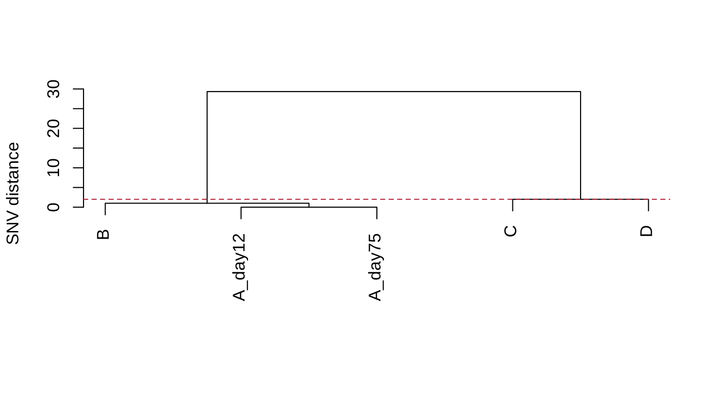
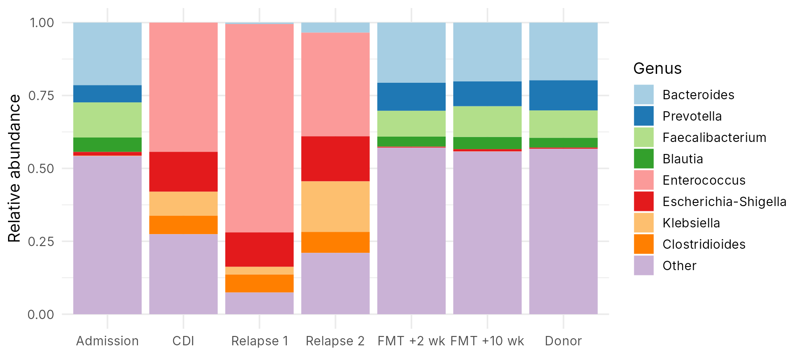
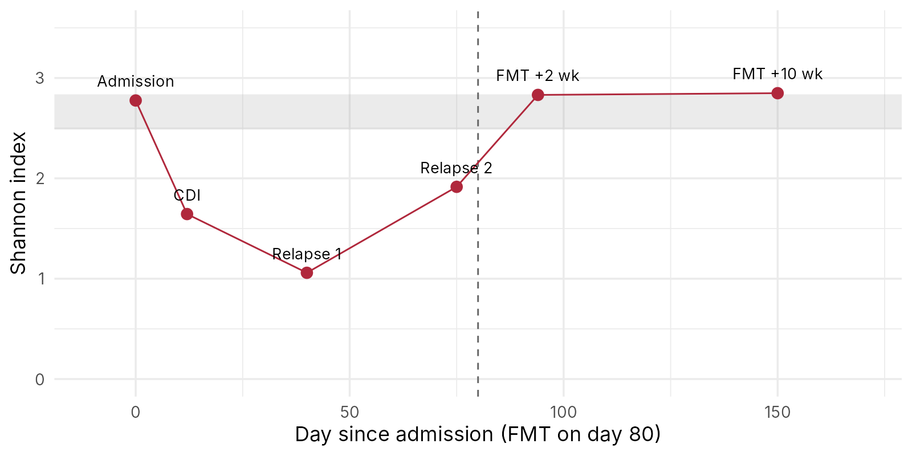
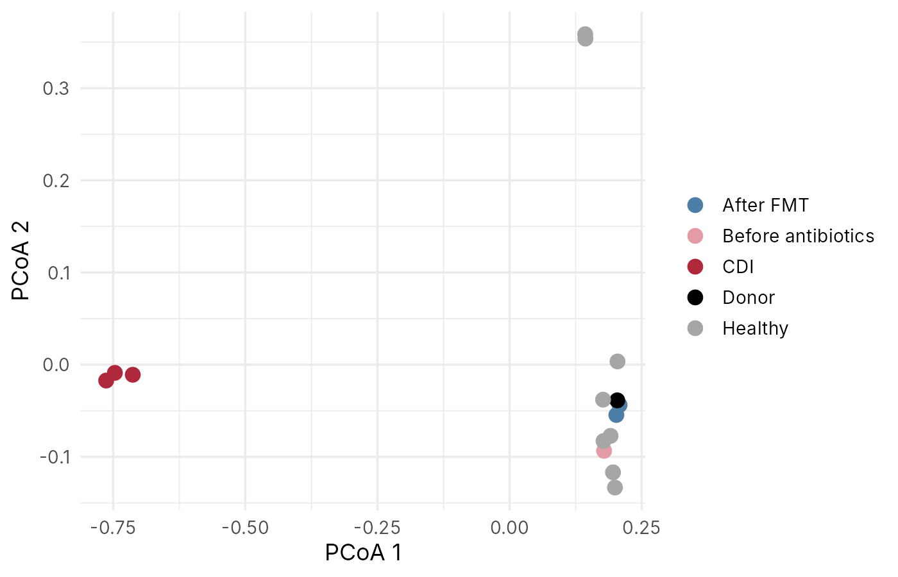
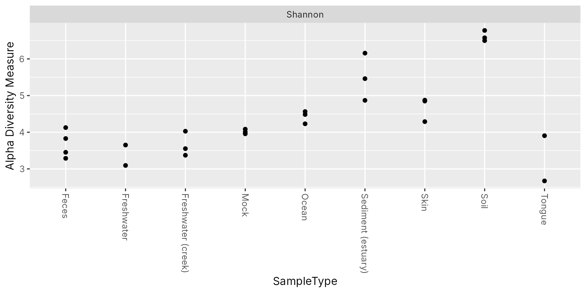

::: {.callout-note collapse="true"}
## 🎯 학습 목표

이 실습을 마치면:

-   Nextstrain에서 계통수와 시간·지역 정보를 읽고 전파 양상 해석
-   CARD에서 항생제 내성 유전자의 기전과 약물 계열 찾기
-   R로 병동 분리주의 SNV 거리를 정리해 전파 가능성이 있는 쌍 찾기
-   R로 장내 세균 구성과 alpha·beta 다양성을 그려 항생제와 FMT 전후 변화 해석
:::

> 🩺 **케이스 다시 보기** (🔗 [W13](w13_microbiome.qmd))\
> 광범위 항생제 뒤 *C. difficile* 장염이 두 번 재발한 70대 환자, 대변 미생물 이식(FMT) 뒤 재발이 멈춤. 같은 병동에 *C. difficile* 환자가 세 명 더.\
> → 오늘 목표: SNV 거리로 병동 환자들의 관계를, 다양성 그림으로 FMT의 효과를 직접 확인

------------------------------------------------------------------------

# 0. 준비물 🧰 {#w14-s0}

-   웹: [Nextstrain](https://nextstrain.org/), [CARD](https://card.mcmaster.ca/) — 모두 가입 필요 x
-   데이터
    -   [w14_cdiff_snp.tsv](../data/w14_cdiff_snp.tsv) — 병동 *C. difficile* 분리주 5개 사이의 SNV 거리
    -   [w14_gut_genera.tsv](../data/w14_gut_genera.tsv) — 대변 시료 15개 × 장내 세균 속(genus) 40개의 16S read 수
-   JupyterHub: 로그인 → 새 R 노트북 → 내려받은 두 파일을 왼쪽 파일 창에 끌어다 놓기 (🔗 [W1 §6.2](w01_intro.qmd#w1-s6-2))

::: {.callout-note collapse="true"}
## 이 데이터에 대해

-   두 파일 모두 실습용 **가상 자료**. 실제 환자 자료가 아님
-   세균 속 이름은 사람 장에서 실제로 흔히 보고되는 이름을 씀
-   시간에 따른 변화의 방향은 발표된 관찰을 따름: 항생제 뒤 다양성이 줄고 소수의 속이 차지함, FMT 뒤 다양성이 공여자 수준으로 회복 (van Nood et al., NEJM 2013). 비율과 read 수는 무작위로 만듦
-   SNV 거리의 해석 기준(최근 전파된 균 사이 0–2개)은 Eyre et al., NEJM 2013을 따름. 거리 값 자체는 가상
-   만든 방법: 저장소의 `scripts/make_w14_data.R`
-   🛠️ 고쳐 보기의 GlobalPatterns는 실제 공개 데이터 (phyloseq 패키지에 들어 있음, Caporaso et al., PNAS 2011)
:::

------------------------------------------------------------------------

# 1. 🌐 Nextstrain으로 전파 읽기 {#w14-s1}

Nextstrain은 전 세계에서 공유된 병원체 유전체로 계통수를 그려 거의 실시간으로 보여 주는 사이트다. SARS-CoV-2로 계통수와 지도를 읽는 법을 익힌다. 화면 배치는 바뀔 수 있으니 아래 요소를 찾아가며 본다.

1.  [Nextstrain](https://nextstrain.org/) 첫 화면 → SARS-CoV-2 → 전 세계(global) 데이터셋 하나 열기
    -   인플루엔자, 엠폭스 같은 다른 병원체 데이터셋도 있음
2.  계통수(Tree) 읽기
    -   끝점 하나 = 바이러스 유전체 하나
    -   가로축 = 채취 날짜(또는 돌연변이 수), 색 = 계통(clade)
    -   **여기서 볼 것**: 가지가 갈라지는 지점 = 공통 조상. 같은 가지에 모인 점들 = 유전적으로 가까움
3.  왼쪽 설정의 **Color By**를 지역이나 나라로 바꾸기
    -   **여기서 볼 것**: 한국 시료가 한 가지에 모여 있나, 여러 가지에 흩어져 있나
4.  지도(Map)와 빈도(Frequencies) 패널
    -   **여기서 볼 것**: 시간이 지나며 어떤 계통의 비율이 커지고 작아지나

| 항목 | 내가 찾은 값 |
|------|-------------|
| 열어 본 데이터셋 이름과 기간 | |
| 가장 최근에 비율이 가장 큰 계통 | |
| 한국 시료가 흩어져 있는 계통 수 (대략) | |
| 지도에서 시료가 가장 많은 지역 | |

✅ **확인 질문** — 지도에서 어떤 나라의 시료가 아주 적다. 그 나라에 바이러스가 적었다는 뜻인가? (🔗 [W13 §6.3](w13_microbiome.qmd#w13-s6-3))

::: {.callout-tip collapse="true"}
## 확인

-   아니다. 지도에는 **시퀀싱해서 공유한** 시료만 나온다. 시퀀싱을 적게 한 나라는 바이러스가 많았어도 적게 보인다
-   한국 시료가 여러 계통에 흩어져 있다면 → 한 번 들어와 퍼진 것이 아니라 여러 번 따로 들어왔을 가능성
:::

------------------------------------------------------------------------

# 2. 🌐 CARD로 내성 유전자 찾기 {#w14-s2}

CARD(Comprehensive Antibiotic Resistance Database)는 항생제 내성 유전자와 그 기전을 모은 데이터베이스다. 세균 유전체에서 찾은 유전자를 여기에 비교해 어떤 약이 안 들지 예측한다.

1.  [CARD](https://card.mcmaster.ca/) 검색창에 `mecA` 입력 → 결과에서 *mecA* 항목 열기
    -   **여기서 볼 것**: 내성 기전(Resistance Mechanism), 약물 계열(Drug Class), 주로 보고된 세균
2.  같은 방법으로 `KPC`, `NDM` 검색
    -   KPC-2, NDM-1처럼 번호가 붙은 비슷한 유전자가 여럿 나옴 → 같은 계열의 변이형들

| 유전자 | 내성 기전 | 약물 계열 | 주로 보고된 세균 |
|---|---|---|---|
| *mecA* | | | |
| KPC | | | |
| NDM | | | |

✅ **확인 질문** — KPC 유전자는 흔히 플라스미드에 실려 있다. 병원 감염 관리에서 이것이 왜 중요한가?

::: {.callout-tip collapse="true"}
## 확인

-   *mecA* → 베타락탐 항생제가 잘 붙지 않는 단백질(PBP2a)을 만들어 원래 표적을 대신함 → 황색포도알균(MRSA)
-   KPC, NDM → 카바페넴 등 베타락탐 항생제를 분해하는 효소 → 장내세균(예: *Klebsiella pneumoniae*, *E. coli*)
-   플라스미드는 세균끼리, 종이 달라도 옮겨 갈 수 있음(수평 유전자 전달, 🔗 [W13 §6.2](w13_microbiome.qmd#w13-s6-2)) → 종이 다른 균들의 집단 발생도 같은 플라스미드 하나가 원인일 수 있음
:::

------------------------------------------------------------------------

# 3. 💻 R로 병동 분리주 비교 {#w14-s3}

## 1) 노트북 시작 {#w14-s3-1}

필요한 패키지를 불러오고 그림 크기를 정한다. 사이트의 코드 블록 오른쪽 위 복사 버튼으로 복사해 셀에 붙여 넣고 **Shift + Enter**.

```r
library(readr)    # 표 읽기
library(dplyr)    # 표 거르기·고르기
library(tidyr)    # 표 모양 바꾸기
library(ggplot2)  # 그림 그리기
library(vegan)    # 다양성 계산

options(repr.plot.width = 8, repr.plot.height = 4)  # 노트북 그림 크기
```

**결과에서 볼 것** — 오류 없이 끝나면 준비 완료. "masked", "This is vegan" 같은 안내문은 오류가 아님

## 2) SNV 거리표 읽기 {#w14-s3-2}

병동에서 나온 *C. difficile* 분리주 5개 사이의 SNV 거리표를 읽는다.

```r
snp <- read_tsv("w14_cdiff_snp.tsv")
snp
```

**결과에서 볼 것** — 행과 열이 같은 분리주 목록인 거리표

| isolate | A_day12 | A_day75 | B | C | D |
|---|---|---|---|---|---|
| A_day12 | 0 | 0 | 1 | 27 | 31 |
| A_day75 | 0 | 0 | 1 | 27 | 31 |
| B | 1 | 1 | 0 | 28 | 32 |
| C | 27 | 27 | 28 | 0 | 2 |
| D | 31 | 31 | 32 | 2 | 0 |

-   `A_day12` = 케이스 환자의 첫 장염 때 균, `A_day75` = 두 번째 재발 때 균
-   `B`, `C`, `D` = 같은 시기 같은 병동의 다른 환자 세 명의 균
-   대각선은 모두 0 (자기 자신과의 거리)

## 3) 쌍으로 펼쳐 가까운 쌍 찾기 {#w14-s3-3}

거리표를 "한 줄 = 분리주 한 쌍"으로 길게 펼치고, 거리 순서로 정렬한다.

```r
snp_pairs <- snp |>
  pivot_longer(-isolate, names_to = "other", values_to = "snv") |>
  filter(isolate < other)

snp_pairs |> arrange(snv)
```

-   `pivot_longer()` = 넓은 표를 긴 표로 펼침 → 열 이름(`other`)과 값(`snv`)이 새 열이 됨
-   `filter(isolate < other)` = 이름 순서로 앞뒤를 정해 같은 쌍(A–B와 B–A)을 두 번 세지 않음

**결과에서 볼 것** — 쌍 10개. 0–2개인 쌍과 25개가 넘는 쌍으로 뚜렷하게 나뉨

이제 최근 전파 기준(SNV 2개 이하, 🔗 [W13 §6.1](w13_microbiome.qmd#w13-s6-1))에 맞는 쌍만 남긴다.

```r
snp_pairs |> filter(snv <= 2)
```

**결과에서 볼 것** — 네 쌍

| isolate | other | snv |
|---|---|---|
| A_day12 | A_day75 | 0 |
| A_day12 | B | 1 |
| A_day75 | B | 1 |
| C | D | 2 |

## 4) 나무로 보기 {#w14-s3-4}

거리가 가까운 것끼리 차례로 묶어 나무 모양으로 그린다. 계통수를 만드는 가장 단순한 방법 중 하나다.

```r
snv_matrix <- as.matrix(snp[, -1])
rownames(snv_matrix) <- snp$isolate

snv_tree <- hclust(as.dist(snv_matrix), method = "average")
plot(snv_tree, main = "", xlab = "", sub = "", ylab = "SNV distance")
abline(h = 2, lty = 2, col = "#B0283C")   # 최근 전파 기준선 (SNV 2개)
```

{fig-align="center" width="85%"}

**결과에서 볼 것** — 빨간 점선 아래에서 묶이는 무리는 몇 개이고, 두 무리 사이의 거리는 얼마인가?

-   `A_day12`–`A_day75` = 0 → 같은 균이 다시 일으킨 **재발**. 새 균에 다시 걸린 것이 아님
-   A–B = 1 → 최근 전파 또는 같은 감염원 공유 가능성. **누가 누구에게** 옮겼는지는 유전체만으로 모름
-   C–D = 2 → 서로 가깝지만 A·B와는 약 30개 차이 → 다른 감염원
-   💡 실제 연구는 더 정교한 계통수 방법을 쓰지만, 읽는 법은 같음

------------------------------------------------------------------------

# 4. 💻 R로 장내 세균 다양성 {#w14-s4}

## 1) 표 읽기 {#w14-s4-1}

대변 시료 15개의 세균 속별 read 수를 읽고, 시료 정보만 먼저 본다.

```r
gut <- read_tsv("w14_gut_genera.tsv")
gut |> select(sample, person, timepoint, day, state)
```

**결과에서 볼 것** — 시료 15개

| sample | 뜻 |
|---|---|
| `P_day0` | 환자, 입원 시 (항생제 전) |
| `P_day12` | 첫 *C. difficile* 장염 |
| `P_day40`, `P_day75` | 1차, 2차 재발 |
| (80일째) | FMT |
| `P_day94`, `P_day150` | FMT 2주 뒤, 10주 뒤 |
| `Donor` | FMT 공여자 |
| `H1`–`H8` | 건강한 성인 8명 (비교 기준) |

다음으로 세균 열만 떼어 숫자 행렬로 만들고, 각 시료를 비율로 바꾼다.

```r
counts <- gut |> select(-sample, -person, -timepoint, -day, -state) |> as.matrix()
rownames(counts) <- gut$sample
dim(counts)

rel <- counts / rowSums(counts)   # 시료마다 합이 1인 비율로
rowSums(rel)
```

**결과에서 볼 것** — `15 40` (시료 15개 × 속 40개), 모든 시료의 비율 합이 `1` → 이것이 상대 풍부도 (🔗 [W13 §4.1](w13_microbiome.qmd#w13-s4-1))

## 2) 누가 자리를 차지했나 — 구성 막대 {#w14-s4-2}

환자의 시간 순서와 공여자 시료에서 눈여겨볼 속 8개의 비율을 막대로 쌓는다. 나머지 32개 속은 `Other`로 묶는다.

```r
top <- c("Bacteroides", "Prevotella", "Faecalibacterium", "Blautia",
         "Enterococcus", "Escherichia-Shigella", "Klebsiella", "Clostridioides")

comp <- gut |>
  filter(person != "Healthy") |>
  pivot_longer(Bacteroides:Haemophilus, names_to = "genus", values_to = "reads") |>
  mutate(genus = ifelse(genus %in% top, genus, "Other")) |>
  group_by(timepoint, genus) |>
  summarise(reads = sum(reads), .groups = "drop") |>
  group_by(timepoint) |>
  mutate(prop = reads / sum(reads)) |>
  ungroup() |>
  mutate(timepoint = factor(timepoint, levels = c("Admission", "CDI", "Relapse 1", "Relapse 2",
                                                  "FMT +2 wk", "FMT +10 wk", "Donor")),
         genus = factor(genus, levels = c(top, "Other")))

ggplot(comp, aes(x = timepoint, y = prop, fill = genus)) +
  geom_col() +
  scale_fill_brewer(palette = "Paired") +
  labs(x = NULL, y = "Relative abundance", fill = "Genus") +
  theme_minimal(base_size = 13)
```

-   `Bacteroides:Haemophilus` = 첫 세균 열부터 마지막 세균 열까지
-   `group_by()` + `summarise()` = `Other`로 묶인 속들의 read를 합침
-   `factor(..., levels = )` = 막대와 색의 순서를 시간 순서대로 고정

{fig-align="center" width="90%"}

**결과에서 볼 것** — 장염·재발 시료와 FMT 뒤 시료는 어떻게 다른가? *Clostridioides*(*C. difficile*가 속한 속)는 언제 보이나?

## 3) Alpha 다양성 {#w14-s4-3}

시료마다 몇 종류가 있는지(richness)와 Shannon 지수를 계산한다.

```r
div <- gut |>
  select(sample, person, timepoint, day, state) |>
  mutate(richness = rowSums(counts > 0),
         shannon = diversity(counts, index = "shannon"))
div
```

-   `counts > 0` = read가 하나라도 있으면 TRUE → `rowSums()`로 세면 그 시료에 있는 속의 수
-   `diversity()` = vegan 패키지의 다양성 함수

**결과에서 볼 것** — 환자와 공여자 (Shannon은 소수 둘째 자리까지)

| sample | timepoint | richness | shannon |
|---|---|---|---|
| P_day0 | Admission | 35 | 2.78 |
| P_day12 | CDI | 8 | 1.64 |
| P_day40 | Relapse 1 | 11 | 1.06 |
| P_day75 | Relapse 2 | 12 | 1.92 |
| P_day94 | FMT +2 wk | 35 | 2.83 |
| P_day150 | FMT +10 wk | 34 | 2.85 |
| Donor | Donor | 32 | 2.79 |

-   건강인 8명: richness 31–34, Shannon 2.49–2.84

환자의 Shannon 지수를 시간 순서로 그리고, 건강인 범위를 회색 띠로 깐다.

```r
healthy <- div |> filter(person == "Healthy")
patient <- div |> filter(person == "Patient")

ggplot(patient, aes(x = day, y = shannon)) +
  annotate("rect", xmin = -Inf, xmax = Inf,
           ymin = min(healthy$shannon), ymax = max(healthy$shannon),
           fill = "grey60", alpha = 0.2) +
  geom_vline(xintercept = 80, linetype = "dashed", colour = "grey40") +
  geom_line(colour = "#B0283C") +
  geom_point(size = 3, colour = "#B0283C") +
  geom_text(aes(label = timepoint), vjust = -1.2, size = 3.5) +
  scale_x_continuous(limits = c(-10, 170)) +
  scale_y_continuous(limits = c(0, 3.5)) +
  labs(x = "Day since admission (FMT on day 80)", y = "Shannon index") +
  theme_minimal(base_size = 13)
```

{fig-align="center" width="90%"}

**결과에서 볼 것** — 다양성이 가장 낮았던 시점은? FMT 뒤 다양성은 건강인 범위 안에 들어오나?

## 4) Beta 다양성 — PCoA {#w14-s4-4}

모든 시료 쌍의 Bray–Curtis 비유사도를 계산하고 PCoA로 2차원 지도에 펼친다.

```r
bray <- vegdist(rel, method = "bray")
pcoa <- cmdscale(bray, k = 2, eig = TRUE)

pc <- gut |>
  select(sample, state) |>
  mutate(PC1 = pcoa$points[, 1], PC2 = pcoa$points[, 2])

ggplot(pc, aes(x = PC1, y = PC2, colour = state)) +
  geom_point(size = 3.5) +
  scale_colour_manual(values = c("Healthy" = "grey65", "Donor" = "black",
                                 "Before antibiotics" = "#E39BA6",
                                 "CDI" = "#B0283C", "After FMT" = "#4C7EA8")) +
  labs(x = "PCoA 1", y = "PCoA 2", colour = NULL) +
  theme_minimal(base_size = 13)
```

-   `vegdist()` = 모든 시료 쌍의 거리 계산, `cmdscale()` = 그 거리를 2차원 좌표로 펼침(PCoA)

{fig-align="center" width="80%"}

**결과에서 볼 것** — FMT 뒤 시료는 누구 옆에 있나? 위쪽에 따로 떨어진 건강인 두 명은 왜 그럴까? (🛠️ 고쳐 보기 2, 🔗 [W13 §1.2](w13_microbiome.qmd#w13-s1-2))

::: {.callout-tip collapse="true"}
## 🛠️ 고쳐 보기

1.  `diversity(counts, index = "shannon")`을 `index = "simpson"`으로 바꾸면 시료의 순서가 달라지나?
2.  건강인 8명의 두 속 read 수 비교: `gut |> filter(person == "Healthy") |> select(sample, Bacteroides, Prevotella)`. PCoA 위쪽의 두 명(H3, H7)은 무엇이 다른가?
3.  실제 공개 데이터로 같은 계산: phyloseq 패키지에 들어 있는 GlobalPatterns (대변, 혀, 피부, 흙, 바닷물 등 26개 시료)

    ```r
    library(phyloseq)
    data(GlobalPatterns)
    plot_richness(GlobalPatterns, x = "SampleType", measures = "Shannon")
    ```

    어떤 환경이 가장 다양하고, 사람 몸의 시료(Feces, Tongue, Skin)는 어디쯤인가?

**확인**: (1) 순서는 거의 같음 → 1차 재발 시료가 가장 낮음 (Simpson 0.47) (2) H3, H7은 *Prevotella* read가 5천–8천 개로 많고 *Bacteroides*는 1천 개 미만. 나머지 여섯 명은 그 반대 → 건강한 사람끼리도 공동체가 크게 다름 (3) 흙(Soil)이 가장 높고(평균 약 6.6), 대변·혀는 3점대. ⚠️ GlobalPatterns는 속보다 훨씬 잘게 나눈 단위(OTU)로 계산해 숫자가 크므로 오늘 표의 Shannon 값과 직접 비교 x

{fig-align="center" width="85%"}
:::

::: {.callout-note collapse="true" icon=false}
## 💡 AI 도우미에게 묻기

-   "이 R 코드를 의예과 학생이 이해할 수 있게 한 줄씩 설명해 줘: (코드 붙여넣기)"
-   "`pivot_longer()`로 넓은 표를 긴 표로 바꾸는 이유를 예를 들어 설명해 줘"
-   "Shannon 지수와 Simpson 지수는 무엇이 다르고 언제 다른 결과를 내?"
:::

------------------------------------------------------------------------

# ✍️ 제출

케이스의 두 질문에 대해 오늘 결과로 한 문단씩:

-   **이식은 왜 효과가 있었을까?** — 구성 막대, Shannon 시간 그래프, PCoA가 각각 보여 주는 것
-   **병동 환자들은 서로 옮긴 걸까?** — SNV 거리로 말할 수 있는 것
-   두 질문 모두, 오늘 결과가 **말해 주지 않는 것**과 그걸 알려면 무엇이 더 필요한지 (예: 입원 기록, 세균 총량, 더 많은 환자)

------------------------------------------------------------------------

# 📝 정리

| 도구 또는 함수 | 한 일 |
|----------------|-------|
| Nextstrain | 병원체 계통수와 시간·지역별 확산 보기 |
| CARD | 항생제 내성 유전자의 기전과 약물 계열 찾기 |
| `pivot_longer()` | 넓은 표를 "한 줄 = 한 쌍(또는 한 값)"인 긴 표로 펼치기 |
| `hclust()` + `plot()` | 가까운 것끼리 묶은 나무 그리기 |
| `rowSums()` | 행마다 합 구하기 (비율 만들기, 종류 수 세기) |
| `diversity()` | Shannon·Simpson 지수 계산 (vegan) |
| `vegdist()` + `cmdscale()` | Bray–Curtis 거리 계산과 PCoA |
| `group_by()` + `summarise()` | 묶음별로 합치기 |
| `geom_col()` · `geom_line()` · `geom_point()` | 막대, 선, 점 그래프 |

# ➕ 참고 링크

-   [Nextstrain](https://nextstrain.org/) · Hadfield J, et al. [*Nextstrain: real-time tracking of pathogen evolution.*](https://doi.org/10.1093/bioinformatics/bty407) Bioinformatics. 2018.
-   [CARD](https://card.mcmaster.ca/) · Alcock BP, et al. [*CARD 2023.*](https://doi.org/10.1093/nar/gkac920) Nucleic Acids Res. 2023.
-   van Nood E, et al. [*Duodenal infusion of donor feces for recurrent Clostridium difficile.*](https://doi.org/10.1056/NEJMoa1205037) N Engl J Med. 2013.
-   Eyre DW, et al. [*Diverse sources of C. difficile infection identified on whole-genome sequencing.*](https://doi.org/10.1056/NEJMoa1216064) N Engl J Med. 2013.
-   Caporaso JG, et al. [*Global patterns of 16S rRNA diversity at a depth of millions of sequences per sample.*](https://doi.org/10.1073/pnas.1000080107) PNAS. 2011. (GlobalPatterns)
-   McMurdie PJ, Holmes S. [*phyloseq: an R package for reproducible interactive analysis and graphics of microbiome census data.*](https://doi.org/10.1371/journal.pone.0061217) PLoS One. 2013.
-   [vegan `diversity()` 설명서](https://vegandevs.github.io/vegan/reference/diversity.html) · [tidyr `pivot_longer()` 설명서](https://tidyr.tidyverse.org/reference/pivot_longer.html)
